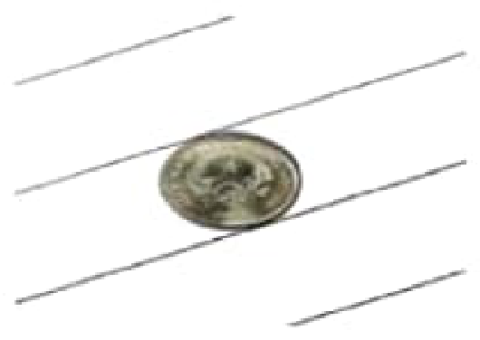
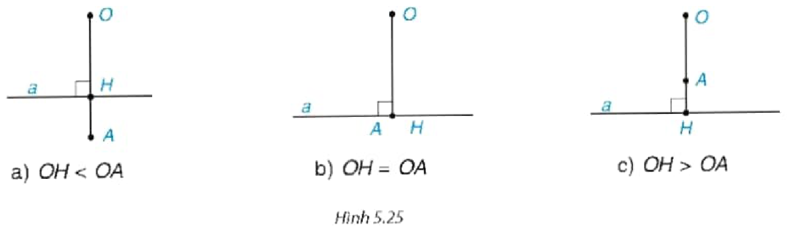
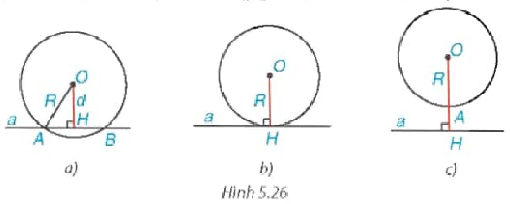
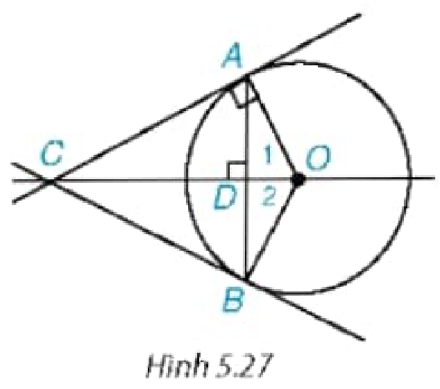
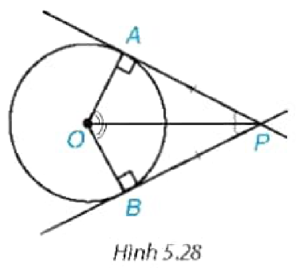
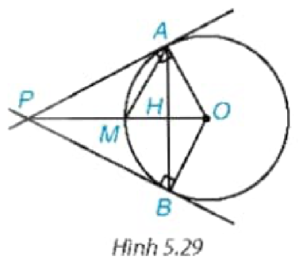

<!-- pdf:101 -->

# BÀI 16: VỊ TRÍ TƯƠNG ĐỐI CỦA ĐƯỜNG THẲNG VÀ ĐƯỜNG TRÒN

## 🔤 Khái niệm, thuật ngữ

- Tiếp tuyến
- Tiếp điểm
- Hai tiếp tuyến cắt nhau

## 🎯 Kiến thức, kĩ năng

- Mô tả và vẽ hình biểu thị ba vị trí tương đối của đường thẳng và đường tròn: cắt nhau, tiếp xúc nhau, không giao nhau.
- Nhận biết tiếp tuyến của đường tròn dựa vào định nghĩa hoặc dấu hiệu nhận biết.
- Áp dụng tính chất của hai tiếp tuyến cắt nhau trong giải toán.

## 🔴 Mở đầu

Người ta gieo một đồng xu hình tròn bán kính $1\text{ cm}$ lên một tờ giấy trải phẳng. Trên tờ giấy đó có vẽ những *đường thẳng song song cách đều*, tức là những đường thẳng song song mà khoảng cách giữa hai đường thẳng bất kì nằm cạnh nhau luôn bằng nhau. Nếu khoảng cách ấy luôn bằng $2\text{ cm}$ thì có thể xảy ra những trường hợp nào sau đây, vì sao?

a) Đồng xu đè lên một đường thẳng (đồng xu che khuất một phần của đường thẳng).

b) Đồng xu không đè lên đường thẳng nào;

c) Đồng xu đè lên nhiều hơn một đường thẳng.

## 1. VỊ TRÍ TƯƠNG ĐỐI CỦA ĐƯỜNG THẲNG VÀ ĐƯỜNG TRÒN

**Số điểm chung của đường thẳng và đường tròn**

**HĐ1:** Cho đường thẳng $a$ và điểm $O$. Gọi $H$ là chân đường vuông góc hạ từ $O$ xuống $a$, và $A$ là một điểm thuộc tia $OH$. Trong mỗi trường hợp sau đây, hãy vẽ đường tròn $(O; OA)$ và cho biết đường thẳng $a$ và đường tròn $(O; OA)$ có bao nhiêu điểm chung?

*Hình 5.25*

<!-- pdf:102 -->

<!-- term: Vị trí tương đối của đường thẳng và đường tròn -->
> 1) Đường thẳng $a$ và đường tròn $(O)$ gọi là *cắt nhau* nếu chúng có đúng hai điểm chung (H.5.26a).
>
> 2) Đường thẳng $a$ và đường tròn $(O)$ gọi là *tiếp xúc với nhau* nếu chúng có duy nhất một điểm chung $H$. Điểm chung ấy gọi là **tiếp điểm**. Khi đó, đường thẳng $a$ còn gọi là **tiếp tuyến** của đường tròn $(O)$ tại $H$ (H.5.26b).
>
> 3) Đường thẳng $a$ và đường tròn $(O)$ gọi là *không giao nhau* nếu chúng không có điểm chung (H.5.26c).

**Nhận xét**

<!-- term: Vị trí tương đối của đường thẳng và đường tròn -->
1) Cho đường thẳng $a$ và đường tròn $(O; R)$. Gọi $d$ là khoảng cách từ $O$ đến $a$. Từ HĐ1, ta nhận thấy: Đường thẳng $a$ và đường tròn $(O; R)$ cắt nhau khi $d < R$ (H.5.26a), tiếp xúc với nhau khi $d = R$ (H.5.26b) và không giao nhau khi $d > R$ (H.5.26c).

*Hình 5.26*

<!-- term: Tính chất của tiếp tuyến -->
2) Nếu đường thẳng $a$ tiếp xúc với đường tròn $(O)$ tại $H$ thì $OH \perp a$.
<!-- ocr-ok: đã đối chiếu trực tiếp ảnh trang PDF 102, OCR đọc sai Nếu thành Nốu và dính chữ Hthì -->

**Luyện tập 1:** Cho đường thẳng $a$ và điểm $O$ cách $a$ một khoảng bằng $4\text{ cm}$. Không vẽ hình, hãy dự đoán xem mỗi đường tròn sau cắt, tiếp xúc hay không cắt đường thẳng $a$. Tại sao?

a) $(O; 3\text{ cm})$;

b) $(O; 5\text{ cm})$;

c) $(O; 4\text{ cm})$.

## 2. DẤU HIỆU NHẬN BIẾT TIẾP TUYẾN CỦA ĐƯỜNG TRÒN

**Đường thẳng và đường tròn tiếp xúc với nhau khi nào?**

**HĐ2:** Cho đoạn thẳng $OH$ và đường thẳng $a$ vuông góc với $OH$ tại $H$.

a) Xác định khoảng cách từ $O$ đến đường thẳng $a$.

b) Nếu vẽ đường tròn $(O; OH)$ thì đường tròn này và đường thẳng $a$ có vị trí tương đối như thế nào?

<!-- term: Dấu hiệu nhận biết tiếp tuyến của đường tròn -->
> **Định lí 1 (Dấu hiệu nhận biết tiếp tuyến):** Nếu một đường thẳng đi qua một điểm nằm trên một đường tròn và vuông góc với bán kính đi qua điểm đó thì đường thẳng ấy là một tiếp tuyến của đường tròn.

<!-- pdf:103 -->

**Ví dụ 1:** Cho $AB$ là một dây không đi qua tâm của đường tròn $(O)$. Đường thẳng qua $O$ và vuông góc với $AB$ cắt tiếp tuyến tại $A$ của $(O)$ ở điểm $C$. Chứng minh rằng $CB$ là một tiếp tuyến của $(O)$.

*Hình 5.27*

**Giải** (H.5.27)

Gọi $D$ là giao điểm của $AB$ và $OC$.
<!-- ocr-ok: đã đối chiếu trực tiếp ảnh trang PDF 103, câu ngắn nhiều kí hiệu toán học -->

Trong tam giác cân $AOB$ ($OA = OB$), đường cao $OD$ (do $OC \perp AB$) cũng là đường phân giác của góc $O$, suy ra $\widehat{O_1} = \widehat{O_2}$.

Ta có $\Delta AOC = \Delta BOC$ (c.g.c), vì $OC$ là cạnh chung, $\widehat{O_1} = \widehat{O_2}$ và $OA = OB$.

Từ đó $\widehat{OBC} = \widehat{OAC} = 90^\circ$ (do $OA$ là tiếp tuyến), tức là $CB$ vuông góc với bán kính $OB$ tại $B$.

Do đó theo định lí 1, $CB$ cũng là tiếp tuyến của $(O)$.

**Luyện tập 2:** Cho một hình vuông có độ dài mỗi cạnh bằng $6\text{ cm}$ và hai đường chéo cắt nhau tại $I$. Chứng minh rằng đường tròn $(I; 3\text{ cm})$ tiếp xúc với cả bốn cạnh của hình vuông.

**Thực hành:** Cho đường thẳng $a$ và điểm $M$ không thuộc $a$. Hãy vẽ đường tròn tâm $M$ tiếp xúc với $a$.
<!-- ocr-ok: đã đối chiếu trực tiếp ảnh trang PDF 103, OCR bỏ sót nhãn hộp Thực hành -->

**Vận dụng:** Trở lại *tình huống mở đầu*. Ở đây, ta hiểu đồng xu nằm đè lên một đường thẳng khi đường tròn (hình ảnh của đồng xu) và đường thẳng ấy cắt nhau.

Bằng cách xét vị trí của tâm đồng xu trong một dải nằm giữa hai đường thẳng song song cạnh nhau (cách đều hoặc không cách đều hai đường thẳng đó), hãy chứng minh rằng chỉ xảy ra các trường hợp a và b, không thể xảy ra trường hợp c.

## 3. HAI TIẾP TUYẾN CẮT NHAU CỦA MỘT ĐƯỜNG TRÒN

**Tính chất của hai tiếp tuyến cắt nhau**

**HĐ3:** Cho điểm $P$ ở bên ngoài một đường tròn tâm $O$. Hãy dùng thước và compa thực hiện các bước vẽ hình như sau:

- Vẽ đường tròn đường kính $PO$ cắt đường tròn $(O)$ tại $A$ và $B$;
- Vẽ và chứng tỏ các đường thẳng $PA$ và $PB$ là hai tiếp tuyến của $(O)$.
$PA$ và $PB$ gọi là **hai tiếp tuyến cắt nhau** của đường tròn $(O)$.

<!-- pdf:104 -->

**HĐ4:** (Dựa vào hình vẽ có được sau HĐ3). Bằng cách xét hai tam giác $OPA$ và $OPB$, chứng minh rằng:

a) $PA = PB$;

b) $PO$ là tia phân giác của góc $APB$;

c) $OP$ là tia phân giác của góc $AOB$.

<!-- term: Định lí về tính chất của hai tiếp tuyến cắt nhau -->
> **Định lí 2:** Nếu hai tiếp tuyến của đường tròn $(O)$ cắt nhau tại điểm $P$ thì:
>
> - Điểm $P$ cách đều hai tiếp điểm;
> - $PO$ là tia phân giác của góc tạo bởi hai tiếp tuyến;
> - $OP$ là tia phân giác của góc tạo bởi hai bán kính qua hai tiếp điểm.

*Hình 5.28*

**Ví dụ 2:** Cho hai tiếp tuyến $PA$ và $PB$ của đường tròn $(O; R)$ ($A$ và $B$ là hai tiếp điểm).
<!-- ocr-ok: đã đối chiếu trực tiếp ảnh trang PDF 104, OCR bỏ sót nhãn hộp Ví dụ 2 -->

a) Chứng minh rằng $OP \perp AB$;

b) Tính $PA$ và $PB$, biết $R = 2\text{ cm}$ và $PO = 4\text{ cm}$.
<!-- ocr-ok: đã đối chiếu trực tiếp ảnh trang PDF 104, câu ngắn hầu hết là công thức LaTeX -->

*Hình 5.29*

**Giải** (H.5.29)

a) Do $OA$ và $OB$ là hai tiếp tuyến cắt nhau của $(O)$ nên theo Định lí 2, ta có $OP$ là tia phân giác của góc $AOB$. Trong tam giác cân $AOB$ ($OA = OB$), đường phân giác $OP$ cũng là đường cao nên ta có $OP \perp AB$.

b) Tam giác $OAP$ có $\widehat{OAP} = 90^\circ$ (do $PA$ tiếp xúc với đường tròn $(O)$ tại $A$) và $OA = R = 2\text{ cm}$ và $OP = 4\text{ cm}$ (giả thiết).
<!-- ocr-ok: đã đối chiếu trực tiếp ảnh trang PDF 104, nhiều công thức LaTeX trong câu -->

Áp dụng định lí Pythagore vào tam giác vuông $OAP$ ta có $AP^2 + OA^2 = OP^2$.

Từ đó suy ra:

$AP^2 = OP^2 - OA^2 = 4^2 - 2^2 = 12$.

Vậy $AP = \sqrt{12} = 2\sqrt{3}\text{ (cm)}$.

Theo tính chất của hai tiếp tuyến cắt nhau, ta cũng có $BP = AP = 2\sqrt{3}\text{ cm}$.

<!-- pdf:105 -->

**Thử thách nhỏ**

Cho góc $xPy$ và điểm $A$ thuộc tia $Px$. Hãy vẽ đường tròn tâm $O$ tiếp xúc với cả hai cạnh của góc $xPy$ sao cho $A$ là một trong hai tiếp điểm.

## BÀI TẬP

5.20. Bạn Thanh cắt $4$ hình tròn bằng giấy có bán kính lần lượt là $4\text{ cm}, 6\text{ cm}, 7\text{ cm}$ và $8\text{ cm}$ để dán trang trí trên một mảnh giấy, trên đó có vẽ trước hai đường thẳng $a$ và $b$. Biết rằng $a$ và $b$ là hai đường thẳng song song với nhau và cách nhau một khoảng $6\text{ cm}$ (nghĩa là mọi điểm trên đường thẳng $b$ đều cách $a$ một khoảng $6\text{ cm}$). Hỏi nếu bạn Thanh dán sao cho tâm của cả $4$ hình tròn đều nằm trên đường thẳng $b$ thì hình nào đè lên đường thẳng $a$, hình nào không đè lên đường thẳng $a$?

5.21. Cho đường tròn $(O)$ đi qua ba đỉnh $A, B$ và $C$ của một tam giác cân tại $A$. Chứng minh rằng đường thẳng đi qua $A$ và song song với $BC$ là một tiếp tuyến của $(O)$.

5.22. Cho góc $xOy$ với đường phân giác $Ot$ và điểm $A$ trên cạnh $Ox$, điểm $B$ trên cạnh $Oy$ sao cho $OA = OB$. Đường thẳng qua $A$ và vuông góc với $Ox$ cắt $Ot$ tại $P$. Chứng minh rằng $OA$ và $OB$ là hai tiếp tuyến cắt nhau của đường tròn $(P; PA)$.

5.23. Cho $SA$ và $SB$ là hai tiếp tuyến cắt nhau của đường tròn $(O)$ ($A$ và $B$ là hai tiếp điểm). Gọi $M$ là một điểm tuỳ ý trên cung nhỏ $AB$. Tiếp tuyến của $(O)$ tại $M$ cắt $SA$ tại $E$ và cắt $SB$ tại $F$.

a) Chứng minh rằng chu vi của tam giác $SEF$ bằng $SA + SB$.

b) Giả sử $M$ là giao điểm của đoạn $SO$ với đường tròn $(O)$. Chứng minh rằng $SE = SF$.

## 📷 Danh sách hình trong bài

| Mã hình | Trang PDF | Vị trí trong bài | Chú thích gốc |
| --- | :---: | --- | --- |
| H9-toan-b16-01 | 101 | Mở đầu | (sách không đánh số, minh hoạ đồng xu trên các đường thẳng song song cách đều) |
| H9-toan-b16-02 | 101 | Mục 1, HĐ1 | Hình 5.25 |
| H9-toan-b16-03 | 102 | Mục 1, Nhận xét | Hình 5.26 |
| H9-toan-b16-04 | 103 | Mục 2, Ví dụ 1 | Hình 5.27 |
| H9-toan-b16-05 | 104 | Mục 3, Định lí 2 | Hình 5.28 |
| H9-toan-b16-06 | 104 | Mục 3, Ví dụ 2 | Hình 5.29 |
