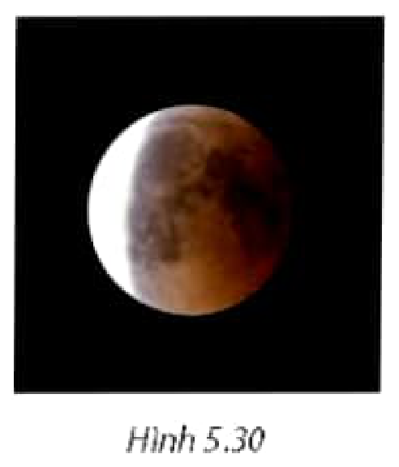
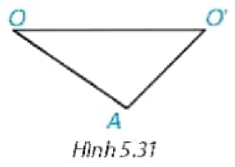
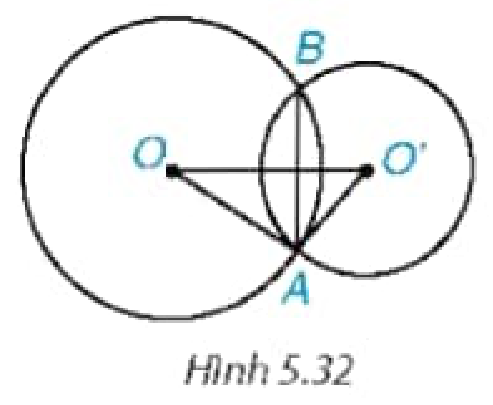
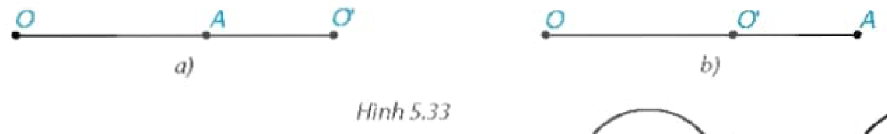
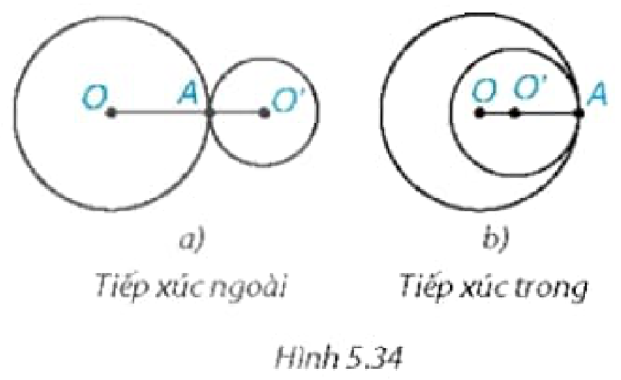
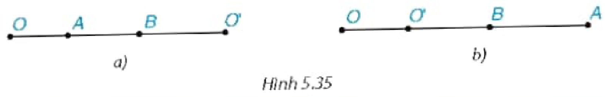
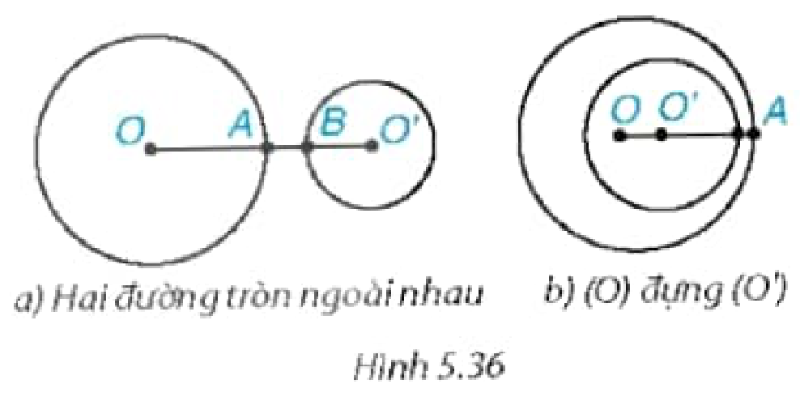
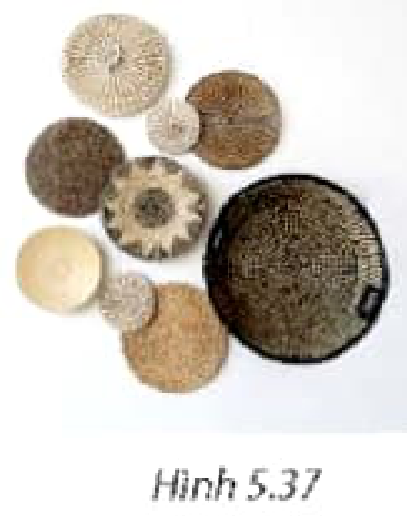

<!-- pdf:106 -->

# BÀI 17: VỊ TRÍ TƯƠNG ĐỐI CỦA HAI ĐƯỜNG TRÒN

## 🔤 Khái niệm, thuật ngữ

- Hai đường tròn cắt nhau
- Hai đường tròn tiếp xúc nhau
- Hai đường tròn không giao nhau.
- Tiếp điểm

## 🎯 Kiến thức, kĩ năng

- Nhận biết các vị trí tương đối của hai đường tròn.

## 🔴 Mở đầu

- Nguyệt thực là hiện tượng Mặt Trăng bị bóng của Trái Đất che khuất toàn bộ (nguyệt thực toàn phần) hay một phần (H.5.30). Do Mặt Trăng và bóng Trái Đất được xem là có dạng hình tròn nên nguyệt thực cho ta một hình ảnh thực tế về vị trí tương đối của hai đường tròn. Em có thể cắt ra hai hình tròn bằng giấy để mô phỏng hiện tượng nguyệt thực. Nhưng trước hết hãy tìm hiểu về vị trí tương đối của hai đường tròn.
- Sau đây, khi nói hai đường tròn mà không có giải thích gì thêm, ta hiểu đó là *hai đường tròn phân biệt*.

*Hình 5.30*

## 1. HAI ĐƯỜNG TRÒN CẮT NHAU

**Tìm hiểu hai đường tròn cắt nhau**

**HĐ1:** Cho hình 5.31, trong đó giả sử $O'A < OA$. Ta có

$OA - O'A < OO' < OA + O'A$.

Hãy vẽ hai đường tròn $(O; OA)$ và $(O'; O'A)$ và cho biết hai đường tròn đó có mấy điểm chung?

*Hình 5.31*

> Nếu hai đường tròn có đúng hai điểm chung thì ta nói đó là **hai đường tròn cắt nhau**. Hai điểm chung gọi là hai **giao điểm** của chúng.

*Hình 5.32*

**Nhận xét**

Từ HĐ1 ta thấy hai đường tròn $(O; R)$ và $(O'; R')$ cắt nhau khi

$R - R' < OO' < R + R'$ (với $R > R'$).

**Ví dụ 1:** Cho hai điểm $O$ và $O'$ sao cho $OO' = 5\text{ cm}$. Hãy giải thích tại sao hai đường tròn $(O; 4\text{ cm})$ và $(O'; 3\text{ cm})$ cắt nhau.
<!-- ocr-ok: đã đối chiếu trực tiếp ảnh trang PDF 106, OCR đọc sai nhãn Ví dụ 1 và kí hiệu đường tròn -->

**Giải**

Đặt $R = 4\text{ cm}; R' = 3\text{ cm}$, ta thấy $1\text{ cm} < 5\text{ cm} < 7\text{ cm}$, nên $R - R' < OO' < R + R'$. Do đó, hai đường tròn đã cho cắt nhau.

<!-- pdf:107 -->

**Luyện tập 1:** Cho đường tròn $(O; 5\text{ cm})$ và điểm $I$ cách $O$ một khoảng $2\text{ cm}$. Xác định vị trí tương đối của đường tròn đã cho và đường tròn $(I; r)$ trong mỗi trường hợp sau:

a) $r = 4\text{ cm}$;

b) $r = 6\text{ cm}$.

## 2. HAI ĐƯỜNG TRÒN TIẾP XÚC NHAU

**Tìm hiểu hai đường tròn tiếp xúc nhau**

**HĐ2:** Trên Hình 5.33a, ta có $OO' = OA + O'A$; trên Hình 5.33b, ta có $OO' = OA - O'A$. Trong mỗi trường hợp, hãy vẽ hai đường tròn $(O; OA)$ và $(O'; O'A)$ và cho biết hai đường tròn đó có mấy điểm chung?

*Hình 5.33*

> Nếu hai đường tròn có duy nhất một điểm chung thì ta nói đó là **hai đường tròn tiếp xúc nhau**. Điểm chung gọi là *tiếp điểm* của chúng.

*Hình 5.34*

**Chú ý**

<!-- term: Hai đường tròn tiếp xúc ngoài, tiếp xúc trong -->
Người ta còn phân biệt hai trường hợp: hai đường tròn *tiếp xúc ngoài* (H.5.34a) và hai đường tròn *tiếp xúc trong* (H.5.34b).

**Nhận xét**

<!-- term: Hai đường tròn tiếp xúc ngoài, tiếp xúc trong -->
1) Từ HĐ2, ta nhận thấy: Hai đường tròn $(O; R)$ và $(O'; R')$ tiếp xúc ngoài khi $OO' = R + R'$, và tiếp xúc trong khi $OO' = R - R'$ ($R > R'$).

2) Nếu hai đường tròn tiếp xúc với nhau thì tiếp điểm thẳng hàng với hai tâm.

**Ví dụ 2:** Cho hai điểm $O$ và $O'$ sao cho $OO' = 5\text{ cm}$. Giải thích tại sao hai đường tròn $(O; 3\text{ cm})$ và $(O'; 2\text{ cm})$ tiếp xúc với nhau. Chúng tiếp xúc trong hay tiếp xúc ngoài?

**Giải**

Đặt $R = 3\text{ cm}$ và $R' = 2\text{ cm}$, ta thấy $5\text{ cm} = 3\text{ cm} + 2\text{ cm}$, nghĩa là $OO' = R + R'$. Vậy hai đường tròn đã cho tiếp xúc ngoài với nhau.

**Luyện tập 2:** Cho hai điểm $O$ và $O'$ sao cho $OO' = 3\text{ cm}$. Giải thích tại sao hai đường tròn $(O; 8\text{ cm})$ và $(O'; 5\text{ cm})$ tiếp xúc với nhau. Chúng tiếp xúc trong hay tiếp xúc ngoài?

<!-- pdf:108 -->

## 3. HAI ĐƯỜNG TRÒN KHÔNG GIAO NHAU

**Tìm hiểu hai đường tròn không giao nhau**

**HĐ3:** Trên Hình 5.35a, ta có $OO' > OA + O'B$; trên Hình 5.35b, ta có $OO' < OA - O'B$. Trong mỗi trường hợp, hãy vẽ hai đường tròn $(O; OA)$ và $(O'; OB)$ và cho biết hai đường tròn đó có điểm chung nào không.

*Hình 5.35*

> Nếu hai đường tròn không có điểm chung nào thì ta nói đó là **hai đường tròn không giao nhau**.

**Chú ý**

<!-- term: Hai đường tròn ngoài nhau, đường tròn đựng đường tròn -->
Người ta còn phân biệt hai trường hợp: hai đường tròn *ngoài nhau* (H.5.36a) và đường tròn này *đựng* đường tròn kia (H.5.36b).

*Hình 5.36*

**Nhận xét**

Từ HĐ3 ta nhận thấy:

<!-- term: Hai đường tròn ngoài nhau, đường tròn đựng đường tròn -->
- Hai đường tròn $(O; R)$ và $(O'; R')$ *ngoài nhau* khi $OO' > R + R'$.
- Đường tròn $(O; R)$ *đựng* đường tròn $(O'; R')$ khi $R > R'$ và $OO' < R - R'$. Đặc biệt, khi $O$ trùng với $O'$ và $R \ne R'$ thì ta có hai đường tròn *đồng tâm*.
<!-- ocr-ok: đã đối chiếu trực tiếp ảnh trang PDF 108, OCR đọc sai Đặc biệt thành Dặc biệt và dính chữ Otrùng -->

**Ví dụ 3:** Xác định vị trí tương đối của hai đường tròn $(O; 3\text{ cm})$ và $(O'; 5\text{ cm})$, biết rằng $OO' > 8\text{ cm}$.

**Giải**

Đặt $R = 3\text{ cm}$ và $R' = 5\text{ cm}$, ta có $OO' = 8\text{ cm} > R + R'$.

Vậy $(O; 3\text{ cm})$ và $(O'; 5\text{ cm})$ là hai đường tròn ngoài nhau.

**Luyện tập 3:** Cho hai điểm $O$ và $O'$ sao cho $OO' = 2\text{ cm}$. Xác định vị trí tương đối của hai đường tròn $(O; 5\text{ cm})$ và $(O'; r)$, biết rằng $r < 3\text{ cm}$.
<!-- ocr-ok: đã đối chiếu trực tiếp ảnh trang PDF 108, OCR bỏ sót nhãn hộp Luyện tập 3 -->

**Thực hành:** Để mô phỏng nguyệt thực, em hãy cắt hai hình tròn từ giấy: hình tròn thứ nhất màu sáng tượng trưng cho Mặt Trăng, hình tròn thứ hai màu tối (to hơn và bằng giấy mờ càng tốt) tượng trưng cho bóng Trái Đất. Sắp xếp hai hình tròn đó để:

a) Mô phỏng nguyệt thực một phần. Khi đó, hình ảnh của hai đường tròn có vị trí tương đối như thế nào?

<!-- pdf:109 -->

b) Mô phỏng nguyệt thực toàn phần. Khi đó, hình ảnh của hai đường tròn có vị trí tương đối như thế nào?

**Tranh luận**

Tròn cho rằng: Nói “hai đường tròn không cắt nhau” cũng có nghĩa là “hai đường tròn không giao nhau”. Theo em, Tròn đúng hay sai?

Ta có bảng tổng kết sau:

| Vị trí tương đối của hai đường tròn $(O; R)$ và $(O'; R')$ ($R \ge R'$) | Số điểm chung | Hệ thức giữa $OO'$ với $R$ và $R'$ |
| --- | :---: | --- |
| Hai đường tròn cắt nhau | $2$ | $R - R' < OO' < R + R'$ |
| Hai đường tròn tiếp xúc nhau: | $1$ | |
| – Tiếp xúc ngoài | | $OO' = R + R'$ |
| – Tiếp xúc trong | | $OO' = R - R' > 0$ |
| Hai đường tròn không giao nhau: | $0$ | |
| – $(O)$ và $(O')$ ở ngoài nhau | | $OO' > R + R'$ |
| – $(O)$ đựng $(O')$ | | $OO' < R - R'$ |

## BÀI TẬP

5.24. Hình 5.37 cho thấy hình ảnh của những đường tròn qua cách trình bày một số sản phẩm mây tre đan. Bằng cách đánh số các đường tròn, em hãy chỉ ra một vài cặp đường tròn cắt nhau và vài cặp đường tròn không giao nhau.

*Hình 5.37*

5.25. Cho hai điểm $O$ và $O'$ cách nhau một khoảng $5\text{ cm}$. Mỗi đường tròn sau đây có vị trí tương đối như thế nào đối với đường tròn $(O; 3\text{ cm})$.

a) Đường tròn $(O'; 3\text{ cm})$;

b) Đường tròn $(O'; 1\text{ cm})$;

c) Đường tròn $(O'; 8\text{ cm})$.

5.26. Cho ba điểm thẳng hàng $O, A$ và $O'$. Với mỗi trường hợp sau, hãy viết hệ thức giữa các độ dài $OO', OA$ và $O'A$ rồi xét xem hai đường tròn $(O; OA)$ và $(O'; O'A)$ tiếp xúc trong hay tiếp xúc ngoài với nhau; vẽ hình để khẳng định dự đoán của mình.

a) Điểm $A$ nằm giữa hai điểm $O$ và $O'$;

b) Điểm $O$ nằm giữa hai điểm $A$ và $O'$;

c) Điểm $O'$ nằm giữa hai điểm $A$ và $O$.

5.27. Cho hai đường tròn $(O)$ và $(O')$ tiếp xúc ngoài với nhau tại $A$. Một đường thẳng qua $A$ cắt $(O)$ tại $B$ và cắt $(O')$ tại $C$. Chứng minh rằng $OB \parallel O'C$.
<!-- ocr-ok: đã đối chiếu trực tiếp ảnh trang PDF 109, OCR đọc sai minh thành mình và dính kí hiệu (O) -->

## 📷 Danh sách hình trong bài

| Mã hình | Trang PDF | Vị trí trong bài | Chú thích gốc |
| --- | :---: | --- | --- |
| H9-toan-b17-01 | 106 | Mở đầu | Hình 5.30 |
| H9-toan-b17-02 | 106 | Mục 1, HĐ1 | Hình 5.31 |
| H9-toan-b17-03 | 106 | Mục 1 | Hình 5.32 |
| H9-toan-b17-04 | 107 | Mục 2, HĐ2 (cạnh dưới bên phải đi qua đỉnh cung tròn trái của Hình 5.34) | Hình 5.33 |
| H9-toan-b17-05 | 107 | Mục 2 | Hình 5.34 |
| H9-toan-b17-06 | 108 | Mục 3, HĐ3 | Hình 5.35 |
| H9-toan-b17-07 | 108 | Mục 3, Chú ý | Hình 5.36 |
| H9-toan-b17-08 | 109 | Bài tập 5.24 | Hình 5.37 |
