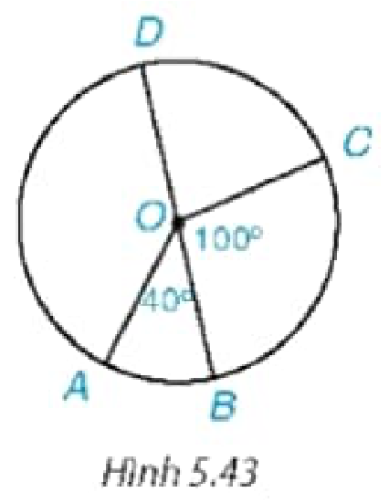
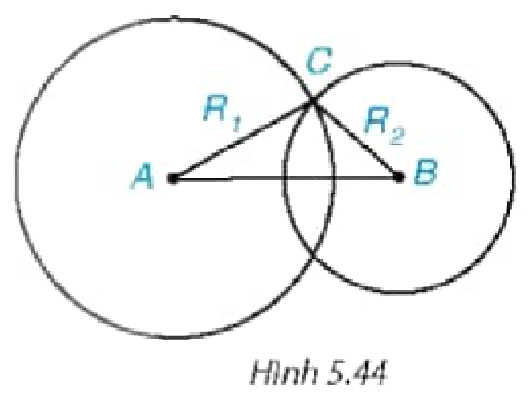
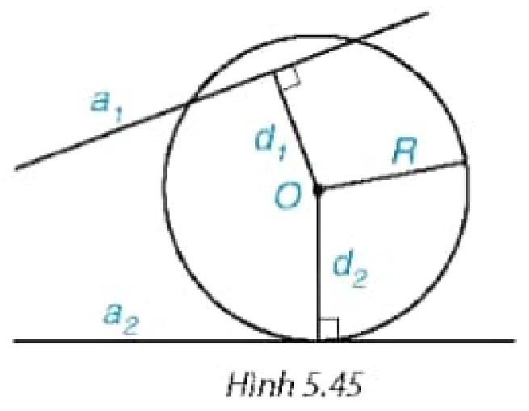
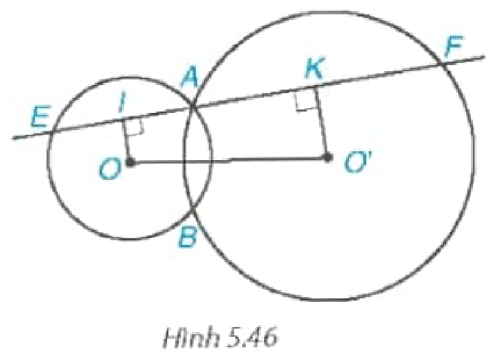

<!-- pdf:114 -->

# BÀI TẬP CUỐI CHƯƠNG V

**A. TRẮC NGHIỆM**

5.32. Cho đường tròn $(O; 4\text{ cm})$ và hai điểm $A, B$. Biết rằng $OA = \sqrt{15}\text{ cm}$ và $OB = 4\text{ cm}$. Khi đó:

A. Điểm $A$ nằm trong $(O)$, điểm $B$ nằm ngoài $(O)$.
<!-- ocr-ok: đã đối chiếu trực tiếp ảnh trang PDF 114, dòng phương án trắc nghiệm ngắn chứa kí hiệu LaTeX -->

B. Điểm $A$ nằm ngoài $(O)$, điểm $B$ nằm trên $(O)$.
<!-- ocr-ok: đã đối chiếu trực tiếp ảnh trang PDF 114, dòng phương án trắc nghiệm ngắn chứa kí hiệu LaTeX -->

C. Điểm $A$ nằm trên $(O)$, điểm $B$ nằm trong $(O)$.
<!-- ocr-ok: đã đối chiếu trực tiếp ảnh trang PDF 114, dòng phương án trắc nghiệm ngắn chứa kí hiệu LaTeX -->

D. Điểm $A$ nằm trong $(O)$, điểm $B$ nằm trên $(O)$.
<!-- ocr-ok: đã đối chiếu trực tiếp ảnh trang PDF 114, OCR đọc sai D thành 2 -->

5.33. Cho Hình 5.43, trong đó $BD$ là đường kính, $\widehat{AOB} = 40^\circ$; $\widehat{BOC} = 100^\circ$. Khi đó:

A. $\text{sđ}\overset{\frown}{DC} = 80^\circ$ và $\text{sđ}\overset{\frown}{AD} = 220^\circ$.

B. $\text{sđ}\overset{\frown}{DC} = 280^\circ$ và $\text{sđ}\overset{\frown}{AD} = 220^\circ$.

C. $\text{sđ}\overset{\frown}{DC} = 280^\circ$ và $\text{sđ}\overset{\frown}{AD} = 140^\circ$.

D. $\text{sđ}\overset{\frown}{DC} = 80^\circ$ và $\text{sđ}\overset{\frown}{AD} = 140^\circ$.

*Hình 5.43*

5.34. Cho hai đường tròn $(A; R_1), (B; R_2)$, trong đó $R_2 < R_1$. Biết rằng hai đường tròn $(A)$ và $(B)$ cắt nhau (H.5.44). Khi đó:

A. $AB < R_1 - R_2$.

B. $R_1 - R_2 < AB < R_1 + R_2$.

C. $AB > R_1 + R_2$.

D. $AB = R_1 + R_2$.

*Hình 5.44*

5.35. Cho đường tròn $(O; R)$ và hai đường thẳng $a_1$ và $a_2$. Gọi $d_1, d_2$ lần lượt là khoảng cách từ điểm $O$ đến $a_1$ và $a_2$. Biết rằng $(O)$ cắt $a_1$ và tiếp xúc với $a_2$ (H.5.45). Khi đó:

A. $d_1 < R$ và $d_2 = R$.

B. $d_1 = R$ và $d_2 < R$.

C. $d_1 > R$ và $d_2 = R$.

D. $d_1 < R$ và $d_2 < R$.

*Hình 5.45*

**B. TỰ LUẬN**

5.36. Cho đường tròn $(O)$ đường kính $BC$ và điểm $A$ (khác $B$ và $C$).
<!-- ocr-ok: đã đối chiếu trực tiếp ảnh trang PDF 114, câu ngắn nhiều kí hiệu toán học -->

a) Chứng minh rằng nếu $A$ nằm trên $(O)$ thì $ABC$ là một tam giác vuông; ngược lại, nếu $ABC$ là tam giác vuông tại $A$ thì $A$ nằm trên $(O)$.

<!-- pdf:115 -->

b) Giả sử $A$ là một trong hai giao điểm của đường tròn $(B; BO)$ với đường tròn $(O)$. Tính các góc của tam giác $ABC$.

c) Với cùng giả thiết câu b, tính độ dài cung $AC$ và diện tích hình quạt nằm trong $(O)$ giới hạn bởi các bán kính $OA$ và $OC$, biết rằng $BC = 6\text{ cm}$.

5.37. Cho $AB$ là một dây bất kì (không phải là đường kính) của đường tròn $(O; 4\text{ cm})$. Gọi $C$ và $D$ lần lượt là các điểm đối xứng với $A$ và $B$ qua tâm $O$.

a) Hai điểm $C$ và $D$ có nằm trên đường tròn $(O)$ không? Vì sao?

b) Biết rằng $ABCD$ là một hình vuông. Tính độ dài cung lớn $AB$ và diện tích hình quạt tròn tạo bởi hai bán kính $OA$ và $OB$.

5.38. Cho điểm $B$ nằm giữa hai điểm $A$ và $C$, sao cho $AB = 2\text{ cm}$ và $BC = 1\text{ cm}$. Vẽ các đường tròn $(A; 1,5\text{ cm}), (B; 3\text{ cm})$ và $(C; 2\text{ cm})$. Hãy xác định các cặp đường tròn:

a) Cắt nhau;

b) Không giao nhau;

c) Tiếp xúc với nhau.

5.39. Cho tam giác vuông $ABC$ ($\widehat{A}$ vuông). Vẽ hai đường tròn $(B; BA)$ và $(C; CA)$ cắt nhau tại $A$ và $A'$. Chứng minh rằng:

a) $BA$ và $BA'$ là hai tiếp tuyến cắt nhau của đường tròn $(C; CA)$.

b) $CA$ và $CA'$ là hai tiếp tuyến cắt nhau của đường tròn $(B; BA)$.

5.40. Cho hai đường tròn $(O)$ và $(O')$ cắt nhau tại $A$ và $B$. Một đường thẳng $d$ đi qua $A$ cắt $(O)$ tại $E$ và cắt $(O')$ tại $F$ ($E$ và $F$ khác $A$). Biết điểm $A$ nằm trong đoạn $EF$. Gọi $I$ và $K$ lần lượt là trung điểm của $AE$ và $AF$ (H.5.46).
<!-- ocr-ok: đã đối chiếu trực tiếp ảnh trang PDF 115, OCR dính chữ dđi và /và -->

*Hình 5.46*

a) Chứng minh rằng tứ giác $OO'KI$ là một hình thang vuông.

b) Chứng minh rằng $IK = \dfrac{1}{2}EF$.

c) Khi $d$ ở vị trí nào ($d$ vẫn qua $A$) thì $OO'KI$ là một hình chữ nhật?
<!-- ocr-ok: đã đối chiếu trực tiếp ảnh trang PDF 115, OCR đọc sai d ở thành dỗ -->

## 📷 Danh sách hình trong bài

| Mã hình | Trang PDF | Vị trí trong bài | Chú thích gốc |
| --- | :---: | --- | --- |
| H9-toan-bt-c05-01 | 114 | Bài tập 5.33 | Hình 5.43 |
| H9-toan-bt-c05-02 | 114 | Bài tập 5.34 | Hình 5.44 |
| H9-toan-bt-c05-03 | 114 | Bài tập 5.35 | Hình 5.45 |
| H9-toan-bt-c05-04 | 115 | Bài tập 5.40 | Hình 5.46 |
