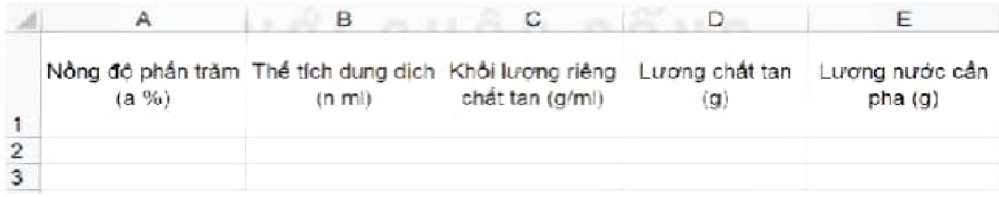

<!-- pdf:116 -->
<!-- Trang mở đầu phần Hoạt động thực hành trải nghiệm cuối Tập 1 (PDF 116): HOẠT ĐỘNG THỰC HÀNH TRẢI NGHIỆM -->

# PHA CHẾ DUNG DỊCH THEO NỒNG ĐỘ YÊU CẦU

## 🎯 Mục tiêu

- Tìm hiểu về nồng độ phần trăm và thiết kế bảng tính Excel để phục vụ việc tính toán lượng chất tan và dung môi theo yêu cầu.

**Chuẩn bị:**

- Ôn tập về nồng độ phần trăm, cách giải hệ hai phương trình bậc nhất hai ẩn.
- Nước tinh khiết; đường cát; muối tinh khiết; cốc đo thể tích; cân đồng hồ (loại $2\text{ kg}$).
- Nếu có điều kiện, mỗi nhóm chuẩn bị một máy tính cá nhân có phần mềm bảng tính Excel.

**CÁC BƯỚC THỰC HIỆN**

**HĐ1. Tính toán lượng chất tan và dung môi để pha chế dung dịch có nồng độ phần trăm cho trước**

Ta cần tính số gam đường cát và số gam nước tinh khiết cần thiết để có thể tạo ra $n = 1000\text{ (ml)}$ dung dịch có nồng độ $a\%$. Biết rằng khối lượng riêng của đường cát là $d = 1,1\text{ (g/ml)}$ và $1\text{ lít}$ nước tinh khiết nặng $1\text{ kg}$.

> **Nồng độ phần trăm** $C$ của một dung dịch tính bằng công thức
>
> $C\% = \dfrac{m_{ct}}{m_{dd}} \times 100\%$
>
> trong đó:
>
> + $m_{ct}$: khối lượng chất tan;
> + $m_{dd}$: khối lượng dung dịch.

<!-- pdf:117 -->

a) Gọi $x\text{ (gam)}$ và $y\text{ (gam)}$ lần lượt là lượng đường cát và nước cần để pha chế. Lập biểu thức tính thể tích và nồng độ dung dịch để chứng minh rằng $x, y$ thoả mãn hệ phương trình

$\begin{cases} \dfrac{x}{1,1} + y = 1000 \\ \dfrac{x}{x + y} \cdot 100 = a. \end{cases}$

b) Biến đổi hệ phương trình trên về dạng hệ hai phương trình bậc nhất hai ẩn

$\begin{cases} x + 1,1y = 1\,100 \\ (100 - a)x - ay = 0. \end{cases}$

Từ đó chứng tỏ nghiệm $(x; y)$ của hệ phương trình này là

$\begin{cases} x = \dfrac{1\,100a}{110 - 0,1a} \\ y = \dfrac{1\,100(100 - a)}{110 - 0,1a}. \end{cases}$

c) Áp dụng: Tính lượng nước và đường cát tương ứng để pha $n = 1\,000\text{ ml}$ nước đường với nồng độ là $a = 63\%$.

**Chú ý:** Ở những lớp có điều kiện, có thể tiến hành thêm hoạt động sau.

**HĐ2. Xây dựng bảng tính Excel**

Thực hiện theo các bước sau để xây dựng bảng tính Excel tính toán lượng chất tan và dung môi cần thiết.

**Bước 1.** Tạo bảng trên phần mềm Excel, điền các ô thông tin vào bảng tính.

| | A | B | C | D | E |
| :---: | :---: | :---: | :---: | :---: | :---: |
| **1** | Nồng độ phần trăm ($a\text{ \%}$) | Thể tích dung dịch ($n\text{ ml}$) | Khối lượng riêng chất tan ($\text{g/ml}$) | Lượng chất tan ($\text{g}$) | Lượng nước cần pha ($\text{g}$) |
| **2** | | | | | |
| **3** | | | | | |
<!-- ocr-ok: đã đối chiếu trực tiếp ảnh trang PDF 117, OCR đọc lỗi chữ nhỏ trong ảnh bảng Excel -->

**Bước 2.** Nhập số liệu vào cột nồng độ phần trăm, thể tích dung dịch, khối lượng riêng của đường ($1,1\text{ g/ml}$).

**Bước 3.** Sử dụng công thức nghiệm ở HĐ1 để nhập công thức vào cột lượng chất tan và lượng nước cần pha.

**Bước 4.** Hoàn thiện bảng tính: Làm tròn số liệu sau dấu phẩy một chữ số và thêm dấu phân cách hàng nghìn cho thể tích dung dịch và khối lượng. Đóng khung cho bảng.

**Thực hành:** Tính số gam muối tinh khiết và số gam nước tinh khiết cần thiết để có thể pha chế được $1\,000\text{ ml}$ dung dịch nước muối sinh lí $0,9\%$, biết rằng khối lượng riêng của muối tinh khiết là $2,16\text{ g/ml}$.

## 📷 Danh sách hình trong bài

| Mã hình | Trang PDF | Vị trí trong bài | Chú thích gốc |
| --- | :---: | --- | --- |
| H9-toan-hd-thtn-01-01 | 117 | HĐ2, Bước 1 | (sách không đánh số, mẫu bảng tính Excel) |
