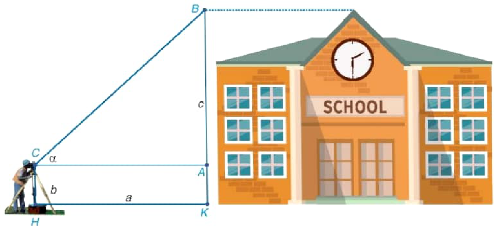
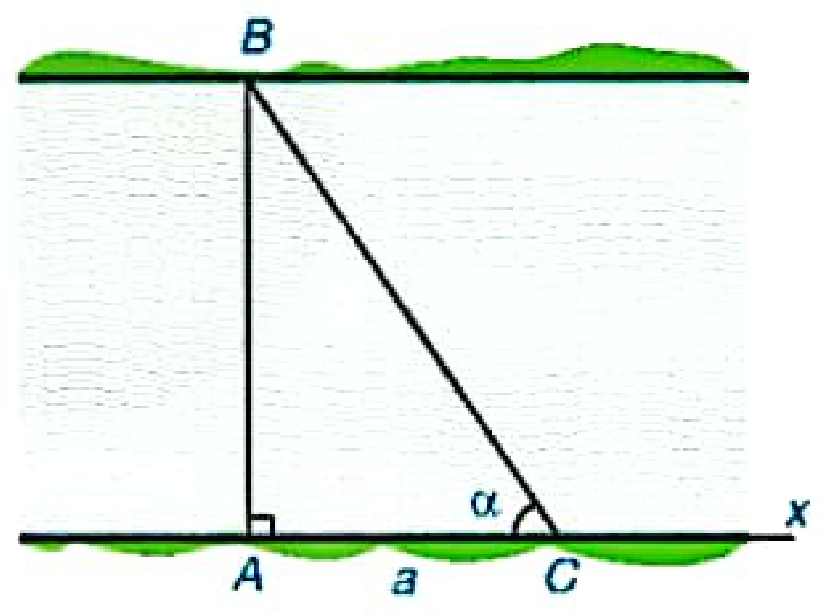

<!-- pdf:118 -->

# TÍNH CHIỀU CAO VÀ XÁC ĐỊNH KHOẢNG CÁCH

## 🎯 Mục tiêu

- Tính chiều cao, đo khoảng cách giữa hai vị trí mà ở giữa chúng có vật cản hoặc chỉ đến được một trong hai vị trí.

## 🔴 Mở đầu

Trong thực tế, nhiều tình huống chúng ta cần đo chiều cao một toà nhà, một cái cây hay đo khoảng cách giữa hai vị trí mà ở giữa chúng có vật cản hoặc chỉ đến được một trong hai vị trí. Có nhiều biện pháp để thực hiện điều đó, từ những biện pháp hiện đại đến những biện pháp rất đơn giản. Chẳng hạn, sử dụng tỉ số lượng giác của góc nhọn. Chúng ta sẽ cùng tìm hiểu điều đó thông qua hoạt động trải nghiệm dưới đây.

**Chuẩn bị:** Giác kế, thước cuộn, máy tính bỏ túi.

**Thực hiện:** Chia lớp thành bốn nhóm, hai nhóm thực hiện Nhiệm vụ 1, hai nhóm thực hiện Nhiệm vụ 2. Các nhóm thực hiện các dự án theo hướng dẫn và trình bày kết quả trước lớp.

**Nhiệm vụ 1. Xác định chiều cao**

**Mục tiêu:** Xác định chiều cao của một toà nhà trong trường mà không thực hiện đo trực tiếp.

**Chuẩn bị, xây dựng ý tưởng:** Nhóm thảo luận, xây dựng ý tưởng thực hiện nhiệm vụ và phân công nhiệm vụ.

**Thực hiện nhiệm vụ:**

<!-- pdf:119 -->

**Bước 1.** Đặt giác kế thẳng đứng cách chân toà nhà một khoảng cách $a$ mét, giả sử chiều cao của giác kế là $b$ mét. Quay ống ngắm của giác kế sao cho ta nhìn thấy đỉnh $B$ của toà nhà. Đọc trên giác kế số đo $\alpha$ của góc $BCA$.

**Bước 2.** Sử dụng hệ thức giữa cạnh và góc trong $\Delta ABC$ vuông tại $A$ và máy tính bỏ túi ta tính được $c = AB = AC \cdot \tan \alpha$.

**Bước 3.** Tính chiều cao của toà nhà là $b + c\text{ (m)}$.

**Báo cáo kết quả:** Sau khi thực hiện đo đạc và tính toán, nhóm trình bày trước lớp và tổ chức đánh giá nhiệm vụ.

**Nhiệm vụ 2. Xác định khoảng cách**

**Mục tiêu:** Xác định khoảng cách giữa hai vị trí giả định trên sân trường (như hai điểm bên hai bờ sông). Vị trí hai điểm giả định do giáo viên xác định.

**Chuẩn bị, xây dựng ý tưởng:** Nhóm thảo luận, xây dựng ý tưởng thực hiện nhiệm vụ và phân công nhiệm vụ.

**Thực hiện nhiệm vụ:**

Để đo khoảng cách giữa hai điểm $A$ và $B$ (giữa hai điểm này có vật cản hoặc chỉ đến được một trong hai vị trí $A, B$), ta thực hiện như sau:

**Bước 1.** Từ điểm $A$ ta kẻ tia $Ax \perp AB$. Trên tia $Ax$ lấy điểm $C$ sao cho $AC = a$ mét. Tại vị trí $C$ sử dụng giác kế ngắm tới điểm $B$. Đọc trên giác kế số đo góc $\alpha$ của góc $ACB$.

**Bước 2.** Sử dụng hệ thức giữa cạnh và góc trong $\Delta ABC$ vuông tại $A$ và MTCT ta tính được $AB = AC \cdot \tan \alpha = \alpha \tan \alpha$.

**Báo cáo kết quả:** Sau khi thực hiện đo đạc và tính toán, nhóm trình bày trước lớp và tổ chức đánh giá nhiệm vụ.

## 📷 Danh sách hình trong bài

| Mã hình | Trang PDF | Vị trí trong bài | Chú thích gốc |
| --- | :---: | --- | --- |
| H9-toan-hd-thtn-02-01 | 118 | Nhiệm vụ 1 | (sách không đánh số, minh hoạ đo chiều cao toà nhà bằng giác kế) |
| H9-toan-hd-thtn-02-02 | 119 | Nhiệm vụ 2 | (sách không đánh số, minh hoạ đo khoảng cách giữa hai điểm A và B) |
