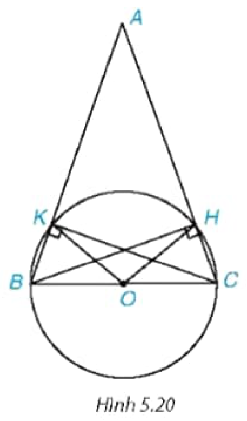
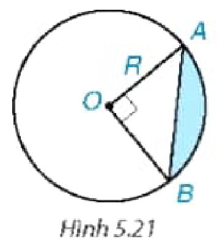
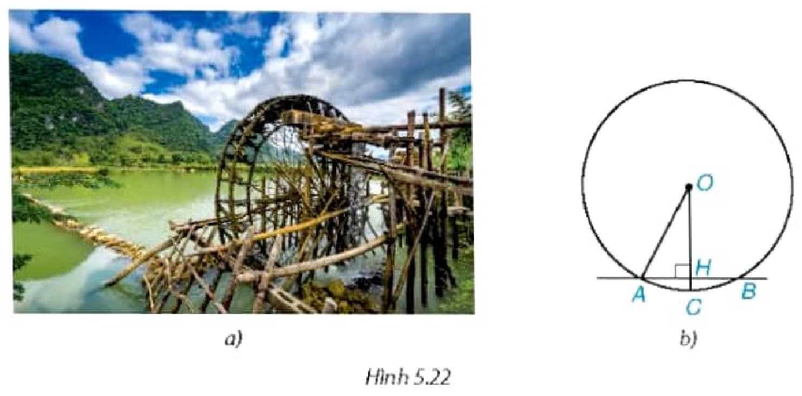
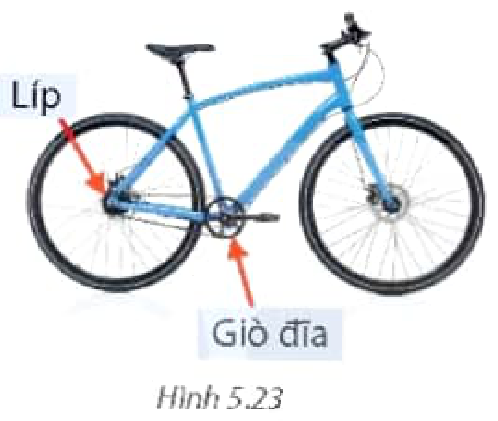
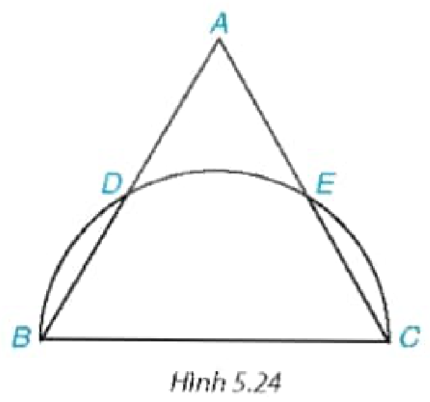

<!-- pdf:98 -->

# LUYỆN TẬP CHUNG (TRANG 96)

**Ví dụ 1:** Cho tam giác nhọn $ABC$ cân tại $A$. Từ $B$ và $C$ kẻ lần lượt hai đường cao $BH$ và $CK$ của tam giác $ABC$.
<!-- ocr-ok: đã đối chiếu trực tiếp ảnh trang PDF 98, OCR bỏ sót nhãn Ví dụ 1 và đọc nhọn thành nhon -->

a) Chứng minh rằng đường tròn tâm $O$ đường kính $BC$ đi qua $K$ và $H$.

b) Chứng minh rằng hai cung nhỏ $BH$ và $CK$ bằng nhau.

c) Tính số đo của cung nhỏ $KH$ nếu $\widehat{BAC} = 40^\circ$.

*Hình 5.20*

**Giải** (H.5.20; học sinh tự ghi giả thiết, kết luận)

a) Đặt $R = \dfrac{BC}{2} = OB = OC$. Khi đó $(O; R)$ là đường tròn đường kính $BC$. Dễ thấy $HO$ là trung tuyến ứng với cạnh huyền của tam giác vuông $HBC$ nên $OH = \dfrac{BC}{2} = R$. Do đó $H \in (O; R)$. Tương tự, ta cũng có $K \in (O; R)$.

Vậy đường tròn $(O; R)$ đi qua các điểm $K$ và $H$.

b) Hai tam giác vuông $HBC$ và $KCB$ có chung cạnh huyền $BC$ và $\widehat{ABC} = \widehat{ACB}$ (do tam giác $ABC$ cân tại $A$) nên $\Delta HBC = \Delta KCB$, suy ra $BH = CK$. Do đó $\Delta BOH = \Delta COK$ (vì $BO = CO, OH = OK, BH = CK$). Từ đó ta có $\widehat{BOH} = \widehat{COK}$.
<!-- ocr-ok: đã đối chiếu trực tiếp ảnh trang PDF 98, OCR đọc sai nên thành nón -->

Mặt khác, $\text{sđ}\overset{\frown}{BH} = \widehat{BOH}, \text{sđ}\overset{\frown}{CK} = \widehat{COK}$, do đó $\overset{\frown}{BH} = \overset{\frown}{CK}$.

c) Ba tam giác cân $ABC, OCH$ và $OBK$ có các góc ở đáy bằng nhau nên ba góc ở đỉnh cũng bằng nhau. Bởi vậy ta có

$\widehat{BOK} = \widehat{HOC} = \widehat{BAC} = 40^\circ$.

Mặt khác, $\widehat{BOK} + \widehat{KOH} + \widehat{HOC} = \widehat{BOC} = 180^\circ$. Do đó

$\widehat{KOH} = 180^\circ - \widehat{BOK} - \widehat{HOC} = 100^\circ$.

Do $\widehat{KOH}$ là góc ở tâm khác góc bẹt nên $\overset{\frown}{KH}$ là cung nhỏ. Do đó $\text{sđ}\overset{\frown}{KH} = \widehat{KOH} = 100^\circ$.

**Ví dụ 2:** Ta gọi hình giới hạn bởi một cung nhỏ của một đường tròn và dây căng cung đó là **hình viên phân**. Lập công thức tính diện tích hình viên phân ứng với cung $90^\circ$, biết bán kính của đường tròn là $R$.

*Hình 5.21*

<!-- pdf:99 -->

**Giải**

Giả sử $AB$ là cung có số đo $90^\circ$; $S$ là diện tích hình viên phân (phần tô màu trên Hình 5.21) và $S_q$ là diện tích của hình quạt ứng với cung đó; $S_t$ là diện tích hình tam giác $OAB$.

Ta có $S_q = \dfrac{90}{360}\pi R^2 = \dfrac{1}{4}\pi R^2$, $S_t = \dfrac{1}{2}OA \cdot OB = \dfrac{1}{2}R^2$. Do đó

$S = S_q - S_t = \dfrac{1}{4}\pi R^2 - \dfrac{1}{2}R^2 = R^2\left(\dfrac{\pi}{4} - \dfrac{1}{2}\right)$.

## BÀI TẬP

5.14. Cho dây $AB$ không qua tâm của đường tròn $(O)$. Gọi $A'$ và $B'$ là hai điểm lần lượt đối xứng với $A$ và $B$ qua $O$. Hỏi đường trung trực của $A'B'$ có phải là trục đối xứng của $(O)$ hay không? Tại sao?
<!-- ocr-ok: đã đối chiếu trực tiếp ảnh trang PDF 99, OCR tách dòng sai chữ trung trực thành trun gtrực -->

5.15. Cho tam giác $ABC$ không là tam giác vuông. Gọi $H$ và $K$ là chân các đường vuông góc lần lượt hạ từ $B$ và $C$ xuống $AC$ và $AB$. Chứng minh rằng:

a) Đường tròn đường kính $BC$ đi qua các điểm $H$ và $K$;

b) $KH < BC$.

5.16. Có thể xem *guồng nước* (còn gọi là *cọn nước*) là một công cụ hay cỗ máy có dạng hình tròn, quay được nhờ sức nước chảy (H.5.22a). Guồng nước thường thấy ở các vùng miền núi. Nhiều guồng nước được làm bằng tre, dùng để đưa nước lên ruộng cao, giã gạo hoặc làm một số việc khác.

Giả sử ngấn nước ngăn cách giữa phần trên và phần dưới nước của một guồng nước được biểu thị bởi cung ứng với một dây dài $4\text{ m}$ và điểm ngập sâu nhất là $0,5\text{ m}$ (trên Hình 5.22b, điểm ngập sâu nhất là điểm $C$, ta có $AB = 4\text{ m}$ và $HC = 0,5\text{ m}$). Dựa vào đó, em hãy tính bán kính của guồng nước.

*Hình 5.22*

<!-- pdf:100 -->

5.17. Cho đường tròn $(O; 5\text{ cm})$.

a) Hãy nêu cách vẽ dây $AB$ sao cho khoảng cách từ điểm $O$ đến dây $AB$ bằng $2,5\text{ cm}$.

b) Tính độ dài của dây $AB$ trong câu a (làm tròn đến hàng phần trăm).

c) Tính số đo và độ dài của cung nhỏ $AB$.

d) Tính diện tích hình quạt tròn ứng với cung nhỏ $AB$.

5.18. Ba bộ phận truyền chuyển động của một chiếc xe đạp gồm một giò đĩa (bánh răng gắn với bàn đạp), một chiếc líp (cũng có dạng bánh răng) gắn với bánh xe và bộ xích (H.5.23). Biết rằng giò đĩa có bán kính $15\text{ cm}$, líp có bán kính $4\text{ cm}$ và bánh xe có đường kính $65\text{ cm}$. Hỏi khi người đi xe đạp một vòng thì xe chạy được quãng đường dài bao nhiêu mét (làm tròn đến hàng phần chục)?

*Hình 5.23*

5.19. Cho tam giác đều $ABC$ có $AB = 2\sqrt{3}\text{ cm}$. Nửa đường tròn đường kính $BC$ cắt hai cạnh $AB$ và $AC$ lần lượt tại $D$ và $E$ (khác $B$ và $C$) (H.5.24).
<!-- ocr-ok: đã đối chiếu trực tiếp ảnh trang PDF 100, nhiều kí hiệu toán học làm giảm số từ thường -->

a) Chứng tỏ rằng ba cung nhỏ $BD, DE$ và $EC$ bằng nhau. Tính số đo mỗi cung ấy.

b) Tính diện tích của hình viên phân (xem Ví dụ 2) giới hạn bởi dây $BD$ và cung nhỏ $BD$.

*Hình 5.24*

## 📷 Danh sách hình trong bài

| Mã hình | Trang PDF | Vị trí trong bài | Chú thích gốc |
| --- | :---: | --- | --- |
| H9-toan-ltc-c05-01-01 | 98 | Ví dụ 1 | Hình 5.20 |
| H9-toan-ltc-c05-01-02 | 98 | Ví dụ 2 | Hình 5.21 |
| H9-toan-ltc-c05-01-03 | 99 | Bài tập 5.16 | Hình 5.22 |
| H9-toan-ltc-c05-01-04 | 100 | Bài tập 5.18 | Hình 5.23 |
| H9-toan-ltc-c05-01-05 | 100 | Bài tập 5.19 | Hình 5.24 |
