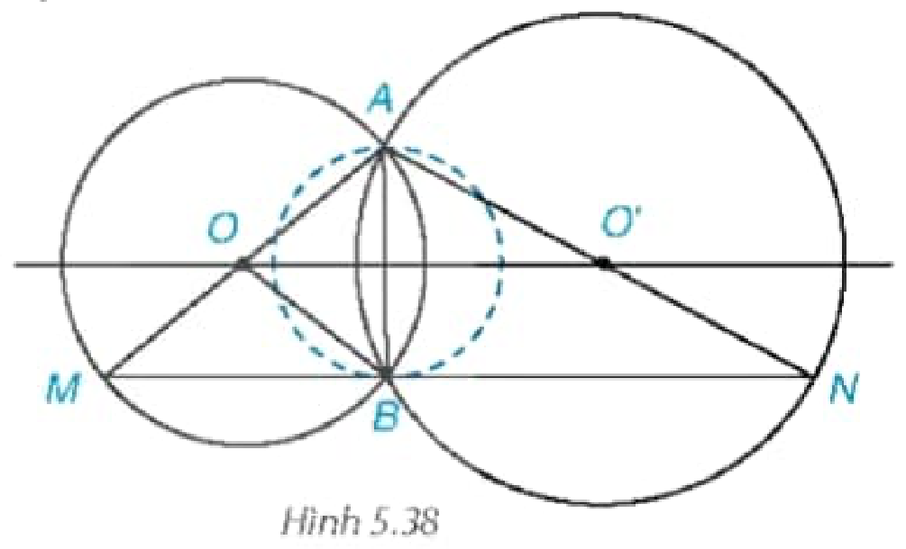
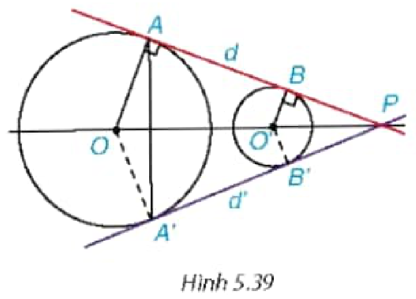
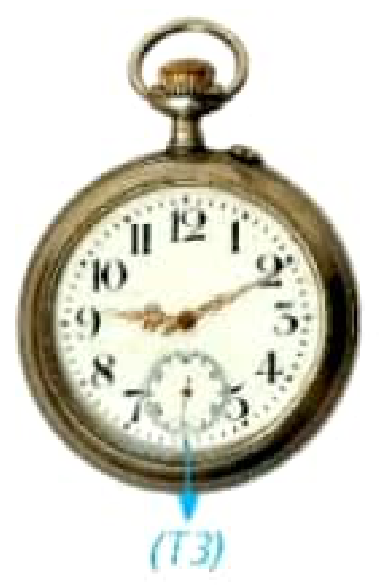
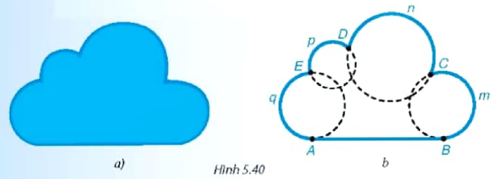
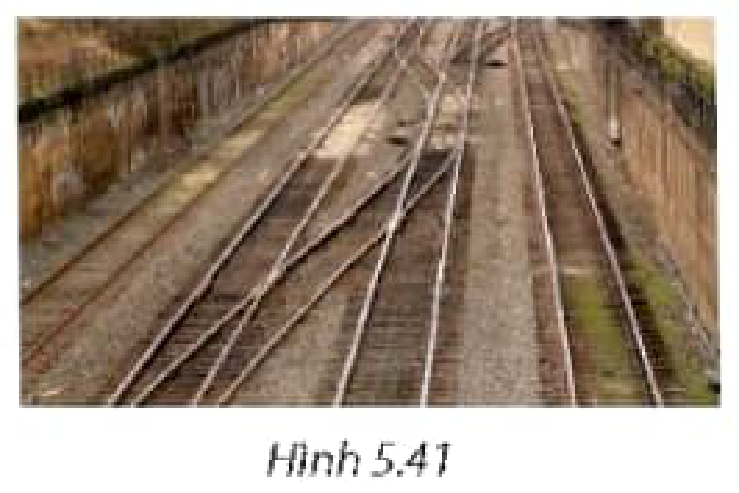
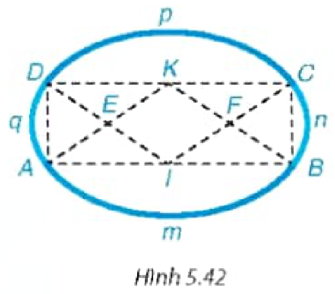
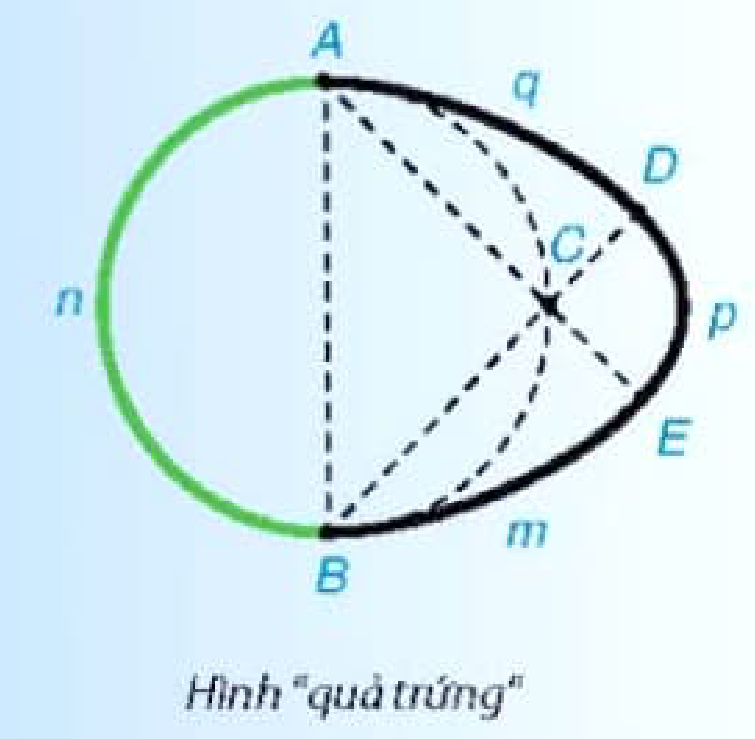
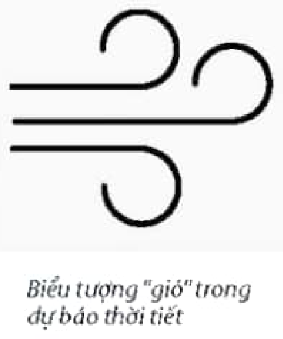

<!-- pdf:110 -->

# LUYỆN TẬP CHUNG (TRANG 108)

**Ví dụ 1:** Cho hai đường tròn $(O; R)$ và $(O'; R')$ cắt nhau tại $A$ và $B$. Gọi $M$ là điểm đối xứng với $A$ qua $O$, $N$ là điểm đối xứng với $A$ qua $O'$.
<!-- ocr-ok: đã đối chiếu trực tiếp ảnh trang PDF 110, OCR bỏ sót nhãn hộp Ví dụ 1 -->

a) Chứng minh rằng $M \in (O), N \in (O')$ và ba điểm $M, B, N$ thẳng hàng.

b) Chứng minh rằng đường thẳng $MN$ tiếp xúc với đường tròn đường kính $AB$.

*Hình 5.38*

**Giải** (H.5.38, học sinh tự ghi giả thiết, kết luận)

a) Do tính đối xứng của $(O)$ nên từ $A \in (O)$ suy ra $M \in (O)$ (vì $M$ đối xứng với $A$ qua $O$).

Tam giác $ABM$ có $BO$ là đường trung tuyến và $BO = \dfrac{1}{2}AM$ (bán kính bằng nửa đường kính) nên là tam giác vuông tại $B$. Vậy $\widehat{ABM} = 90^\circ$.

Tương tự, ta cũng có $N \in (O')$ và $\widehat{ABN} = 90^\circ$. Từ hai kết quả trên suy ra

$\widehat{MBN} = \widehat{ABM} + \widehat{ABN} = 90^\circ + 90^\circ = 180^\circ$.

Điều đó chứng tỏ ba điểm $M, B, N$ thẳng hàng.

b) Kết quả câu a còn cho thấy $MN \perp AB$, tức là $MN$ vuông góc với bán kính của đường tròn đường kính $AB$ tại $B$. Do đó, $MN$ là tiếp tuyến của đường tròn đường kính $AB$.

**Ví dụ 2:** Cho hai đường tròn ngoài nhau $(O; R)$ và $(O'; R')$ với giả thiết $R > R'$. Một đường thẳng $d$ tiếp xúc với $(O; R)$ tại $A$ và tiếp xúc với $(O'; R')$ tại $B$ sao cho $O$ và $O'$ nằm cùng phía đối với $d$. Giả sử $d$ cắt đường thẳng $OO'$ tại điểm $P$ (Hình 5.39).

a) Chứng minh rằng $\dfrac{PO}{PO'} = \dfrac{R}{R'}$;

b) Gọi $A'$ là điểm đối xứng với $A$ qua $OO'$. Chứng minh rằng đường thẳng $PA'$ tiếp xúc với $(O)$ và với $(O')$.

<!-- pdf:111 -->

**Giải** (H.5.39, học sinh tự ghi giả thiết, kết luận)

*Hình 5.39*

a) Do $d$ tiếp xúc với $(O)$ tại $A$, tiếp xúc với $(O')$ tại $B$ nên $OA \perp d$ và $O'B \perp d$. Do đó, trong tam giác $POA$ ta có $O'B \parallel OA$, suy ra $\Delta POA \backsim \Delta PO'B$. Từ đó, ta có
<!-- ocr-ok: đã đối chiếu trực tiếp ảnh trang PDF 111, OCR dính chữ gtiếp và dvà, đọc sai tam thành tạm -->

$\dfrac{PO}{PO'} = \dfrac{OA}{O'B} = \dfrac{R}{R'}$.

b) Do $A'$ đối xứng với $A$ qua $OO'$ và $A \in (O)$ nên $A' \in (O)$ và $OO' \perp AA'$, tức là $OP \perp AA'$.
<!-- ocr-ok: đã đối chiếu trực tiếp ảnh trang PDF 111, câu ngắn nhiều kí hiệu toán học -->

Tam giác $OAA'$ là tam giác cân (do $OA = OA'$) có $OP \perp AA'$ nên $OP$ là tia phân giác của góc $AOA'$, suy ra $\widehat{AOP} = \widehat{A'OP}$.
<!-- ocr-ok: đã đối chiếu trực tiếp ảnh trang PDF 111, OCR đọc sai phân thành phần -->

Hai tam giác $AOP$ và $A'OP$ có: $OA = OA'$ (bán kính đường tròn $(O)$); $OP$ chung và $\widehat{AOP} = \widehat{A'OP}$. Vậy $\Delta AOP = \Delta A'OP$ (c.g.c), suy ra $\widehat{PA'O} = \widehat{PAO}$ mà $\widehat{PAO} = 90^\circ$ (do $PA$ tiếp xúc với $(O)$) nên $\widehat{PA'O} = 90^\circ$.
<!-- ocr-ok: đã đối chiếu trực tiếp ảnh trang PDF 111, nhiều công thức LaTeX trong câu -->

Vậy $PA'$ vuông góc với bán kính $OA'$ của $(O)$ tại $A'$. Điều đó chứng tỏ $PA'$ tiếp xúc với $(O)$ tại $A'$.

Đối với đường tròn $(O')$, gọi $B'$ là chân đường vuông góc hạ từ $O'$ xuống $PA'$. Để khẳng định rằng $PA'$ cũng tiếp xúc với $(O')$ tại $B'$, ta chỉ cần chứng minh $B' \in (O')$.

Thật vậy, $O'B'$ và $OA'$ cùng vuông góc với $PA'$ nên $O'B' \parallel OA'$, suy ra $\Delta POA' \backsim \Delta PO'B'$. Do đó
<!-- ocr-ok: đã đối chiếu trực tiếp ảnh trang PDF 111, OCR đọc sai đó thành dó -->

$\dfrac{OA'}{O'B'} = \dfrac{PO}{PO'}$.

Mà theo câu a ta có $\dfrac{PO}{PO'} = \dfrac{R}{R'}$ nên $\dfrac{OA'}{O'B'} = \dfrac{R}{R'}$, hay $\dfrac{R}{O'B'} = \dfrac{R}{R'}$.
<!-- ocr-ok: đã đối chiếu trực tiếp ảnh trang PDF 111, OCR đọc sót chữ theo câu -->

Điều này chứng tỏ $O'B' = R'$, nghĩa là $B' \in (O')$.

Vậy $PA'$ tiếp xúc với $(O)$ tại $A'$ và tiếp xúc với $(O')$ tại $B'$.
<!-- ocr-ok: đã đối chiếu trực tiếp ảnh trang PDF 111, câu ngắn nhiều kí hiệu toán học -->

## BÀI TẬP

5.28. Cho hai đường thẳng $a$ và $b$ song song với nhau, điểm $O$ nằm trong phần mặt phẳng ở giữa hai đường thẳng đó. Biết rằng khoảng cách từ $O$ đến $a$ và $b$ lần lượt bằng $2\text{ cm}$ và $3\text{ cm}$.

a) Hỏi bán kính $R$ của đường tròn $(O; R)$ phải thoả mãn điều kiện gì để $(O; R)$ cắt cả hai đường thẳng $a$ và $b$?

b) Biết rằng đường tròn $(O; R)$ tiếp xúc với đường thẳng $a$. Hãy xác định vị trí tương đối của đường tròn $(O; R)$ và đường thẳng $b$.

<!-- pdf:112 -->

5.29. Khi chuyển động, giả sử đầu mũi kim dài của một chiếc đồng hồ vạch nên một đường tròn, kí hiệu là $(T1)$, trong khi đầu mũi kim ngắn vạch nên một đường tròn khác, kí hiệu là $(T2)$.

a) Hai đường tròn $(T1)$ và $(T2)$ có vị trí tương đối như thế nào?

b) Giả sử bán kính của $(T1)$ và $(T2)$ lần lượt là $R_1$ và $R_2$. Người ta vẽ trên mặt đồng hồ một hoạ tiết hình tròn có tâm nằm cách điểm trục kim đồng hồ một khoảng bằng $\dfrac{1}{2}R_1$ và có bán kính bằng $\dfrac{1}{2}R_2$.

Hãy cho biết vị trí tương đối của đường tròn $(T3)$ đối với mỗi đường tròn $(T1)$ và $(T2)$.

Vẽ ba đường tròn đó nếu $R_1 = 3\text{ cm}$ và $R_2 = 2\text{ cm}$.

*(T3)*

5.30. Cho đường tròn $(O)$ đường kính $AB$, tiếp tuyến $xx'$ tại $A$ và tiếp tuyến $yy'$ tại $B$ của $(O)$. Một tiếp tuyến thứ ba của $(O)$ tại điểm $P$ ($P$ khác $A$ và $B$) cắt $xx'$ tại $M$ và cắt $yy'$ tại $N$.
<!-- ocr-ok: đã đối chiếu trực tiếp ảnh trang PDF 112, OCR dính chữ xx'tại và yy'tại -->

a) Chứng minh rằng $MN = MA + NB$.

b) Đường thẳng đi qua $O$ và vuông góc với $AB$ cắt $NM$ tại $Q$. Chứng minh rằng $Q$ là trung điểm của đoạn $MN$.

c) Chứng minh rằng $AB$ tiếp xúc với đường tròn đường kính $MN$.

5.31. Cho hai đường tròn $(O)$ và $(O')$ tiếp xúc ngoài với nhau tại $A$ và cùng tiếp xúc với đường thẳng $d$ tại $B$ và $C$ (khác $A$), trong đó $B \in (O)$ và $C \in (O')$. Tiếp tuyến của $(O)$ tại $A$ cắt $BC$ tại $M$. Chứng minh rằng:

a) Đường thẳng $MA$ tiếp xúc với $(O')$;

b) Điểm $M$ là trung điểm của đoạn thẳng $BC$ từ đó suy ra $ABC$ là tam giác vuông.

## 💡 Em có biết?

*(Đọc thêm)*

**Vẽ chắp nối trơn**

Trong những bản tin dự báo thời tiết trên truyền hình, các em có thể bắt gặp hình biểu tượng của đám mây như Hình 5.40.a. Quan sát đường viền của hình này, các em thấy có gì đáng chú ý?

*Hình 5.40*

- Thứ nhất, đường viền gồm một đoạn thẳng và $4$ cung tròn được chắp nối với nhau như Hình 5.40.b.
- Thứ hai, trên Hình 5.40.b, ta thấy đường viền bị “gãy” tại những điểm $C, D$ và $E$ (đó là những điểm chắp nối giữa hai cung tròn). Trong khi đó tại điểm chắp nối giữa đoạn thẳng $AB$ và cung tròn $AqE$, đường viền không bị “gãy”. Ta nói rằng đoạn thẳng $AB$ được *chắp nối trơn* với cung $AqE$ (tại điểm $A$). Tương tự, cung $BmC$ cũng được chắp nối trơn với đoạn $AB$ (tại điểm $B$).

<!-- pdf:113 -->

Chắp nối trơn có nhiều ứng dụng trong thực tế đời sống. Chẳng hạn, tàu hoả phải chạy trên đường ray thẳng hoặc đường thẳng chắp nối trơn với đoạn đường cong (H.5.41).

*Hình 5.41*

Vậy muốn có chắp nối trơn ta làm làm thế nào? Trước hết, ta tìm hiểu về vẽ chắp nối trơn. Cách vẽ chắp nối trơn được suy ra từ hai kết luận sau:

1) Nếu một đoạn thẳng được chắp nối trơn với một cung tròn thì đoạn thẳng đó nằm trên tiếp tuyến của đường tròn chứa cung tròn đó tại điểm chắp nối.

2) Nếu hai cung tròn được chắp nối trơn với nhau thì hai đường tròn chứa hai cung ấy tiếp xúc nhau tại điểm chắp nối.

Để hiểu thêm về vẽ chắp nối trơn, em hãy chuẩn bị thước kẻ và compa để vẽ hình “trái xoan” (H.5.42) theo hướng dẫn sau đây:

*Hình 5.42*

- Vẽ hình chữ nhật $ABCD$ (kích thước tuỳ ý).
- Xác định trung điểm $I$ của đoạn $AB$ và trung điểm $K$ của đoạn $CD$.
- Tìm giao điểm $E$ của $AK$ và $DI$; giao điểm $F$ của $BK$ và $CI$.
- Vẽ $4$ cung: $\overset{\frown}{AmB}$ (tâm $K$), $\overset{\frown}{CpD}$ (tâm $I$), $\overset{\frown}{BnC}$ (tâm $F$) và $\overset{\frown}{DqA}$ (tâm $E$).
<!-- ocr-ok: đã đối chiếu trực tiếp ảnh trang PDF 113, OCR đọc sai tuỳ thành tuỷ, tâm thành tàm -->

Bốn cung tròn vừa vẽ tạo nên hình “trái xoan”. Trong hình đó, tâm của hai cung liên tiếp, chẳng hạn, tâm $K$ của cung $AmB$ và tâm $F$ của cung $BnC$ thẳng hàng với điểm chắp nối $B$, chứng tỏ hai đường tròn $(K)$ và $(F)$ tiếp xúc nhau tại điểm $B$. Điều đó cho phép hai cung này chắp nối trơn với nhau tại $B$.

Em hãy tìm hiểu điều tương tự đối với các cặp cung liên tiếp còn lại để hiểu tại sao các cung tròn đã vẽ đều chắp nối trơn với nhau.

Bây giờ em hãy tự mình tìm hiểu và trao đổi với các bạn khác về cách vẽ hai hình sau đây nhé!

*Hình “quả trứng”*

*Biểu tượng “gió” trong dự báo thời tiết*

## 📷 Danh sách hình trong bài

| Mã hình | Trang PDF | Vị trí trong bài | Chú thích gốc |
| --- | :---: | --- | --- |
| H9-toan-ltc-c05-02-01 | 110 | Ví dụ 1 | Hình 5.38 |
| H9-toan-ltc-c05-02-02 | 111 | Ví dụ 2 | Hình 5.39 |
| H9-toan-ltc-c05-02-03 | 112 | Bài tập 5.29 | (T3) |
| H9-toan-ltc-c05-02-04 | 112 | Em có biết? | Hình 5.40 |
| H9-toan-ltc-c05-02-05 | 113 | Em có biết? | Hình 5.41 |
| H9-toan-ltc-c05-02-06 | 113 | Em có biết? | Hình 5.42 |
| H9-toan-ltc-c05-02-07 | 113 | Em có biết? | Hình “quả trứng” |
| H9-toan-ltc-c05-02-08 | 113 | Em có biết? | Biểu tượng “gió” trong dự báo thời tiết |
