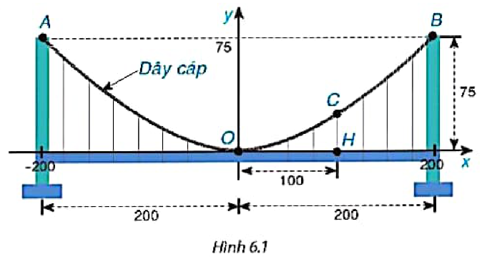
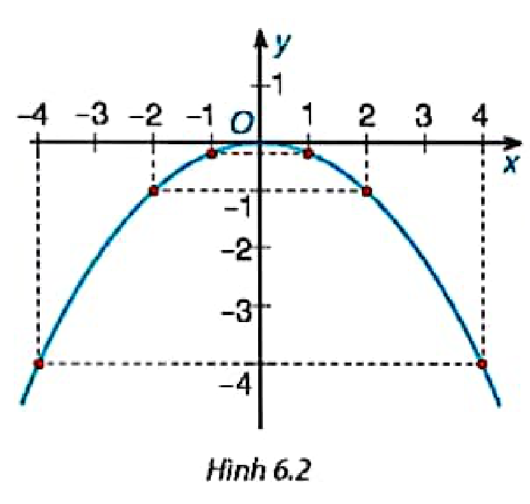
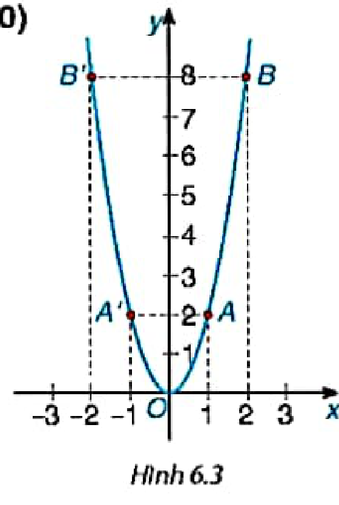
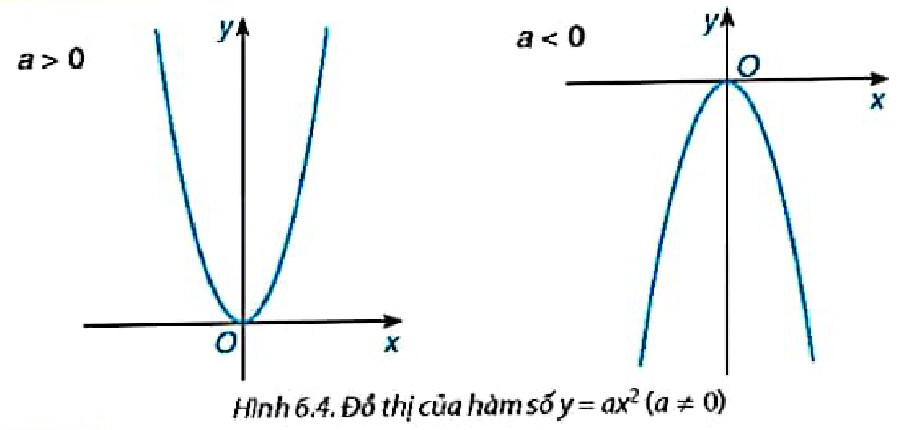
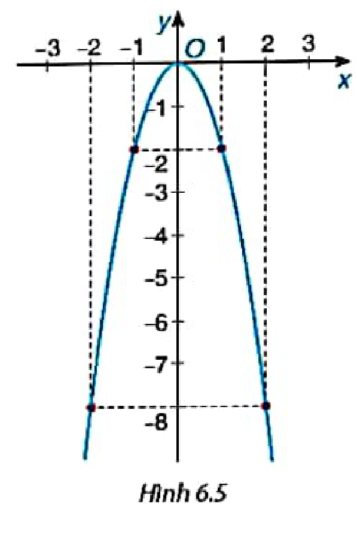
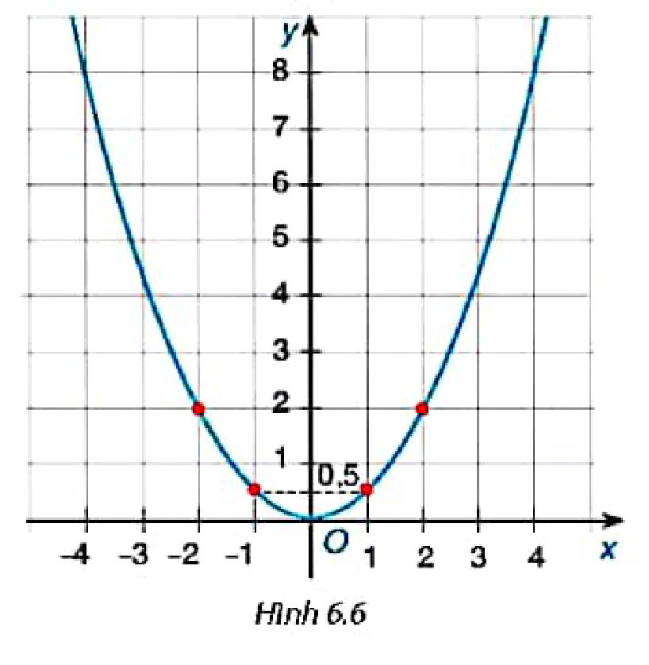
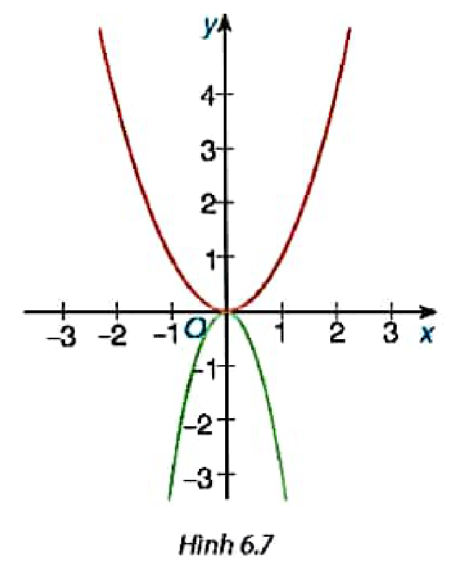
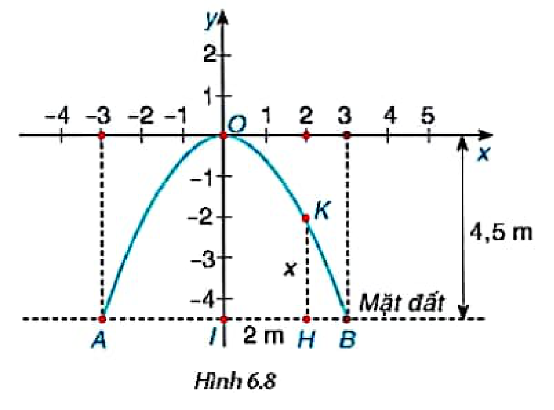

<!-- pdf:6 -->
<!-- Phần giới thiệu đầu Chương VI (nửa trên trang PDF 6): ĐẠI SỐ — CHƯƠNG VI: HÀM SỐ y = ax² (a ≠ 0). PHƯƠNG TRÌNH BẬC HAI MỘT ẨN -->

Chương này trình bày cách vẽ và tính chất đồ thị của hàm số $y = ax^2$ ($a \ne 0$), cách giải phương trình bậc hai một ẩn và những ứng dụng thực tiễn liên quan.

# BÀI 18: HÀM SỐ Y = AX² (A ≠ 0)

## 🔤 Khái niệm, thuật ngữ

- Hàm số $y = ax^2$ ($a \ne 0$)
- Đồ thị của hàm số $y = ax^2$ ($a \ne 0$)
- Đỉnh
- Trục đối xứng

## 🎯 Kiến thức, kĩ năng

- Thiết lập bảng giá trị của hàm số $y = ax^2$ ($a \ne 0$).
- Vẽ đồ thị của hàm số $y = ax^2$ ($a \ne 0$).
- Nhận biết tính đối xứng trục và trục đối xứng của đồ thị hàm số $y = ax^2$ ($a \ne 0$).
- Giải quyết một số vấn đề thực tiễn gắn với hàm số $y = ax^2$ ($a \ne 0$).

## 🔴 Mở đầu

Một cây cầu treo có trụ tháp đôi cao $75\text{ m}$ so với mặt của cây cầu và cách nhau $400\text{ m}$. Các dây cáp có dạng đồ thị của hàm số $y = ax^2$ ($a \ne 0$) như Hình 6.1 và được treo trên các đỉnh tháp. Tìm chiều cao $CH$ của dây cáp biết điểm $H$ cách tâm $O$ của cây cầu $100\text{ m}$ (giả sử mặt của cây cầu là bằng phẳng).

*Hình 6.1*

<!-- pdf:7 -->

## 1. HÀM SỐ $y = ax^2$ ($a \ne 0$)

**Nhận biết hàm số $y = ax^2$ ($a \ne 0$)**

**HĐ1:** Khi thả một vật rơi tự do và bỏ qua sức cản của không khí, quãng đường của chuyển động $s$ (mét) của vật được cho bằng công thức $s = 4,9t^2$, trong đó $t$ là thời gian chuyển động của vật (giây).

a) Hoàn thành bảng sau vào vở:

| $t$ (giây) | $0$ | $1$ | $2$ |
| --- | :---: | :---: | :---: |
| $s$ ($\text{m}$) | $?$ | $?$ | $?$ |

b) Giả sử một vật rơi tự do từ độ cao $19,6\text{ m}$ so với mặt đất. Hỏi sau bao lâu vật chạm đất?

**HĐ2:** a) Viết công thức tính diện tích $S$ của hình tròn bán kính $r$.

b) Hoàn thành bảng sau vào vở (lấy $\pi = 3,14$ và làm tròn kết quả đến chữ số thập phân thứ hai):

| $r$ ($\text{cm}$) | $1$ | $2$ | $3$ | $4$ |
| --- | :---: | :---: | :---: | :---: |
| $S$ ($\text{cm}^2$) | $?$ | $?$ | $?$ | $?$ |

Những công thức tính $s$ theo $t$ (trong HĐ1), tính $S$ theo $r$ (trong HĐ2) biểu thị những hàm số có cùng một dạng, gọi là **hàm số $y = ax^2$** ($a \ne 0$).

**Nhận xét.** Hàm số $y = ax^2$ ($a \ne 0$) xác định với mọi giá trị $x$ thuộc $\mathbb{R}$.

**Ví dụ 1:** Cho hàm số $y = \dfrac{3}{2}x^2$. Hoàn thành bảng giá trị sau vào vở:

| $x$ | $-3$ | $-2$ | $-1$ | $0$ | $1$ | $2$ | $3$ |
| :---: | :---: | :---: | :---: | :---: | :---: | :---: | :---: |
| $y$ | $?$ | $?$ | $?$ | $?$ | $?$ | $?$ | $?$ |

**Giải**

Bảng giá trị:

| $x$ | $-3$ | $-2$ | $-1$ | $0$ | $1$ | $2$ | $3$ |
| :---: | :---: | :---: | :---: | :---: | :---: | :---: | :---: |
| $y$ | $\dfrac{27}{2}$ | $6$ | $\dfrac{3}{2}$ | $0$ | $\dfrac{3}{2}$ | $6$ | $\dfrac{27}{2}$ |

**Luyện tập 1:** Cho hàm số $y = -\dfrac{3}{2}x^2$. Hoàn thành bảng giá trị sau vào vở:

| $x$ | $-3$ | $-2$ | $-1$ | $0$ | $1$ | $2$ | $3$ |
| :---: | :---: | :---: | :---: | :---: | :---: | :---: | :---: |
| $y$ | $?$ | $?$ | $?$ | $?$ | $?$ | $?$ | $?$ |

**Vận dụng 1:** Một vật rơi tự do từ độ cao $98\text{ m}$ so với mặt đất. Quãng đường chuyển động $s$ ($\text{m}$) của vật rơi phụ thuộc vào thời gian $t$ (giây) được cho bởi công thức $s = 4,9t^2$.

a) Sau $2$ giây, vật này cách mặt đất bao nhiêu mét?

b) Hỏi sau bao lâu kể từ khi bắt đầu rơi, vật này chạm đất?

<!-- pdf:8 -->

## 2. ĐỒ THỊ CỦA HÀM SỐ $y = ax^2$ ($a \ne 0$)

**Cách vẽ đồ thị hàm số $y = ax^2$ ($a \ne 0$)**

**HĐ3:** Cho hàm số $y = 2x^2$.

a) Hoàn thành bảng giá trị sau vào vở:

| $x$ | $-3$ | $-2$ | $-1$ | $0$ | $1$ | $2$ | $3$ |
| :---: | :---: | :---: | :---: | :---: | :---: | :---: | :---: |
| $y$ | $?$ | $?$ | $?$ | $?$ | $?$ | $?$ | $?$ |

b) Trong mặt phẳng toạ độ $Oxy$, biểu diễn các điểm $(x; y)$ trong bảng giá trị ở câu a. Bằng cách làm tương tự, lấy nhiều điểm $(x; 2x^2)$ với $x \in \mathbb{R}$ và nối lại, ta được đồ thị của hàm số $y = 2x^2$.

<!-- term: Cách vẽ đồ thị hàm số $y = ax^2$ -->
> Cách vẽ đồ thị hàm số $y = ax^2$ ($a \ne 0$)
> - Lập bảng ghi một số cặp giá trị tương ứng của $x$ và $y$.
> - Trong mặt phẳng toạ độ $Oxy$, biểu diễn các cặp điểm $(x; y)$ trong bảng giá trị trên và nối chúng lại để được một đường cong là đồ thị của hàm số $y = ax^2$ ($a \ne 0$).

**Ví dụ 2:** Vẽ đồ thị của hàm số $y = -\dfrac{1}{4}x^2$.
<!-- ocr-ok: đã đối chiếu ảnh trang PDF 8, OCR không nhận diện nhãn Ví dụ 2 nền xanh -->

**Giải**

Lập bảng một số giá trị tương ứng giữa $x$ và $y$:

| $x$ | $-4$ | $-2$ | $-1$ | $0$ | $1$ | $2$ | $4$ |
| :---: | :---: | :---: | :---: | :---: | :---: | :---: | :---: |
| $y$ | $-4$ | $-1$ | $-\dfrac{1}{4}$ | $0$ | $-\dfrac{1}{4}$ | $-1$ | $-4$ |

Biểu diễn các điểm $(-4; -4)$; $(-2; -1)$; $\left(-1; -\dfrac{1}{4}\right)$; $(0; 0)$; $\left(1; -\dfrac{1}{4}\right)$; $(2; -1)$ và $(4; -4)$ trên mặt phẳng toạ độ $Oxy$ và nối chúng lại ta được đồ thị hàm số $y = -\dfrac{1}{4}x^2$ như Hình 6.2.

*Hình 6.2*

**Nhận biết tính đối xứng của đồ thị hàm số $y = ax^2$ ($a \ne 0$)**

**HĐ4:** Xét đồ thị của hàm số $y = 2x^2$ đã vẽ ở HĐ3 (H.6.3).

*Hình 6.3*

a) Đồ thị nằm phía trên hay phía dưới trục hoành? Điểm nào là điểm thấp nhất của đồ thị?

b) So sánh hoành độ và tung độ của các cặp điểm thuộc đồ thị: $A(1; 2)$ và $A'(-1; 2)$; $B(2; 8)$ và $B'(-2; 8)$. Từ đó hãy nhận xét mối liên hệ về vị trí giữa các cặp điểm nêu trên.

<!-- pdf:9 -->

c) Tìm điểm $C$ có hoành độ $x = \dfrac{1}{2}$ thuộc đồ thị. Xác định toạ độ của điểm $C'$ đối xứng với điểm $C$ qua trục tung $Oy$ và cho biết điểm $C'$ có thuộc đồ thị đã cho hay không.

> **Đồ thị của hàm số $y = ax^2$** ($a \ne 0$) là một đường cong, gọi là **đường parabol**, có các tính chất sau:
> - Có **đỉnh** là gốc toạ độ $O$;
> - Có **trục đối xứng** là $Oy$;
> - Nằm phía trên trục hoành nếu $a > 0$ và nằm phía dưới trục hoành nếu $a < 0$.

> **Pi:** Hai điểm $(x; y)$ và $(-x; y)$ đối xứng nhau qua trục tung $Oy$.

*Hình 6.4. Đồ thị của hàm số $y = ax^2$ ($a \ne 0$)*

**Ví dụ 3:**

a) Vẽ đồ thị của hàm số $y = -2x^2$.

b) Tìm toạ độ các điểm thuộc đồ thị có tung độ bằng $-\dfrac{1}{2}$ và nhận xét về tính đối xứng giữa các điểm đó.

**Giải**

a) Lập bảng một số giá trị tương ứng giữa $x$ và $y$:

| $x$ | $-2$ | $-1$ | $0$ | $1$ | $2$ |
| :---: | :---: | :---: | :---: | :---: | :---: |
| $y$ | $-8$ | $-2$ | $0$ | $-2$ | $-8$ |

Biểu diễn các điểm $(-2; -8)$, $(-1; -2)$, $(0; 0)$, $(1; -2)$ và $(2; -8)$ trên mặt phẳng toạ độ $Oxy$ và nối chúng lại ta được đồ thị của hàm số $y = -2x^2$ như Hình 6.5.

*Hình 6.5*

b) Ta có: $y = -\dfrac{1}{2}$ nên $-2x^2 = -\dfrac{1}{2}$, hay $x^2 = \dfrac{1}{4}$. Suy ra $x = \dfrac{1}{2}$ hoặc $x = -\dfrac{1}{2}$.
<!-- ocr-ok: đã đối chiếu ảnh trang PDF 9, câu chứa nhiều phân số và luỹ thừa trong LaTeX -->

Vậy có hai điểm cần tìm là $\left(\dfrac{1}{2}; -\dfrac{1}{2}\right)$ và $\left(-\dfrac{1}{2}; -\dfrac{1}{2}\right)$. Hai điểm này đối xứng với nhau qua trục tung $Oy$.

**Nhận xét.**
- Khi vẽ đồ thị hàm số $y = ax^2$ ($a \ne 0$), ta cần xác định tối thiểu $5$ điểm thuộc đồ thị là gốc toạ độ $O$ và hai cặp điểm đối xứng với nhau qua trục tung $Oy$.
- Do đồ thị của hàm số $y = ax^2$ ($a \ne 0$) nhận trục tung $Oy$ là trục đối xứng nên ta có thể lập bảng giá trị của hàm số này với những giá trị $x$ không âm và vẽ phần đồ thị tương ứng ở bên phải trục tung, sau đó lấy đối xứng phần đồ thị đã vẽ qua trục tung ta sẽ được đồ thị của hàm số đã cho.

<!-- pdf:10 -->

**Luyện tập 2:** Vẽ đồ thị của hàm số $y = \dfrac{1}{2}x^2$. Tìm các điểm thuộc đồ thị có tung độ bằng $2$ và nhận xét về tính đối xứng giữa các điểm đó.

**Vận dụng 2:** Giải quyết bài toán ở *tình huống mở đầu*.
<!-- ocr-ok: đã đối chiếu ảnh trang PDF 10, OCR đọc nhầm nhãn Vận dụng 2 và chữ tình huống -->

## BÀI TẬP

6.1. Cho hàm số $y = 0,25x^2$. Hoàn thành bảng giá trị sau vào vở:

| $x$ | $-3$ | $-2$ | $-1$ | $0$ | $1$ | $2$ | $3$ |
| :---: | :---: | :---: | :---: | :---: | :---: | :---: | :---: |
| $y$ | $?$ | $?$ | $?$ | $?$ | $?$ | $?$ | $?$ |

6.2. Cho hình lăng trụ đứng có đáy là hình vuông cạnh $a$ ($\text{cm}$) và chiều cao $10\text{ cm}$.

a) Viết công thức tính thể tích $V$ của lăng trụ theo $a$ và tính giá trị của $V$ khi $a = 2\text{ cm}$.

b) Nếu độ dài cạnh đáy tăng lên hai lần thì thể tích của hình lăng trụ thay đổi thế nào?

6.3. Diện tích toàn phần $S$ ($\text{cm}^2$) của hình lập phương, tức là tổng diện tích xung quanh và diện tích của hai mặt đáy là một hàm số của độ dài cạnh $a$ ($\text{cm}$).

a) Viết công thức của hàm số này.

b) Sử dụng công thức nhận được ở câu a để tính độ dài cạnh của một hình lập phương có diện tích toàn phần là $54\text{ cm}^2$.

6.4. Vẽ đồ thị của các hàm số sau:

a) $y = 3x^2$;

b) $y = -\dfrac{1}{3}x^2$.

6.5. Biết rằng đường cong trong Hình 6.6 là một parabol $y = ax^2$.

a) Tìm hệ số $a$.

b) Tìm tung độ của điểm thuộc parabol có hoành độ $x = -2$.

c) Tìm các điểm thuộc parabol có tung độ $y = 8$.

*Hình 6.6*

<!-- pdf:11 -->

6.6. Trong Hình 6.7 có hai đường cong là đồ thị của hai hàm số $y = -3x^2$ và $y = x^2$. Hãy cho biết đường nào là đồ thị của hàm số $y = -3x^2$.

*Hình 6.7*

6.7. Một cổng vòm được thiết kế dạng parabol $y = ax^2$ như Hình 6.8. Biết chiều rộng của chân cổng là $AB = 6\text{ m}$ và chiều cao của cổng là $OI = 4,5\text{ m}$.

*Hình 6.8*

a) Tìm hệ số $a$ dựa vào các dữ kiện trên. Từ đó, tính độ dài đoạn $HK$ biết $H$ cách điểm chính giữa cổng $I$ là $2\text{ m}$.

b) Để vận chuyển hàng qua cổng, người ta dự định sử dụng một xe tải có chiều rộng $2\text{ m}$, chiều cao $3\text{ m}$. Hỏi xe tải này có thể đi qua được cổng vòm đó hay không?

## 📷 Danh sách hình trong bài

| Mã hình | Trang PDF | Vị trí trong bài | Chú thích gốc |
| --- | :---: | --- | --- |
| H9-toan-b18-01 | 6 | Mở đầu | Hình 6.1 |
| H9-toan-b18-02 | 8 | Mục 2, Ví dụ 2 | Hình 6.2 |
| H9-toan-b18-03 | 8 | Mục 2, HĐ4 (cạnh trái góc trên đi sát kí hiệu $(a \ne 0)$ của tiểu mục bên cạnh) | Hình 6.3 |
| H9-toan-b18-04 | 9 | Mục 2 | Hình 6.4. Đồ thị của hàm số $y = ax^2$ ($a \ne 0$) |
| H9-toan-b18-05 | 9 | Mục 2, Ví dụ 3 | Hình 6.5 |
| H9-toan-b18-06 | 10 | Bài tập 6.5 | Hình 6.6 |
| H9-toan-b18-07 | 11 | Bài tập 6.6 | Hình 6.7 |
| H9-toan-b18-08 | 11 | Bài tập 6.7 | Hình 6.8 |
