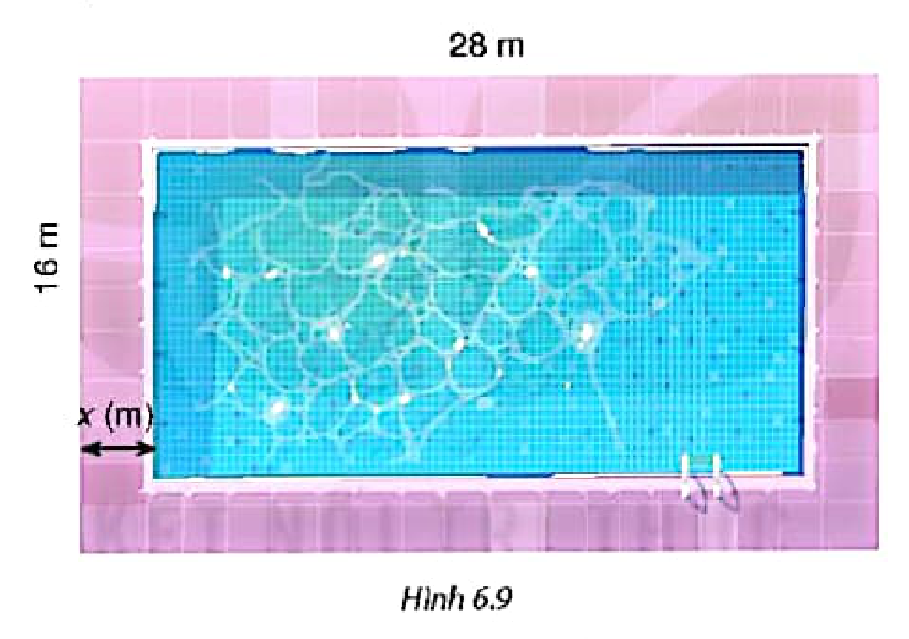
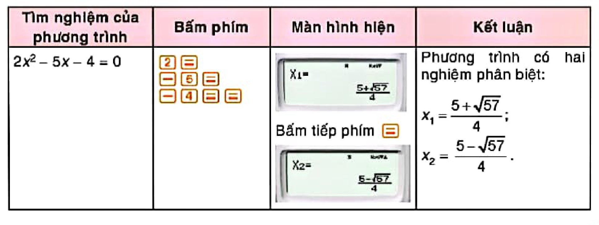
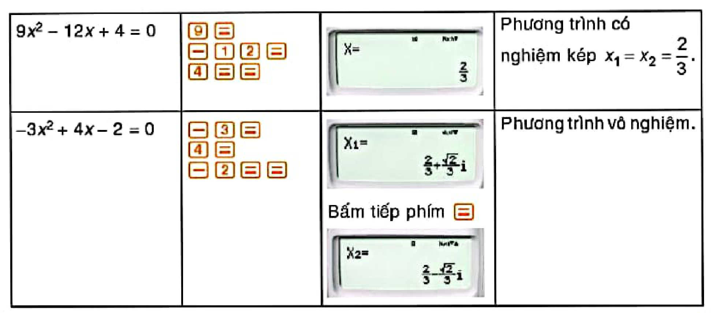
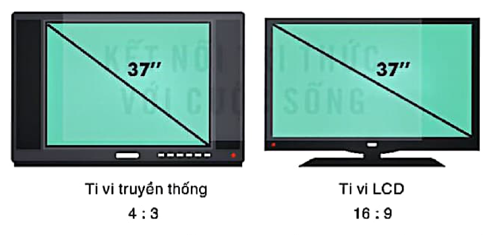

<!-- pdf:12 -->

# BÀI 19: PHƯƠNG TRÌNH BẬC HAI MỘT ẨN

## 🔤 Khái niệm, thuật ngữ

- Phương trình bậc hai một ẩn
- Công thức nghiệm
- Biệt thức
<!-- ocr-ok: đã đối chiếu ảnh trang PDF 12, OCR dính chữ trong hộp Khái niệm, thuật ngữ -->

## 🎯 Kiến thức, kĩ năng

- Nhận biết khái niệm phương trình bậc hai một ẩn.
- Giải phương trình bậc hai một ẩn.
- Tính nghiệm của phương trình bậc hai một ẩn bằng máy tính cầm tay.
- Vận dụng phương trình bậc hai vào giải quyết bài toán thực tiễn.

## 🔴 Mở đầu

Trên một mảnh đất hình chữ nhật có kích thước $28\text{ m} \times 16\text{ m}$, người ta dự định làm một bể bơi có đường đi xung quanh (H.6.9). Hỏi bề rộng của đường đi là bao nhiêu để diện tích của bể bơi là $288\text{ m}^2$?

*Hình 6.9*

## 1. ĐỊNH NGHĨA PHƯƠNG TRÌNH BẬC HAI MỘT ẨN

**Nhận biết phương trình bậc hai một ẩn**

Xét bài toán trong *tình huống mở đầu*.

**HĐ1:** Gọi $x$ ($\text{m}$) là bề rộng của mặt đường ($0 < x < 8$). Tính chiều dài và chiều rộng của bể bơi theo $x$.

**HĐ2:** Dựa vào kết quả HĐ1, tính diện tích của bể bơi theo $x$.

**HĐ3:** Sử dụng giả thiết và kết quả HĐ2, hãy viết phương trình để tìm $x$.

> **Phương trình bậc hai một ẩn** (nói gọn là *phương trình bậc hai*) là phương trình có dạng
> $ax^2 + bx + c = 0,$
> trong đó $x$ là **ẩn**; $a, b, c$ là những số cho trước gọi là **hệ số** và $a \ne 0$.

<!-- pdf:13 -->

**Ví dụ 1:** Trong các phương trình sau, những phương trình nào là phương trình bậc hai ẩn $x$? Chỉ rõ các hệ số $a, b, c$ của mỗi phương trình đó.

a) $2x^2 - 3x + 1 = 0$;

b) $x^2 - 3 = 0$;

c) $\left(\dfrac{1}{x}\right)^2 + 3 \cdot \dfrac{1}{x} + 2 = 0$;

d) $-5x^2 = 0$.

**Giải**

a) Phương trình $2x^2 - 3x + 1 = 0$ là phương trình bậc hai với $a = 2, b = -3, c = 1$.

b) Phương trình $x^2 - 3 = 0$ là phương trình bậc hai với $a = 1, b = 0, c = -3$.

c) Phương trình $\left(\dfrac{1}{x}\right)^2 + 3 \cdot \dfrac{1}{x} + 2 = 0$ không phải là phương trình bậc hai.

d) Phương trình $-5x^2 = 0$ là phương trình bậc hai với $a = -5, b = 0, c = 0$.
<!-- ocr-ok: đã đối chiếu ảnh trang PDF 13, OCR bỏ sót dòng lời giải câu d -->

**Luyện tập 1:** Trong các phương trình sau, những phương trình nào là phương trình bậc hai ẩn $x$? Chỉ rõ các hệ số $a, b, c$ của mỗi phương trình đó.

a) $x^2 + 5 = 0$;

b) $2x^2 + 7x = 0$;

c) $\dfrac{x^2 - 2x + 5}{x} = 0$;

d) $0,5x^2 = 0$.

**Tranh luận**

> **Pi:** Phương trình (ẩn $x$) $mx^2 + 2x + 1 = 0$ ($m$ là một số cho trước) là một phương trình bậc hai với $a = m, b = 2, c = 1$.

Ý kiến của em thế nào?

## 2. CÁCH GIẢI PHƯƠNG TRÌNH BẬC HAI MỘT ẨN CÓ DẠNG ĐẶC BIỆT

**Cách giải phương trình bậc hai một ẩn dạng khuyết**

<!-- term: Giải phương trình bậc hai một ẩn dạng khuyết -->
Giải một phương trình bậc hai là tìm tất cả các nghiệm của nó. Dưới đây, thông qua một số ví dụ đơn giản, ta trình bày cách giải một số phương trình bậc hai dạng $ax^2 + bx + c = 0$ ($a \ne 0$), mà khuyết số hạng bậc nhất (tức là $b = 0$) hoặc khuyết số hạng tự do (tức là $c = 0$), bằng phương pháp đặt nhân tử chung đưa về dạng tích hoặc dùng hằng đẳng thức để đưa vế trái về một bình phương.

> - Nếu $A \cdot B = 0$ thì $A = 0$ hoặc $B = 0$.
> - Nếu $A^2 = B$ ($B \ge 0$) thì $A = \sqrt{B}$ hoặc $A = -\sqrt{B}$.
<!-- ocr-ok: đã đối chiếu ảnh trang PDF 13, hộp tóm tắt công thức chứa nhiều kí hiệu toán học trong LaTeX -->

**Ví dụ 2:** Giải các phương trình sau:

a) $2x^2 - 4x = 0$;

b) $3x^2 + 8x = 0$.

<!-- pdf:14 -->

**Giải**

a) $2x^2 - 4x = 0$

$2x(x - 2) = 0$

$x = 0$ hoặc $x = 2$.

Vậy phương trình có hai nghiệm: $x_1 = 0, x_2 = 2$.

b) $3x^2 + 8x = 0$

$x(3x + 8) = 0$

$x = 0$ hoặc $x = -\dfrac{8}{3}$.

Vậy phương trình có hai nghiệm: $x_1 = 0, x_2 = -\dfrac{8}{3}$.

**Luyện tập 2:** Giải các phương trình sau:
<!-- ocr-ok: đã đối chiếu ảnh trang PDF 14, OCR không nhận diện nhãn Luyện tập 2 nền xanh -->

a) $2x^2 + 6x = 0$;

b) $5x^2 + 11x = 0$.

**Ví dụ 3:** Giải các phương trình sau:

a) $x^2 - 9 = 0$;

b) $(x + 1)^2 = 3$.

**Giải**

a) $x^2 - 9 = 0$

$x^2 = 9$

$x = 3$ hoặc $x = -3$.

Vậy phương trình có hai nghiệm: $x_1 = 3, x_2 = -3$.

b) $(x + 1)^2 = 3$

$x + 1 = \sqrt{3}$ hoặc $x + 1 = -\sqrt{3}$

$x = -1 + \sqrt{3}$ hoặc $x = -1 - \sqrt{3}$.

Vậy phương trình có hai nghiệm: $x_1 = -1 + \sqrt{3}, x_2 = -1 - \sqrt{3}$.

**Luyện tập 3:** Giải các phương trình sau:
<!-- ocr-ok: đã đối chiếu ảnh trang PDF 14, OCR đọc sai nhãn Luyện tập 3 nền xanh -->

a) $x^2 - 25 = 0$;

b) $(x + 3)^2 = 5$.

**Chú ý.** Để giải phương trình bậc hai dạng $x^2 + bx = c$, ta có thể cộng thêm vào hai vế của phương trình với cùng một số thích hợp để vế trái có thể biến đổi thành một bình phương. Từ đó có thể giải phương trình đã cho.

**Ví dụ 4:** Cho phương trình $x^2 - 4x = 1$.
<!-- ocr-ok: đã đối chiếu ảnh trang PDF 14, OCR đọc thiếu nhãn Ví dụ 4 nền xanh -->

a) Hãy cộng vào cả hai vế của phương trình với cùng một số thích hợp để được một phương trình mà vế trái có thể biến đổi thành một bình phương.

b) Dựa vào câu a và cách giải Ví dụ 3b, hãy giải phương trình đã cho.

**Giải**

a) $x^2 - 4x = 1$

$x^2 - 4x + 4 = 1 + 4$

$(x - 2)^2 = 5$.

b) Từ kết quả câu a, ta có:

$x - 2 = \sqrt{5}$ hoặc $x - 2 = -\sqrt{5}$, suy ra là $x = 2 + \sqrt{5}$ hoặc $x = 2 - \sqrt{5}$.
<!-- ocr-ok: đã đối chiếu ảnh trang PDF 14, câu chứa nhiều biểu thức căn thức trong LaTeX -->

Vậy phương trình có hai nghiệm: $x_1 = 2 + \sqrt{5}, x_2 = 2 - \sqrt{5}$.

<!-- pdf:15 -->

**Luyện tập 4:** Cho phương trình $x^2 + 6x = 1$.
<!-- ocr-ok: đã đối chiếu ảnh trang PDF 15, OCR không nhận diện nhãn Luyện tập 4 nền xanh -->

Hãy cộng vào cả hai vế của phương trình với cùng một số thích hợp để được một phương trình mà vế trái có thể biến đổi thành một bình phương. Từ đó, hãy giải phương trình đã cho.

## 3. CÔNG THỨC NGHIỆM CỦA PHƯƠNG TRÌNH BẬC HAI

**Xây dựng công thức nghiệm của phương trình bậc hai**

**HĐ4:** Thực hiện lần lượt các bước sau để giải phương trình:

$2x^2 - 8x + 3 = 0.$

a) Chuyển hạng tử tự do sang vế phải.

b) Chia cả hai vế của phương trình cho hệ số của $x^2$.

c) Thêm vào hai vế của phương trình nhận được ở câu b với cùng một số để vế trái có thể biến đổi thành một bình phương. Từ đó tìm nghiệm $x$.

**Cách giải phương trình bậc hai**

Tương tự HĐ4, để giải phương trình bậc hai $ax^2 + bx + c = 0$ ($a \ne 0$) trong trường hợp tổng quát, ta làm như sau:

- Chuyển hạng tử tự do $c$ sang vế phải: $ax^2 + bx = -c$.
- Chia cả hai vế của phương trình cho hệ số $a$ của $x^2$: $x^2 + \dfrac{b}{a}x = -\dfrac{c}{a}$.
- Cộng vào hai vế của phương trình nhận được với $\dfrac{b^2}{4a^2}$ để vế trái có thể biến đổi thành bình phương của một biểu thức: $x^2 + \dfrac{b}{a}x + \dfrac{b^2}{4a^2} = -\dfrac{c}{a} + \dfrac{b^2}{4a^2}$ hay $\left(x + \dfrac{b}{2a}\right)^2 = \dfrac{b^2 - 4ac}{4a^2}$.

Kí hiệu $\Delta = b^2 - 4ac$ và gọi là **biệt thức** của phương trình ($\Delta$ đọc là “đenta”). Khi đó, ta có thể viết lại phương trình cuối dưới dạng $\left(x + \dfrac{b}{2a}\right)^2 = \dfrac{\Delta}{4a^2}$.

Từ đây, ta có kết quả sau:

<!-- term: Công thức nghiệm của phương trình bậc hai -->
> Xét phương trình bậc hai một ẩn $ax^2 + bx + c = 0$ ($a \ne 0$).
> Tính biệt thức $\Delta = b^2 - 4ac$.
> - Nếu $\Delta > 0$ thì phương trình có hai nghiệm phân biệt:
> $x_1 = \dfrac{-b + \sqrt{\Delta}}{2a}; \quad x_2 = \dfrac{-b - \sqrt{\Delta}}{2a}.$
> - Nếu $\Delta = 0$ thì phương trình có **nghiệm kép** $x_1 = x_2 = -\dfrac{b}{2a}$.
> - Nếu $\Delta < 0$ thì phương trình vô nghiệm.
<!-- ocr-ok: đã đối chiếu ảnh trang PDF 15, khung công thức nghiệm chứa nhiều kí hiệu trong LaTeX -->

<!-- pdf:16 -->

**Ví dụ 5:** Cho phương trình $3x^2 + 7x - 1 = 0$.
<!-- ocr-ok: đã đối chiếu ảnh trang PDF 16, OCR không nhận diện nhãn Ví dụ 5 nền xanh -->

a) Xác định các hệ số $a, b, c$.

b) Tính biệt thức $\Delta$.

c) Áp dụng công thức nghiệm, giải phương trình đã cho.

**Giải**

a) Ta có: $a = 3, b = 7, c = -1$.

b) Ta có: $\Delta = b^2 - 4ac = 7^2 - 4 \cdot 3 \cdot (-1) = 49 + 12 = 61$.

c) Do $\Delta > 0$, áp dụng công thức nghiệm, phương trình có hai nghiệm phân biệt:

$x_1 = \dfrac{-7 + \sqrt{61}}{6}, \quad x_2 = \dfrac{-7 - \sqrt{61}}{6}.$

**Ví dụ 6:** Giải các phương trình sau:
<!-- ocr-ok: đã đối chiếu ảnh trang PDF 16, OCR không nhận diện nhãn Ví dụ 6 nền xanh -->

a) $x^2 - 6x + 9 = 0$;

b) $2x^2 + 3x + 5 = 0$.

**Giải**

a) Ta có: $\Delta = (-6)^2 - 4 \cdot 1 \cdot 9 = 0$. Do đó, phương trình có nghiệm kép:

$x_1 = x_2 = -\dfrac{b}{2a} = -\dfrac{-6}{2} = 3.$

b) Ta có: $\Delta = 3^2 - 4 \cdot 2 \cdot 5 = 9 - 40 = -31 < 0$. Do đó, phương trình vô nghiệm.

**Luyện tập 5:** Áp dụng công thức nghiệm, giải các phương trình sau:
<!-- ocr-ok: đã đối chiếu ảnh trang PDF 16, OCR không nhận diện nhãn Luyện tập 5 nền xanh -->

a) $2x^2 - 5x + 1 = 0$;

b) $x^2 + 8x + 16 = 0$;

c) $x^2 - x + 1 = 0$.

**Thử thách nhỏ**

> **Pi:** Có thể nói gì về nghiệm của phương trình bậc hai $ax^2 + bx + c = 0$ nếu $a$ và $c$ trái dấu?
<!-- ocr-ok: đã đối chiếu ảnh trang PDF 16, hộp bóng thoại của nhân vật Pi -->

Em hãy trả lời câu hỏi của anh Pi.

**Chú ý.** Xét phương trình bậc hai $ax^2 + bx + c = 0$ ($a \ne 0$), với $b = 2b'$ và $\Delta' = b'^2 - ac$.
- Nếu $\Delta' > 0$ thì phương trình có hai nghiệm phân biệt:
$x_1 = \dfrac{-b' + \sqrt{\Delta'}}{a}; \quad x_2 = \dfrac{-b' - \sqrt{\Delta'}}{a}.$
- Nếu $\Delta' = 0$ thì phương trình có nghiệm kép $x_1 = x_2 = -\dfrac{b'}{a}$.
- Nếu $\Delta' < 0$ thì phương trình vô nghiệm.
Các công thức ở trên gọi là **công thức nghiệm thu gọn**.
<!-- ocr-ok: đã đối chiếu ảnh trang PDF 16, mục Chú ý chứa công thức nghiệm thu gọn trong LaTeX -->

<!-- pdf:17 -->

**Ví dụ 7:** Xác định $a, b', c$ rồi dùng công thức nghiệm thu gọn giải các phương trình sau:

a) $2x^2 + 6x + 1 = 0$;

b) $x^2 - 4\sqrt{3}x + 12 = 0$.

**Giải**

a) Ta có: $a = 2, b' = 3, c = 1$ và $\Delta' = 3^2 - 2 \cdot 1 = 7 > 0$. Do đó, phương trình có hai nghiệm phân biệt: $x_1 = \dfrac{-3 + \sqrt{7}}{2}; x_2 = \dfrac{-3 - \sqrt{7}}{2}$.

b) Ta có: $a = 1, b' = -2\sqrt{3}, c = 12$ và $\Delta' = \left(-2\sqrt{3}\right)^2 - 1 \cdot 12 = 0$. Do đó, phương trình có nghiệm kép: $x_1 = x_2 = 2\sqrt{3}$.

**Luyện tập 6:** Xác định $a, b', c$ rồi dùng công thức nghiệm thu gọn giải các phương trình sau:

a) $3x^2 + 8x - 3 = 0$;

b) $x^2 + 6\sqrt{2}x + 2 = 0$.

**Vận dụng:** Giải bài toán trong *tình huống mở đầu*.

## 4. TÌM NGHIỆM CỦA PHƯƠNG TRÌNH BẬC HAI BẰNG MÁY TÍNH CẦM TAY

Sử dụng máy tính cầm tay, ta có thể dễ dàng tìm nghiệm của các phương trình bậc hai một ẩn.

**Ví dụ 8:** Sử dụng máy tính cầm tay, tìm nghiệm của các phương trình sau:

a) $2x^2 - 5x - 4 = 0$;

b) $9x^2 - 12x + 4 = 0$;

c) $-3x^2 + 4x - 2 = 0$.

**Giải.** Với một loại máy tính cầm tay, sau khi mở máy ta bấm phím `MODE` `5` `3` để chuyển về chế độ giải phương trình bậc hai.

Tiếp theo, với từng phương trình ta thực hiện như sau:

| Tìm nghiệm của phương trình | Bấm phím | Màn hình hiện | Kết luận |
| --- | --- | --- | --- |
| $2x^2 - 5x - 4 = 0$ | `2` `=` `-` `5` `=` `-` `4` `=` `=` | $X_1 = \dfrac{5 + \sqrt{57}}{4}$; bấm tiếp phím `=` hiện $X_2 = \dfrac{5 - \sqrt{57}}{4}$ | Phương trình có hai nghiệm phân biệt: $x_1 = \dfrac{5 + \sqrt{57}}{4}$; $x_2 = \dfrac{5 - \sqrt{57}}{4}$. |

<!-- pdf:18 -->

| Tìm nghiệm của phương trình | Bấm phím | Màn hình hiện | Kết luận |
| --- | --- | --- | --- |
| $9x^2 - 12x + 4 = 0$ | `9` `=` `-` `1` `2` `=` `4` `=` `=` | $X = \dfrac{2}{3}$ | Phương trình có nghiệm kép $x_1 = x_2 = \dfrac{2}{3}$. |
| $-3x^2 + 4x - 2 = 0$ | `-` `3` `=` `4` `=` `-` `2` `=` `=` | $X_1 = \dfrac{2}{3} + \dfrac{\sqrt{2}}{3}i$; bấm tiếp phím `=` hiện $X_2 = \dfrac{2}{3} - \dfrac{\sqrt{2}}{3}i$ | Phương trình vô nghiệm. |
<!-- ocr-ok: đã đối chiếu ảnh trang PDF 18, bảng thao tác bấm phím và màn hình máy tính cầm tay -->

**Chú ý.** Để hiển thị kết quả xấp xỉ ở dạng số thập phân sau khi nhận kết quả ta bấm phím `S⇔D`.

**Luyện tập 7:** Sử dụng máy tính cầm tay, tìm nghiệm của các phương trình sau:

a) $5x^2 + 2\sqrt{10}x + 2 = 0$;

b) $3x^2 - 5x + 7 = 0$;

c) $4x^2 - 4x + 1 = 0$.

## BÀI TẬP

6.8. Đưa các phương trình sau về dạng $ax^2 + bx + c = 0$ và xác định các hệ số $a, b, c$ của phương trình đó.

a) $3x^2 + 2x - 1 = x^2 - x$;

b) $(2x + 1)^2 = x^2 + 1$.

6.9. Giải các phương trình sau:

a) $2x^2 + \dfrac{1}{3}x = 0$;

b) $(3x + 2)^2 = 5$.

6.10. Không cần giải phương trình, hãy xác định các hệ số $a, b, c$, tính biệt thức $\Delta$ và xác định số nghiệm của mỗi phương trình sau:

a) $11x^2 + 13x - 1 = 0$;

b) $9x^2 + 42x + 49 = 0$;

c) $x^2 - 2x + 3 = 0$.

<!-- pdf:19 -->

6.11. Dùng công thức nghiệm của phương trình bậc hai, giải các phương trình sau:

a) $x^2 - 2\sqrt{5} + 2 = 0$;

b) $4x^2 + 28x + 49 = 0$;

c) $3x^2 - 3\sqrt{2}x + 1 = 0$.

6.12. Sử dụng máy tính cầm tay, tìm nghiệm của các phương trình sau:

a) $0,1x^2 + 2,5x - 0,2 = 0$;

b) $0,01x^2 - 0,05x + 0,0625 = 0$;

c) $1,2x^2 + 0,75x + 2,5 = 0$;

6.13. Độ cao $h$ (mét) so với mặt đất của một vật được phóng thẳng đứng lên trên từ mặt đất với vận tốc ban đầu $v_0 = 19,6\text{ m/s}$ cho bởi công thức $h = 19,6t - 4,9t^2$, ở đó $t$ là thời gian kể từ khi phóng (giây) (theo *Vật lí đại cương, NXB Giáo dục Việt Nam, 2016*). Hỏi sau bao lâu kể từ khi phóng, vật sẽ rơi trở lại mặt đất?

6.14. Kích thước màn hình ti vi hình chữ nhật được xác định bằng độ dài đường chéo. Ti vi truyền thống có định dạng $4 : 3$, nghĩa là tỉ lệ giữa chiều dài và chiều rộng của màn hình là $4 : 3$. Hỏi diện tích của màn hình ti vi truyền thống $37\text{ in}$ là bao nhiêu? Diện tích của màn hình ti vi LCD $37\text{ in}$ có định dạng $16 : 9$ là bao nhiêu? Màn hình ti vi nào có diện tích lớn hơn? Ở đây, các diện tích của màn hình được tính bằng inch vuông.

6.15. Một mảnh vườn hình chữ nhật có chiều rộng ngắn hơn chiều dài $6\text{ m}$ và có diện tích là $140\text{ m}^2$. Tính các kích thước của mảnh vườn đó.

## 📷 Danh sách hình trong bài

| Mã hình | Trang PDF | Vị trí trong bài | Chú thích gốc |
| --- | :---: | --- | --- |
| H9-toan-b19-01 | 12 | Mở đầu | Hình 6.9 |
| H9-toan-b19-02 | 17 | Mục 4, Ví dụ 8 | (bảng thao tác bấm phím và màn hình máy tính cầm tay cho phương trình $2x^2 - 5x - 4 = 0$) |
| H9-toan-b19-03 | 18 | Mục 4, Ví dụ 8 | (bảng thao tác bấm phím và màn hình máy tính cầm tay cho các phương trình $9x^2 - 12x + 4 = 0$ và $-3x^2 + 4x - 2 = 0$) |
| H9-toan-b19-04 | 19 | Bài tập 6.14 | Ti vi truyền thống 4 : 3; Ti vi LCD 16 : 9 |
