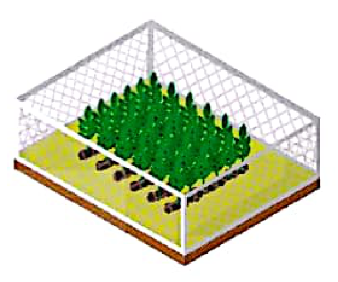

<!-- pdf:23 -->

# BÀI 20: ĐỊNH LÍ VIÈTE VÀ ỨNG DỤNG

## 🔤 Khái niệm, thuật ngữ

- Định lí Viète

## 🎯 Kiến thức, kĩ năng

- Giải thích định lí Viète.
- Vận dụng định lí Viète để tính nhẩm nghiệm của phương trình bậc hai, tìm hai số khi biết tổng và tích của chúng.

## 🔴 Mở đầu

Bác An có $40\text{ m}$ hàng rào lưới thép. Bác muốn dùng nó để rào xung quanh một mảnh đất trống (đủ rộng) thành một mảnh vườn hình chữ nhật có diện tích $96\text{ m}^2$ để trồng rau. Tính chiều dài và chiều rộng của mảnh vườn đó.

## 1. ĐỊNH LÍ VIÈTE

**Khám phá định lí Viète**

Xét phương trình bậc hai $ax^2 + bx + c = 0$ ($a \ne 0$). Giả sử $\Delta = b^2 - 4ac \ge 0$.

**HĐ1:** Nhắc lại công thức tính hai nghiệm $x_1, x_2$ của phương trình trên.

**HĐ2:** Từ kết quả HĐ1, hãy tính $x_1 + x_2$ và $x_1 x_2$.

Từ kết quả HĐ2, ta có **định lí Viète** như sau:
> Nếu $x_1, x_2$ là hai nghiệm của phương trình $ax^2 + bx + c = 0$ ($a \ne 0$) thì
> $\begin{cases} x_1 + x_2 = -\dfrac{b}{a} \\ x_1 x_2 = \dfrac{c}{a}. \end{cases}$
<!-- ocr-ok: đã đối chiếu ảnh trang PDF 23, khung định lí Viète chứa hệ thức trong LaTeX -->

**Ví dụ 1:** Không giải phương trình, hãy tính biệt thức $\Delta$ (hoặc $\Delta'$) để kiểm tra điều kiện có nghiệm, rồi tính tổng và tích các nghiệm của các phương trình bậc hai sau:

a) $2x^2 + 11x + 7 = 0$;

b) $4x^2 - 12x + 9 = 0$.

**Giải**

a) Ta có: $\Delta = 11^2 - 4 \cdot 2 \cdot 7 = 65 > 0$ nên phương trình có hai nghiệm phân biệt $x_1, x_2$. Theo định lí Viète, ta có:

$x_1 + x_2 = -\dfrac{11}{2}; \quad x_1 x_2 = \dfrac{7}{2}.$

<!-- pdf:24 -->

b) Ta có: $\Delta' = 6^2 - 4 \cdot 9 = 0$ nên phương trình có hai nghiệm trùng nhau $x_1, x_2$.

Theo định lí Viète, ta có:

$x_1 + x_2 = -\dfrac{-12}{4} = 3; \quad x_1 x_2 = \dfrac{9}{4}.$

**Luyện tập 1:** Không giải phương trình, hãy tính biệt thức $\Delta$ (hoặc $\Delta'$) để kiểm tra điều kiện có nghiệm, rồi tính tổng và tích các nghiệm của các phương trình bậc hai sau:

a) $2x^2 - 7x + 3 = 0$;

b) $25x^2 - 20x + 4 = 0$;

c) $2\sqrt{2}x^2 - 4 = 0$.

**Tranh luận**

> **Tròn:** Không cần giải, tớ biết ngay tổng và tích hai nghiệm của phương trình $x^2 - x + 1 = 0$ đều bằng $1$.

Ý kiến của em thế nào?

## 2. ÁP DỤNG ĐỊNH LÍ VIÈTE ĐỂ TÍNH NHẨM NGHIỆM

**Giải phương trình bậc hai khi biết một nghiệm của nó**

**HĐ3:** Cho phương trình $2x^2 - 7x + 5 = 0$.

a) Xác định các hệ số $a, b, c$ rồi tính $a + b + c$.

b) Chứng tỏ rằng $x_1 = 1$ là một nghiệm của phương trình.

c) Dùng định lí Viète để tìm nghiệm còn lại $x_2$ của phương trình.

**HĐ4:** Cho phương trình $3x^2 + 5x + 2 = 0$.

a) Xác định các hệ số $a, b, c$ rồi tính $a - b + c$.

b) Chứng tỏ rằng $x_1 = -1$ là một nghiệm của phương trình.

c) Dùng định lí Viète để tìm nghiệm còn lại $x_2$ của phương trình.

<!-- term: Tính nhẩm nghiệm của phương trình bậc hai -->
> Xét phương trình $ax^2 + bx + c = 0$ ($a \ne 0$).
> - Nếu $a + b + c = 0$ thì phương trình có một nghiệm là $x_1 = 1$, còn nghiệm kia là $x_2 = \dfrac{c}{a}$.
> - Nếu $a - b + c = 0$ thì phương trình có một nghiệm là $x_1 = -1$, còn nghiệm kia là $x_2 = -\dfrac{c}{a}$.

<!-- pdf:25 -->

**Ví dụ 2:** Bằng cách nhẩm nghiệm, hãy giải các phương trình sau:

a) $x^2 - 6x + 5 = 0$;

b) $5x^2 + 14x + 9 = 0$.

**Giải**

a) Ta có: $a + b + c = 1 + (-6) + 5 = 0$ nên phương trình có hai nghiệm: $x_1 = 1, x_2 = 5$.

b) Ta có: $a - b + c = 5 - 14 + 9 = 0$ nên phương trình có hai nghiệm: $x_1 = -1, x_2 = -\dfrac{9}{5}$.

**Ví dụ 3:** Giải phương trình $x^2 - 7x + 12 = 0$, biết phương trình có một nghiệm là $x_1 = 3$.

**Giải**

Gọi $x_2$ là nghiệm còn lại của phương trình. Theo định lí Viète, ta có: $x_1 x_2 = 12$.

Do đó, $x_2 = \dfrac{12}{x_1} = \dfrac{12}{3} = 4$.

Vậy phương trình có hai nghiệm: $x_1 = 3, x_2 = 4$.

**Luyện tập 2:** Tính nhẩm nghiệm của các phương trình sau:

a) $3x^2 - 11x + 8 = 0$;

b) $4x^2 + 15x + 11 = 0$;

c) $x^2 + 2\sqrt{2}x + 2 = 0$, biết phương trình có một nghiệm là $x = -\sqrt{2}$.

**Thử thách nhỏ**

> - **Vuông:** Hãy tìm một phương trình bậc hai mà tổng và tích các nghiệm của phương trình là hai số đối nhau.
> - **Tròn:** Tớ tìm ra rồi! Đó là phương trình $x^2 + x + 1 = 0$.

Em có đồng ý với ý kiến của Tròn không? Vì sao?

## 3. TÌM HAI SỐ KHI BIẾT TỔNG VÀ TÍCH CỦA CHÚNG

**Thiết lập phương trình bậc hai để tìm hai số khi biết tổng và tích của chúng**

**HĐ5:** Giả sử hai số có tổng $S = 5$ và tích $P = 6$. Thực hiện các bước sau để lập phương trình bậc hai nhận hai số đó làm nghiệm.

a) Gọi một số là $x$. Tính số kia theo $x$.

b) Sử dụng kết quả câu a và giả thiết, hãy lập phương trình để tìm $x$.

<!-- term: Tìm hai số khi biết tổng và tích của chúng -->
> Nếu hai số có tổng bằng $S$ và tích bằng $P$ thì hai số đó là hai nghiệm của phương trình bậc hai:
> $x^2 - Sx + P = 0.$
> Điều kiện để có hai số đó là $S^2 - 4P \ge 0$.

<!-- pdf:26 -->

**Ví dụ 4:** Tìm hai số biết tổng của chúng bằng $9$, tích của chúng bằng $20$.

**Giải**

Hai số cần tìm là hai nghiệm của phương trình $x^2 - 9x + 20 = 0$.

Ta có: $\Delta = (-9)^2 - 4 \cdot 1 \cdot 20 = 1; \sqrt{\Delta} = 1$.

Suy ra phương trình có hai nghiệm: $x_1 = \dfrac{9 - 1}{2} = 4; x_2 = \dfrac{9 + 1}{2} = 5$.

Vậy hai số cần tìm là $4$ và $5$.

**Luyện tập 3:** Tìm hai số biết tổng của chúng bằng $-11$, tích của chúng bằng $28$.

**Vận dụng:** Giải bài toán trong *tình huống mở đầu*.

## BÀI TẬP

6.23. Không giải phương trình, hãy tính tổng và tích các nghiệm (nếu có) của các phương trình sau:

a) $x^2 - 12x + 8 = 0$;

b) $2x^2 + 11x - 5 = 0$;

c) $3x^2 - 10 = 0$;

d) $x^2 - x + 3 = 0$.

6.24. Tính nhẩm nghiệm của các phương trình sau:

a) $2x^2 - 9x + 7 = 0$;

b) $3x^2 + 11x + 8 = 0$;

c) $7x^2 - 15x + 2 = 0$, biết phương trình có một nghiệm $x_1 = 2$.

6.25. Tìm hai số $u$ và $v$, biết:

a) $u + v = 20, uv = 99$;

b) $u + v = 2, uv = 15$.

6.26. Chứng tỏ rằng nếu phương trình bậc hai $ax^2 + bx + c = 0$ có hai nghiệm là $x_1$ và $x_2$ thì đa thức $ax^2 + bx + c$ phân tích được thành nhân tử như sau:

$ax^2 + bx + c = a(x - x_1)(x - x_2).$

*Áp dụng:* Phân tích các đa thức sau thành nhân tử:

a) $x^2 + 11x + 18$;

b) $3x^2 + 5x - 2$.

6.27. Một bể bơi hình chữ nhật có diện tích $500\text{ m}^2$ và chu vi là $150\text{ m}$. Tính các kích thước của bể bơi này.

## 📷 Danh sách hình trong bài

| Mã hình | Trang PDF | Vị trí trong bài | Chú thích gốc |
| --- | :---: | --- | --- |
| H9-toan-b20-01 | 23 | Mở đầu | (sách không đánh số, hình minh hoạ mảnh vườn hình chữ nhật rào lưới thép) |
