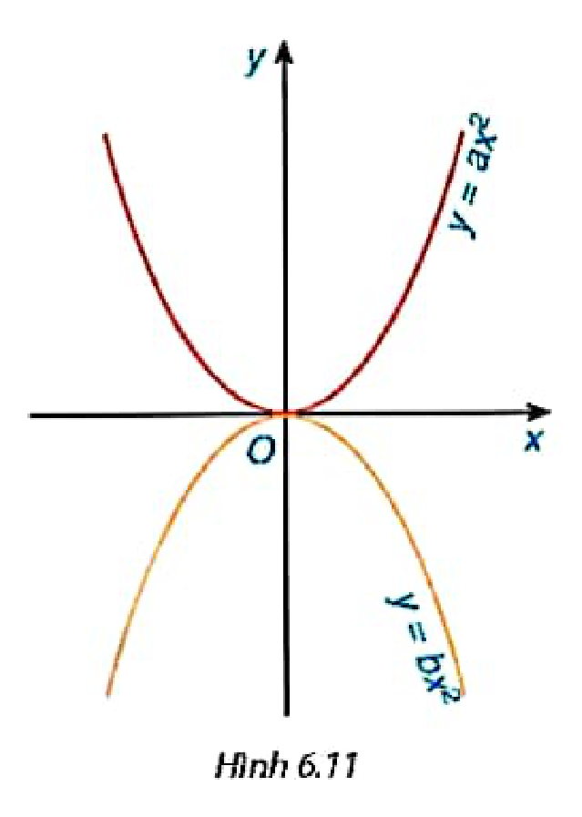

<!-- pdf:32 -->

# BÀI TẬP CUỐI CHƯƠNG VI

## ✏️ A. TRẮC NGHIỆM

6.39. Điểm nào sau đây thuộc đồ thị của hàm số $y = \dfrac{1}{2}x^2$?

A. $(1; 2)$.

B. $(2; 1)$.

C. $(-1; 2)$.

D. $\left(-1; \dfrac{1}{2}\right)$.

6.40. Hình 6.11 là hai đường parabol trong mặt phẳng toạ độ $Oxy$. Khẳng định nào sau đây là đúng?

*Hình 6.11*

A. $a < 0 < b$.

B. $a < b < 0$.

C. $a > b > 0$.

D. $a > 0 > b$.

6.41. Các nghiệm của phương trình $x^2 + 7x + 12 = 0$ là

A. $x_1 = 3; x_2 = 4$.

B. $x_1 = -3; x_2 = -4$.

C. $x_1 = 3; x_2 = -4$.

D. $x_1 = -3; x_2 = 4$.

6.42. Phương trình bậc hai có hai nghiệm $x_1 = 13$ và $x_2 = 25$ là

A. $x^2 - 13x + 25 = 0$.

B. $x^2 - 25x + 13 = 0$.

C. $x^2 - 38x + 325 = 0$.

D. $x^2 + 38x + 325 = 0$.

6.43. Gọi $x_1, x_2$ là hai nghiệm của phương trình $x^2 - 5x + 6 = 0$. Khi đó, giá trị của biểu thức $A = x_1^2 + x_2^2$ là

A. $13$.

B. $19$.

C. $25$.

D. $5$.

6.44. Chiều dài và chiều rộng của hình chữ nhật có chu vi $20\text{ cm}$ và diện tích $24\text{ cm}^2$ là

A. $5\text{ cm}$ và $4\text{ cm}$.

B. $6\text{ cm}$ và $4\text{ cm}$.

C. $8\text{ cm}$ và $3\text{ cm}$.

D. $10\text{ cm}$ và $2\text{ cm}$.

## ✏️ B. TỰ LUẬN

6.45. Vẽ đồ thị của các hàm số $y = \dfrac{5}{2}x^2$ và $y = -\dfrac{5}{2}x^2$ trên cùng một mặt phẳng toạ độ.

6.46. Cho hàm số $y = ax^2$. Xác định hệ số $a$, biết đồ thị hàm số đi qua điểm $A(3; 3)$. Vẽ đồ thị của hàm số trong trường hợp đó.

6.47. Giải các phương trình sau:

a) $5x^2 - 6\sqrt{5}x + 2 = 0$;

b) $2x^2 + 2\sqrt{6}x + 3 = 0$.

<!-- pdf:33 -->

6.48. Cho phương trình $x^2 - 11x + 30 = 0$. Gọi $x_1, x_2$ là hai nghiệm của phương trình. Không giải phương trình, hãy tính:

a) $x_1^2 + x_2^2$;

b) $x_1^3 + x_2^3$.

6.49. Tìm hai số $u$ và $v$, biết:

a) $u + v = 13$ và $uv = 40$;

b) $u - v = 4$ và $uv = 77$.

6.50. Các kĩ sư đảm bảo an toàn của đường cao tốc thường sử dụng công thức $d = 0,05v^2 + 1,1v$ để ước tính khoảng cách an toàn tối thiểu $d$ (feet) (tức là độ dài quãng đường mà xe đi được kể từ khi đạp phanh đến khi xe dừng lại) đối với một phương tiện di chuyển với tốc độ $v$ (dặm/giờ) (theo *Algebra 2, NXB MacGraw-Hill, 2008*). Giả sử giới hạn tốc độ trên một đường cao tốc nào đó là $70$ dặm/giờ. Nếu một ô tô có thể dừng lại sau $300$ feet kể từ khi đạp phanh thì ô tô đó có chạy nhanh hơn giới hạn tốc độ của đường cao tốc này không?

6.51. Bác Hương gửi tiết kiệm ngân hàng $100$ triệu đồng với kì hạn $12$ tháng. Sau một năm, do chưa có nhu cầu sử dụng nên bác chưa rút sổ tiết kiệm này ra mà gửi tiếp và gửi thêm một sổ tiết kiệm mới với số tiền $50$ triệu đồng, cũng với kì hạn $12$ tháng. Sau hai năm (kể từ khi gửi lần đầu), bác Hương nhận được số tiền cả vốn lẫn lãi là $176$ triệu đồng. Tính lãi suất năm của hình thức gửi tiết kiệm này (giả sử lãi suất không đổi trong suốt quá trình gửi).

6.52. Hai khối học sinh lớp $8$ và lớp $9$ của một trường trung học cơ sở tham gia lao động. Nếu làm chung thì sẽ hoàn thành công việc sau $1$ giờ $12$ phút. Nếu mỗi khối lớp làm riêng thì khối lớp $9$ làm xong nhanh hơn khối lớp $8$ là $1$ giờ. Hỏi nếu mỗi khối lớp làm riêng thì sau bao lâu sẽ hoàn thành công việc?

## 📷 Danh sách hình trong bài

| Mã hình | Trang PDF | Vị trí trong bài | Chú thích gốc |
| --- | :---: | --- | --- |
| H9-toan-bt-c06-01 | 32 | Bài tập 6.40 | Hình 6.11 |
