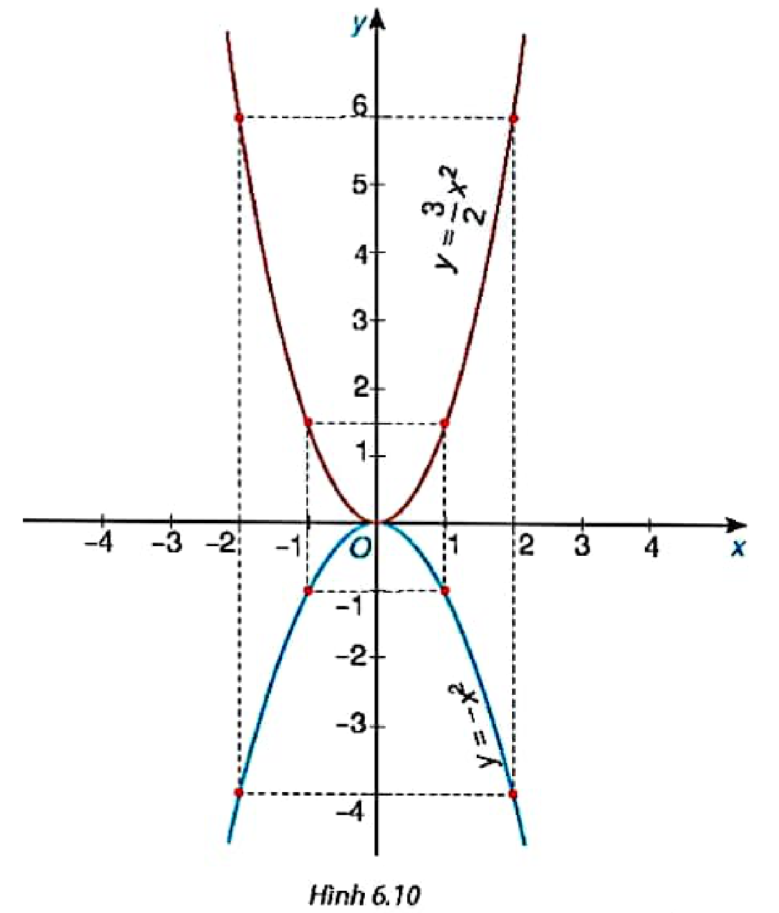

<!-- pdf:20 -->

# LUYỆN TẬP CHUNG (TRANG 18)

**Ví dụ 1:** Cho hai hàm số: $y = \dfrac{3}{2}x^2$ và $y = -x^2$.
<!-- ocr-ok: đã đối chiếu ảnh trang PDF 20, OCR bỏ sót nhãn Ví dụ 1 nền xanh -->

a) Vẽ đồ thị của hai hàm số này trên cùng một mặt phẳng toạ độ.

b) Tìm điểm $A$ thuộc đồ thị $y = \dfrac{3}{2}x^2$, điểm $B$ thuộc đồ thị $y = -x^2$, biết rằng $A$ và $B$ đều có hoành độ $x = -\dfrac{3}{2}$.

**Giải**

a) Lập bảng một số giá trị tương ứng giữa $x$ và $y$ của hai hàm số đã cho:

| $x$ | $-2$ | $-1$ | $0$ | $1$ | $2$ |
| :---: | :---: | :---: | :---: | :---: | :---: |
| $y = \dfrac{3}{2}x^2$ | $6$ | $\dfrac{3}{2}$ | $0$ | $\dfrac{3}{2}$ | $6$ |

| $x$ | $-2$ | $-1$ | $0$ | $1$ | $2$ |
| :---: | :---: | :---: | :---: | :---: | :---: |
| $y = -x^2$ | $-4$ | $-1$ | $0$ | $-1$ | $-4$ |

Từ đó vẽ được đồ thị của hai hàm số này như Hình 6.10:

*Hình 6.10*

b) Với $x = -\dfrac{3}{2}$, thay vào công thức $y = \dfrac{3}{2}x^2$ ta có: $y = \dfrac{3}{2} \cdot \left(\dfrac{-3}{2}\right)^2 = \dfrac{27}{8}$. Vậy $A\left(-\dfrac{3}{2}; \dfrac{27}{8}\right)$.
<!-- ocr-ok: đã đối chiếu ảnh trang PDF 20, câu chứa nhiều phân số và toạ độ trong LaTeX -->

Với $x = -\dfrac{3}{2}$, thay vào công thức $y = -x^2$ ta có: $y = -\left(-\dfrac{3}{2}\right)^2 = -\dfrac{9}{4}$. Vậy $B\left(-\dfrac{3}{2}; -\dfrac{9}{4}\right)$.
<!-- ocr-ok: đã đối chiếu ảnh trang PDF 20, câu chứa nhiều phân số và toạ độ trong LaTeX -->

<!-- pdf:21 -->

**Ví dụ 2:** Giả sử số lượng cá trong một hồ nào đó tăng, giảm theo công thức:

$P = 50(100 + 15t - t^2), \quad 0 \le t \le 15.$

Ở đây $P$ là số lượng cá trong hồ sau $t$ năm tính từ ngày $01$ tháng $01$ năm $2020$, khi lần đầu tiên số lượng cá trong hồ được ước tính. Hỏi theo mô hình này, thì:

a) Vào thời điểm nào, số lượng cá trong hồ sẽ là $7\ 500$ con?

b) Vào thời điểm nào, số lượng cá trong hồ sẽ trở lại như tại thời điểm ban đầu vào ngày $01$ tháng $01$ năm $2020$?

**Giải**

a) Ta cần tìm $t$ sao cho:

$P = 7\ 500$, tức là $50(100 + 15t - t^2) = 7\ 500$, hay $t^2 - 15t + 50 = 0.$

Giải phương trình bậc hai này ta được hai nghiệm là $t = 5$ hoặc $t = 10$. Cả hai nghiệm này đều thích hợp.

Giá trị $t = 5$ ứng với thời điểm vào ngày 01-01-2025.

Giá trị $t = 10$ ứng với thời điểm vào ngày 01-01-2030.

Vậy theo mô hình đã cho, có hai thời điểm mà số cá trong hồ là $7\ 500$ con, đó là vào ngày 01-01-2025 hoặc vào ngày 01-01-2030.

b) Số lượng cá trong hồ tại thời điểm ban đầu (ngày 01-01-2020) là:

$P(0) = 50 \cdot 100 = 5\ 000$ (con).

Ta cần tìm $t$ sao cho: $P = 5\ 000$, hay $15t - t^2 = 0$, tức là $t = 0$ hoặc $t = 15$.
<!-- ocr-ok: đã đối chiếu ảnh trang PDF 21, câu chứa nhiều biểu thức toán học trong LaTeX -->

Giá trị $t = 0$ ứng với thời điểm ban đầu, tức là ngày 01-01-2020.

Giá trị $t = 15$ ứng với thời điểm ngày 01-01-2035.

Vậy theo mô hình đã cho, thì vào ngày 01-01-2035, số lượng cá sẽ trở lại như tại thời điểm ban đầu.

## BÀI TẬP

6.16. Biết rằng parabol $y = ax^2$ ($a \ne 0$) đi qua điểm $A\left(2; 4\sqrt{3}\right)$.

a) Tìm hệ số $a$ và vẽ đồ thị của hàm số $y = ax^2$ với $a$ vừa tìm được.

b) Tìm tung độ của điểm thuộc parabol có hoành độ $x = -1$.

c) Tìm các điểm thuộc parabol có tung độ $y = 5\sqrt{3}$.

<!-- pdf:22 -->

6.17. Công thức $E = \dfrac{1}{2}mv^2$ ($\text{J}$) được dùng để tính động năng của một vật có khối lượng $m$ ($\text{kg}$) khi chuyển động với vận tốc $v$ ($\text{m/s}$) (theo *Vật lí đại cương, NXB Giáo dục Việt Nam, 2016*).

a) Giả sử một quả bóng có khối lượng $2\text{ kg}$ đang bay với vận tốc $6\text{ m/s}$. Tính động năng của quả bóng đó.

b) Giả sử động năng của quả bóng đang bay có khối lượng $1,5\text{ kg}$ là $48\text{ J}$, hãy tính vận tốc bay của quả bóng đó.

6.18. Chiều dài $l$ (mét) của một con lắc đơn tỉ lệ thuận với bình phương chu kì $T$ (giây) của nó (chu kì là thời gian để thực hiện một dao động). Con lắc đơn có chiều dài $223,4\text{ cm}$ thì có chu kì $3$ giây.

a) Tìm công thức liên hệ giữa $l$ và $T$.

b) Tìm chiều dài của con lắc có chu kì $5$ giây.

c) Chu kì của con lắc có chiều dài $0,98\text{ m}$ là bao nhiêu?

(Trong tất cả các câu trên, kết quả được tính chính xác đến hàng phần mười).

6.19. Sử dụng công thức nghiệm hoặc công thức nghiệm thu gọn, giải các phương trình sau:

a) $x^2 - 2\sqrt{5}x + 1 = 0$;

b) $3x^2 - 9x + 3 = 0$;

c) $11x^2 - 13x + 5 = 0$;

d) $2x^2 + 2\sqrt{6}x + 3 = 0$.

6.20. Sử dụng máy tính cầm tay, tìm nghiệm gần đúng của các phương trình sau (làm tròn kết quả đến chữ số thập phân thứ hai):

a) $\sqrt{2}x^2 - \sqrt{5}x + 1 = 0$;

b) $x^2 - \left(\sqrt{3} - 1\right)x + \sqrt{7} = 0$.

6.21. Từ một tấm tôn hình vuông, người ta cắt bỏ bốn hình vuông có độ dài cạnh $8\text{ cm}$ ở bốn góc, sau đó gập thành một chiếc thùng có dạng hình hộp chữ nhật không có nắp và có thể tích là $200\text{ cm}^3$. Tính độ dài cạnh của tấm tôn hình vuông ban đầu.

6.22. Giả sử doanh thu (nghìn đồng) của một cửa hàng bán phở trong một ngày có thể mô hình hoá bằng công thức $R(x) = x(220 - 4x)$ với $30 \le x \le 50$, trong đó $x$ (nghìn đồng) là giá tiền của một bát phở. Nếu muốn doanh thu của cửa hàng đạt $3$ triệu đồng thì giá bán của mỗi bát phở phải là bao nhiêu?

## 📷 Danh sách hình trong bài

| Mã hình | Trang PDF | Vị trí trong bài | Chú thích gốc |
| --- | :---: | --- | --- |
| H9-toan-ltc-c06-01-01 | 20 | Ví dụ 1 | Hình 6.10 |
