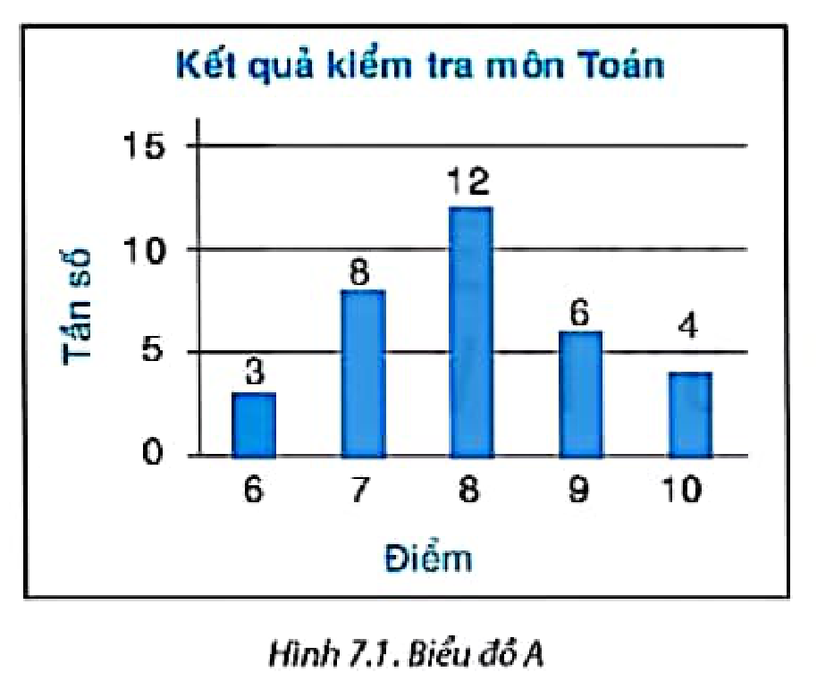
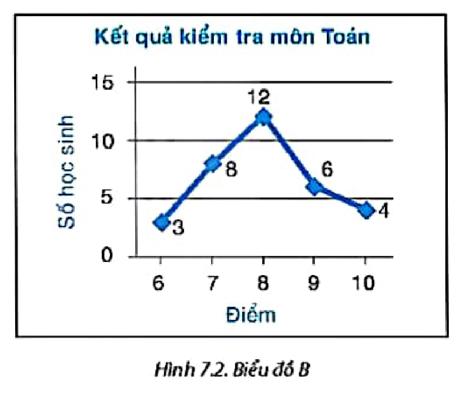
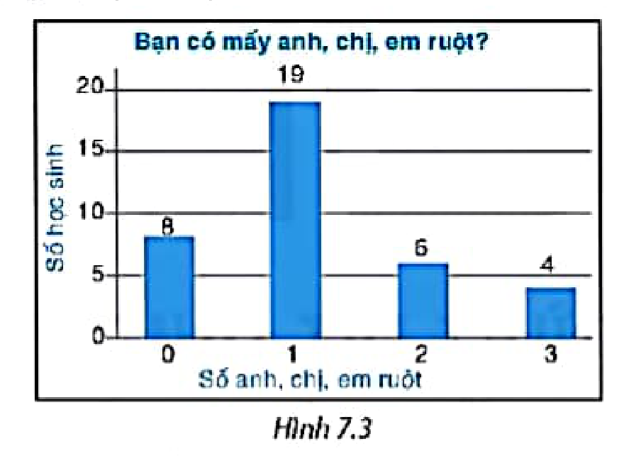
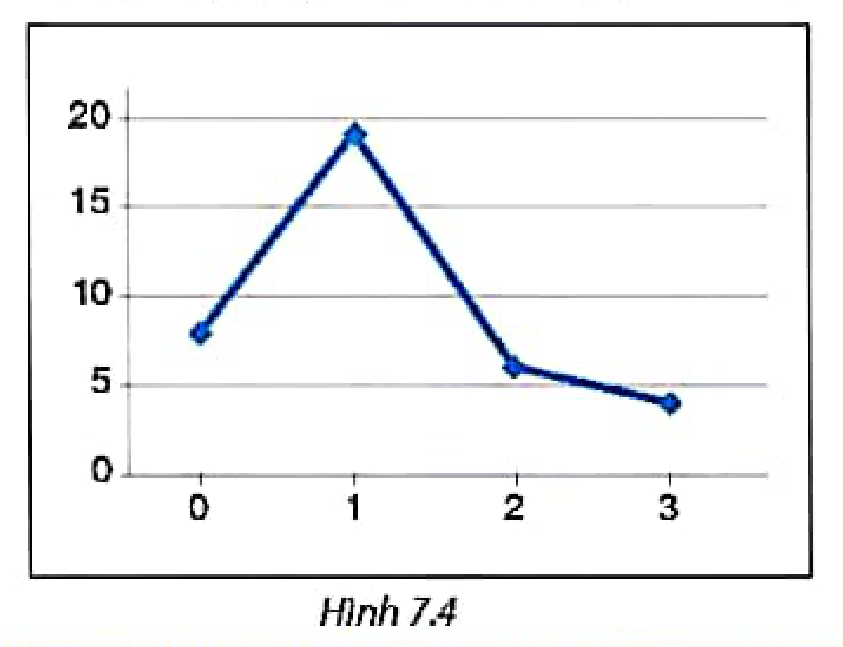
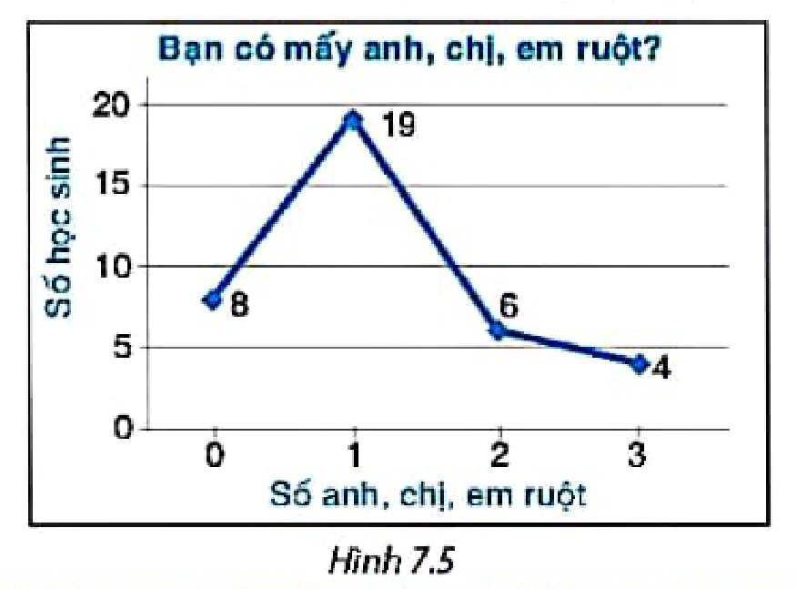
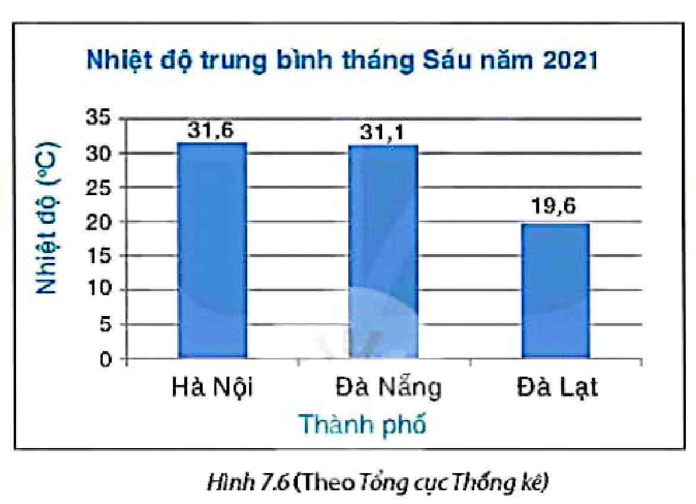
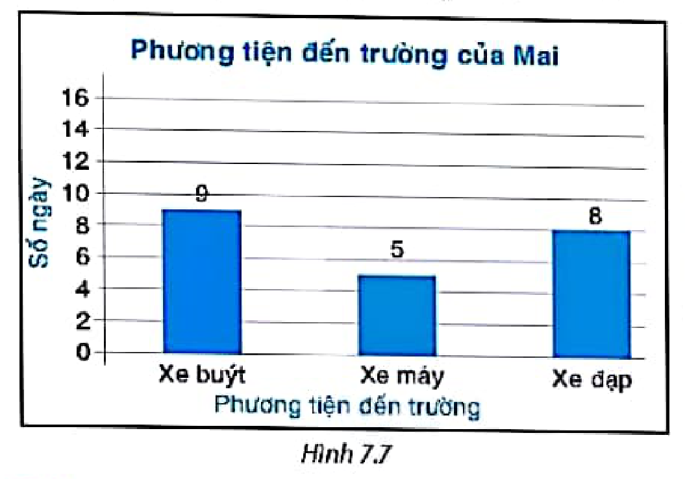
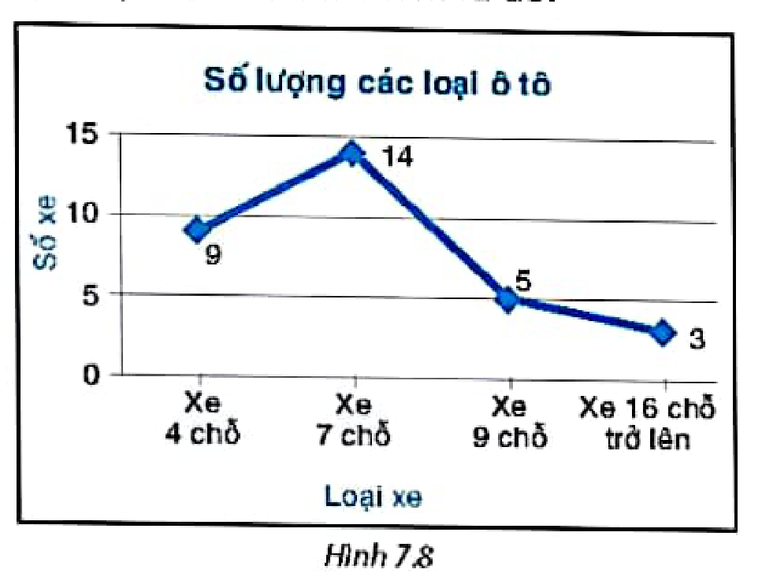

<!-- pdf:34 -->
<!-- Phần giới thiệu đầu Chương VII (nửa trên trang PDF 34): THỐNG KÊ — CHƯƠNG VII: TẦN SỐ VÀ TẦN SỐ TƯƠNG ĐỐI -->

“Bạn có thể có dữ liệu không chứa thông tin nhưng bạn không thể có thông tin nếu thiếu dữ liệu.”

Daniel Keys Moran, Nhà viết truyện khoa học viễn tưởng người Mỹ.
<!-- ocr-ok: đã đối chiếu ảnh trang PDF 34, OCR dính chữ danh ngôn đầu chương -->

# BÀI 22: BẢNG TẦN SỐ VÀ BIỂU ĐỒ TẦN SỐ

## 🔤 Khái niệm, thuật ngữ

- Tần số
- Bảng tần số
- Biểu đồ tần số

## 🎯 Kiến thức, kĩ năng

- Thiết lập bảng tần số, biểu đồ tần số.
- Giải thích ý nghĩa và vai trò của tần số trong thực tiễn.

## 🔴 Mở đầu

Với dãy dữ liệu $x_1, x_2, \dots, x_n$ có nhiều giá trị giống nhau thì có cách nào biểu diễn dãy dữ liệu này thuận tiện hơn không? Chúng ta sẽ tìm hiểu vấn đề này trong bài học.

## 1. BẢNG TẦN SỐ

**Tần số và bảng tần số**

**HĐ1:** Bạn Minh muốn tìm hiểu về dự định của các bạn học sinh khối lớp $9$ trong trường sau khi tốt nghiệp Trung học cơ sở. Em hãy giúp bạn Minh thực hiện khảo sát ý kiến của các bạn trong lớp mình theo mẫu phiếu bên.

<!-- pdf:35 -->

a) Bạn Minh muốn khảo sát ý kiến của những ai? Em đã giúp bạn Minh khảo sát ý kiến của tất cả những người đó?

b) Liệt kê dãy dữ liệu thu được và đếm số học sinh theo mỗi lựa chọn.

**Nhận xét.** Dữ liệu mà bạn Minh muốn có là dữ liệu về ý kiến của tất cả học sinh khối lớp $9$ trong trường. Dãy dữ liệu mà em thu được trong khảo sát trên là một phần của dữ liệu bạn Minh muốn có và được gọi là **mẫu dữ liệu**. Số giá trị của mẫu dữ liệu được gọi là **cỡ mẫu**.

> - **Tần số** của một giá trị là số lần xuất hiện giá trị đó trong mẫu dữ liệu.
> - **Bảng tần số** là bảng thống kê cho biết tần số của các giá trị trong mẫu dữ liệu. Bảng tần số có dạng sau:

| Giá trị | $x_1$ | $x_2$ | ... | $x_k$ |
| --- | :---: | :---: | :---: | :---: |
| Tần số | $m_1$ | $m_2$ | ... | $m_k$ |

trong đó $m_1$ là tần số của $x_1$, $m_2$ là tần số của $x_2, \dots, m_k$ là tần số của $x_k$.

> ❓ Lập bảng tần số cho mẫu dữ liệu thu được trong HĐ1.

**Chú ý.** Người ta còn cho bảng tần số ở dạng cột: cột thứ nhất ghi các giá trị, cột thứ hai ghi tần số của các giá trị đó.

**Ví dụ 1:** Để mua giày thể thao cho các bạn nam trong lớp luyện tập chuẩn bị cho giải bóng đá của trường, Huy đã thu thập cỡ giày của các bạn nam trong lớp và thu được kết quả như sau:

$40, 36, 37, 36, 40, 38, 39, 38, 37, 36, 40, 39, 36, 38, 37, 38, 38, 37, 38, 38, 38, 36.$

a) Bạn Huy cần mua giày các cỡ nào? Mỗi loại bao nhiêu đôi?

b) Lập bảng tần số cho dãy dữ liệu trên. Từ bảng tần số, cho biết cỡ giày nào phù hợp với nhiều bạn nam trong lớp nhất.

**Giải**

a) Bạn Huy cần mua giày với các cỡ $36, 37, 38, 39, 40$. Giày cỡ $36$ cần $5$ đôi; cỡ $37$ cần $4$ đôi; cỡ $38$ cần $8$ đôi; cỡ $39$ cần $2$ đôi; cỡ $40$ cần $3$ đôi.
<!-- ocr-ok: đã đối chiếu ảnh trang PDF 35, câu liệt kê nhiều số liệu trong LaTeX -->

b) Bảng tần số:

| Cỡ giày | $36$ | $37$ | $38$ | $39$ | $40$ |
| --- | :---: | :---: | :---: | :---: | :---: |
| Tần số | $5$ | $4$ | $8$ | $2$ | $3$ |

Giày cỡ $38$ phù hợp với nhiều bạn nam trong lớp nhất.

<!-- pdf:36 -->

**Luyện tập 1:** Bảng sau đây ghi lại tên các bạn đạt điểm tốt vào các ngày trong tuần của lớp 9E, mỗi điểm tốt ghi tên một lần.

| Ngày | Thứ Hai | Thứ Ba | Thứ Tư | Thứ Năm | Thứ Sáu |
| :---: | :---: | :---: | :---: | :---: | :---: |
| Tên bạn đạt điểm tốt | Bình, Nam | Tuấn, Thảo | Bình | Yến, Nam | Nam, Thảo |

a) Trong tuần những bạn nào đạt điểm tốt? Mỗi bạn đạt được mấy điểm tốt?

b) Lập bảng tần số cho dãy dữ liệu này. Bạn nào có số lần đạt điểm tốt nhiều nhất?

**Nhận xét.** Trong bảng tần số, ta chỉ liệt kê các giá trị $x_i$ khác nhau. Các giá trị $x_i$ này có thể không là số.

Tần số của một giá trị cho biết giá trị đó xuất hiện trong mẫu dữ liệu nhiều hay ít, từ đó ta dễ dàng xác định được giá trị xuất hiện nhiều nhất, ít nhất.

## 2. BIỂU ĐỒ TẦN SỐ

**Tìm hiểu về biểu đồ tần số**

**HĐ2:** Cho hai biểu đồ sau:

*Hình 7.1. Biểu đồ A*

*Hình 7.2. Biểu đồ B*

a) Đọc và giải thích mỗi biểu đồ trên.

b) Hai biểu đồ trên có biểu diễn cùng một dữ liệu không? Lập bảng thống kê cho dữ liệu đó. Bảng thống kê thu được có phải là bảng tần số hay không?

> Biểu đồ biểu diễn bảng tần số được gọi là **biểu đồ tần số**. Biểu đồ tần số thường gặp là **biểu đồ tần số dạng cột** (H.7.1) và **biểu đồ tần số dạng đoạn thẳng** (H.7.2).

> **Pi:** Biểu đồ tần số dạng đoạn thẳng còn gọi là **đa giác tần số** (frequency polygon).

<!-- pdf:37 -->

<!-- term: Cách vẽ biểu đồ tần số dạng đoạn thẳng -->
**Nhận xét.** Để vẽ biểu đồ tần số dạng đoạn thẳng ta thực hiện theo các bước sau:
*Bước 1.* Vẽ trục ngang để biểu diễn các giá trị trong dãy dữ liệu, vẽ trục đứng thể hiện tần số.
*Bước 2.* Với mỗi giá trị trên trục ngang và tần số tương ứng ta xác định một điểm. Nối các điểm liên tiếp với nhau.
*Bước 3.* Ghi chú giải cho các trục, các điểm và tiêu đề của biểu đồ.

**Ví dụ 2:** Bạn Bình thống kê số anh, chị, em ruột của các bạn trong lớp và thu được bảng sau:

| Số anh, chị, em ruột | $0$ | $1$ | $2$ | $3$ |
| --- | :---: | :---: | :---: | :---: |
| Số bạn | $8$ | $19$ | $6$ | $4$ |

Vẽ biểu đồ tần số dạng cột và biểu đồ tần số dạng đoạn thẳng biểu diễn bảng thống kê trên.

**Giải**

- Vẽ biểu đồ tần số dạng cột (H.7.3).

*Hình 7.3*

- Vẽ biểu đồ tần số dạng đoạn thẳng.

*Bước 1.* Vẽ các trục (H.7.4).

*Bước 2.* Xác định các điểm và nối các điểm liên tiếp với nhau (H.7.4).

*Bước 3.* Ghi chú giải cho các trục, các điểm và tiêu đề của biểu đồ (H.7.5).

*Hình 7.4*

*Hình 7.5*

<!-- pdf:38 -->

**Luyện tập 2:** Bảng tần số sau cho biết số học sinh của lớp 9D dự đoán đội bóng vô địch World Cup 2022 trước khi giải đấu bắt đầu.

| Đội bóng | Brazil | Anh | Pháp | Argentina |
| --- | :---: | :---: | :---: | :---: |
| Số bạn dự đoán | $8$ | $15$ | $12$ | $5$ |

Vẽ biểu đồ tần số dạng cột và biểu đồ tần số dạng đoạn thẳng biểu diễn bảng tần số trên.

**Tranh luận**

Biểu đồ cột sau biểu diễn nhiệt độ trung bình tháng Sáu tại ba thành phố của Việt Nam năm 2021.

*Hình 7.6 (Theo Tổng cục Thống kê)*

> - **Vuông:** Đây là biểu đồ tần số.
> - **Tròn:** Đây không phải là biểu đồ tần số.

Em ủng hộ Vuông hay Tròn? Vì sao?

## BÀI TẬP

7.1. Một nhóm học sinh đã khảo sát ý kiến về ý thức giữ gìn vệ sinh công cộng của các bạn trong trường với các mức đánh giá Tốt, Khá, Trung bình, Kém và thu được kết quả như sau:

Tốt, Trung bình, Tốt, Trung bình, Khá, Tốt, Khá, Tốt, Tốt, Khá, Trung bình, Kém, Khá, Tốt, Khá, Tốt, Trung bình, Khá, Tốt, Tốt, Tốt, Khá, Kém, Trung bình, Tốt, Khá, Tốt, Khá, Tốt, Khá, Khá.

a) Lập bảng tần số cho dãy dữ liệu trên.

b) Từ bảng tần số, hãy cho biết mức đánh giá nào chiếm ưu thế nhất. Vì sao?

<!-- pdf:39 -->

7.2. Cho biểu đồ tranh biểu diễn số lượng học sinh trong lớp đăng kí tham gia các câu lạc bộ của trường như sau:

<!-- Mỗi biểu tượng biểu diễn cho 1 học sinh: Câu lạc bộ võ thuật 6, Câu lạc bộ tiếng Anh 9, Câu lạc bộ nghệ thuật 5 -->

Lập bảng tần số cho dữ liệu được biểu diễn trong biểu đồ tranh trên.

7.3. Biểu đồ Hình 7.7 cho biết số ngày sử dụng phương tiện đến trường của bạn Mai trong tháng Chín. Lập bảng tần số cho dữ liệu được biểu diễn trên biểu đồ.

*Hình 7.7*

*Hình 7.8*

7.4. Người ta thống kê các loại ô tô chạy qua một trạm thu phí trong $1$ giờ và vẽ được biểu đồ tần số như Hình 7.8.

a) Lập bảng tần số cho dữ liệu được biểu diễn trên biểu đồ.

b) Từ bảng tần số, hãy cho biết loại xe nào đi qua trạm thu phí nhiều nhất.

7.5. Bảng thống kê sau cho biết số lượng các thiên tai xảy ra tại Việt Nam giai đoạn 1990 – 2021.

| Loại thiên tai | Hạn hán | Bệnh dịch | Lũ lụt | Sạt lở đất | Bão |
| --- | :---: | :---: | :---: | :---: | :---: |
| Số lượng | $6$ | $9$ | $71$ | $6$ | $94$ |

*(Theo vietnam.opendevelopmentmekong.net)*

Vẽ biểu đồ tần số dạng cột và biểu đồ tần số dạng đoạn thẳng biểu diễn bảng thống kê trên.

## 📷 Danh sách hình trong bài

| Mã hình | Trang PDF | Vị trí trong bài | Chú thích gốc |
| --- | :---: | --- | --- |
| H9-toan-b22-01 | 34 | Mục 1, HĐ1 | (phiếu khảo sát: Dự định của bạn sau khi học xong lớp 9?) |
| H9-toan-b22-02 | 36 | Mục 2, HĐ2 | Hình 7.1. Biểu đồ A |
| H9-toan-b22-03 | 36 | Mục 2, HĐ2 | Hình 7.2. Biểu đồ B |
| H9-toan-b22-04 | 37 | Mục 2, Ví dụ 2 | Hình 7.3 |
| H9-toan-b22-05 | 37 | Mục 2, Ví dụ 2 | Hình 7.4 |
| H9-toan-b22-06 | 37 | Mục 2, Ví dụ 2 | Hình 7.5 |
| H9-toan-b22-07 | 38 | Mục 2, Tranh luận | Hình 7.6 (Theo Tổng cục Thống kê) |
| H9-toan-b22-08 | 39 | Bài tập 7.2 (cạnh dưới đi sát dòng câu hỏi ngay bên dưới chú thích biểu đồ tranh) | (biểu đồ tranh số lượng học sinh đăng kí tham gia câu lạc bộ) |
| H9-toan-b22-09 | 39 | Bài tập 7.3 | Hình 7.7 |
| H9-toan-b22-10 | 39 | Bài tập 7.4 | Hình 7.8 |
