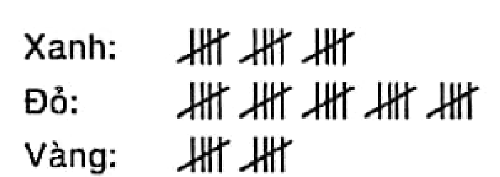
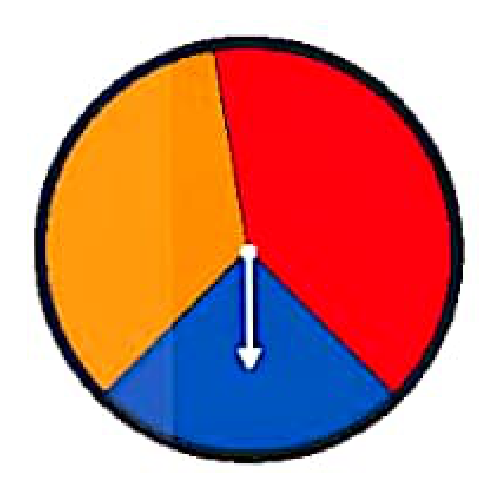
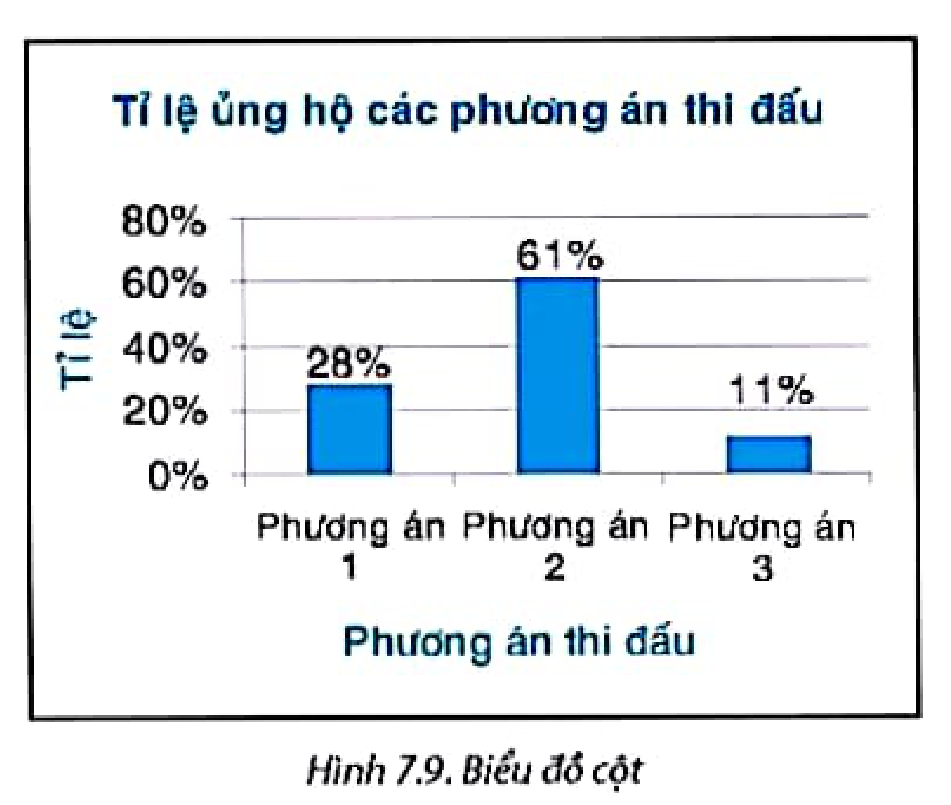
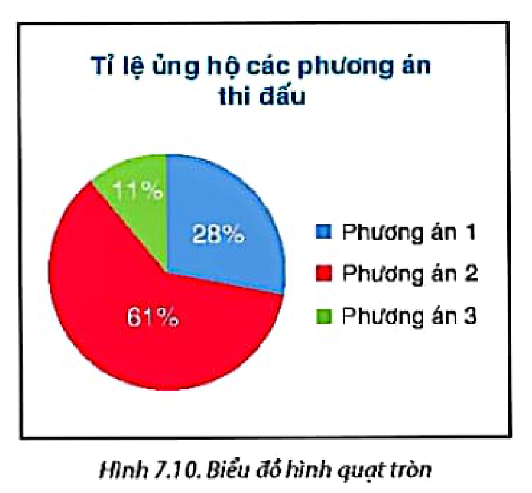
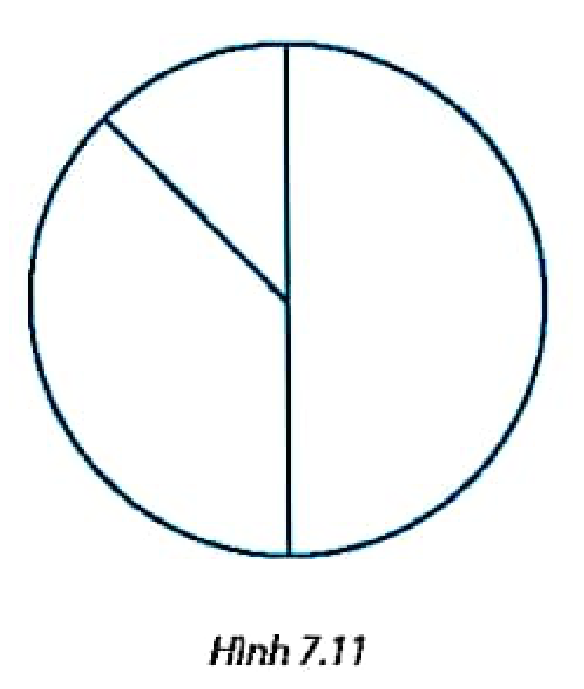
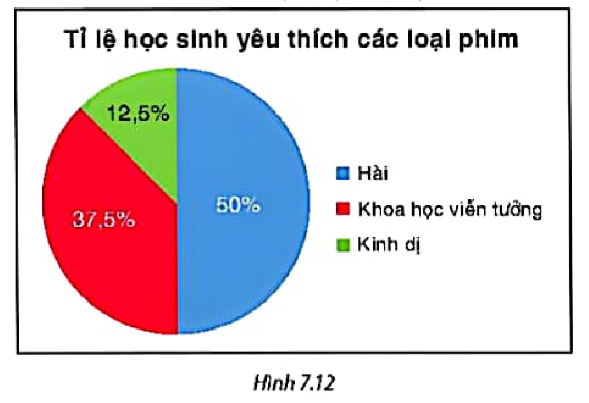
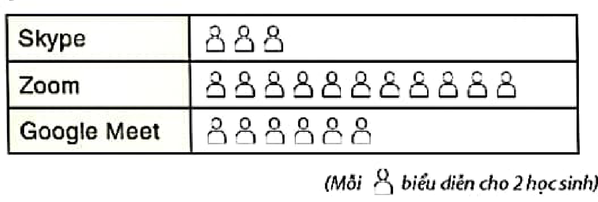

<!-- pdf:40 -->

# BÀI 23: BẢNG TẦN SỐ TƯƠNG ĐỐI VÀ BIỂU ĐỒ TẦN SỐ TƯƠNG ĐỐI

## 🔤 Khái niệm, thuật ngữ

- Tần số tương đối
- Bảng tần số tương đối

## 🎯 Kiến thức, kĩ năng

- Thiết lập bảng tần số tương đối, biểu đồ tần số tương đối.
- Giải thích ý nghĩa và vai trò của tần số tương đối trong thực tiễn.

## 🔴 Mở đầu

Ở bài trước chúng ta đã được học các cách biểu diễn dãy dữ liệu để dễ dàng thấy được tần số xuất hiện của mỗi giá trị trong dãy. Trong bài này, chúng ta sẽ tìm hiểu các cách biểu diễn dãy dữ liệu để dễ dàng thấy được tỉ lệ xuất hiện của các giá trị trong dãy.

## 1. BẢNG TẦN SỐ TƯƠNG ĐỐI

**Tần số tương đối và bảng tần số tương đối**

**HĐ1:** Có một túi kín đựng $10$ quả bóng, mỗi quả có một trong các màu xanh, đỏ hoặc vàng. Thực hiện $30$ lần lấy bóng, mỗi lần lấy $1$ quả, ghi lại màu quả bóng được lấy ra sau đó trả lại bóng vào túi và trộn đều.

a) Từ dữ liệu ghi lại, cho biết tần số xuất hiện của các quả bóng màu xanh, đỏ, vàng. Lập tỉ số giữa tần số và số lần lấy bóng.

b) Đoán xem trong túi số lượng bóng có màu gì là ít nhất, nhiều nhất.

> Cho dãy dữ liệu $x_1, x_2, \dots, x_n$. **Tần số tương đối** $f_i$ của giá trị $x_i$ là tỉ số giữa tần số của $x_i$ (gọi là $m_i$) với $n$.
> Bảng sau đây được gọi là **bảng tần số tương đối**.

| Giá trị | $x_1$ | ... | $x_k$ |
| --- | :---: | :---: | :---: |
| Tần số tương đối | $f_1$ | ... | $f_k$ |

trong đó $n = m_1 + \dots + m_k$ và $f_1 = \dfrac{m_1}{n} \cdot 100(\%)$ là tần số tương đối của $x_1, \dots, f_k = \dfrac{m_k}{n} \cdot 100(\%)$ là tần số tương đối của $x_k$.

> **Pi:** Tần số tương đối còn gọi là **tần suất**.

> ❓ Lập bảng tần số tương đối cho dãy dữ liệu thu được trong HĐ1.

**Chú ý.** Người ta còn cho bảng tần số tương đối ở dạng cột: cột thứ nhất ghi các giá trị, cột thứ hai ghi tần số tương đối của các giá trị đó.

**Ví dụ 1:** Thu thập dữ liệu về chất lượng không khí tại một địa điểm trong $30$ ngày mùa xuân cho kết quả như sau:

M1, M1, M2, M2, M2, M2, M1, M2, M2, M2, M2, M2, M2, M2, M2, M4, M3, M3, M3, M3, M4, M4, M1, M1, M1, M1, M3, M3, M3, M1.

*(M1: Tốt; M2: Trung bình; M3: Kém; M4: Xấu)*
<!-- ocr-ok: đã đối chiếu ảnh trang PDF 40, OCR đọc nhầm M1 thành Mĩ và M4 thành 4 -->

<!-- pdf:41 -->

a) Lập bảng tần số tương đối cho dãy dữ liệu trên.

b) Trong một ngày xuân, khả năng cao nhất địa điểm này có chất lượng không khí ở mức nào?

**Giải**

a) Tổng số quan sát là $n = 30$. Số ngày có chất lượng không khí ở các mức M1, M2, M3, M4 tương ứng là $m_1 = 8, m_2 = 12, m_3 = 7, m_4 = 3$. Do đó các tần số tương đối cho các mức M1, M2, M3, M4 lần lượt là:

$f_1 = \dfrac{8}{30} \approx 26,7\%; \quad f_2 = \dfrac{12}{30} = 40\%; \quad f_3 = \dfrac{7}{30} \approx 23,3\%; \quad f_4 = \dfrac{3}{30} = 10\%.$

Ta có bảng tần số tương đối sau:

| Chất lượng không khí | M1 | M2 | M3 | M4 |
| --- | :---: | :---: | :---: | :---: |
| Tần số tương đối | $26,7\%$ | $40\%$ | $23,3\%$ | $10\%$ |

b) Trong một ngày xuân, khả năng cao nhất là địa điểm này có chất lượng không khí ở mức M2, tức là mức Trung bình.

**Nhận xét.** Tần số tương đối của một giá trị là ước lượng cho xác suất xuất hiện giá trị đó.

**Luyện tập 1:** Quay $50$ lần một tấm bìa hình tròn được chia thành ba hình quạt với các màu xanh, đỏ, vàng. Quan sát và ghi lại mũi tên chỉ vào hình quạt có màu nào khi tấm bìa dừng lại. Kết quả thu được như sau:

<!-- Xanh: 15 vạch; Đỏ: 25 vạch; Vàng: 10 vạch -->

a) Lập bảng tần số tương đối cho kết quả thu được.

b) Ước lượng xác suất mũi tên chỉ vào hình quạt màu đỏ.

## 2. BIỂU ĐỒ TẦN SỐ TƯƠNG ĐỐI

**Tìm hiểu về biểu đồ tần số tương đối**

**HĐ2:** Có ba phương án thi đấu tại giải bóng đá khối lớp $9$ của một trường như sau:

Phương án 1: Các đội đấu vòng tròn, tính điểm;

Phương án 2: Chia các đội thành hai bảng, mỗi bảng lấy hai đội vào trận bán kết;

Phương án 3: Các đội bốc thăm ghép cặp, đấu loại trực tiếp.

Ban tổ chức đã lấy phiếu khảo sát ý kiến. Kết quả được Bình và Nam biểu diễn bằng các biểu đồ như sau:

<!-- pdf:42 -->

*Hình 7.9. Biểu đồ cột*

*Hình 7.10. Biểu đồ hình quạt tròn*

a) Đọc và giải thích mỗi biểu đồ trên.

b) Lập bảng tần số tương đối cho kết quả khảo sát ý kiến.

> - Biểu đồ biểu diễn bảng tần số tương đối được gọi là **biểu đồ tần số tương đối**. Dạng thường gặp của biểu đồ tần số tương đối là biểu đồ cột và biểu đồ hình quạt tròn.

<!-- term: Cách vẽ biểu đồ hình quạt tròn -->
> - Để vẽ biểu đồ hình quạt tròn ta thực hiện theo các bước sau:
> *Bước 1.* Xác định số đo cung tương ứng của các hình quạt dùng để biểu diễn tần số tương đối của các giá trị theo công thức $360^\circ \cdot f_i$ với $i = 1, \dots, k$.
> *Bước 2.* Vẽ hình tròn và chia hình tròn thành các hình quạt có số đo cung tương ứng được xác định trong Bước 1.
> *Bước 3.* Định dạng các hình quạt tròn (thường bằng cách tô màu), ghi tần số tương đối, chú giải và tiêu đề.

**Ví dụ 2:** Cho bảng tần số tương đối về loại phim yêu thích của các học sinh trong lớp 9A như sau:

| Loại phim | Hài | Khoa học viễn tưởng | Kinh dị |
| --- | :---: | :---: | :---: |
| Tỉ lệ bạn yêu thích | $50\%$ | $37,5\%$ | $12,5\%$ |

Vẽ biểu đồ hình quạt tròn biểu diễn bảng tần số tương đối trên.

**Giải**

*Bước 1.* Xác định số đo cung tương ứng của các hình quạt biểu diễn các tần số tương đối cho mỗi loại phim:

Hài: $360^\circ \cdot 50\% = 180^\circ$;

Khoa học viễn tưởng: $360^\circ \cdot 37,5\% = 135^\circ$;

Kinh dị: $360^\circ \cdot 12,5\% = 45^\circ$.

<!-- pdf:43 -->

*Bước 2.* Vẽ hình tròn và chia hình tròn thành các hình quạt (H.7.11).

*Hình 7.11*

*Hình 7.12*

*Bước 3.* Định dạng các hình quạt tròn, ghi tỉ lệ phần trăm, chú giải và tiêu đề (H.7.12).

**Luyện tập 2:** Bảng tần số tương đối sau cho biết tỉ lệ học sinh đánh giá độ khó của đề thi học kì môn Toán theo các mức độ.

| Đánh giá | Rất khó | Khó | Trung bình | Dễ |
| --- | :---: | :---: | :---: | :---: |
| Tỉ lệ | $10\%$ | $25\%$ | $45\%$ | $20\%$ |

Vẽ biểu đồ hình quạt tròn biểu diễn bảng tần số tương đối này.

**Tranh luận**

Bạn Bình phát phiếu (H.7.13) lấy ý kiến bình chọn của $40$ bạn trong lớp về địa điểm đi dã ngoại. Kết quả bạn Bình thu được như sau:

| Địa điểm | Vườn quốc gia Ba Vì | Vườn quốc gia Cát Bà | Vườn quốc gia Cúc Phương |
| --- | :---: | :---: | :---: |
| Tỉ lệ bạn bình chọn | $70\%$ | $30\%$ | $50\%$ |

*Hình 7.13*

> - **Vuông:** Tớ sẽ dùng biểu đồ hình quạt tròn để biểu diễn bảng thống kê này.
> - **Tròn:** Không được. Cậu phải dùng biểu đồ cột để biểu diễn.

Ý kiến của bạn thế nào?

<!-- pdf:44 -->

## BÀI TẬP

7.6. Lớp 9A có $40$ bạn, trong đó $20$ bạn mặc áo cỡ M, $13$ bạn mặc áo cỡ S, $7$ bạn mặc áo cỡ L. Hãy lập bảng tần số tương đối cho dữ liệu này.

7.7. Biểu đồ tranh sau đây biểu diễn số lượng học sinh lớp 9B bình chọn phần mềm học trực tuyến được yêu thích nhất:

<!-- Mỗi biểu tượng biểu diễn cho 2 học sinh: Skype 3, Zoom 10, Google Meet 6 -->

Lập bảng tần số tương đối cho dữ liệu được biểu diễn trong biểu đồ tranh trên.

7.8. Quay $150$ lần một tấm bìa hình tròn được chia thành bốn hình quạt với các màu xanh, đỏ, tím, vàng. Quan sát mũi tên chỉ vào hình quạt màu gì và ghi lại, thu được kết quả sau:

| Màu | Xanh | Đỏ | Tím | Vàng |
| --- | :---: | :---: | :---: | :---: |
| Số lần | $60$ | $30$ | $40$ | $20$ |

a) Lập bảng tần số tương đối cho dữ liệu trên.

b) Ước lượng các xác suất mũi tên chỉ vào hình quạt màu xanh, màu vàng.

c) Vẽ biểu đồ hình quạt tròn biểu diễn bảng tần số tương đối thu được ở câu a.

7.9. Theo Tổng cục Thống kê, vào năm 2021 trong số $50,5$ triệu lao động Việt Nam từ $15$ tuổi trở lên có $13,9$ triệu lao động đang làm việc trong lĩnh vực nông nghiệp, lâm nghiệp và thuỷ sản; $16,9$ triệu lao động đang làm việc trong lĩnh vực công nghiệp và xây dựng; $19,7$ triệu lao động đang làm việc trong lĩnh vực dịch vụ.

a) Lập bảng tần số tương đối cho dữ liệu trên.

b) Vẽ biểu đồ hình quạt tròn biểu diễn bảng tần số tương đối thu được ở câu a.

c) Tính tỉ lệ lao động không làm việc trong lĩnh vực nông nghiệp, lâm nghiệp và thuỷ sản.

7.10. Bảng thống kê sau cho biết tỉ lệ tăng trưởng GDP năm 2022 theo khu vực kinh tế.

| Khu vực kinh tế | Nông nghiệp, lâm nghiệp và thuỷ sản | Công nghiệp và xây dựng | Dịch vụ |
| --- | :---: | :---: | :---: |
| Mức tăng trưởng | $3,36\%$ | $7,78\%$ | $9,99\%$ |

*(Theo Tổng cục Thống kê)*

a) Bảng thống kê trên có là bảng tần số tương đối hay không?

b) Lựa chọn loại biểu đồ thích hợp và biểu diễn bảng thống kê trên bằng loại biểu đồ đó.

## 📷 Danh sách hình trong bài

| Mã hình | Trang PDF | Vị trí trong bài | Chú thích gốc |
| --- | :---: | --- | --- |
| H9-toan-b23-01 | 41 | Mục 1, Luyện tập 1 | (bảng vạch kiểm đếm kết quả Xanh, Đỏ, Vàng) |
| H9-toan-b23-02 | 41 | Mục 1, Luyện tập 1 | (tấm bìa hình tròn chia ba hình quạt màu xanh, đỏ, vàng) |
| H9-toan-b23-03 | 42 | Mục 2, HĐ2 | Hình 7.9. Biểu đồ cột |
| H9-toan-b23-04 | 42 | Mục 2, HĐ2 | Hình 7.10. Biểu đồ hình quạt tròn |
| H9-toan-b23-05 | 43 | Mục 2, Ví dụ 2 | Hình 7.11 |
| H9-toan-b23-06 | 43 | Mục 2, Ví dụ 2 | Hình 7.12 |
| H9-toan-b23-07 | 43 | Mục 2, Tranh luận | Hình 7.13 |
| H9-toan-b23-08 | 44 | Bài tập 7.7 | (biểu đồ tranh bình chọn phần mềm học trực tuyến) |
