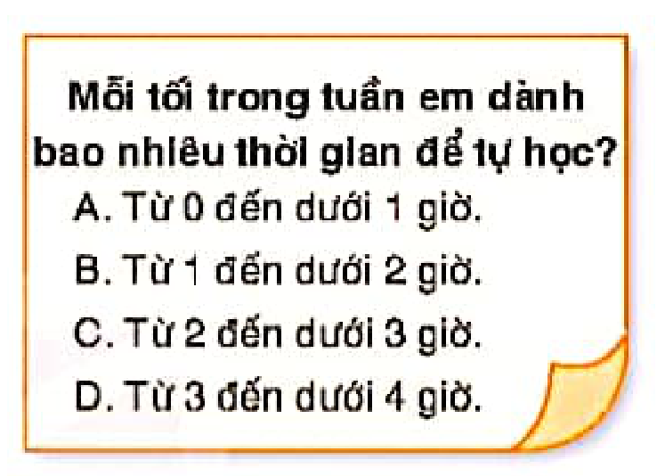
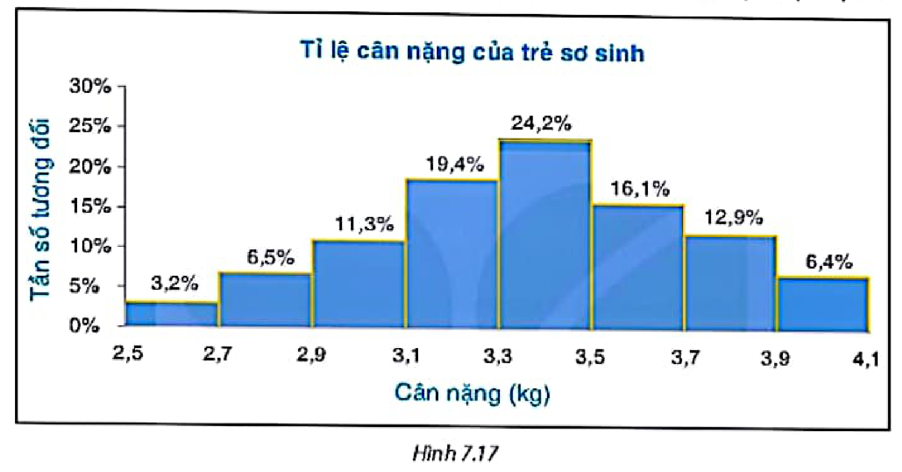
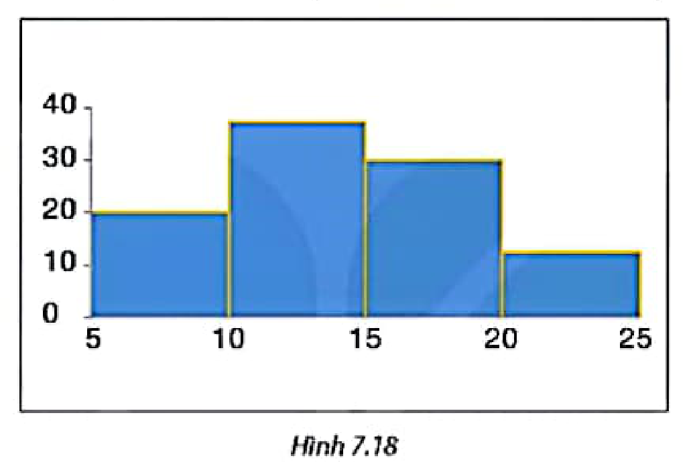
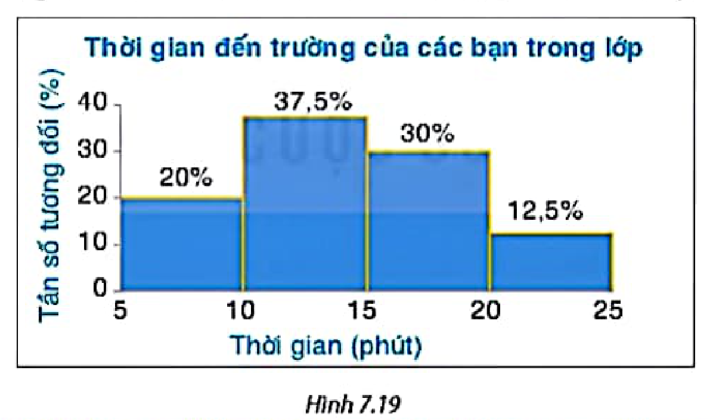
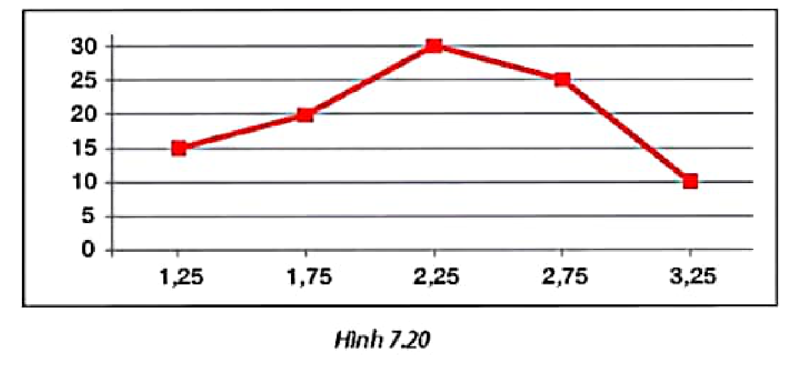
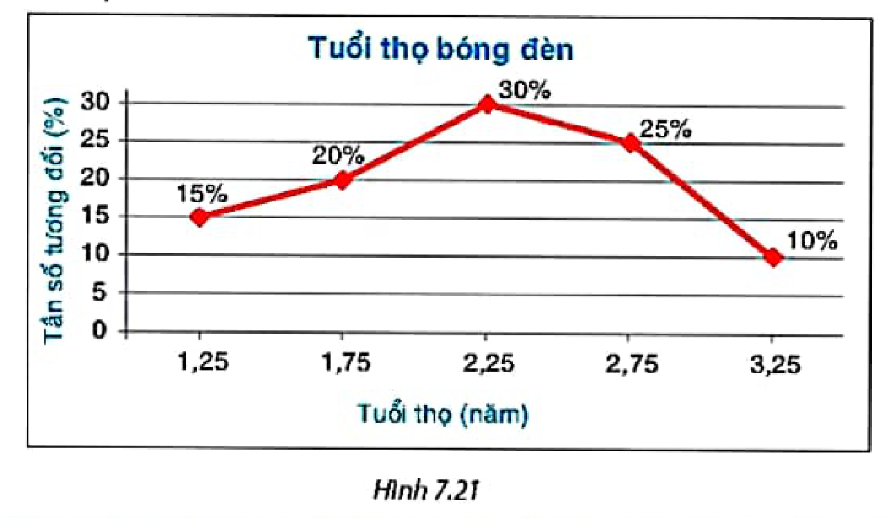

<!-- pdf:48 -->

# BÀI 24: BẢNG TẦN SỐ, TẦN SỐ TƯƠNG ĐỐI GHÉP NHÓM VÀ BIỂU ĐỒ

## 🔤 Khái niệm, thuật ngữ

- Bảng tần số ghép nhóm
- Bảng tần số tương đối ghép nhóm
- Biểu đồ tần số tương đối ghép nhóm

## 🎯 Kiến thức, kĩ năng

- Thiết lập bảng tần số ghép nhóm, bảng tần số tương đối ghép nhóm.
- Vẽ biểu đồ tần số tương đối ghép nhóm.

## 🔴 Mở đầu

Để tìm hiểu về thời gian tự học trong ngày của học sinh, giáo viên chủ nhiệm lớp 9C đã phát phiếu hỏi theo mẫu bên cho các bạn trong lớp.

Chúng ta biểu diễn dữ liệu thu được như thế nào? Hãy cũng tìm hiểu trong bài học này!

## 1. BẢNG TẦN SỐ, TẦN SỐ TƯƠNG ĐỐI GHÉP NHÓM

**Tìm hiểu bảng tần số ghép nhóm và bảng tần số tương đối ghép nhóm**

**HĐ1:** Giáo viên chủ nhiệm lớp 9C đã thu được kết quả như sau: Thời gian tự học dưới $1$ giờ có $10$ bạn; từ $1$ giờ đến dưới $2$ giờ có $15$ bạn; từ $2$ giờ đến dưới $3$ giờ có $8$ bạn; từ $3$ giờ đến dưới $4$ giờ có $7$ bạn. Dựa vào dữ liệu trên, hãy hoàn thiện các bảng sau vào vở:

| Thời gian (giờ) | $[0; 1)$ | $[1; 2)$ | $[2; 3)$ | $[3; 4)$ |
| --- | :---: | :---: | :---: | :---: |
| Tần số | $?$ | $?$ | $?$ | $?$ |

*Bảng 7.1*

| Thời gian (giờ) | $[0; 1)$ | $[1; 2)$ | $[2; 3)$ | $[3; 4)$ |
| --- | :---: | :---: | :---: | :---: |
| Tần số tương đối | $?$ | $?$ | $?$ | $?$ |

*Bảng 7.2*

> **Pi:** **Nhóm số liệu** $[a; b)$ là nhóm gồm các số liệu lớn hơn hoặc bằng $a$ và nhỏ hơn $b$.

Bảng 7.1 được gọi là *bảng tần số ghép nhóm*, bảng 7.2 được gọi là *bảng tần số tương đối ghép nhóm*.

Trong nhiều trường hợp, ta khó biết giá trị chính xác của số liệu mà chỉ biết nó thuộc một nhóm số liệu nào đó. Nhóm số liệu thường gặp là $[a; b)$, trong đó $a$ là **đầu mút trái**, $b$ là **đầu mút phải**.

<!-- pdf:49 -->

> **Bảng tần số ghép nhóm** là bảng tần số của các nhóm số liệu:

| Nhóm | $[a_1; a_2)$ | $[a_2; a_3)$ | ... | $[a_k; a_{k+1})$ |
| --- | :---: | :---: | :---: | :---: |
| Tần số | $m_1$ | $m_2$ | ... | $m_k$ |

*Bảng 7.3. Bảng tần số ghép nhóm*

> **Tần số $m_i$ của nhóm** $[a_i; a_{i+1})$ là số giá trị của mẫu số liệu lớn hơn hoặc bằng $a_i$ và nhỏ hơn $a_{i+1}$.
>
> **Bảng tần số tương đối ghép nhóm** là bảng tần số tương đối của các nhóm số liệu:

| Nhóm | $[a_1; a_2)$ | $[a_2; a_3)$ | ... | $[a_k; a_{k+1})$ |
| --- | :---: | :---: | :---: | :---: |
| Tần số tương đối | $f_1$ | $f_2$ | ... | $f_k$ |

*Bảng 7.4. Bảng tần số tương đối ghép nhóm*

> trong đó $n = m_1 + \dots + m_k$ và
> $f_1 = \dfrac{m_1}{n} \cdot 100(\%)$ là **tần số tương đối của nhóm** $[a_1; a_2), \dots,$
> $f_k = \dfrac{m_k}{n} \cdot 100(\%)$ là tần số tương đối của nhóm $[a_k; a_{k+1})$.

**Ví dụ 1:** Đo chiều cao (đơn vị là $\text{cm}$) của học sinh lớp 9C cho kết quả như sau:

$156 \quad 157 \quad 164 \quad 166 \quad 166 \quad 165 \quad 157 \quad 154 \quad 155 \quad 158 \quad 160 \quad 163 \quad 163$

$161 \quad 162 \quad 159 \quad 159 \quad 160 \quad 160 \quad 160 \quad 159 \quad 158 \quad 160 \quad 160 \quad 158 \quad 163$

$162 \quad 162 \quad 162 \quad 161 \quad 162 \quad 161 \quad 163 \quad 161 \quad 163 \quad 161 \quad 164 \quad 166 \quad 165 \quad 165.$

Lập bảng tần số ghép nhóm và bảng tần số tương đối ghép nhóm cho mẫu số liệu này với các nhóm $[155; 158), [158; 161), [161; 164), [164; 167)$.

**Giải.** Số học sinh có chiều cao từ $150\text{ cm}$ đến dưới $158\text{ cm}$ là $5$ học sinh; từ $158\text{ cm}$ đến dưới $161\text{ cm}$ là $12$ học sinh; từ $161$ đến dưới $164\text{ cm}$ là $15$ học sinh; từ $164$ đến dưới $167\text{ cm}$ là $8$ học sinh. Do đó, tần số tương ứng với các nhóm là $m_1 = 5, m_2 = 12, m_3 = 15, m_4 = 8$. Ta có bảng tần số ghép nhóm như sau:

| Chiều cao ($\text{cm}$) | $[150; 158)$ | $[158; 161)$ | $[161; 164)$ | $[164; 167)$ |
| --- | :---: | :---: | :---: | :---: |
| Số học sinh | $5$ | $12$ | $15$ | $8$ |

Tổng số học sinh trong lớp là $n = 5 + 12 + 15 + 8 = 40$. Tỉ lệ học sinh có chiều cao từ $150\text{ cm}$ đến dưới $158\text{ cm}$ là $\dfrac{5}{40} = 12,5\%$; từ $158\text{ cm}$ đến dưới $161\text{ cm}$ là $\dfrac{12}{40} = 30\%$; từ $161\text{ cm}$ đến dưới $164\text{ cm}$ là $\dfrac{15}{40} = 37,5\%$; từ $164\text{ cm}$ đến dưới $167\text{ cm}$ là $\dfrac{8}{40} = 20\%$. Ta có bảng tần số tương đối ghép nhóm như sau:

| Chiều cao ($\text{cm}$) | $[150; 158)$ | $[158; 161)$ | $[161; 164)$ | $[164; 167)$ |
| --- | :---: | :---: | :---: | :---: |
| Tần số tương đối | $12,5\%$ | $30\%$ | $37,5\%$ | $20\%$ |

<!-- pdf:50 -->

**Luyện tập 1:** Cho bảng tần số ghép nhóm về tuổi thọ của một số ong mật cái như sau:

| Tuổi thọ (ngày) | $[30; 40)$ | $[40; 50)$ | $[50; 60)$ |
| --- | :---: | :---: | :---: |
| Tần số | $12$ | $23$ | $15$ |

a) Đọc và giải thích bảng thống kê trên.

b) Lập bảng tần số tương đối ghép nhóm cho bảng thống kê này.

**Ví dụ 2:** Chỉ số chất lượng không khí (AQI) cho biết tình trạng chất lượng không khí và mức độ ảnh hưởng đến sức khoẻ con người. Chất lượng không khí là *Tốt* nếu AQI từ $0$ đến dưới $50$; là *Trung bình* nếu AQI từ $50$ đến dưới $100$; là *Kém* nếu AQI từ $100$ đến dưới $150$; là *Xấu* nếu AQI từ $150$ đến dưới $200$. Chất lượng không khí tại Hà Nội từ ngày 4-2-2023 đến 5-3-2023 được cho như sau:

Trung bình, Trung bình, Trung bình, Trung bình, Trung bình, Trung bình, Trung bình, Trung bình, Kém, Kém, Kém, Kém, Xấu, Xấu, Kém, Xấu, Xấu, Xấu, Kém, Kém, Kém, Kém, Kém, Xấu, Kém, Xấu, Xấu, Xấu, Xấu, Xấu.

*(Theo iqair.com)*

Lập bảng tần số ghép nhóm và bảng tần số tương đối ghép nhóm theo chỉ số AQI cho dãy dữ liệu trên.

**Giải.** Có $8$ ngày chất lượng không khí ở mức *Trung bình* tương ứng với chỉ số AQI từ $50$ đến dưới $100$; có $11$ ngày chất lượng không khí ở mức *Kém* tương ứng với chỉ số AQI từ $100$ đến dưới $150$; có $11$ ngày chất lượng không khí ở mức *Xấu* tương ứng với chỉ số AQI từ $150$ đến dưới $200$. Ta có bảng tần số ghép nhóm sau:

| Chỉ số AQI | $[50; 100)$ | $[100; 150)$ | $[150; 200)$ |
| --- | :---: | :---: | :---: |
| Tần số | $8$ | $11$ | $11$ |

Tỉ lệ ngày có chất lượng không khí ở mức *Trung bình* là $\dfrac{8}{30} \approx 26,6\%$; ở mức *Kém* là $\dfrac{11}{30} \approx 36,7\%$; ở mức *Xấu* là $\dfrac{11}{30} \approx 36,7\%$. Ta có bảng tần số tương đối ghép nhóm sau:

| Chỉ số AQI | $[50; 100)$ | $[100; 150)$ | $[150; 200)$ |
| --- | :---: | :---: | :---: |
| Tần số tương đối | $26,6\%$ | $36,7\%$ | $36,7\%$ |

**Luyện tập 2:** Chỉ số phát triển con người (HDI) là chỉ tiêu tổng hợp phản ánh các mặt thu nhập, sức khoẻ, giáo dục của người dân trong một quốc gia. Các nước và vùng lãnh thổ trên thế giới được chia thành bốn nhóm theo HDI: Nhóm 1 (rất cao) có HDI từ $0,8$ trở lên; Nhóm 2 (cao) có HDI từ $0,7$ đến dưới $0,8$; Nhóm 3 (trung bình) có HDI từ $0,55$ đến dưới $0,7$; Nhóm 4 (thấp) có HDI dưới $0,55$. Năm 2021, chỉ số HDI của $11$ quốc gia Đông Nam Á như sau:

$0,939 \quad 0,829 \quad 0,803 \quad 0,8 \quad 0,705 \quad 0,703 \quad 0,699 \quad 0,607 \quad 0,607 \quad 0,593 \quad 0,585.$

<!-- pdf:51 -->

Dựa vào dữ liệu trên, hãy hoàn thành bảng tần số ghép nhóm sau:

| Chỉ số HDI | $[0; 0,55)$ | $[0,55; 0,7)$ | $[0,7; 0,8)$ | $[0,8; 1,0)$ |
| --- | :---: | :---: | :---: | :---: |
| Tần số | $?$ | $?$ | $?$ | $?$ |

## 2. BIỂU ĐỒ TẦN SỐ TƯƠNG ĐỐI GHÉP NHÓM DẠNG CỘT

**Tìm hiểu về biểu đồ tần số tương đối ghép nhóm dạng cột**

**HĐ2:** Biểu đồ Hình 7.17 cho biết tỉ lệ cân nặng của $62$ trẻ sơ sinh tại một bệnh viện.

*Hình 7.17*

a) Đọc và giải thích số liệu được biểu diễn trên biểu đồ.

b) Lập bảng thống kê cho số liệu được biểu diễn trên biểu đồ. Bảng thống kê đó có phải là bảng tần số tương đối ghép nhóm không?

> - **Biểu đồ tần số tương đối ghép nhóm dạng cột** là biểu đồ gồm các cột liền nhau để biểu diễn bảng tần số tương đối ghép nhóm. Trong biểu đồ này, chiều cao mỗi cột biểu diễn tần số tương đối của nhóm số liệu.

<!-- term: Cách vẽ biểu đồ tần số tương đối ghép nhóm dạng cột -->
> - Để vẽ biểu đồ tần số tương đối ghép nhóm dạng cột biểu diễn bảng tần số tương đối ghép nhóm với các nhóm số liệu có độ dài bằng nhau ta thực hiện theo các bước sau:
> *Bước 1.* Vẽ trục đứng, trục ngang. Trên trục đứng xác định đơn vị độ dài phù hợp với các tần số tương đối. Trên trục ngang xác định các nhóm số liệu cần biểu diễn.
> *Bước 2.* Dựng các hình cột (kề nhau) ứng với các nhóm dữ liệu, mỗi hình cột có chiều cao bằng tần số tương đối của nhóm số liệu.
> *Bước 3.* Ghi chú giải cho các trục, các cột và tiêu đề cho biểu đồ.

> **Pi:** Biểu đồ tần số tương đối (tần số) ghép nhóm dạng cột còn gọi là **tổ chức đồ** (histogram).

**Chú ý.** Trong biểu đồ trên, nếu chiều cao mỗi cột biểu diễn tần số của nhóm số liệu thì ta có **biểu đồ tần số ghép nhóm dạng cột**.

<!-- pdf:52 -->

**Ví dụ 3:** Vẽ biểu đồ tần số tương đối ghép nhóm dạng cột cho bảng thống kê sau về thời gian đi từ nhà tới trường của một số bạn trong lớp 9D.

| Thời gian (phút) | $[5; 10)$ | $[10; 15)$ | $[15; 20)$ | $[20; 25)$ |
| --- | :---: | :---: | :---: | :---: |
| Tần số tương đối | $20\%$ | $37,5\%$ | $30\%$ | $12,5\%$ |

**Giải**

*Bước 1.* Vẽ các trục của biểu đồ, xác định đơn vị độ dài trên trục đứng, các nhóm trên trục ngang (H.7.18).

*Bước 2.* Dựng các hình cột kề nhau ứng với các nhóm số liệu (H.7.18).

*Hình 7.18*

*Bước 3.* Ghi chú giải cho các trục, các cột và tiêu đề của biểu đồ (H.7.19).

*Hình 7.19*

**Luyện tập 3:** Vẽ biểu đồ tần số tương đối ghép nhóm dạng cột cho bảng sau về chiều cao của một số cây chà là giống $3$ tháng tuổi.

| Chiều cao ($\text{cm}$) | $[30; 34)$ | $[34; 38)$ | $[38; 42)$ | $[42; 46)$ |
| --- | :---: | :---: | :---: | :---: |
| Tần số tương đối | $20\%$ | $35\%$ | $30\%$ | $15\%$ |

<!-- pdf:53 -->

## 3. BIỂU ĐỒ TẦN SỐ TƯƠNG ĐỐI GHÉP NHÓM DẠNG ĐOẠN THẲNG

Để biểu diễn bảng tần số tương đối ghép nhóm ta cũng có thể dùng **biểu đồ tần số tương đối ghép nhóm dạng đoạn thẳng**.

**Cách vẽ biểu đồ tần số tương đối ghép nhóm dạng đoạn thẳng**

<!-- term: Các bước vẽ biểu đồ tần số tương đối ghép nhóm dạng đoạn thẳng -->
Để vẽ biểu đồ tần số tương đối ghép nhóm dạng đoạn thẳng cho mẫu số liệu ghép nhóm, ta thực hiện theo các bước sau:
*Bước 1.* Chọn giá trị $x_i = \dfrac{a_i + a_{i+1}}{2}$ đại diện cho nhóm số liệu $[a_i; a_{i+1})$ với $i = 1, 2, \dots, k$.
*Bước 2.* Vẽ trục ngang để biểu diễn các **giá trị đại diện** cho các nhóm số liệu, vẽ trục đứng thể hiện tần số tương đối.
*Bước 3.* Với mỗi giá trị đại diện $x_i$ trên trục ngang và tần số tương đối $f_i$ tương ứng, ta xác định một điểm $M_i(x_i; f_i)$. Nối các điểm liên tiếp với nhau.
*Bước 4.* Ghi chú giải cho các trục, các điểm và tiêu đề của biểu đồ.

**Chú ý.** Trong cách vẽ biểu đồ trên, nếu thay tần số tương đối bằng tần số thì ta có **biểu đồ tần số ghép nhóm dạng đoạn thẳng**.

**Ví dụ 4:** Cho bảng tần số tương đối ghép nhóm sau về tuổi thọ của một loại bóng đèn.

| Tuổi thọ (năm) | $[1; 1,5)$ | $[1,5; 2)$ | $[2; 2,5)$ | $[2,5; 3)$ | $[3; 3,5)$ |
| --- | :---: | :---: | :---: | :---: | :---: |
| Tần số tương đối | $15\%$ | $20\%$ | $30\%$ | $25\%$ | $10\%$ |

Vẽ biểu đồ tần số tương đối ghép nhóm dạng đoạn thẳng cho bảng thống kê trên.

**Giải**

*Bước 1.* Chọn giá trị đại diện cho các nhóm số liệu ta có bảng sau:

| Tuổi thọ (năm) | $1,25$ | $1,75$ | $2,25$ | $2,75$ | $3,25$ |
| --- | :---: | :---: | :---: | :---: | :---: |
| Tần số tương đối | $15\%$ | $20\%$ | $30\%$ | $25\%$ | $10\%$ |

*Bước 2.* Vẽ các trục (H.7.20).

*Bước 3.* Xác định các điểm, nối các điểm liên tiếp với nhau (H.7.20).

*Hình 7.20*

<!-- pdf:54 -->

*Bước 4.* Ghi chú giải cho các trục, các điểm và tiêu đề của biểu đồ tần số tương đối ghép nhóm (H.7.21).

*Hình 7.21*

**Chú ý.** Trên trục ngang ta cũng có thể điền các nhóm số liệu thay cho các giá trị đại diện.
<!-- ocr-ok: đã đối chiếu ảnh trang PDF 54, OCR bỏ sót dòng Chú ý ngay dưới Hình 7.21 -->

**Luyện tập 4:** Cho bảng tần số ghép nhóm sau về thời gian gọi (phút) của một số cuộc điện thoại.

| Thời gian (phút) | $[0,5; 2,5)$ | $[2,5; 4,5)$ | $[4,5; 6,5)$ | $[6,5; 8,5)$ | $[8,5; 10,5)$ |
| --- | :---: | :---: | :---: | :---: | :---: |
| Số cuộc gọi | $6$ | $14$ | $20$ | $12$ | $8$ |

Vẽ biểu đồ tần số tương đối ghép nhóm dạng đoạn thẳng cho bảng thống kê trên.

## 💡 EM CÓ BIẾT? (Đọc thêm)

Để biểu diễn bảng tần số tương đối ghép nhóm với các nhóm $[a_i; a_{i+1}), i = 1, 2, \dots, k$ có độ dài $l_i = a_{i+1} - a_i$ không bằng nhau bằng biểu đồ tần số tương đối dạng cột người ta dựng các cột có đáy bằng $l_i$ và chiều cao là $y_i = \dfrac{f_i}{l_i}$, tức là diện tích của mỗi cột chính bằng tần số tương đối của nhóm $[a_i; a_{i+1})$.

## BÀI TẬP

7.17. Một cuộc điều tra về thời gian dùng mạng Internet trong ngày của học sinh lớp $9$ tại một thành phố cho kết quả như sau:

| Thời gian (giờ) | $[0; 0,5)$ | $[0,5; 1,0)$ | $[1,0; 1,5)$ | $[1,5; 2,0)$ | $[2,0; 2,5)$ |
| --- | :---: | :---: | :---: | :---: | :---: |
| Tỉ lệ | $15\%$ | $27\%$ | $23\%$ | $18\%$ | $17\%$ |

a) Đọc và giải thích bảng thống kê trên.

b) Để thu được bảng thống kê trên, người ta đã lập phiếu điều tra và thu về tổng cộng $2\ 000$ phiếu trả lời. Lập bảng tần số ghép nhóm cho kết quả thu được.

<!-- pdf:55 -->

7.18. Ghi lại cấp độ động đất của các trận động đất xảy ra tại một vùng trong $10$ năm người ta thu được kết quả sau:

I, V, II, III, VI, V, IV, II, III, V, VI, VII, VIII, I, I, II, VI, VII, IV.
<!-- ocr-ok: đã đối chiếu ảnh trang PDF 55, OCR không nhận diện dãy chữ số La Mã màu xanh -->

Biết rằng theo thang Richter thì trận động đất cấp I có độ lớn từ $1$ đến dưới $3$; cấp II và III có độ lớn từ $3$ đến dưới $4$; cấp IV và V có độ lớn từ $4$ đến dưới $5$; cấp VI và VII có độ lớn từ $5$ đến dưới $6$; cấp VIII có độ lớn từ $6$ đến dưới $6,9$.

Lập bảng tần số ghép nhóm cho độ lớn các trận động đất xảy ra ở vùng này theo thang Richter.

7.19. Giáo viên ghi lại thời gian chạy cự li $100$ mét của các học sinh lớp 9A cho kết quả như sau:

| Thời gian (giây) | $[13; 15)$ | $[15; 17)$ | $[17; 19)$ | $[19; 21)$ |
| --- | :---: | :---: | :---: | :---: |
| Số học sinh | $5$ | $20$ | $13$ | $2$ |

a) Nêu các nhóm số liệu và tần số tương ứng.

b) Lập bảng tần số tương đối ghép nhóm.

7.20. Người ta trồng cà rốt và thử nghiệm một loại phân bón mới. Khi thu hoạch người ta đo chiều dài các củ cà rốt thu được kết quả sau:

| Chiều dài ($\text{cm}$) | $[15; 16)$ | $[16; 17)$ | $[17; 18)$ | $[18; 19)$ | $[19; 20)$ | $[20; 21)$ |
| --- | :---: | :---: | :---: | :---: | :---: | :---: |
| Số củ cà rốt | $8$ | $17$ | $30$ | $28$ | $12$ | $5$ |

Vẽ biểu đồ tần số tương đối ghép nhóm dạng cột cho bảng thống kê trên.

7.21. Thời gian chờ mua vé xem bóng đá của một số cổ động viên được cho như sau:

| Thời gian (phút) | $[0; 5)$ | $[5; 10)$ | $[10; 15)$ | $[15; 20)$ | $[20; 25)$ | $[25; 30)$ |
| --- | :---: | :---: | :---: | :---: | :---: | :---: |
| Số cổ động viên | $15$ | $38$ | $50$ | $27$ | $20$ | $10$ |

a) Lập bảng tần số tương đối ghép nhóm.

b) Vẽ biểu đồ tần số tương đối ghép nhóm dạng đoạn thẳng cho bảng thống kê thu được ở câu a.

## 📷 Danh sách hình trong bài

| Mã hình | Trang PDF | Vị trí trong bài | Chú thích gốc |
| --- | :---: | --- | --- |
| H9-toan-b24-01 | 48 | Mở đầu | (mẫu phiếu hỏi: Mỗi tối trong tuần em dành bao nhiêu thời gian để tự học?) |
| H9-toan-b24-02 | 51 | Mục 2, HĐ2 | Hình 7.17 |
| H9-toan-b24-03 | 52 | Mục 2, Ví dụ 3 | Hình 7.18 |
| H9-toan-b24-04 | 52 | Mục 2, Ví dụ 3 | Hình 7.19 |
| H9-toan-b24-05 | 53 | Mục 3, Ví dụ 4 | Hình 7.20 |
| H9-toan-b24-06 | 54 | Mục 3, Ví dụ 4 | Hình 7.21 |
