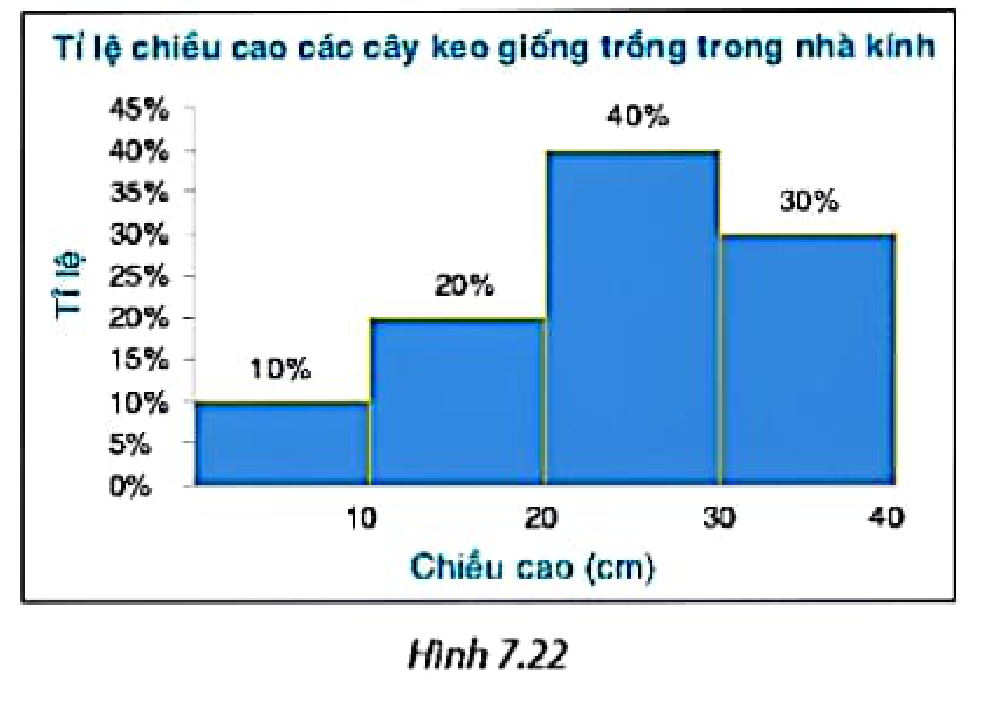

<!-- pdf:56 -->

# BÀI TẬP CUỐI CHƯƠNG VII

## ✏️ A. TRẮC NGHIỆM

*Sử dụng dữ liệu sau để trả lời các bài tập từ 7.22 đến 7.24.*

Gieo một con xúc xắc $50$ lần cho kết quả như sau:

| Số chấm xuất hiện | $1$ | $2$ | $3$ | $4$ | $5$ | $6$ |
| --- | :---: | :---: | :---: | :---: | :---: | :---: |
| Tần số | $8$ | $7$ | $?$ | $8$ | $6$ | $11$ |

7.22. Tần số xuất hiện của mặt $3$ chấm là

A. $9$.

B. $10$.

C. $11$.

D. $12$.

7.23. Tần số tương đối xuất hiện của mặt $5$ chấm là

A. $6\%$.

B. $8\%$.

C. $12\%$.

D. $14\%$.

7.24. Để biểu diễn bảng thống kê trên, **không** thể dùng loại biểu đồ nào sau đây?

A. Biểu đồ tranh.

B. Biểu đồ tần số dạng cột.

C. Biểu đồ tần số dạng đoạn thẳng.

D. Biểu đồ cột kép.

7.25. Cho bảng tần số tương đối ghép nhóm về thời gian đi từ nhà đến trường của học sinh lớp 9A như sau:

| Thời gian đến trường (phút) | $[0; 10)$ | $[10; 20)$ | $[20; 30)$ |
| --- | :---: | :---: | :---: |
| Tần số tương đối | $20\%$ | $55\%$ | $25\%$ |

Để vẽ biểu đồ tần số tương đối ghép nhóm dạng đoạn thẳng, ta dùng giá trị nào đại diện cho nhóm số liệu $[10; 20)$?

A. $10$.

B. $15$.

C. $20$.

D. $30$.

## ✏️ B. TỰ LUẬN

7.26. Biểu đồ tần số tương đối ghép nhóm Hình 7.22 cho biết tỉ lệ chiều cao của các cây keo giống do một kĩ sư lâm nghiệp đã trồng trong nhà kính.

*Hình 7.22*

Lập bảng tần số tương đối ghép nhóm cho dữ liệu được biểu diễn trên biểu đồ.

<!-- pdf:57 -->

7.27. Kĩ sư lâm nghiệp trên cũng trồng một số cây keo giống khác ngoài trời thu được kết quả như sau:

| Chiều cao ($\text{cm}$) | $[0; 10)$ | $[10; 20)$ | $[20; 30)$ | $[30; 40)$ |
| --- | :---: | :---: | :---: | :---: |
| Số cây | $5$ | $9$ | $4$ | $2$ |

a) Vẽ biểu đồ tần số tương đối ghép nhóm dạng cột cho bảng thống kê trên.

b) Từ biểu đồ vừa vẽ và biểu đồ cho trong bài tập 7.26, hãy so sánh chiều cao của các cây keo giống được trồng trong nhà kính và trồng ngoài trời.

7.28. Tỉ lệ học sinh bình chọn cho danh hiệu cầu thủ xuất sắc nhất trong giải bóng đá của trường được cho trong bảng sau:

| Cầu thủ | Huy | Minh | An | Thảo |
| --- | :---: | :---: | :---: | :---: |
| Tỉ lệ học sinh bình chọn | $30\%$ | $25\%$ | $10\%$ | $35\%$ |

Biết rằng có $500$ học sinh tham gia bình chọn.

a) Vẽ biểu đồ hình quạt tròn biểu diễn bảng tần số tương đối trên.

b) Lập bảng tần số biểu diễn số học sinh bình chọn cho danh hiệu cầu thủ xuất sắc nhất trong giải bóng đá của trường.

7.29. Qua đợt khám mắt, lớp 9A có $20$ học sinh bị cận thị trong đó có $10$ học sinh cận thị nhẹ, $8$ học sinh cận thị vừa và $2$ học sinh cận thị nặng. Biết rằng cận thị có số đo từ $0,25$ đến dưới $3,25$ dioptre là cận thị nhẹ; từ $3,25$ đến dưới $6,25$ dioptre là cận thị vừa; từ $6,25$ đến dưới $10,25$ dioptre là cận thị nặng.

a) Lập bảng tần số và bảng tần số tương đối ghép nhóm theo độ cận thị của các học sinh này.

b) Vẽ biểu đồ tần số tương đối ghép nhóm dạng đoạn thẳng cho bảng tần số tương đối ghép nhóm thu được ở câu a.

7.30. Lương của các công nhân một nhà máy được cho trong bảng sau:

| Lương (triệu đồng) | $[5; 7)$ | $[7; 9)$ | $[9; 11)$ | $[11; 13)$ | $[13; 15)$ |
| --- | :---: | :---: | :---: | :---: | :---: |
| Số công nhân | $20$ | $50$ | $70$ | $40$ | $20$ |

a) Nêu các nhóm số liệu và tần số. Giải thích ý nghĩa cho một nhóm số liệu và tần số của nó.

b) Vẽ biểu đồ tần số tương đối ghép nhóm dạng cột cho bảng thống kê trên.

## 📷 Danh sách hình trong bài

| Mã hình | Trang PDF | Vị trí trong bài | Chú thích gốc |
| --- | :---: | --- | --- |
| H9-toan-bt-c07-01 | 56 | Bài tập 7.26 | Hình 7.22 |
