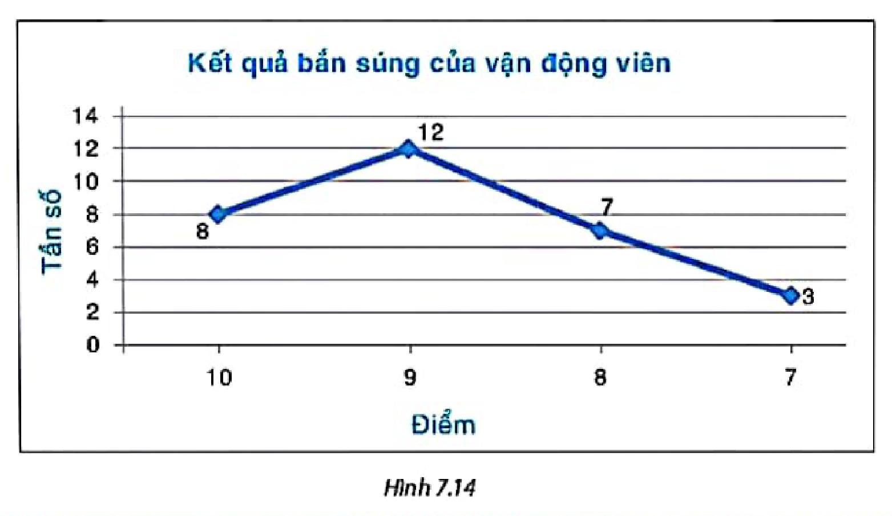
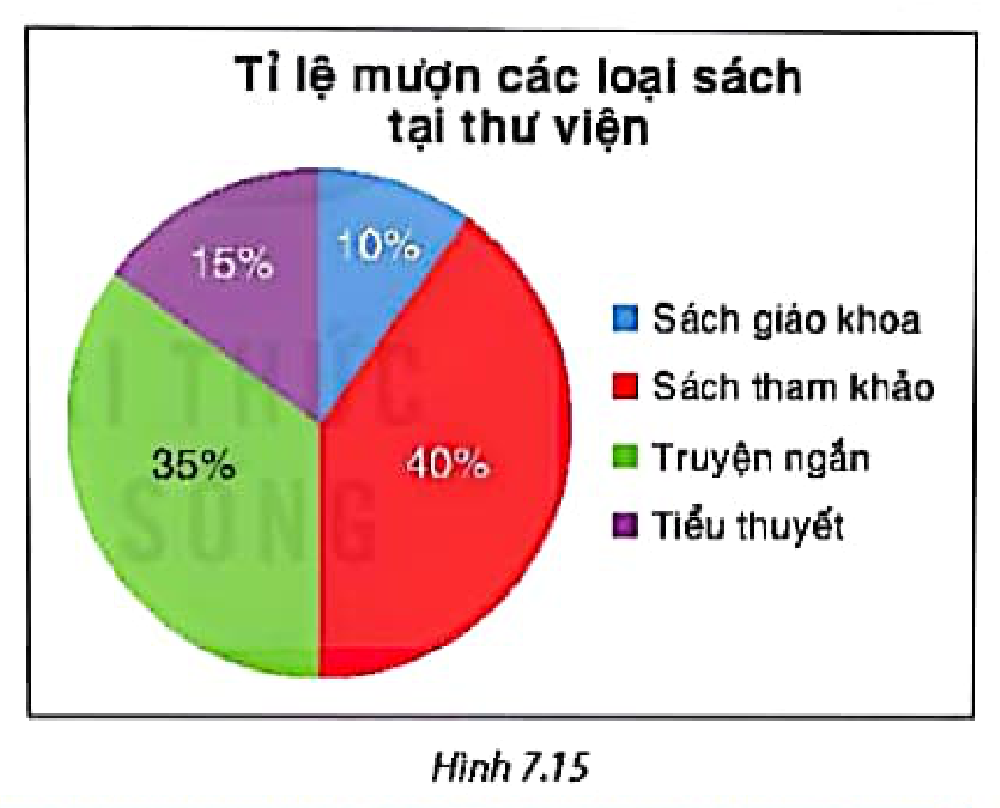
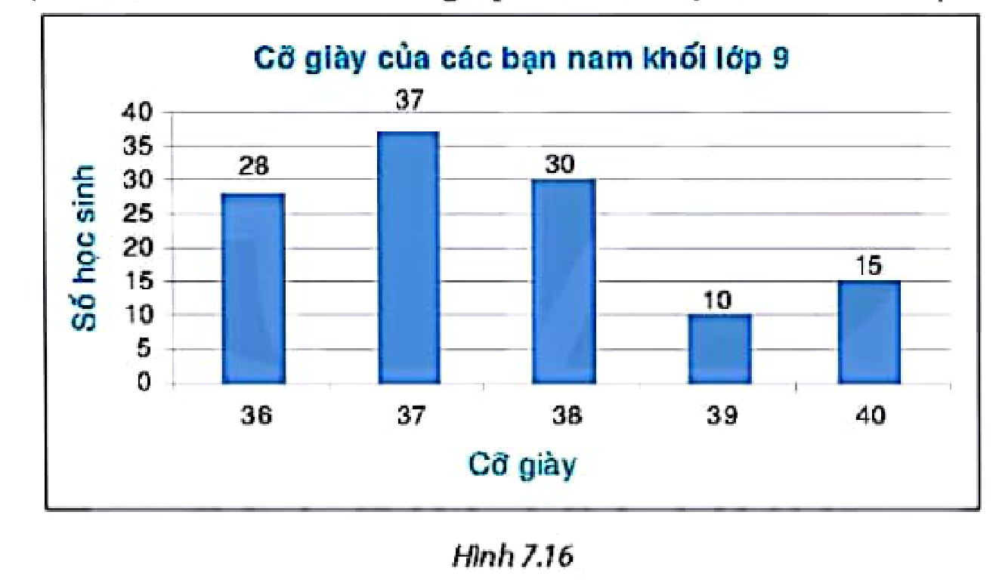

<!-- pdf:45 -->

# LUYỆN TẬP CHUNG (TRANG 43)

**Ví dụ 1:** Một vận động viên bắn $30$ viên đạn vào bia với các điểm số thu được như sau:

$10, 8, 9, 9, 10, 9, 9, 9, 8, 7, 10, 10, 9, 8, 7, 10, 9, 8, 7, 9, 9, 9, 10, 9, 10, 8, 9, 8, 8, 10.$

a) Lập bảng tần số và tần số tương đối cho dãy dữ liệu trên.

b) Vẽ biểu đồ tần số dạng đoạn thẳng cho bảng tần số thu được ở câu a.

**Giải**

a) Số lần vận động viên được $10, 9, 8, 7$ điểm tương ứng là $8, 12, 7, 3$. Ta có bảng tần số sau:

| Điểm | $10$ | $9$ | $8$ | $7$ |
| --- | :---: | :---: | :---: | :---: |
| Tần số | $8$ | $12$ | $7$ | $3$ |

Tổng số lần bắn là $n = 30$.

Tỉ lệ được $10, 9, 8, 7$ điểm tương ứng là $\dfrac{8}{30} \approx 26,7\%; \dfrac{12}{30} = 40\%; \dfrac{7}{30} \approx 23,3\%; \dfrac{3}{30} = 10\%$.

Ta có bảng tần số tương đối sau:

| Điểm | $10$ | $9$ | $8$ | $7$ |
| --- | :---: | :---: | :---: | :---: |
| Tần số tương đối | $26,7\%$ | $40\%$ | $23,3\%$ | $10\%$ |

b) Vẽ biểu đồ tần số dạng đoạn thẳng (H.7.14).

*Hình 7.14*

<!-- pdf:46 -->

**Ví dụ 2:** Bảng thống kê sau cho biết số lượt mượn các loại sách trong một tuần tại thư viện của một trường Trung học cơ sở.

| Loại sách | Sách giáo khoa | Sách tham khảo | Truyện ngắn | Tiểu thuyết |
| --- | :---: | :---: | :---: | :---: |
| Số lượt | $20$ | $80$ | $70$ | $30$ |

a) Lập bảng tần số tương đối cho bảng thống kê trên.

b) Vẽ biểu đồ hình quạt tròn biểu diễn bảng tần số tương đối thu được ở câu a.

**Giải**

a) Tổng số lượt mượn sách là $20 + 80 + 70 + 30 = 200$.

Tỉ lệ lượt mượn sách giáo khoa, sách tham khảo, truyện ngắn, tiểu thuyết tương ứng là

$\dfrac{20}{200} = 10\%; \quad \dfrac{80}{200} = 40\%; \quad \dfrac{70}{200} = 35\%; \quad \dfrac{30}{200} = 15\%.$

Ta có bảng tần số tương đối như sau:

| Loại sách | Sách giáo khoa | Sách tham khảo | Truyện ngắn | Tiểu thuyết |
| --- | :---: | :---: | :---: | :---: |
| Tần số tương đối | $10\%$ | $40\%$ | $35\%$ | $15\%$ |

b) Số đo cung tương ứng của các hình quạt biểu diễn tỉ lệ các loại sách được mượn là:

Sách giáo khoa: $360^\circ \cdot 10\% = 36^\circ$;

Sách tham khảo: $360^\circ \cdot 40\% = 144^\circ$;

Truyện ngắn: $360^\circ \cdot 35\% = 126^\circ$;

Tiểu thuyết: $360^\circ \cdot 15\% = 54^\circ$.

Biểu đồ hình quạt tròn như Hình 7.15.

*Hình 7.15*

## BÀI TẬP

7.11. Bảng thống kê sau cho biết số lượng học sinh của lớp 9B theo mức độ cận thị.

| Mức độ | Không cận thị | Cận thị nhẹ | Cận thị vừa | Cận thị nặng |
| --- | :---: | :---: | :---: | :---: |
| Số học sinh | $10$ | $13$ | $12$ | $5$ |

a) Lập bảng tần số tương đối cho bảng thống kê trên.

b) Đa số học sinh của lớp 9B cận thị hay không cận thị?

<!-- pdf:47 -->

7.12. Tỉ lệ bình chọn các tiết mục văn nghệ của các lớp 9A, 9B, 9C, 9D tham gia hội diễn văn nghệ khối lớp $9$ như sau:

| Lớp | 9A | 9B | 9C | 9D |
| --- | :---: | :---: | :---: | :---: |
| Tỉ lệ học sinh bình chọn | $35\%$ | $25\%$ | $30\%$ | $10\%$ |

Biết rằng có $300$ học sinh tham gia bình chọn. Lập bảng tần số biểu diễn số học sinh bình chọn cho tiết mục văn nghệ của mỗi lớp.

7.13. Bạn Hoàng khảo sát ý kiến của các bạn trong tổ về chất lượng phục vụ của căng tin trường thu được kết quả sau:

A, B, C, B, A, A, B, A, B, A,

trong đó A là mức Tốt, B là mức Trung bình, C là mức Kém.

Hãy lập bảng tần số và bảng tần số tương đối biểu diễn kết quả bạn Hoàng thu được.

7.14. Biểu đồ cột Hình 7.16 cho biết cỡ giày của các bạn nam khối lớp $9$ trong trường.

*Hình 7.16*

Lập bảng tần số và bảng tần số tương đối cho dữ liệu được biểu diễn trên biểu đồ.

7.15. Cho bảng tần số sau:

| Điểm thi môn Toán | $6$ | $7$ | $8$ | $9$ | $10$ |
| --- | :---: | :---: | :---: | :---: | :---: |
| Số học sinh | $5$ | $8$ | $12$ | $10$ | $4$ |

Vẽ biểu đồ tần số dạng đoạn thẳng cho bảng tần số trên.

7.16. Theo dõi thời tiết tại một điểm du lịch trong $30$ ngày người ta thu được bảng sau:

| Thời tiết | Không mưa | Mưa nhỏ | Mưa to |
| --- | :---: | :---: | :---: |
| Số ngày | $10$ | $8$ | $12$ |

a) Lập bảng tần số tương đối và vẽ biểu đồ hình quạt tròn biểu diễn bảng tần số tương đối thu được.

b) Ước lượng xác suất để một ngày trời có mưa ở điểm du lịch này.

## 📷 Danh sách hình trong bài

| Mã hình | Trang PDF | Vị trí trong bài | Chú thích gốc |
| --- | :---: | --- | --- |
| H9-toan-ltc-c07-01-01 | 45 | Ví dụ 1 | Hình 7.14 |
| H9-toan-ltc-c07-01-02 | 46 | Ví dụ 2 | Hình 7.15 |
| H9-toan-ltc-c07-01-03 | 47 | Bài tập 7.14 | Hình 7.16 |
