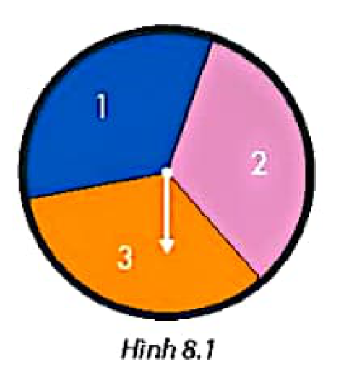

<!-- pdf:58 -->
<!-- Phần giới thiệu đầu Chương VIII (nửa trên trang PDF 58): XÁC SUẤT — CHƯƠNG VIII: XÁC SUẤT CỦA BIẾN CỐ TRONG MỘT SỐ MÔ HÌNH XÁC SUẤT ĐƠN GIẢN -->

Trong chương này các em sẽ được học cách tính xác suất của một số biến cố liên quan tới phép thử gồm một hoặc hai hành động, thực nghiệm đơn giản tiến hành liên tiếp hay đồng thời.

# BÀI 25: PHÉP THỬ NGẪU NHIÊN VÀ KHÔNG GIAN MẪU

## 🔤 Khái niệm, thuật ngữ

- Phép thử ngẫu nhiên
- Không gian mẫu của phép thử

## 🎯 Kiến thức, kĩ năng

- Nhận biết phép thử ngẫu nhiên và không gian mẫu của phép thử.

## 🔴 Mở đầu

Ở lớp $8$ ta đã làm quen với những hành động, thực nghiệm đơn giản, mà kết quả của chúng không thể biết được trước khi thực hiện. Trong bài học này, chúng ta sẽ gặp những hành động, thực nghiệm phức tạp hơn hoặc được tiến hành liên tiếp hay đồng thời.

Một cửa hàng muốn tặng hai phần quà cho hai trong bốn khách hàng có lượng mua nhiều nhất trong tháng bằng cách rút thăm ngẫu nhiên. Việc rút thăm được tiến hành như sau: Nhân viên viết tên $4$ khách hàng đó vào $4$ lá phiếu để vào một chiếc hộp. Nhân viên rút ngẫu nhiên một lá phiếu trong hộp. Lá phiếu rút ra không trả lại vào hộp. Sau đó, nhân viên tiếp tục rút ngẫu nhiên một lá phiếu từ ba lá phiếu còn lại. Hai khách hành có tên trong hai lá phiếu được rút ra là hai khách hàng được tặng quà. Hỏi có bao nhiêu kết quả có thể xảy ra?

<!-- pdf:59 -->

**Phép thử ngẫu nhiên và không gian mẫu**

**HĐ:** Xét *tình huống mở đầu*.

a) Hỏi trước khi rút thăm có thể nói trước hai khách hàng nào được chọn hay không?

b) Cho ví dụ về ba trường hợp có thể xảy ra.

> - Một hoặc một số hành động, thực nghiệm được tiến hành liên tiếp hay đồng thời mà kết quả của chúng không thể biết được trước khi thực hiện nhưng có thể liệt kê được tất cả các kết quả có thể xảy ra, được gọi là một **phép thử ngẫu nhiên**, gọi tắt là **phép thử**.
> - Tập hợp tất cả các kết quả có thể xảy ra của phép thử (gọi tắt là tập tất cả các kết quả có thể của phép thử) được gọi là **không gian mẫu của phép thử**.
> Không gian mẫu của phép thử được kí hiệu là $\Omega$.

**Ví dụ 1:** Bạn Lan gieo một con xúc xắc và bạn Hoà gieo một đồng xu. Quan sát số chấm xuất hiện trên con xúc xắc và mặt xuất hiện của đồng xu.

a) Phép thử và kết quả của phép thử là gì?

b) Mô tả không gian mẫu của phép thử. Không gian mẫu có bao nhiêu phần tử?

**Giải**

a) Phép thử là bạn Lan gieo một con xúc xắc và bạn Hoà gieo một đồng xu. Kết quả của phép thử là số chấm xuất hiện trên con xúc xắc và mặt xuất hiện của đồng xu (mặt sấp (S), mặt ngửa (N)).

b) Ta liệt kê được tất cả các kết quả có thể của phép thử bằng cách lập bảng sau:

| Đồng xu \ Xúc xắc | $1$ | $2$ | $3$ | $4$ | $5$ | $6$ |
| :---: | :---: | :---: | :---: | :---: | :---: | :---: |
| S | $(1, \text{S})$ | $(2, \text{S})$ | $(3, \text{S})$ | $(4, \text{S})$ | $(5, \text{S})$ | $(6, \text{S})$ |
| N | $(1, \text{N})$ | $(2, \text{N})$ | $(3, \text{N})$ | $(4, \text{N})$ | $(5, \text{N})$ | $(6, \text{N})$ |
<!-- ocr-ok: đã đối chiếu ảnh trang PDF 59, bảng hai chiều có đường chéo ở ô đầu -->

Mỗi ô là một kết quả có thể. Không gian mẫu là tập hợp $12$ ô của bảng trên. Do đó không gian mẫu của phép thử là $\Omega = \{(1, \text{S}); (2, \text{S}); (3, \text{S}); (4, \text{S})\ (5, \text{S})\ (6, \text{S}); (1, \text{N}); (2, \text{N}); (3, \text{N}); (4, \text{N}); (5, \text{N}); (6, \text{N})\}$. Vậy không gian mẫu có $12$ phần tử.

<!-- pdf:60 -->

**Luyện tập 1:** Một tấm bìa cứng hình tròn được chia làm ba hình quạt bằng nhau, đánh số $1; 2; 3$ và được gắn vào trục quay có mũi tên cố định ở tâm (H.8.1). Bạn Hiền quay tấm bìa liên tiếp hai lần và quan sát xem mũi tên chỉ vào hình quạt nào khi tấm bìa dừng lại.

*Hình 8.1*

a) Phép thử và kết quả của phép thử là gì?

b) Mô tả không gian mẫu của phép thử. Không gian mẫu có bao nhiêu phần tử?

*Gợi ý.* Ta liệt kê được tất cả các kết quả có thể của phép thử bằng cách lập bảng như mẫu sau:

| Lần 1 \ Lần 2 | $1$ | $2$ | $3$ |
| :---: | :---: | :---: | :---: |
| $1$ | $(1, 1)$ | ... | ... |
| $2$ | ... | ... | ... |
| $3$ | ... | ... | $(3, 3)$ |

**Ví dụ 2:** Một hộp kín đựng $4$ quả bóng có cùng khối lượng và kích thước, được đánh số $1; 2; 3; 4$. Lấy ngẫu nhiên lần lượt hai quả bóng từ hộp, quả bóng được lấy ra lần đầu không trả lại vào hộp. Quan sát hai số ghi trên hai quả bóng được lấy ra.

a) Phép thử và kết quả của phép thử là gì?

b) Mô tả không gian mẫu của phép thử. Không gian mẫu có bao nhiêu phần tử?

**Giải**

a) Phép thử là lấy ngẫu nhiên lần lượt hai quả bóng từ hộp, quả bóng được lấy ra lần đầu không trả lại vào hộp.

Kết quả của phép thử là một cặp số $(a, b)$, trong đó $a$ và $b$ tương ứng là số ghi trên quả bóng được lấy ra ở lần thứ nhất và lần thứ hai. Vì quả bóng được lấy ra lần đầu không trả lại vào hộp nên $a \ne b$.

b) Ta liệt kê được tất cả các kết quả có thể của phép thử bằng cách lập bảng như sau:

| Lần 1 \ Lần 2 | $1$ | $2$ | $3$ | $4$ |
| :---: | :---: | :---: | :---: | :---: |
| $1$ | ~~$(1, 1)$~~ | $(1, 2)$ | $(1, 3)$ | $(1, 4)$ |
| $2$ | $(2, 1)$ | ~~$(2, 2)$~~ | $(2, 3)$ | $(2, 4)$ |
| $3$ | $(3, 1)$ | $(3, 2)$ | ~~$(3, 3)$~~ | $(3, 4)$ |
| $4$ | $(4, 1)$ | $(4, 2)$ | $(4, 3)$ | ~~$(4, 4)$~~ |

Chú ý rằng $a \ne b$ nên cặp có hai phần tử trùng nhau không được tính, tức là trong bảng ta phải xoá $4$ ô: $(1, 1), (2, 2), (3, 3), (4, 4)$. Do đó không gian mẫu của phép thử là

$\Omega = \{(1, 2); (1, 3); (1, 4); (2, 1); (2, 3); (2, 4); (3, 1); (3, 2); (3, 4); (4, 1); (4, 2); (4, 3)\}.$

Vậy không gian mẫu có $12$ phần tử.

<!-- pdf:61 -->

**Luyện tập 2:** Trở lại *tình huống mở đầu*.
<!-- ocr-ok: đã đối chiếu ảnh trang PDF 61, OCR đọc sai nhãn Luyện tập 2 nền xanh -->

a) Phép thử và kết quả của phép thử là gì?

b) Mô tả không gian mẫu của phép thử. Không gian mẫu có bao nhiêu phần tử?

*Gợi ý.* Kí hiệu bốn khách hàng có lượng mua nhiều nhất lần lượt là A, B, C và D rồi làm tương tự như Ví dụ 2.

**Vận dụng:** Màu hạt của đậu Hà Lan có hai kiểu hình: màu vàng và màu xanh, có hai gene ứng với hai kiểu hình này allele trội A và allele lặn a. Hình dạng hạt của đậu Hà Lan có hai kiểu hình: hạt trơn và hạt nhăn, có hai gene ứng với hai kiểu hình này allele trội B và allele lặn b.

Khi cho lai hai cây đậu Hà Lan, cây con lấy ngẫu nhiên một gene từ cây bố và một gene từ cây mẹ để hình thành một cặp gene. Phép thử là cho lai hai cây đậu Hà Lan, trong đó cây bố có kiểu gene là $(\text{AA}, \text{Bb})$, cây mẹ có kiểu gene là $(\text{Aa}, \text{Bb})$.

Hãy mô tả không gian mẫu của phép thử trên. Không gian mẫu có bao nhiêu phần tử?

*Gợi ý.* Về kiểu gene, có hai kiểu gene ứng với màu hạt của cây con là AA; Aa.

Có bốn kiểu gene ứng với hình dạng hạt của cây con là BB; Bb; bB; bb.

Liệt kê được tất cả các kết quả có thể của phép thử bằng cách lập bảng theo mẫu sau:

| Màu hạt \ Dạng hạt | BB | Bb | bB | bb |
| :---: | :---: | :---: | :---: | :---: |
| AA | ... | ... | ... | ... |
| Aa | ... | ... | ... | ... |

## BÀI TẬP

8.1. Chọn ngẫu nhiên một gia đình có hai con và quan sát giới tính của hai người con đó.

a) Phép thử và kết quả của phép thử là gì?

b) Mô tả không gian mẫu của phép thử.

8.2. Một hộp đựng $5$ tấm thẻ ghi các số $1; 2; 3; 4; 5$. Rút ngẫu nhiên lần lượt hai tấm thẻ từ hộp, tấm thẻ rút ra lần đầu không trả lại vào hộp.

a) Phép thử và kết quả của phép thử là gì?

b) Mô tả không gian mẫu của phép thử. Không gian mẫu có bao nhiêu phần tử?

8.3. Có hai nhóm học sinh: Nhóm I có ba học sinh nam là Huy, Sơn, Tùng; nhóm II có ba học sinh nữ là Hồng, Phương, Linh. Giáo viên chọn ngẫu nhiên một học sinh từ mỗi nhóm.

a) Phép thử và kết quả của phép thử là gì?

b) Mô tả không gian mẫu của phép thử. Không gian mẫu có bao nhiêu phần tử?

8.4. Xếp ngẫu nhiên ba bạn Mai, Việt, Lan trên một chiếc ghế dài.

a) Phép thử và kết quả của phép thử là gì?

b) Mô tả không gian mẫu của phép thử. Không gian mẫu có bao nhiêu phần tử?

## 📷 Danh sách hình trong bài

| Mã hình | Trang PDF | Vị trí trong bài | Chú thích gốc |
| --- | :---: | --- | --- |
| H9-toan-b25-01 | 60 | Luyện tập 1 | Hình 8.1 |
