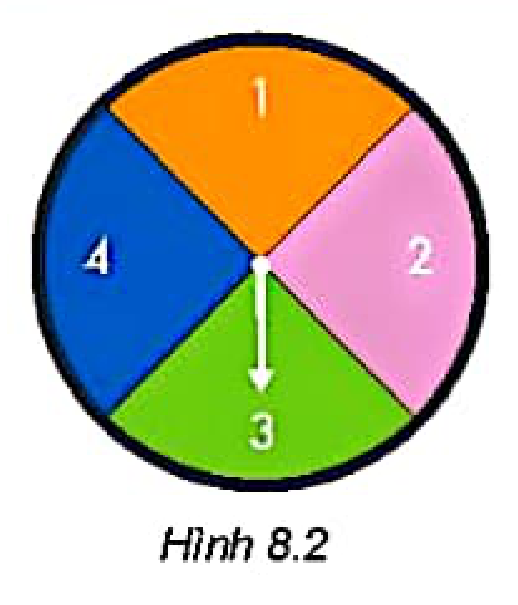

<!-- pdf:62 -->

# BÀI 26: XÁC SUẤT CỦA BIẾN CỐ LIÊN QUAN TỚI PHÉP THỬ

## 🔤 Khái niệm, thuật ngữ

- Biến cố
- Kết quả thuận lợi

## 🎯 Kiến thức, kĩ năng

- Biết tính xác suất của biến cố liên quan đến phép thử gồm một hoặc hai hành động, thực nghiệm đơn giản tiến hành liên tiếp hay đồng thời.

## 🔴 Mở đầu

Màu hạt của đậu Hà Lan có hai kiểu hình là vàng và xanh. Có hai gene ứng với hai kiểu hình này là allele trội A và allele lặn a. Hình dạng hạt của đậu Hà Lan có hai kiểu hình là hạt trơn và hạt nhăn. Có hai gene ứng với hai kiểu hình này là allele trội B và allele lặn b. Khi cho lai hai cây đậu Hà Lan, cặp gene của cây con được lấy ngẫu nhiên một gene từ cây bố và một gene từ cây mẹ. Phép thử là cho lai hai cây đậu Hà Lan, trong đó cây bố và cây mẹ có kiểu hình là “hạt vàng và trơn”. Hỏi xác suất để cây con có kiểu hình như cây bố và cây mẹ là bao nhiêu?

## 1. KẾT QUẢ THUẬN LỢI CHO MỘT BIẾN CỐ LIÊN QUAN TỚI PHÉP THỬ

**Kết quả thuận lợi cho một biến cố**

**HĐ:** Bạn Tùng gieo một con xúc xắc liên tiếp hai lần. Xét các biến cố sau:

$E$: “Cả hai lần gieo con xúc xắc đều xuất hiện mặt có số chấm là số nguyên tố”;

$F$: “Cả hai lần gieo con xúc xắc đều không xuất hiện mặt có số chấm là số chẵn”.

a) Phép thử là gì?

b) Giả sử số chấm xuất hiện trên con xúc xắc trong lần gieo thứ nhất, thứ hai tương ứng là $2$ và $5$ chấm. Khi đó, biến cố nào xảy ra? Biến cố nào không xảy ra?

> Cho phép thử $T$. Xét biến cố $E$, ở đó việc xảy ra hay không xảy ra của $E$ tuỳ thuộc vào kết quả của phép thử $T$. Kết quả của phép thử $T$ làm cho biến cố $E$ xảy ra gọi là **kết quả thuận lợi** cho $E$.

**Ví dụ 1:** Một tấm bìa cứng hình tròn được chia làm bốn hình quạt bằng nhau, đánh số $1; 2; 3; 4$ và được gắn vào trục quay có mũi tên ở tâm (H.8.2). Bạn Tuấn quay tấm bìa hai lần, quan sát và ghi lại số của hình quạt mà mũi tên chỉ vào.

*Hình 8.2*

a) Phép thử là gì? Hãy mô tả không gian mẫu của phép thử.

<!-- pdf:63 -->

b) Xét biến cố $E$: “Tổng hai số ghi trên hai hình quạt ở hai lần quay bằng $5$”. Mô tả các kết quả thuận lợi cho biến cố $E$.

c) Xét biến cố $F$: “Tích hai số ghi trên hai hình quạt ở hai lần quay bằng $4$”. Mô tả các kết quả thuận lợi cho biến cố $F$.

**Giải**

a) Phép thử là quay tấm bìa hai lần. Kết quả của phép thử là một cặp số $(a, b)$, trong đó $a$ và $b$ tương ứng là số ghi trên các hình quạt mà mũi tên chỉ vào ở lần quay thứ nhất và thứ hai.

Ta liệt kê được tất cả các kết quả có thể của phép thử bằng cách lập bảng như sau:

| Lần 1 \ Lần 2 | $1$ | $2$ | $3$ | $4$ |
| :---: | :---: | :---: | :---: | :---: |
| $1$ | $(1, 1)$ | $(1, 2)$ | $(1, 3)$ | $(1, 4)$ |
| $2$ | $(2, 1)$ | $(2, 2)$ | $(2, 3)$ | $(2, 4)$ |
| $3$ | $(3, 1)$ | $(3, 2)$ | $(3, 3)$ | $(3, 4)$ |
| $4$ | $(4, 1)$ | $(4, 2)$ | $(4, 3)$ | $(4, 4)$ |

Mỗi ô trong bảng là một kết quả có thể. Không gian mẫu là tập hợp $16$ ô của bảng trên. Như vậy, không gian mẫu của phép thử là

$\Omega = \{(1, 1); (1, 2); (1, 3); (1, 4); (2, 1); (2, 2); (2, 3); (2, 4); (3, 1); (3, 2); (3, 3); (3, 4); (4, 1); (4, 2); (4, 3); (4, 4)\}.$

b) Các kết quả thuận lợi cho biến cố $E$ là $(1, 4); (2, 3); (3, 2); (4, 1)$.

c) Các kết quả thuận lợi cho biến cố $F$ là $(1, 4); (2, 2); (4, 1)$.

**Luyện tập 1:** Bạn Hoàng lấy ngẫu nhiên một quả cầu từ một túi đựng $2$ quả cầu gồm một quả màu đen và một quả màu trắng, có cùng khối lượng và kích thước. Bạn Hải rút ngẫu nhiên một tấm thẻ từ một hộp đựng $3$ tấm thẻ A, B, C.

a) Mô tả không gian mẫu của phép thử.

b) Xét các biến cố sau:

$E$: “Bạn Hoàng lấy được quả cầu màu đen”;

$F$: “Bạn Hoàng lấy được quả cầu màu trắng và bạn Hải không rút được tấm thẻ A”.

Hãy mô tả các kết quả thuận lợi cho hai biến cố $E$ và $F$.

## 2. TÍNH XÁC SUẤT CỦA BIẾN CỐ LIÊN QUAN ĐẾN PHÉP THỬ KHI CÁC KẾT QUẢ CỦA PHÉP THỬ ĐỒNG KHẢ NĂNG

> Giả sử rằng các kết quả có thể của phép thử $T$ là đồng khả năng. Khi đó **xác suất** $P(E)$ của biến cố $E$ bằng tỉ số giữa số kết quả thuận lợi cho biến cố $E$ và số phần tử của tập $\Omega$:
> $P(E) = \dfrac{n(E)}{n(\Omega)},$
> trong đó $\Omega$ là không gian mẫu của $T$; $n(E)$ là số kết quả thuận lợi cho biến cố $E$ và $n(\Omega)$ là số phần tử của tập $\Omega$.

<!-- pdf:64 -->

**Cách tính xác suất của một biến cố**

<!-- term: Các bước tính xác suất của một biến cố -->
Việc tính xác suất của một biến cố $E$ gồm các bước sau:
*Bước 1.* Mô tả không gian mẫu của phép thử. Từ đó xác định số phần tử của không gian mẫu $\Omega$.
*Bước 2.* Chứng tỏ các kết quả có thể của phép thử là đồng khả năng.
*Bước 3.* Mô tả các kết quả thuận lợi cho biến cố $E$. Từ đó xác định số kết quả thuận lợi cho biến cố $E$.
*Bước 4.* Lập tỉ số giữa số kết quả thuận lợi cho biến cố $E$ với số phần tử của không gian mẫu $\Omega$.

**Ví dụ 2:** Ba bạn Bảo, Châu, Dương được xếp ngẫu nhiên ngồi trên một hàng ghế có ba chỗ ngồi. Tính xác suất của các biến cố sau:

a) $E$: “Bảo không ngồi ngoài cùng bên phải”;

b) $F$: “Châu và Dương không ngồi cạnh nhau”.

**Giải**

Kí hiệu ba bạn Bảo, Châu, Dương lần lượt là B, C, D.

Ta liệt kê các kết quả có thể xảy ra:

- Bảo ngồi ngoài cùng bên trái: có $2$ cách xếp là BCD và BDC.
- Bảo ngồi giữa: có $2$ cách xếp là CBD và DBC.
- Bảo ngồi ngoài cùng bên phải: có $2$ cách xếp là CDB và DCB.

Vậy không gian mẫu của phép thử là $\Omega = \{\text{BCD}; \text{BDC}; \text{CBD}; \text{DBC}; \text{CDB}; \text{DCB}\}$. Tập $\Omega$ có $6$ phần tử.

Vì việc xếp chỗ ngồi là ngẫu nhiên nên các kết quả có thể là đồng khả năng.

a) Có $4$ kết quả thuận lợi cho biến cố $E$ là BCD, BDC, CBD và DBC. Vậy $P(E) = \dfrac{4}{6} = \dfrac{2}{3}$.

b) Có $2$ kết quả thuận lợi cho biến cố $F$ là CBD và DBC. Vậy $P(F) = \dfrac{2}{6} = \dfrac{1}{3}$.

**Luyện tập 2:** Cho hai túi I và II, mỗi túi chứa $3$ tấm thẻ được ghi các số $2; 3; 7$. Rút ngẫu nhiên từ mỗi túi ra một tấm thẻ và ghép thành số có hai chữ số với chữ số trên tấm thẻ rút từ túi I là chữ số hàng chục. Tính xác suất của các biến cố sau:

a) $A$: “Số tạo thành chia hết cho $4$”;

b) $B$: “Số tạo thành là số nguyên tố”.

**Ví dụ 3:** Để trả lời câu hỏi trong *tình huống mở đầu* ta cần biết kiểu gene của cây bố và cây mẹ. Giả sử cây bố có kiểu gene là $(\text{AA}, \text{Bb})$, cây mẹ có kiểu gene là $(\text{Aa}, \text{Bb})$. Khi đó yêu cầu bài toán trở thành tính xác suất để cây con có hạt vàng và trơn.

<!-- pdf:65 -->

**Giải**

Ở Bài 25, ta đã biết không gian mẫu là:

$\Omega = \{(\text{AA}, \text{BB}); (\text{AA}, \text{Bb}); (\text{AA}, \text{bB}); (\text{AA}, \text{bb}); (\text{Aa}, \text{BB}); (\text{Aa}, \text{Bb}); (\text{Aa}, \text{bB}); (\text{Aa}, \text{bb})\}.$

Tập $\Omega$ có $8$ phần tử. Phép thử có $8$ kết quả có thể. Do cây con chọn ngẫu nhiên một gene từ cây bố và một gene từ cây mẹ nên các kết quả có thể trên là đồng khả năng.

Gọi $M$ là biến cố “Cây con có hạt vàng và trơn”.

Cây con có hạt vàng và trơn nếu trong gene màu hạt có ít nhất một allele trội A và trong gene dạng hạt có ít nhất một allele trội B.

Có $6$ kết quả thuận lợi cho biến cố $M$ là $(\text{AA}, \text{BB}); (\text{AA}, \text{Bb}); (\text{AA}, \text{bB}); (\text{Aa}, \text{BB}); (\text{Aa}, \text{Bb}); (\text{Aa}, \text{bB})$.

Vậy $P(M) = \dfrac{6}{8} = \dfrac{3}{4}$.

**Luyện tập 3:** Trở lại Ví dụ 3, tính xác suất để cây con có hạt vàng và nhăn.

## BÀI TẬP

8.5. Chọn ngẫu nhiên một gia đình có hai con. Giả thiết rằng biến cố “Sinh con trai” và biến cố “Sinh con gái” là đồng khả năng. Tính xác suất của các biến cố sau:

$A$: “Gia đình đó có cả con trai và con gái”;

$B$: “Gia đình đó có con trai”.

8.6. Gieo đồng thời hai con xúc xắc cân đối, đồng chất I và II. Tính xác suất các biến cố sau:

$E$: “Có đúng một con xúc xắc xuất hiện mặt $6$ chấm”;

$F$: “Có ít nhất một con xúc xắc xuất hiện mặt $6$ chấm”;

$G$: “Tích của hai số chấm xuất hiện trên hai con xúc xắc nhỏ hơn hoặc bằng $6$”.

8.7. Bạn An gieo một đồng xu cân đối và bạn Bình rút ngẫu nhiên một tấm thẻ từ hộp chứa $5$ tấm thẻ ghi các số $1; 2; 3; 4; 5$. Tính xác suất của các biến cố sau:

$E$: “Rút được tấm thẻ ghi số lẻ”;

$F$: “Rút được tấm thẻ ghi số chẵn và đồng xu xuất hiện mặt sấp”;

$G$: “Rút được tấm thẻ ghi số $5$ hoặc đồng xu xuất hiện mặt ngửa”.

8.8. Có hai túi I và II mỗi túi chứa $4$ tấm thẻ được đánh số $1; 2; 3; 4$. Rút ngẫu nhiên từ mỗi túi ra một tấm thẻ và nhân hai số ghi trên hai tấm thẻ với nhau. Tính xác suất của các biến cố sau:

$A$: “Kết quả là một số lẻ”;

$B$: “Kết quả là $1$ hoặc một số nguyên tố”.

## 📷 Danh sách hình trong bài

| Mã hình | Trang PDF | Vị trí trong bài | Chú thích gốc |
| --- | :---: | --- | --- |
| H9-toan-b26-01 | 62 | Mở đầu | (sách không đánh số, ảnh minh hoạ hạt đậu Hà Lan màu xanh và màu vàng) |
| H9-toan-b26-02 | 62 | Mục 1, Ví dụ 1 | Hình 8.2 |
