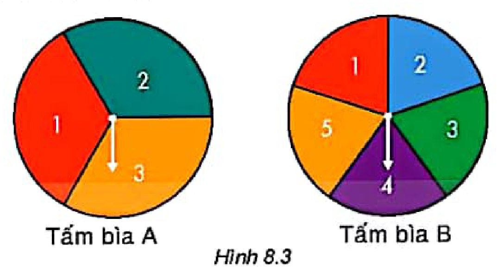
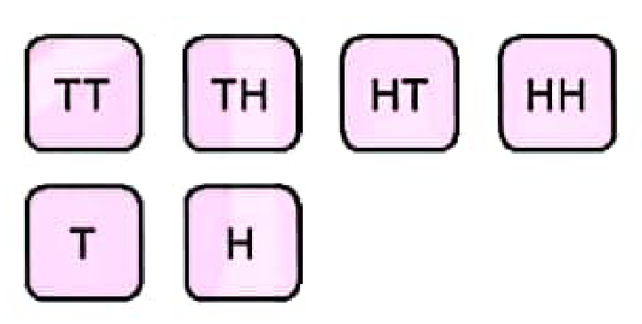

<!-- pdf:66 -->

# LUYỆN TẬP CHUNG (TRANG 64)

**Ví dụ:** Tấm bìa cứng A hình tròn được chia thành $3$ hình quạt có diện tích bằng nhau, đánh số $1; 2; 3$ và tấm bìa cứng B hình tròn được chia thành $5$ hình quạt có diện tích bằng nhau, đánh số $1; 2; 3; 4; 5$ (H.8.3). Trục quay của A và B được gắn mũi tên ở tâm. Bạn Nam quay tấm bìa A, bạn Bình quay tấm bìa B. Quan sát xem mũi tên dừng ở hình quạt nào trên hai tấm bìa.

*Hình 8.3*

a) Phép thử là gì?

b) Mô tả không gian mẫu của phép thử.

c) Tính xác suất của các biến cố sau:

$E$: “Tích hai số ở hình quạt mà hai mũi tên chỉ vào bằng $6$”;

$F$: “Tích hai số ở hình quạt mà hai mũi tên chỉ vào nhỏ hơn $5$”;

$G$: “Tích hai số ở hình quạt mà hai mũi tên chỉ vào là số chẵn”.

**Giải**

a) Phép thử là bạn Nam quay tấm bìa A, bạn Bình quay tấm bìa B.

b) Ta lập bảng sau:

| B \ A | $1$ | $2$ | $3$ |
| :---: | :---: | :---: | :---: |
| $1$ | $(1, 1)$ | $(1, 2)$ | $(1, 3)$ |
| $2$ | $(2, 1)$ | $(2, 2)$ | $(2, 3)$ |
| $3$ | $(3, 1)$ | $(3, 2)$ | $(3, 3)$ |
| $4$ | $(4, 1)$ | $(4, 2)$ | $(4, 3)$ |
| $5$ | $(5, 1)$ | $(5, 2)$ | $(5, 3)$ |

Mỗi ô trong bảng trên là một kết quả có thể. Các kết quả có thể này là đồng khả năng.

Không gian mẫu là $\Omega = \{(1, 1); (1, 2); (1, 3); (2, 1); (2, 2); (2, 3); (3, 1); (3, 2); (3, 3); (4, 1); (4, 2); (4, 3); (5, 1); (5, 2); (5, 3)\}$.

Không gian mẫu có $15$ phần tử.

<!-- pdf:67 -->

c) - Có $2$ kết quả thuận lợi cho biến cố $E$ là $(3, 2)$ và $(2, 3)$. Vậy $P(E) = \dfrac{2}{15}$.
<!-- ocr-ok: đã đối chiếu ảnh trang PDF 67, câu chứa nhiều cặp số và tỉ số trong LaTeX -->

- Các kết quả thuận lợi cho biến cố $F$: Có một ô có tích hai số bằng $1$ là $(1, 1)$; các ô có tích hai số bằng $2$ là $(1, 2); (2, 1)$; các ô có tích hai số bằng $3$ là $(1, 3); (3, 1)$; các ô có tích hai số bằng $4$ là $(2, 2); (4, 1)$. Do đó, có $7$ kết quả thuận lợi cho biến cố $F$ là $(1, 1); (1, 2); (2, 1); (1, 3); (3, 1); (2, 2); (4, 1)$. Vậy $P(F) = \dfrac{7}{15}$.

- Tích $ab$ là số chẵn khi và chỉ khi trong cặp $(a, b)$ có ít nhất một số chẵn.

Do đó, có $9$ kết quả thuận lợi cho biến cố $G$ là $(1, 2); (2, 1); (2, 2); (2, 3); (3, 2); (4, 1); (4, 2); (4, 3); (5, 2)$.

Vậy $P(G) = \dfrac{9}{15} = \dfrac{3}{5}$.

## BÀI TẬP

8.9. Có hai túi đựng các tấm thẻ. Túi I đựng $4$ tấm thẻ ghi các chữ cái TT, TH, HT và HH. Túi II đựng $2$ tấm thẻ ghi các chữ cái T và H. Từ mỗi túi rút ngẫu nhiên ra một tấm thẻ rồi ghép hai thẻ lại với nhau để được ba chữ cái, trong đó thẻ hai chữ cái đặt trước, chẳng hạn tấm thẻ TT ghép với tấm thẻ H được ba chữ cái TTH. Tính xác suất của các biến cố sau:

a) $E$: “Trong ba chữ cái, có hai chữ H và một chữ T”;

b) $F$: “Trong ba chữ cái, có nhiều nhất hai chữ T”.

8.10. Gieo đồng thời hai con xúc xắc cân đối và đồng chất I và II. Tính xác suất của các biến cố sau:

$G$: “Không có con xúc xắc nào xuất hiện mặt $6$ chấm”;

$H$: “Số chấm xuất hiện trên con xúc xắc I là số lẻ và số chấm xuất hiện trên con xúc xắc II lớn hơn $4$”;

$K$: “Số chấm xuất hiện trên cả hai con xúc xắc lớn hơn $2$”.

8.11. Trên một dãy phố có ba quán ăn A, B, C. Hai bạn Văn và Hải mỗi người chọn ngẫu nhiên một quán ăn để ăn trưa.

a) Mô tả không gian mẫu của phép thử.

b) Tính xác suất của các biến cố sau:

$E$: “Hai bạn cùng vào một quán”;

$F$: “Cả hai bạn không chọn quán C”;

$G$: “Có ít nhất một bạn chọn quán B”.

## 📷 Danh sách hình trong bài

| Mã hình | Trang PDF | Vị trí trong bài | Chú thích gốc |
| --- | :---: | --- | --- |
| H9-toan-ltc-c08-01-01 | 66 | Ví dụ | Hình 8.3 |
| H9-toan-ltc-c08-01-02 | 67 | Bài tập 8.9 | (sách không đánh số, minh hoạ $4$ tấm thẻ TT, TH, HT, HH và $2$ tấm thẻ T, H) |
