<!-- pdf:69 -->
<!-- Phần giới thiệu đầu Chương IX (nửa trên trang PDF 69): HÌNH HỌC PHẲNG — CHƯƠNG IX: ĐƯỜNG TRÒN NGOẠI TIẾP VÀ ĐƯỜNG TRÒN NỘI TIẾP -->

Trong chương này chúng ta sẽ tìm hiểu về những đường tròn đi qua các đỉnh của tam giác, tứ giác hay lục giác và những đường tròn lớn nhất có thể vẽ được nằm bên trong hình đó. Những đường tròn đó lần lượt được gọi là các đường tròn ngoại tiếp và các đường tròn nội tiếp.

# BÀI 27: GÓC NỘI TIẾP

## 🔤 Khái niệm, thuật ngữ

- Góc nội tiếp
- Cung bị chắn

## 🎯 Kiến thức, kĩ năng

- Nhận biết góc nội tiếp của một đường tròn.
- Nhận biết cung bị chắn bởi góc nội tiếp của một đường tròn.
- Giải thích mối liên hệ giữa số đo góc nội tiếp với số đo góc ở tâm chắn cùng một cung.

## 🔴 Mở đầu

Chúng ta đã biết số đo góc ở tâm $BOC$ của đường tròn $(O)$ trong Hình 9.1 bằng số đo của cung bị chắn $\overset{\frown}{BC}$. Vậy số đo của góc này có mối quan hệ gì với số đo của góc $BAC$?

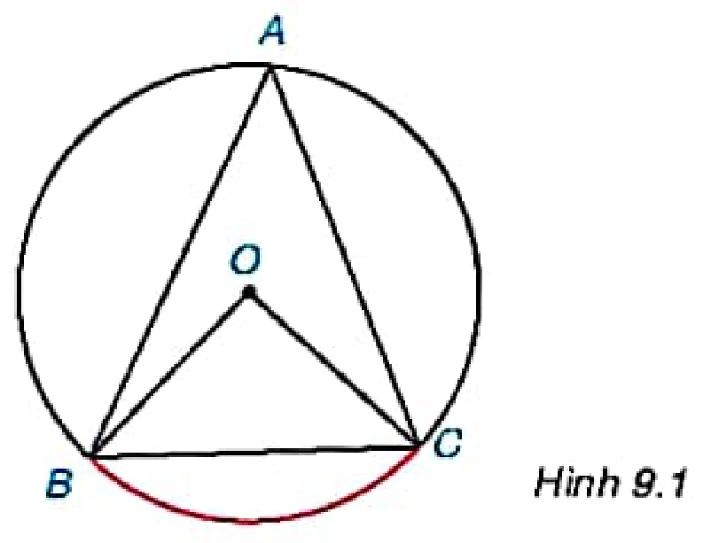
*Hình 9.1*

<!-- pdf:70 -->

**Góc nội tiếp và cung bị chắn**

**HĐ:** Vẽ đường tròn tâm $O$ có bán kính bằng $2\text{ cm}$ và dây cung $AB$ có độ dài bằng $2\text{ cm}$. Lấy một điểm $C$ tuỳ ý nằm trên cung lớn $AmB$ (H.9.2).

a) Cho biết số đo của góc ở tâm $AOB$ và số đo của cung bị chắn $AB$.

b) Đo góc $ACB$ và so sánh với kết quả của bạn bên cạnh.

c) Lấy điểm $D$ tuỳ ý nằm trên cung $ACB$. Đo góc $ADB$ và so sánh với các góc $ACB$ và $AOB$.

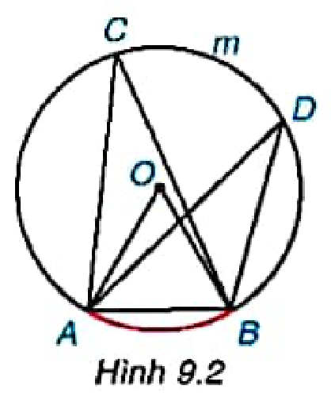
*Hình 9.2*

> **Pi:** $\Delta AOB$ là tam giác đều.
<!-- ocr-ok: đã đối chiếu ảnh trang PDF 70, bóng thoại của nhân vật Pi -->

Các góc $ACB$ và $ADB$ ở Hình 9.2 được gọi là các *góc nội tiếp* của đường tròn $(O)$ và $\overset{\frown}{AB}$ là *cung bị chắn*.

Tổng quát, chúng ta có định nghĩa về góc nội tiếp như sau:

**Định nghĩa**

> **Góc nội tiếp** là góc có đỉnh nằm trên đường tròn và hai cạnh chứa hai dây cung của đường tròn đó. Cung nằm bên trong góc được gọi là **cung bị chắn**.

**Ví dụ 1:** Trong các góc $A, B, C, D$ ở Hình 9.3, góc nào là góc nội tiếp, góc nào không phải góc nội tiếp? Vì sao?

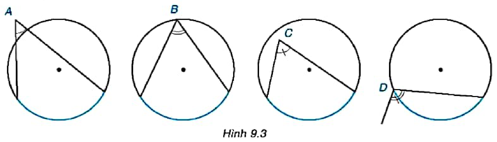
*Hình 9.3*

**Giải**

Các góc $A$ và $C$ không phải góc nội tiếp của đường tròn vì đỉnh không nằm trên đường tròn. Góc $D$ có một cạnh không chứa dây cung của đường tròn nên cũng không là góc nội tiếp của đường tròn. Góc $B$ có đỉnh $B$ nằm trên đường tròn và hai cạnh chứa hai dây cung của đường tròn nên là góc nội tiếp của đường tròn.

<!-- pdf:71 -->

Định lí sau cho biết mối liên hệ giữa góc nội tiếp với cung bị chắn:

**Định lí**

<!-- term: Số đo của góc nội tiếp -->
> Trong một đường tròn, số đo của góc nội tiếp bằng nửa số đo của cung bị chắn.

| GT | $A, B, C \in (O)$. |
| --- | --- |
| KL | $\widehat{ACB} = \dfrac{1}{2}\text{sđ}\overset{\frown}{AB}$ (cung $AB$ không chứa $C$). |
<!-- ocr-ok: đã đối chiếu ảnh trang PDF 71, bảng giả thiết kết luận chứa kí hiệu LaTeX -->

*Chứng minh.* Ta xét ba trường hợp sau (H.9.3).

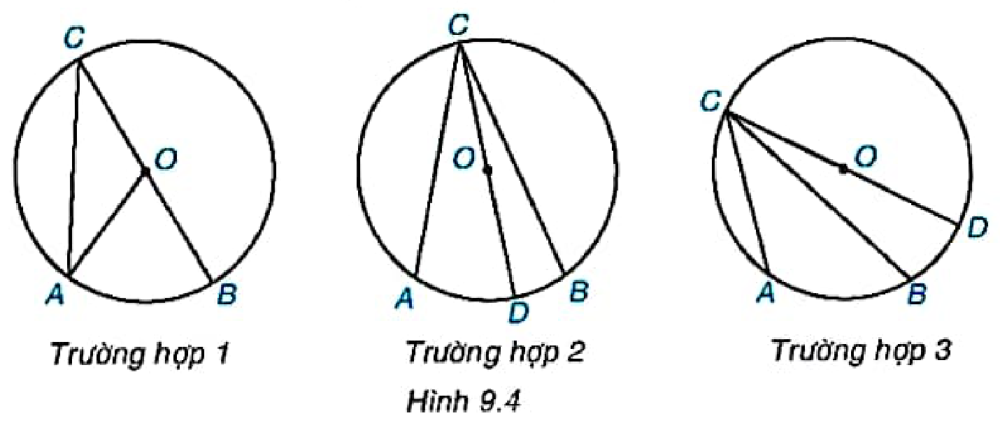
*Hình 9.4*

*Trường hợp 1:* Tâm $O$ nằm trên một cạnh của góc $ACB$. Giả sử $O \in CB$. Do tam giác $OAC$ cân tại $O$ và có tổng các góc bằng $180^\circ$ nên:

$2\widehat{ACB} = \widehat{ACO} + \widehat{CAO} = 180^\circ - \widehat{AOC} = \widehat{AOB}.$

Do $\widehat{AOB} = \text{sđ}\overset{\frown}{AB}$ (vì $\widehat{AOB}$ là góc ở tâm chắn cung $AB$) nên $\widehat{ACB} = \dfrac{1}{2}\widehat{AOB} = \dfrac{1}{2}\text{sđ}\overset{\frown}{AB}$.
<!-- ocr-ok: đã đối chiếu ảnh trang PDF 71, đoạn chứng minh chứa nhiều kí hiệu góc và cung bằng LaTeX -->

*Trường hợp 2:* Tâm $O$ nằm bên trong góc $ACB$. Vẽ đường kính $CD$. Áp dụng *Trường hợp 1* cho các góc nội tiếp $ACD$ và $DCB$ với cạnh $CD$ đi qua $O$, ta được:

$\widehat{ACD} = \dfrac{1}{2}\text{sđ}\overset{\frown}{AD}$ và $\widehat{DCB} = \dfrac{1}{2}\text{sđ}\overset{\frown}{DB}$.

Suy ra $\widehat{ACB} = \widehat{ACD} + \widehat{DCB} = \dfrac{1}{2}\text{sđ}\overset{\frown}{AD} + \dfrac{1}{2}\text{sđ}\overset{\frown}{DB} = \dfrac{1}{2}\text{sđ}\overset{\frown}{AB}$.

*Trường hợp 3:* Tâm $O$ nằm ngoài góc $ACB$. Vẽ đường kính $CD$. Áp dụng *Trường hợp 1* cho các góc nội tiếp $ACD$ và $BCD$ với cạnh $CD$ đi qua $O$, tương tự như trên ta được:

$\widehat{ACB} = \widehat{ACD} - \widehat{BCD} = \dfrac{1}{2}\text{sđ}\overset{\frown}{AD} - \dfrac{1}{2}\text{sđ}\overset{\frown}{BD} = \dfrac{1}{2}\text{sđ}\overset{\frown}{AB}.$

**Nhận xét.** Từ định lí trên ta có các khẳng định sau:

- Các góc nội tiếp bằng nhau chắn các cung bằng nhau.
- Các góc nội tiếp cùng chắn một cung hoặc chắn các cung bằng nhau thì bằng nhau.
- Các góc nội tiếp chắn cung nhỏ thì có số đo bằng nửa số đo của góc ở tâm chắn cùng một cung.
- Góc nội tiếp chắn nửa đường tròn là góc vuông.

<!-- pdf:72 -->

> ❓ Hãy cho biết số đo góc nội tiếp tìm được trong Hình 9.3 ở Ví dụ 1, biết rằng số đo của các cung màu xanh trong hình đều bằng $120^\circ$.

**Ví dụ 2:** Cho đường tròn $(O)$ và các điểm $A, B, C, D$ trên $(O)$ như Hình 9.5. Biết rằng $\widehat{BAC} = 60^\circ$, hãy tính số đo của các góc $BOC$ và $BDC$.

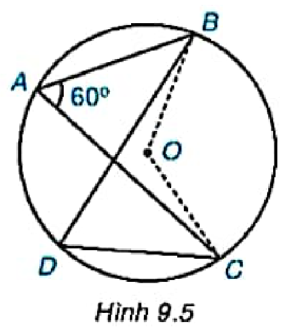
*Hình 9.5*

**Giải** (H.9.5). Xét đường tròn $(O)$, ta có:

- Do hai góc nội tiếp $\widehat{BDC}$ và $\widehat{BAC}$ cùng chắn cung $BC$ nên

$\widehat{BDC} = \widehat{BAC} = 60^\circ;$

- Vì góc nội tiếp $\widehat{BAC}$ và góc ở tâm $\widehat{BOC}$ cùng chắn cung nhỏ $BC$ nên

$\widehat{BOC} = 2\widehat{BAC} = 120^\circ.$

**Luyện tập:** Cho đường tròn tâm $O$ và hai dây cung $AB, CD$ cắt nhau tại điểm $X$ nằm trong đường tròn (H.9.6). Chứng minh rằng $\Delta AXC \backsim \Delta DXB$.

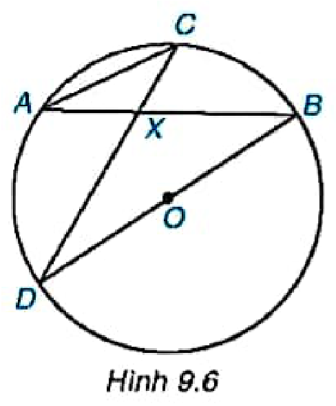
*Hình 9.6*

**Vận dụng:** Trở lại *tình huống mở đầu*, hãy tính số đo của góc $BAC$ nếu biết đường tròn có bán kính $2\text{ cm}$ và dây cung $BC = 2\sqrt{2}\text{ cm}$.

> **Pi:** Tam giác $BOC$ có phải tam giác vuông không?
<!-- ocr-ok: đã đối chiếu ảnh trang PDF 72, bóng thoại của nhân vật Pi -->

## BÀI TẬP

9.1. Những khẳng định nào sau đây là đúng?

a) Hai góc nội tiếp bằng nhau thì chắn cùng một cung.

b) Góc nội tiếp nhỏ hơn $90^\circ$ có số đo bằng nửa số đo của góc ở tâm chắn cùng một cung.

c) Góc nội tiếp chắn cung nhỏ có số đo bằng số đo của góc ở tâm chắn cùng một cung.

d) Hai góc nội tiếp bằng nhau thì chắn hai cung bằng nhau.

<!-- pdf:73 -->

9.2. Cho các điểm như Hình 9.7. Tính số đo các góc của tam giác $ABC$, biết rằng $\widehat{AOB} = 120^\circ$, $\widehat{BOC} = 80^\circ$.

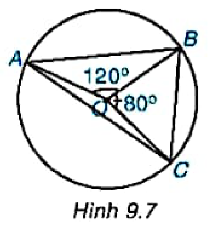
*Hình 9.7*

9.3. Cho đường tròn $(O)$ và hai dây cung $AC, BD$ cắt nhau tại $X$ (H.9.8). Tính số đo góc $AXB$ biết rằng $\widehat{ADB} = 30^\circ$ và $\widehat{DBC} = 50^\circ$.

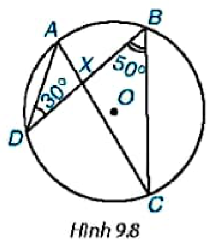
*Hình 9.8*

9.4. Cho đường tròn $(O)$ và hai dây cung $AB, CD$ cắt nhau tại điểm $I$ nằm trong $(O)$ (H.9.9).
<!-- ocr-ok: đã đối chiếu ảnh trang PDF 73, OCR đọc nhầm kí hiệu điểm I và (O) -->

a) Biết rằng $\widehat{AOC} = 60^\circ$, $\widehat{BOD} = 80^\circ$. Tính số đo của góc $AID$.

b) Chứng minh rằng $IA \cdot IB = IC \cdot ID$.

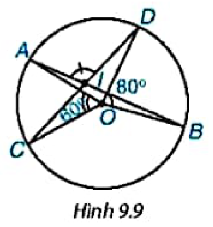
*Hình 9.9*

9.5. Cho đường tròn $(O)$, đường kính $AB$ và điểm $S$ nằm ngoài $(O)$. Cho hai đường thẳng $SA, SB$ lần lượt cắt $(O)$ tại $M$ (khác $A$) và $N$ (khác $B$). Gọi $P$ là giao điểm của $BM$ và $AN$ (H.9.10). Chứng minh rằng $SP$ vuông góc với $AB$.
<!-- ocr-ok: đã đối chiếu ảnh trang PDF 73, đoạn đề bài chứa nhiều kí hiệu điểm và đường thẳng bằng LaTeX -->

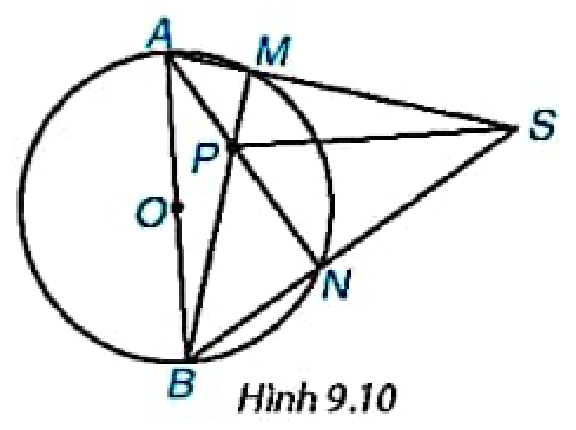
*Hình 9.10*

9.6. Trên sân bóng, khi trái bóng được đặt tại điểm phạt đền thì có góc sút bằng $36^\circ$ và trái bóng cách mỗi cọc gôn $11,6\text{ m}$ (H.9.11). Hỏi khi trái bóng đặt ở vị trí cách điểm phạt đền $11,6\text{ m}$ thì góc sút bằng bao nhiêu?

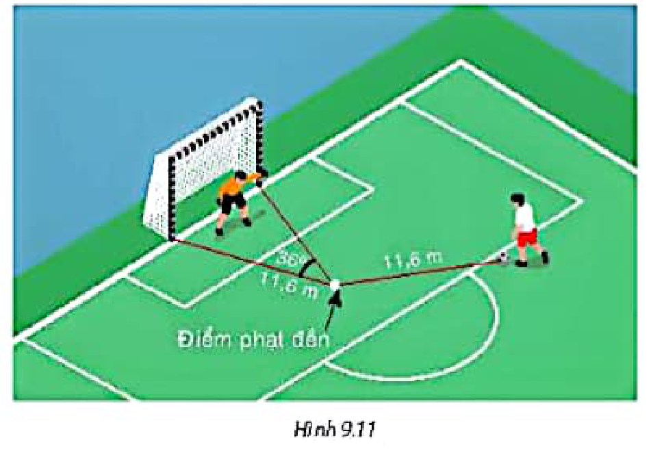
*Hình 9.11*

## 📷 Danh sách hình trong bài

| Mã hình | Trang PDF | Vị trí trong bài | Chú thích gốc |
| --- | :---: | --- | --- |
| H9-toan-b27-01 | 69 | Mở đầu | Hình 9.1 |
| H9-toan-b27-02 | 70 | Góc nội tiếp và cung bị chắn, HĐ | Hình 9.2 |
| H9-toan-b27-03 | 70 | Ví dụ 1 | Hình 9.3 |
| H9-toan-b27-04 | 71 | Định lí, Chứng minh | Hình 9.4 |
| H9-toan-b27-05 | 72 | Ví dụ 2 | Hình 9.5 |
| H9-toan-b27-06 | 72 | Luyện tập | Hình 9.6 |
| H9-toan-b27-07 | 73 | Bài tập 9.2 | Hình 9.7 |
| H9-toan-b27-08 | 73 | Bài tập 9.3 | Hình 9.8 |
| H9-toan-b27-09 | 73 | Bài tập 9.4 | Hình 9.9 |
| H9-toan-b27-10 | 73 | Bài tập 9.5 | Hình 9.10 |
| H9-toan-b27-11 | 73 | Bài tập 9.6 | Hình 9.11 |
