<!-- pdf:74 -->

# BÀI 28: ĐƯỜNG TRÒN NGOẠI TIẾP VÀ ĐƯỜNG TRÒN NỘI TIẾP CỦA MỘT TAM GIÁC

## 🔤 Khái niệm, thuật ngữ

- Đường tròn ngoại tiếp tam giác
- Đường tròn nội tiếp tam giác

## 🎯 Kiến thức, kĩ năng

- Nhận biết định nghĩa đường tròn ngoại tiếp tam giác.
- Xác định tâm và bán kính đường tròn ngoại tiếp tam giác, trong đó có tâm và bán kính đường tròn ngoại tiếp tam giác vuông, tam giác đều.
- Nhận biết định nghĩa đường tròn nội tiếp tam giác.
- Xác định tâm và bán kính đường tròn nội tiếp tam giác, trong đó có tâm và bán kính đường tròn nội tiếp tam giác đều.

## 🔴 Mở đầu

Cho trước một tam giác $ABC$. Bằng thước kẻ và compa, em có thể vẽ được một đường tròn đi qua ba đỉnh của tam giác và đường tròn tiếp xúc với cả ba cạnh của tam giác hay không?

## 1. ĐƯỜNG TRÒN NGOẠI TIẾP MỘT TAM GIÁC

**Khái niệm đường tròn ngoại tiếp tam giác**

**HĐ1:** Cho $d$ là đường trung trực của đoạn thẳng $AB$ và $O$ là một điểm trên $d$ (H.9.12). Hỏi đường tròn tâm $O$ đi qua $A$ thì có đi qua $B$ không?

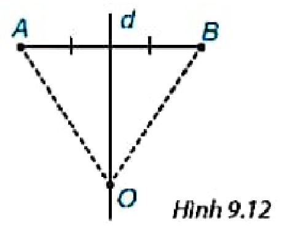
*Hình 9.12*

**HĐ2:** Cho tam giác $ABC$ có ba đường trung trực đồng quy tại $O$ (H.9.13). Hãy giải thích tại sao đường tròn $(O; OA)$ đi qua ba đỉnh của tam giác $ABC$.

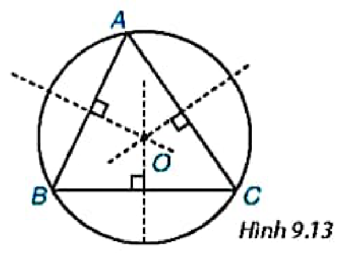
*Hình 9.13*

Đường tròn $(O; OA)$ như trên gọi là đường tròn ngoại tiếp tam giác $ABC$.

Tổng quát, ta có định nghĩa sau:

> **Đường tròn ngoại tiếp** một tam giác là đường tròn đi qua ba đỉnh của tam giác đó.

Trong Hình 9.13, đường tròn $(O)$ ngoại tiếp tam giác $ABC$. Ta cũng nói tam giác $ABC$ nội tiếp đường tròn $(O)$, hay $(O)$ là đường tròn ngoại tiếp tam giác $ABC$. Tâm $O$ là giao điểm của ba đường trung trực của tam giác $ABC$.

<!-- pdf:75 -->

> ❓ Hãy kể tên bốn tam giác nội tiếp đường tròn $(O)$ trong Hình 9.14.

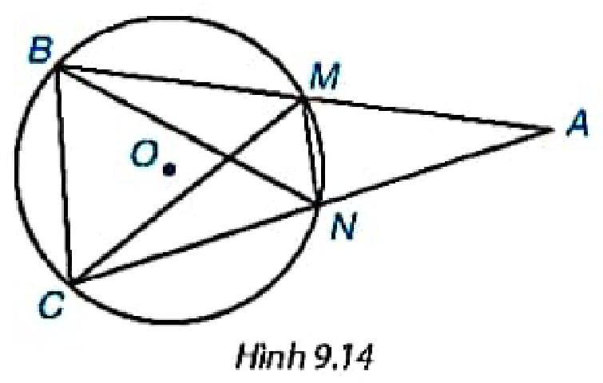
*Hình 9.14*

**Đường tròn ngoại tiếp tam giác vuông**

**HĐ3:** Cho tam giác $ABC$ vuông tại đỉnh $A$ (H.9.15). Gọi $N, P$ lần lượt là trung điểm của các cạnh $AB$ và $AC$.

a) Vẽ hai đường trung trực $a, b$ của các cạnh $AB, AC$, cắt nhau tại $M$.

b) Hãy giải thích vì sao $MN, MP$ là các đường trung bình của tam giác $ABC$.

c) Hãy giải thích vì sao $M$ là trung điểm của $BC$, từ đó suy ra đường tròn ngoại tiếp của tam giác $ABC$ có tâm $M$ và bán kính $MB = MC = \dfrac{BC}{2}$.

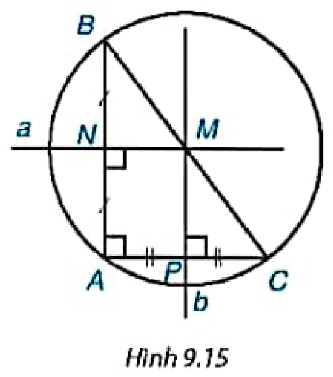
*Hình 9.15*

<!-- term: Tâm và bán kính đường tròn ngoại tiếp tam giác vuông -->
> Đường tròn ngoại tiếp tam giác vuông có tâm là trung điểm của cạnh huyền và bán kính bằng một nửa cạnh huyền.

**Ví dụ 1:** Cho tam giác $ABC$ vuông tại $A$ có $AB = 2\text{ cm}$, $AC = 4\text{ cm}$. Vẽ đường tròn $(O; R)$ ngoại tiếp tam giác $ABC$ và tính bán kính $R$.

**Giải** (H.9.16).

Lấy $O$ là trung điểm của $BC$ và vẽ đường tròn $(O)$ đi qua $A$. Khi đó, $(O)$ là đường tròn ngoại tiếp tam giác $ABC$.

Theo định lí Pythagore, ta có:

$BC^2 = AB^2 + AC^2 = 4 + 16 = 20$, hay $BC = 2\sqrt{5}\text{ cm}$.

Vậy đường tròn $(O)$ có bán kính $R = \dfrac{BC}{2} = \sqrt{5}\text{ cm}$.

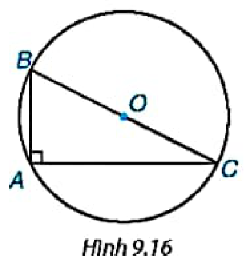
*Hình 9.16*

**Luyện tập 1:** Cho tam giác $ABC$ có $AC = 3\text{ cm}$, $AB = 4\text{ cm}$ và $BC = 5\text{ cm}$. Tính bán kính của đường tròn ngoại tiếp tam giác $ABC$.
<!-- ocr-ok: đã đối chiếu ảnh trang PDF 75, OCR không nhận diện nhãn Luyện tập 1 nền xanh -->

**Đường tròn ngoại tiếp tam giác đều**

**HĐ4:** a) Vẽ tam giác đều $ABC$. Hãy trình bày cách xác định tâm của đường tròn ngoại tiếp tam giác $ABC$ và vẽ đường tròn đó.

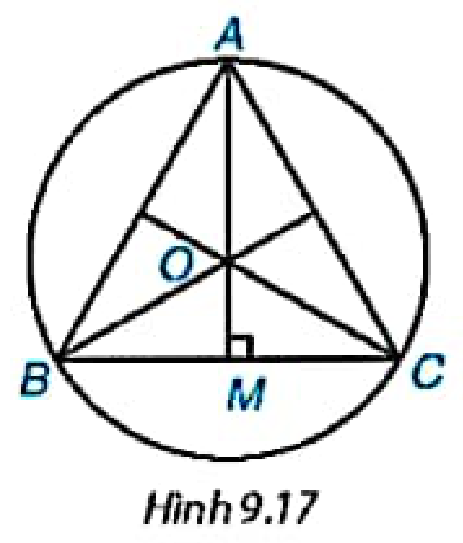
*Hình 9.17*

<!-- pdf:76 -->

b) Giải thích vì sao tâm $O$ của đường tròn ngoại tiếp tam giác $ABC$ trùng với trọng tâm của tam giác đó (H.9.17).

c) Giải thích vì sao $\widehat{OBM} = 30^\circ$ và $OB = \dfrac{\sqrt{3}}{3}BC$ (với $M$ là trung điểm của $BC$).

<!-- term: Tâm và bán kính đường tròn ngoại tiếp tam giác đều -->
> Đường tròn ngoại tiếp tam giác đều cạnh $a$ có tâm là trọng tâm của tam giác đó và bán kính bằng $\dfrac{\sqrt{3}}{3}a$.

**Ví dụ 2:** Cho tam giác đều $ABC$ có cạnh bằng $3\text{ cm}$. Vẽ đường tròn $(O; R)$ ngoại tiếp tam giác $ABC$. Tính bán kính $R$.

**Giải** (H.9.18).

Lấy $O$ là giao điểm của ba đường trung tuyến của tam giác $ABC$ và vẽ đường tròn $(O)$ đi qua $A$. Đường tròn $(O)$ là đường tròn ngoại tiếp tam giác $ABC$ có bán kính $R = \dfrac{\sqrt{3}}{3}BC = \sqrt{3}\text{ cm}$.

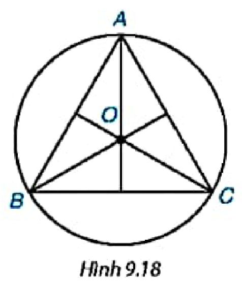
*Hình 9.18*

**Luyện tập 2:** Cho tam giác đều $ABC$ nội tiếp đường tròn $(O)$ có bán kính bằng $4\text{ cm}$. Tính độ dài các cạnh của tam giác.

## 2. ĐƯỜNG TRÒN NỘI TIẾP MỘT TAM GIÁC

**Đường tròn nội tiếp tam giác**

**HĐ5:** Cho tam giác $ABC$ có ba đường phân giác đồng quy tại điểm $I$. Gọi $D, E, F$ lần lượt là chân các đường vuông góc kẻ từ $I$ xuống các cạnh $BC, CA$ và $AB$ (H.9.19).

a) Hãy giải thích vì sao các điểm $D, E, F$ cùng nằm trên một đường tròn có tâm $I$.

b) Gọi $(I)$ là đường tròn trên. Hãy giải thích vì sao $(I)$ tiếp xúc với các cạnh của tam giác $ABC$.

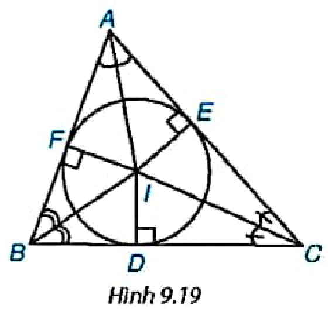
*Hình 9.19*

Đường tròn $(I)$ như trên được gọi là đường tròn nội tiếp tam giác $ABC$ với các tiếp điểm trên các cạnh $BC, CA, AB$ lần lượt là $D, E, F$. Ta cũng nói tam giác $ABC$ ngoại tiếp đường tròn $(I)$ (H.9.19).

Tổng quát, ta có định nghĩa sau:

> Đường tròn tiếp xúc với ba cạnh của tam giác được gọi là **đường tròn nội tiếp** tam giác. Tam giác đó được gọi là ngoại tiếp đường tròn. Tâm đường tròn nội tiếp tam giác là giao điểm ba đường phân giác của tam giác.

> **Pi:** Đường tròn tiếp xúc với một cạnh của tam giác nghĩa là tiếp xúc với đường thẳng chứa cạnh đó và có tiếp điểm nằm trên cạnh đó.

<!-- pdf:77 -->

> ❓ Mỗi tam giác có bao nhiêu đường tròn nội tiếp? Có bao nhiêu tam giác cùng ngoại tiếp một đường tròn?

**Đường tròn nội tiếp tam giác đều**

**HĐ6:** Cho tam giác $ABC$ đều có trọng tâm $G$.

a) Giải thích vì sao $G$ cũng là tâm đường tròn nội tiếp tam giác $ABC$.

b) Từ đó, giải thích vì sao bán kính đường tròn nội tiếp tam giác $ABC$ bằng một nửa bán kính đường tròn ngoại tiếp tam giác $ABC$ và bằng $\dfrac{\sqrt{3}}{6}BC$.

<!-- term: Tâm và bán kính đường tròn nội tiếp tam giác đều -->
> Đường tròn nội tiếp tam giác đều cạnh $a$ có tâm là trọng tâm của tam giác đó và bán kính bằng $\dfrac{\sqrt{3}}{6}a$.

**Ví dụ 3:** Cho tam giác $ABC$ ngoại tiếp đường tròn $(I)$. Biết rằng $\widehat{A} = 40^\circ$, $\widehat{B} = 60^\circ$. Tính số đo của các góc $BIC$, $CIA$ và $AIB$.

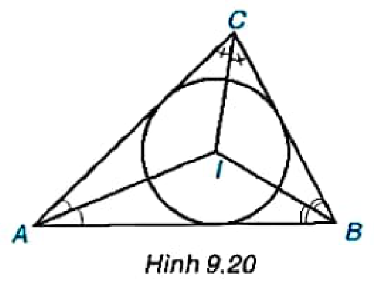
*Hình 9.20*

**Giải** (H.9.20).

Vì tổng ba góc của tam giác $ABC$ bằng $180^\circ$ nên $\widehat{ACB} = 180^\circ - \widehat{BAC} - \widehat{ABC} = 80^\circ$.

Vì tam giác $ABC$ ngoại tiếp đường tròn $(I)$ nên $I$ là giao điểm các đường phân giác của tam giác $ABC$. Do đó, ta có: $\widehat{CAI} = \widehat{BAI} = \dfrac{\widehat{BAC}}{2} = 20^\circ$;

$\widehat{CBI} = \widehat{ABI} = \dfrac{\widehat{ABC}}{2} = 30^\circ$; $\widehat{ACI} = \widehat{BCI} = \dfrac{\widehat{ACB}}{2} = 40^\circ$.

Vì tổng các góc trong tam giác $BIC$ bằng $180^\circ$ nên

$\widehat{BIC} = 180^\circ - \widehat{CBI} - \widehat{BCI} = 180^\circ - 30^\circ - 40^\circ = 110^\circ.$

Tương tự, $\widehat{CIA} = 180^\circ - \widehat{ACI} - \widehat{CAI} = 120^\circ$ và $\widehat{AIB} = 180^\circ - \widehat{ABI} - \widehat{BAI} = 130^\circ$.

**Thực hành**

Vẽ đường tròn nội tiếp của tam giác $ABC$ bằng thước kẻ và compa theo các bước sau:

– Vẽ tia phân giác góc $B$ như sau: Dùng compa vẽ một cung tròn tâm $B$ cắt hai cạnh $BC, BA$ lần lượt tại $X$ và $Y$. Vẽ hai cung tròn tâm $X, Y$ có cùng bán kính, hai cung này cắt nhau tại một điểm $Z$ khác $B$. Kẻ tia $BZ$ ta được tia phân giác góc $B$.

– Tương tự, vẽ tia phân giác góc $C$, cắt tia $BZ$ tại $I$.

– Vẽ đường cao $ID$ từ $I$ xuống $BC$ ($D$ thuộc $BC$). Vẽ đường tròn $(I; ID)$ (H.9.21).
<!-- ocr-ok: đã đối chiếu ảnh trang PDF 77, câu chứa nhiều kí hiệu điểm và đoạn thẳng bằng LaTeX -->

<!-- pdf:78 -->

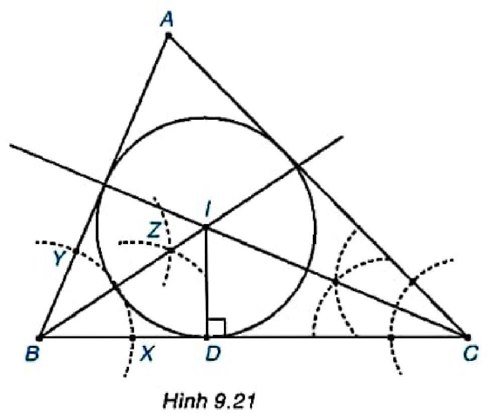
*Hình 9.21*

Khi đó đường tròn $(I; ID)$ là đường tròn nội tiếp tam giác $ABC$ cần vẽ.

**Luyện tập 3:** Cho tam giác đều $ABC$ (H.9.22).
<!-- ocr-ok: đã đối chiếu ảnh trang PDF 78, OCR không nhận diện nhãn Luyện tập 3 nền xanh -->

a) Vẽ đường tròn $(I; r)$ nội tiếp tam giác $ABC$.

b) Biết rằng $BC = 4\text{ cm}$, hãy tính bán kính $r$.

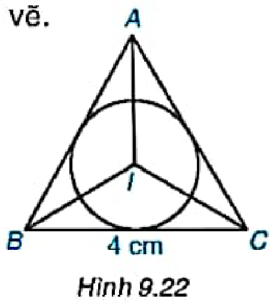
*Hình 9.22*

## BÀI TẬP

9.7. Cho đường tròn $(O)$ ngoại tiếp tam giác $ABC$. Tính bán kính của $(O)$, biết rằng tam giác $ABC$ vuông cân tại $A$ và có cạnh bên bằng $2\sqrt{2}\text{ cm}$.

9.8. Cho tam giác đều $ABC$ nội tiếp đường tròn $(O)$. Biết rằng đường tròn $(O)$ có bán kính bằng $3\text{ cm}$. Tính diện tích tam giác $ABC$.

9.9. Cho tam giác $ABC$ nội tiếp đường tròn $(O)$. Gọi $H$ là trực tâm của tam giác $ABC$. Chứng minh rằng $\widehat{BAH} = \widehat{OAC}$.

9.10. Cho đường tròn $(I)$ nội tiếp tam giác $ABC$ với các tiếp điểm trên các cạnh $AB, AC$ lần lượt là $E, F$. Chứng minh rằng $\widehat{EIF} + \widehat{BAC} = 180^\circ$.

9.11. Cho tam giác đều $ABC$ ngoại tiếp đường tròn $(I)$. Tính độ dài các cạnh của tam giác $ABC$ biết rằng bán kính của $(I)$ bằng $1\text{ cm}$.

9.12. Người ta muốn làm một khung gỗ hình tam giác đều để đặt vừa khít một chiếc đồng hồ hình tròn có đường kính $30\text{ cm}$ (H.9.23). Hỏi độ dài các cạnh (phía bên trong) của khung gỗ phải bằng bao nhiêu?

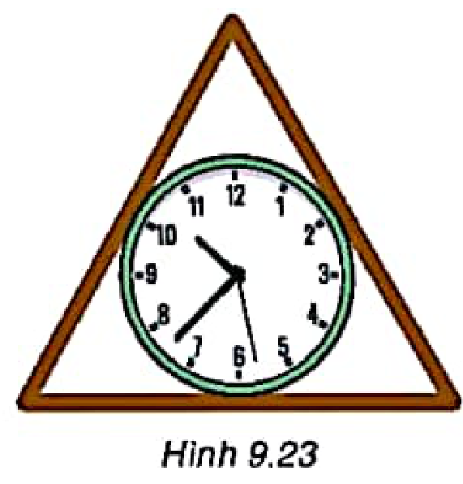
*Hình 9.23*

<!-- pdf:79 -->

## 💡 Em có biết?

**(Đọc thêm) ĐƯỜNG TRÒN BÀNG TIẾP TAM GIÁC**

Chúng ta biết rằng đường tròn nội tiếp một tam giác thì tiếp xúc với ba cạnh của tam giác và nằm bên trong tam giác. Ngoài ra, mỗi tam giác cho trước còn có ba đường tròn khác cũng tiếp xúc với ba đường thẳng chứa các cạnh của tam giác, nhưng chúng nằm ngoài tam giác. Các đường tròn đó gọi là các đường tròn bàng tiếp.

Cụ thể, ta có định nghĩa sau: **Đường tròn bàng tiếp** của tam giác $ABC$ trong góc $A$ là đường tròn tiếp xúc với cạnh $BC$ và tiếp xúc với các tia đối của tia $BA$ và tia $CA$.

Tương tự, ta cũng có đường tròn bàng tiếp trong các góc $B$ và $C$ của tam giác $ABC$.

*Vẽ đường tròn bàng tiếp.* Ta vẽ đường tròn bàng tiếp trong góc $A$ của tam giác $ABC$ như sau:

– Vẽ hai đường phân giác ngoài góc $B$ và $C$ của tam giác $ABC$. Gọi $I_a$ là giao điểm của hai đường phân giác ngoài này. Khi đó, $I_a$ nằm ngoài tam giác $ABC$ và cách đều các đường thẳng $AB, BC, CA$.

– Kẻ đường thẳng qua $I_a$ vuông góc với $AC$ và cắt $AC$ tại điểm $E$. Vẽ đường tròn $(I_a; I_aE)$. Khi đó, đường tròn $(I_a; I_aE)$ sẽ tiếp xúc với cạnh $BC$ và tiếp xúc với các tia đối của tia $BA, CA$. Vậy $(I_a; I_aE)$ là đường tròn bàng tiếp trong góc $A$ của tam giác $ABC$ như hình bên.

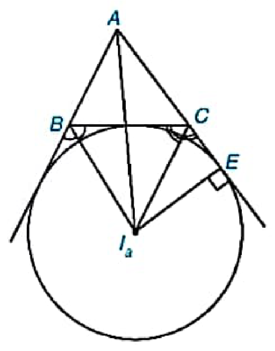

## 📷 Danh sách hình trong bài

| Mã hình | Trang PDF | Vị trí trong bài | Chú thích gốc |
| --- | :---: | --- | --- |
| H9-toan-b28-01 | 74 | Mục 1, HĐ1 | Hình 9.12 |
| H9-toan-b28-02 | 74 | Mục 1, HĐ2 | Hình 9.13 |
| H9-toan-b28-03 | 75 | Mục 1, Câu hỏi | Hình 9.14 |
| H9-toan-b28-04 | 75 | Mục 1, HĐ3 | Hình 9.15 |
| H9-toan-b28-05 | 75 | Mục 1, Ví dụ 1 | Hình 9.16 |
| H9-toan-b28-06 | 75 | Mục 1, HĐ4 | Hình 9.17 |
| H9-toan-b28-07 | 76 | Mục 1, Ví dụ 2 | Hình 9.18 |
| H9-toan-b28-08 | 76 | Mục 2, HĐ5 | Hình 9.19 |
| H9-toan-b28-09 | 77 | Mục 2, Ví dụ 3 | Hình 9.20 |
| H9-toan-b28-10 | 78 | Mục 2, Thực hành | Hình 9.21 |
| H9-toan-b28-11 | 78 | Mục 2, Luyện tập 3 | Hình 9.22 |
| H9-toan-b28-12 | 78 | Bài tập 9.12 | Hình 9.23 |
| H9-toan-b28-13 | 79 | Em có biết? | (sách không đánh số, hình vẽ đường tròn bàng tiếp $(I_a; I_aE)$ trong góc $A$ của tam giác $ABC$) |
