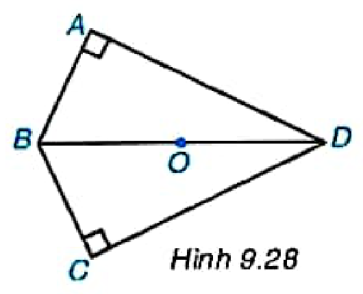
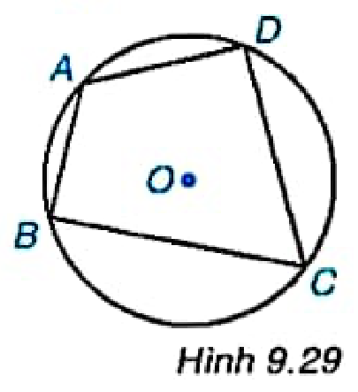
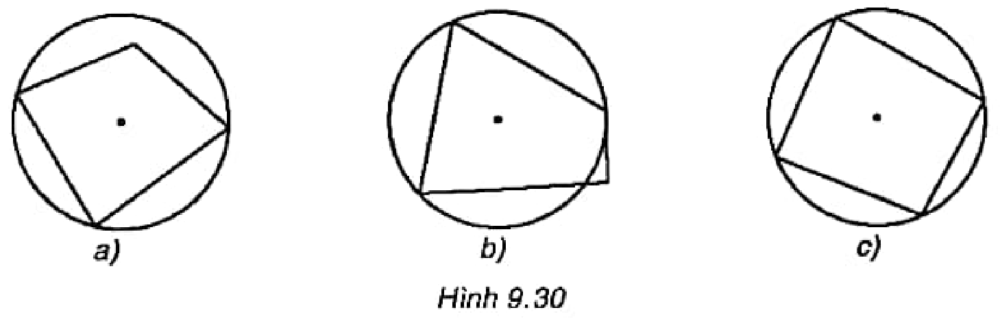
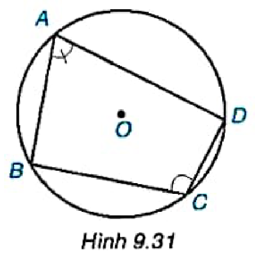
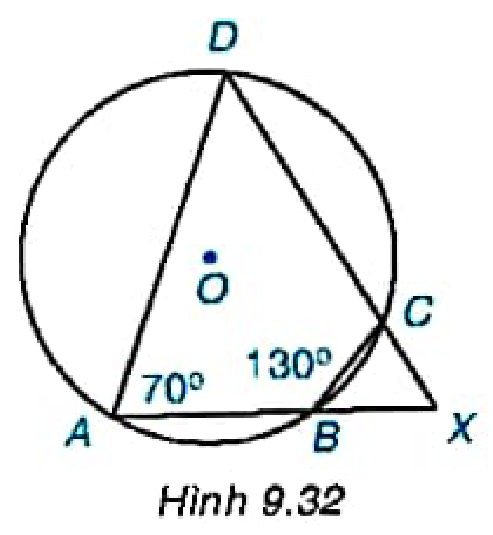
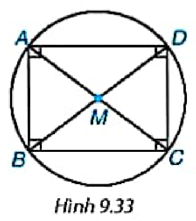
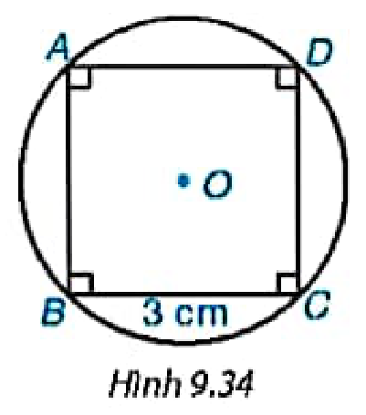
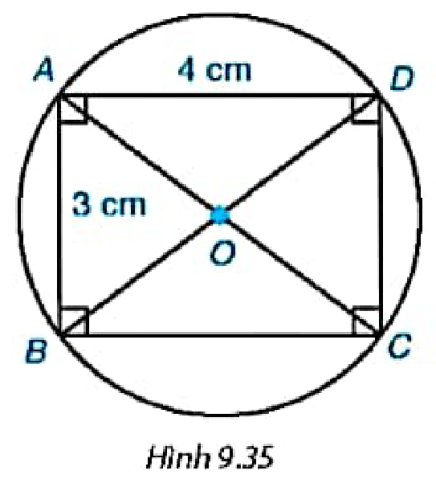
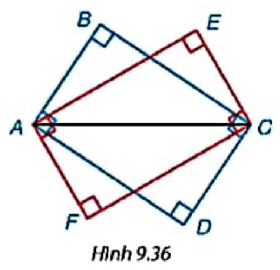
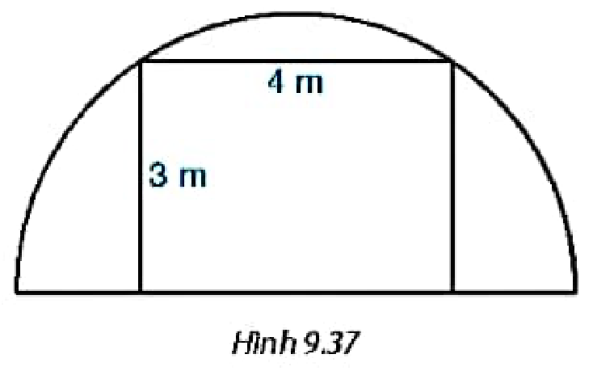

<!-- pdf:82 -->

# BÀI 29: TỨ GIÁC NỘI TIẾP

## 🔤 Khái niệm, thuật ngữ

- Tứ giác nội tiếp
- Đường tròn ngoại tiếp tứ giác

## 🎯 Kiến thức, kĩ năng

- Nhận biết tứ giác nội tiếp đường tròn và giải thích định lí về tổng hai góc đối của tứ giác nội tiếp bằng $180^\circ$.
- Xác định tâm và bán kính đường tròn ngoại tiếp hình chữ nhật, hình vuông.
- Giải quyết một số vấn đề thực tiễn gắn với đường tròn.

## 🔴 Mở đầu

Với mỗi tam giác cho trước luôn có một đường tròn đi qua ba đỉnh của tam giác đó. Điều này có đúng với tứ giác hay không? Trong bài học này, các em sẽ tìm hiểu vấn đề đó.

## 1. ĐƯỜNG TRÒN NGOẠI TIẾP MỘT TỨ GIÁC

**Đường tròn đi qua bốn đỉnh của một tứ giác**

**HĐ1:** Cho tứ giác $ABCD$ có $\widehat{A} = \widehat{C} = 90^\circ$ (H.9.28). Hãy giải thích vì sao bốn đỉnh của tứ giác $ABCD$ cùng nằm trên một đường tròn có tâm là trung điểm $O$ của đoạn thẳng $BD$.

*Hình 9.28*

**HĐ2:** Trên đường tròn $(O)$, lấy các điểm $A, B, C, D$ sao cho $ABCD$ là tứ giác lồi (H.9.29). Các đường trung trực của các cạnh $AB, BC, CD, DA$ có đồng quy hay không?

*Hình 9.29*

Các tứ giác $ABCD$ như Hình 9.28 và Hình 9.29 được gọi là nội tiếp đường tròn $(O)$ và ta cũng nói đường tròn $(O)$ ngoại tiếp tứ giác $ABCD$. Cụ thể, ta có định nghĩa sau:

> Tứ giác có bốn đỉnh nằm trên một đường tròn được gọi là **tứ giác nội tiếp đường tròn** (hoặc đơn giản là **tứ giác nội tiếp**) và đường tròn được gọi là **đường tròn ngoại tiếp tứ giác**.

**Ví dụ 1:** Trong các hình sau (H.9.30), hình nào vẽ một tứ giác nội tiếp một đường tròn?

*Hình 9.30*

<!-- pdf:83 -->

**Giải.** Hình a và b không vẽ tứ giác nào nội tiếp một đường tròn vì mỗi tứ giác có ba đỉnh nằm trên đường tròn và đỉnh còn lại không nằm trên đường tròn.

Hình c vẽ một tứ giác nội tiếp một đường tròn vì tứ giác có bốn đỉnh nằm trên đường tròn.

**HĐ3:** Em hãy đo các góc đối nhau $A$ và $C$ của tứ giác $ABCD$ trong HĐ2 và tính tổng $\widehat{A} + \widehat{C}$. So sánh kết quả của em với các bạn.

Tổng quát, chúng ta có định lí sau đây về tổng số đo các góc đối nhau của một tứ giác nội tiếp.

**Định lí**

<!-- term: Tổng số đo hai góc đối nhau của tứ giác nội tiếp -->
> Trong một tứ giác nội tiếp, tổng số đo hai góc đối nhau bằng $180^\circ$.

| GT | Tứ giác $ABCD$ nội tiếp $(O)$. |
| --- | --- |
| KL | $\widehat{A} + \widehat{C} = 180^\circ$; $\widehat{B} + \widehat{D} = 180^\circ$. |
<!-- ocr-ok: đã đối chiếu ảnh trang PDF 83, bảng giả thiết kết luận chứa kí hiệu LaTeX -->

*Chứng minh*

Do hai điểm $B, D$ chia đường tròn $(O)$ thành hai cung $\overset{\frown}{BCD}$ và $\overset{\frown}{BAD}$ nên $\text{sđ}\overset{\frown}{BCD} + \text{sđ}\overset{\frown}{BAD} = 360^\circ$.
<!-- ocr-ok: đã đối chiếu ảnh trang PDF 83, câu chứng minh chứa nhiều kí hiệu cung bằng LaTeX -->

Do $\widehat{A}$ và $\widehat{C}$ là các góc nội tiếp của đường tròn $(O)$ lần lượt chắn cung $\overset{\frown}{BCD}$ và $\overset{\frown}{BAD}$ nên
<!-- ocr-ok: đã đối chiếu ảnh trang PDF 83, câu chứng minh chứa nhiều kí hiệu góc và cung bằng LaTeX -->

$\widehat{A} + \widehat{C} = \dfrac{1}{2}\text{sđ}\overset{\frown}{BCD} + \dfrac{1}{2}\text{sđ}\overset{\frown}{BAD} = 180^\circ.$

Tương tự, $\widehat{B} + \widehat{D} = 180^\circ$.

*Hình 9.31*

**Ví dụ 2:** Cho tứ giác $ABCD$ nội tiếp đường tròn $(O)$ như Hình 9.32. Hai đường thẳng $AB$ và $DC$ cắt nhau tại $X$. Biết rằng $\widehat{DAB} = 70^\circ$, $\widehat{ABC} = 130^\circ$. Tính số đo của các góc $BCD$ và $BXC$.

*Hình 9.32*

**Giải.** Vì $ABCD$ là tứ giác nội tiếp đường tròn $(O)$ nên các góc đối diện có tổng số đo bằng $180^\circ$.

Do đó $\widehat{DAB} + \widehat{BCD} = 180^\circ$, hay $\widehat{BCD} = 180^\circ - \widehat{DAB} = 180^\circ - 70^\circ = 110^\circ$.

Tương tự, ta có: $\widehat{ABC} + \widehat{CDA} = 180^\circ$, hay $\widehat{CDA} = 180^\circ - \widehat{ABC} = 180^\circ - 130^\circ = 50^\circ$.

Vì tổng các góc trong tam giác $AXD$ bằng $180^\circ$ nên:

$\widehat{BXC} = \widehat{AXD} = 180^\circ - \widehat{DAB} - \widehat{CDA} = 180^\circ - 70^\circ - 50^\circ = 60^\circ.$

**Luyện tập 1:** Cho tam giác $ABC$ có các đường cao $BE, CF$. Biết rằng $\widehat{B} = 60^\circ$, $\widehat{C} = 80^\circ$.

a) Chứng tỏ rằng tứ giác $BCEF$ nội tiếp một đường tròn có tâm là trung điểm của cạnh $BC$.

b) Tính số đo của các góc $BFE$ và $CEF$.

<!-- pdf:84 -->

**Thử thách nhỏ 1**

Cho tứ giác $ABCD$, biết rằng các đường trung trực của ba đoạn thẳng $AB, AC, AD$ đồng quy tại một điểm. Hãy giải thích vì sao $ABCD$ là tứ giác nội tiếp.

## 2. ĐƯỜNG TRÒN NGOẠI TIẾP HÌNH CHỮ NHẬT VÀ HÌNH VUÔNG

**Đường tròn ngoại tiếp hình chữ nhật và hình vuông**

**HĐ4:** Vẽ hình chữ nhật $ABCD$ và giao điểm $M$ của hai đường chéo $AC$ và $BD$ (H.9.33).

a) Hãy giải thích vì sao điểm $M$ cách đều bốn đỉnh của hình chữ nhật $ABCD$.

b) Chứng tỏ rằng hình chữ nhật $ABCD$ nội tiếp một đường tròn có bán kính bằng nửa đường chéo hình chữ nhật.

*Hình 9.33*

**HĐ5:** Cho hình vuông $ABCD$ có cạnh bằng $3\text{ cm}$ (H.9.34). Hãy xác định tâm, vẽ đường tròn ngoại tiếp hình vuông $ABCD$ và cho biết bán kính của đường tròn đó.

*Hình 9.34*

Từ hai hoạt động trên, ta có khẳng định sau:

<!-- term: Tâm và bán kính đường tròn ngoại tiếp hình chữ nhật, hình vuông -->
> Hình chữ nhật và hình vuông là các tứ giác nội tiếp. Đường tròn ngoại tiếp của chúng có tâm là giao điểm của hai đường chéo và bán kính bằng một nửa độ dài đường chéo.

> ❓ Với điểm $A$ cho trước nằm trên đường tròn $(O)$, có bao nhiêu hình vuông có một đỉnh là $A$ nội tiếp đường tròn $(O)$?

**Ví dụ 3:** Cho hình chữ nhật $ABCD$ có $AB = 3\text{ cm}$, $AD = 4\text{ cm}$. Vẽ đường tròn $(O; R)$ ngoại tiếp hình chữ nhật $ABCD$ và tính bán kính $R$.

**Giải**

Gọi $O$ là giao điểm của $AC$ và $BD$. Vẽ đường tròn tâm $O$ bán kính $R = OA$. Đường tròn $(O; R)$ vừa vẽ ngoại tiếp hình chữ nhật $ABCD$ (H.9.35).

Áp dụng định lí Pythagore cho tam giác $ABD$ vuông tại $A$, ta có:

$BD^2 = AB^2 + AD^2 = 3^2 + 4^2 = 25$ nên $BD = 5\text{ cm}$.

Do đó, ta có $R = \dfrac{BD}{2} = 2,5\text{ cm}$.

*Hình 9.35*

<!-- pdf:85 -->

**Luyện tập 2:** Cho hình thoi $ABCD$ có các cạnh bằng $3\text{ cm}$. Gọi $M, N, P, Q$ lần lượt là trung điểm của $AB, BC, CA, AD$. Chứng tỏ rằng tứ giác $MNPQ$ là hình chữ nhật và tìm bán kính đường tròn ngoại tiếp của tứ giác đó.

**Thử thách nhỏ 2**

Nếu các hình chữ nhật có chung một đường chéo (ví dụ như hai hình chữ nhật $ABCD$ và $AECF$ trong Hình 9.36) thì các đỉnh của chúng có cùng nằm trên một đường tròn không?

*Hình 9.36*

## BÀI TẬP

9.18. Cho $ABCD$ là tứ giác nội tiếp. Tính số đo của các góc còn lại của tứ giác trong mỗi trường hợp sau:

a) $\widehat{A} = 60^\circ$, $\widehat{B} = 80^\circ$;

b) $\widehat{B} = 70^\circ$, $\widehat{C} = 90^\circ$;

c) $\widehat{C} = 100^\circ$, $\widehat{D} = 60^\circ$;

d) $\widehat{D} = 110^\circ$, $\widehat{A} = 80^\circ$.

9.19. Cho điểm $I$ nằm ngoài đường tròn $(O)$. Qua $I$ kẻ hai đường thẳng lần lượt cắt $(O)$ tại bốn điểm $A, B$ và $C, D$ sao cho $A$ nằm giữa $B$ và $I$, $C$ nằm giữa $D$ và $I$. Chứng minh rằng $\widehat{IBD} = \widehat{ICA}$, $\widehat{IAC} = \widehat{IDB}$ và $IA \cdot IB = IC \cdot ID$.
<!-- ocr-ok: đã đối chiếu ảnh trang PDF 85, đề bài chứa nhiều kí hiệu điểm và góc bằng LaTeX -->

9.20. Cho hình bình hành $ABCD$ nội tiếp đường tròn $(O)$. Chứng minh rằng $ABCD$ là hình chữ nhật.

9.21. Cho hình thang $ABCD$ ($AB$ song song với $CD$) nội tiếp đường tròn $(O)$. Chứng minh rằng $ABCD$ là hình thang cân.

9.22. Tính diện tích của một hình chữ nhật, biết rằng hình chữ nhật đó có chiều dài gấp hai lần chiều rộng và bán kính đường tròn ngoại tiếp bằng $2,5\text{ cm}$.

9.23. Người ta muốn dựng một khung cổng hình chữ nhật rộng $4\text{ m}$ và cao $3\text{ m}$, bên ngoài khung cổng được bao bởi một khung thép dạng nửa đường tròn như Hình 9.37. Tính chiều dài của đoạn thép làm khung nửa đường tròn đó.

*Hình 9.37*

## 📷 Danh sách hình trong bài

| Mã hình | Trang PDF | Vị trí trong bài | Chú thích gốc |
| --- | :---: | --- | --- |
| H9-toan-b29-01 | 82 | Mục 1, HĐ1 | Hình 9.28 |
| H9-toan-b29-02 | 82 | Mục 1, HĐ2 | Hình 9.29 |
| H9-toan-b29-03 | 82 | Mục 1, Ví dụ 1 | Hình 9.30 |
| H9-toan-b29-04 | 83 | Mục 1, Định lí | Hình 9.31 |
| H9-toan-b29-05 | 83 | Mục 1, Ví dụ 2 | Hình 9.32 |
| H9-toan-b29-06 | 84 | Mục 2, HĐ4 | Hình 9.33 |
| H9-toan-b29-07 | 84 | Mục 2, HĐ5 | Hình 9.34 |
| H9-toan-b29-08 | 84 | Mục 2, Ví dụ 3 | Hình 9.35 |
| H9-toan-b29-09 | 85 | Mục 2, Thử thách nhỏ 2 | Hình 9.36 |
| H9-toan-b29-10 | 85 | Bài tập 9.23 | Hình 9.37 |
