<!-- pdf:86 -->

# BÀI 30: ĐA GIÁC ĐỀU

## 🔤 Khái niệm, thuật ngữ

- Đa giác, đa giác đều
- Đỉnh, cạnh, góc của đa giác
- Phép quay

## 🎯 Kiến thức, kĩ năng

- Nhận dạng đa giác đều. Nhận biết những hình phẳng đều trong tự nhiên, nghệ thuật, kiến trúc, công nghệ chế tạo,...
- Nhận biết vẻ đẹp của thế giới tự nhiên biểu hiện qua tính đều.
- Nhận biết phép quay. Mô tả được các phép quay giữ nguyên hình đa giác đều.

## 🔴 Mở đầu

Chúng ta đã biết tam giác đều được tạo bởi ba cạnh bằng nhau, hình vuông được tạo bởi bốn cạnh bằng nhau. Hơn nữa, các góc trong mỗi hình đó bằng nhau. Trong bài này các em sẽ được học về những hình tương tự như vậy nhưng số cạnh có thể nhiều hơn, chúng được gọi chung là các đa giác đều.

## 1. ĐA GIÁC ĐỀU

**Đa giác**

– Những hình như Hình 9.38 được gọi chung là các **đa giác**.

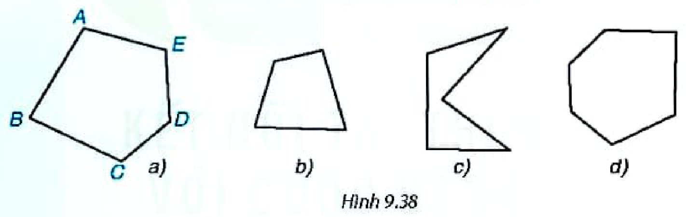
*Hình 9.38*

<!-- term: Đỉnh, cạnh, góc của đa giác -->
– Các đa giác $ABCDE$ (H.9.38a) là những hình gồm năm đoạn thẳng $AB, BC, CD, DE, EA$, trong đó bất kì hai đoạn thẳng nào có một điểm chung cũng không cùng nằm trên một đường thẳng. Đa giác $ABCDE$ có năm đỉnh là các điểm $A, B, C, D, E$; năm cạnh là các đoạn thẳng $AB, BC, CD, DE, EA$ và năm góc là các góc $EAB, ABC, BCD, CDE, DEA$.

– Nếu với một cạnh bất kì, các đỉnh không thuộc cạnh đó đều nằm về một phía đối với đường thẳng chứa cạnh đó thì đa giác được gọi là **đa giác lồi**. Các đa giác trong Hình 9.38 a, b, d là các đa giác lồi. Đa giác trong Hình 9.38c không phải đa giác lồi.

**Đa giác đều**

**HĐ1:** Ta đã biết các tam giác đều và hình vuông có các đỉnh nằm trên một đường tròn. Ta dựng một đa giác lồi $5$ cạnh có các đỉnh nằm trên một đường tròn như sau:

– Vẽ đường tròn tâm $O$ bán kính $R$.

<!-- pdf:87 -->

– Lần lượt lấy các điểm $A, B, C, D, E$ trên đường tròn theo thứ tự ngược chiều kim đồng hồ (hoặc theo chiều kim đồng hồ) sao cho:

$\widehat{AOB} = \widehat{BOC} = \widehat{COD} = \widehat{DOE} = \widehat{EOA} = \dfrac{360^\circ}{5} = 72^\circ.$

Em hãy giải thích vì sao các cạnh và các góc của đa giác $ABCDE$ bằng nhau (H.9.39).

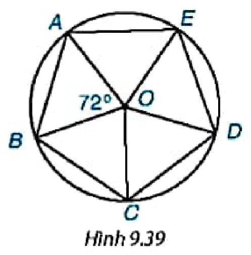
*Hình 9.39*

Đa giác $ABCDE$ như Hình 9.39 được gọi là một đa giác đều. Tổng quát, ta có định nghĩa:

> **Đa giác đều** là một đa giác lồi có các cạnh bằng nhau và các góc bằng nhau.

Người ta chứng minh được rằng các đỉnh của mỗi đa giác đều luôn cùng nằm trên một đường tròn, được gọi là **đường tròn ngoại tiếp đa giác**, tâm đường tròn được gọi là **tâm của đa giác** và đa giác được gọi là nội tiếp đường tròn đó.

> ❓ Nếu một lục giác đều (đa giác đều $6$ cạnh) nội tiếp đường tròn bán kính $2\text{ cm}$ (H.9.40) thì độ dài các cạnh của lục giác đều bằng bao nhiêu centimét? Số đo các góc của lục giác đều bằng bao nhiêu độ?

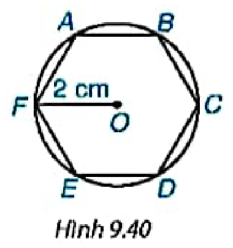
*Hình 9.40*

**Ví dụ 1:** a) Dưới đây là hình các đa giác đều thường gặp trong hình học (H.9.41).

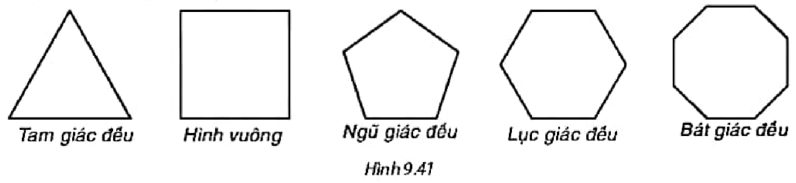
*Hình 9.41*

b) Trong nghệ thuật, kiến trúc, công nghệ chế tạo và thế giới tự nhiên có nhiều hình phẳng có dạng đa giác đều. Những hình phẳng này không chỉ đẹp vì sự cân đối hài hoà mà còn tối ưu trong việc sắp xếp và sử dụng (H.9.42).

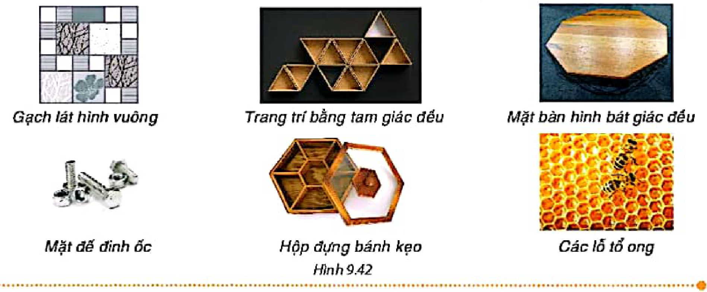
*Hình 9.42*

<!-- pdf:88 -->

**Ví dụ 2:** Trong các hình phẳng dưới đây, hình phẳng nào có dạng là một đa giác đều?

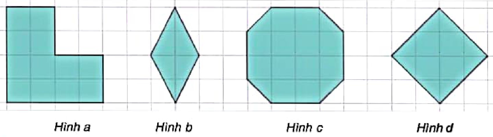

**Giải.** Ta thấy đa giác trong hình a không phải đa giác lồi, đa giác trong hình b là hình thoi có các góc không bằng nhau, đa giác trong hình c là bát giác có các cạnh không bằng nhau, đa giác trong hình d là hình vuông. Do vậy chỉ có hình phẳng trong hình d có dạng đa giác đều.

**Ví dụ 3:** Cho tam giác đều $ABC$ có cạnh $6\text{ cm}$. Trên cạnh $AB$ lấy các điểm $M, N$; trên cạnh $BC$ lấy các điểm $P, Q$; trên cạnh $CA$ lấy các điểm $E, F$, sao cho các đoạn thẳng $AM, MN, NB, BP, PQ, QC, CE, EF, FA$ đều bằng $2\text{ cm}$ như Hình 9.43. Hỏi $MNPQEF$ có là một lục giác đều hay không?

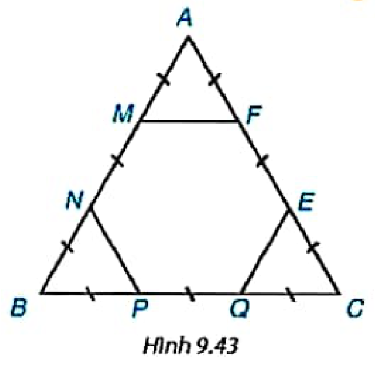
*Hình 9.43*

**Giải** (H.9.43).

Theo Hình 9.43, ta thấy $MNPQEF$ là một đa giác lồi.

Ta có $\dfrac{AM}{AB} = \dfrac{AF}{AC} = \dfrac{1}{3}$. Theo định lí Thalès đảo cho tam giác $ABC$ và đường thẳng $MF$ thì $MF \parallel BC$.

Suy ra $\dfrac{MF}{BC} = \dfrac{AM}{AB} = \dfrac{1}{3}$. Do đó $MF = \dfrac{BC}{3} = 2\text{ cm}$. Tương tự, $NP = QE = 2\text{ cm}$.
<!-- ocr-ok: đã đối chiếu ảnh trang PDF 88, dòng biến đổi chứa nhiều phân thức LaTeX -->

Vậy lục giác $MNPQEF$ có tất cả các cạnh bằng nhau.

Mặt khác, tam giác $AMF$ là tam giác đều vì $AM = MF = FA = 2\text{ cm}$ nên

$\widehat{FMA} = 60^\circ$ và $\widehat{FMN} = 180^\circ - \widehat{FMA} = 120^\circ$.

Tương tự các góc tại các đỉnh $N, P, Q, E, F$ của lục giác $MNPQEF$ đều bằng nhau và bằng $120^\circ$. Vậy lục giác $MNPQEF$ có các cạnh và các góc bằng nhau. Do đó $MNPQEF$ là lục giác đều.

**Luyện tập 1:** Cho $M, N, P, Q, K$ lần lượt là trung điểm của các cạnh $AB, BC, CD, DE$ và $EA$ của ngũ giác đều $ABCDE$ (H.9.44). Hỏi $MNPQK$ có phải là ngũ giác đều hay không?

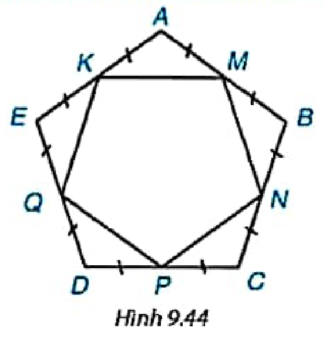
*Hình 9.44*

<!-- pdf:89 -->

**Thử thách nhỏ 1**

Cho một bát giác đều (đa giác đều $8$ cạnh) nội tiếp một đường tròn tâm $O$ (H.9.45). Hỏi mỗi góc của bát giác đều có số đo bằng bao nhiêu?

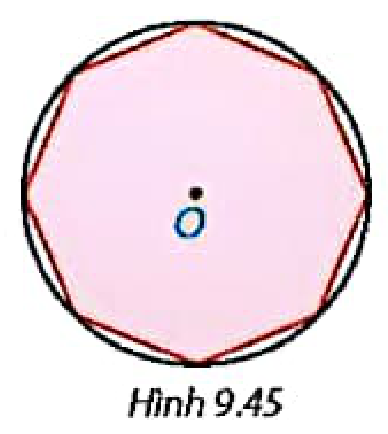
*Hình 9.45*

## 2. PHÉP QUAY

**Phép quay**

**HĐ2:** Để bày bàn ăn cho nhiều người, các nhà hàng thường sử dụng bàn xoay có hình tròn và quay được quanh tâm của hình tròn. Đặt một chiếc cốc nhỏ ở vị trí điểm $A$ trên bàn xoay hình tròn với tâm $O$ sao cho điểm $A$ khác điểm $O$. Khi quay bàn xoay thuận chiều kim đồng hồ (H.9.46) thì chiếc cốc di chuyển đến một vị trí mới là điểm $B$.

Em hãy so sánh khoảng cách từ hai điểm $A$ và $B$ đến điểm $O$. Hai điểm $A, B$ có cùng nằm trên một đường tròn tâm $O$ hay không?

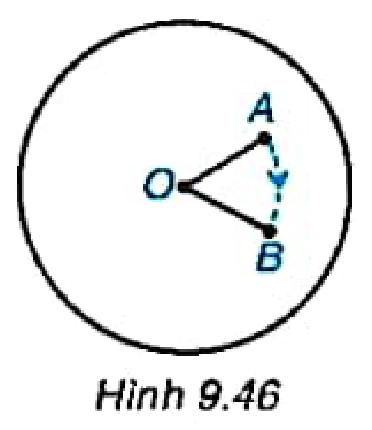
*Hình 9.46*

**HĐ3:** Trên bàn xoay tâm $O$, vẽ tam giác đều $ABC$ nội tiếp một đường tròn $(O)$ và hai tia $OA, OB$ (H.9.47). Khi quay bàn xoay thuận chiều kim đồng hồ để tia $OA$ di chuyển trùng với tia $OB$ (ở vị trí ban đầu), điểm $A$ có di chuyển đến vị trí của điểm $B$ không và sẽ di chuyển trên cung tròn nào của đường tròn $(O)$? Khi đó, điểm $C$ sẽ di chuyển đến vị trí của điểm nào?

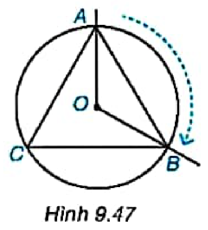
*Hình 9.47*

Trong HĐ2 và HĐ3, ta đã thực hiện một phép quay tâm $O$ để quay tia $OA$ theo chiều kim đồng hồ đến tia $OB$ và điểm $A$ khi di chuyển tạo thành cung $AB$ của đường tròn $(O; OA)$. Ta nói phép quay này biến điểm $A$ thành điểm $B$. Cụ thể ta có khái niệm phép quay như sau:

> **Phép quay thuận chiều** $\alpha^\circ$ ($0^\circ < \alpha^\circ < 360^\circ$) tâm $O$ giữ nguyên điểm $O$, biến điểm $A$ khác điểm $O$ thành điểm $B$ thuộc đường tròn $(O; OA)$ sao cho tia $OA$ quay thuận chiều kim đồng hồ đến tia $OB$ thì điểm $A$ tạo nên cung $AB$ có số đo $\alpha^\circ$ (H.9.48a). Định nghĩa tương tự cho **phép quay ngược chiều** $\alpha^\circ$ tâm $O$ (H.9.48b).
>
> Phép quay $0^\circ$ và phép quay $360^\circ$ giữ nguyên mọi điểm.

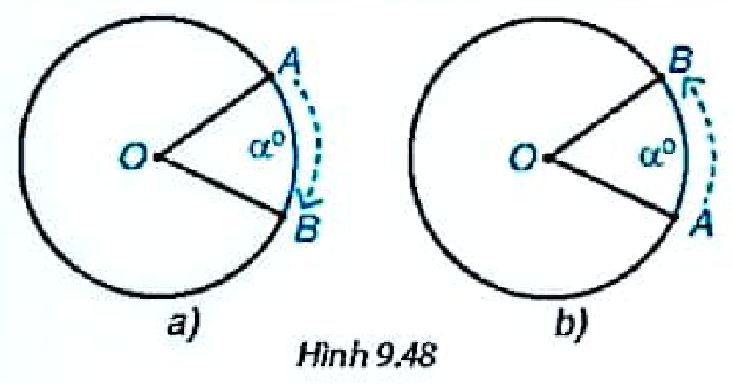
*Hình 9.48*

<!-- pdf:90 -->

> ❓ a) Phép quay ngược chiều $180^\circ$ tâm $O$ biến điểm $A$ thành điểm $A'$. Hỏi điểm $A'$ có đối xứng với điểm $A$ qua $O$ hay không?
>
> b) Nếu phép quay thuận chiều $\alpha^\circ$ tâm $O$ biến điểm $A$ thành điểm $B$ thì phép quay ngược chiều $\alpha^\circ$ tâm $O$ có biến điểm $B$ thành điểm $A$ hay không?

**Ví dụ 4:** Cho tam giác đều $ABC$ nội tiếp đường tròn $(O)$ như Hình 9.49. Hãy cho biết các phép quay ngược chiều lần lượt $120^\circ, 240^\circ, 360^\circ$ với tâm $O$ sẽ biến các đỉnh $A, B, C$ thành những điểm nào?

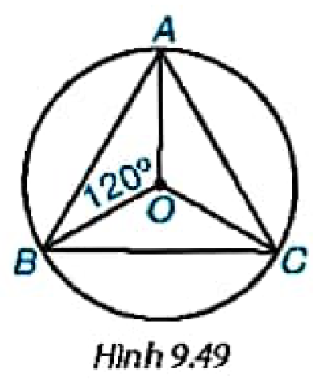
*Hình 9.49*

**Giải.** Các phép quay ngược chiều lần lượt $120^\circ, 240^\circ, 360^\circ$ với tâm $O$ biến các điểm $A, B, C$ thành những điểm tương ứng được cho bởi bảng sau:

| Phép quay ngược chiều \ Đỉnh | $A$ | $B$ | $C$ |
| :---: | :---: | :---: | :---: |
| $120^\circ$ | $B$ | $C$ | $A$ |
| $240^\circ$ | $C$ | $A$ | $B$ |
| $360^\circ$ | $A$ | $B$ | $C$ |

Người ta nói ba phép quay trên biến tam giác đều $ABC$ thành chính nó, hay các phép quay này giữ nguyên tam giác đều $ABC$. Tổng quát, ta có khái niệm và kết quả sau:

> Một phép quay được gọi là **giữ nguyên một đa giác đều** $\mathcal{H}$ nếu phép quay đó biến mỗi điểm của $\mathcal{H}$ thành một điểm của $\mathcal{H}$.
>
> Người ta chỉ ra rằng nếu một phép quay biến các đỉnh của đa giác đều $\mathcal{H}$ thành các đỉnh của $\mathcal{H}$ thì phép quay đó giữ nguyên $\mathcal{H}$.

**Luyện tập 2:** Cho hình vuông $ABCD$ nội tiếp đường tròn $(O)$ như Hình 9.50.
<!-- ocr-ok: đã đối chiếu ảnh trang PDF 90, OCR không nhận diện nhãn Luyện tập 2 nền xanh -->

a) Phép quay thuận chiều $90^\circ$ tâm $O$ biến các điểm $A, B, C, D$ thành những điểm nào? Phép quay này có giữ nguyên hình vuông $ABCD$ không?

b) Hãy liệt kê thêm ba phép quay khác với tâm $O$ theo chiều kim đồng hồ giữ nguyên hình vuông $ABCD$.

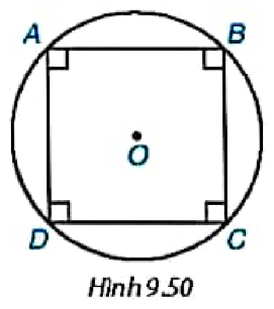
*Hình 9.50*

**Thực hành:** Cho điểm $O$ và điểm $A$ khác điểm $O$ (H.9.51). Phép quay ngược chiều $60^\circ$ tâm $O$ biến điểm $A$ thành điểm $A'$. Xác định điểm $A'$ theo hướng dẫn sau: Vẽ đường tròn $(O; OA)$ và tia $Ox$ sao cho $\widehat{AOx} = 60^\circ$, tia $Ox$ cắt đường tròn $(O; OA)$ tại điểm $A'$ (H.9.51).
<!-- ocr-ok: đã đối chiếu ảnh trang PDF 90, OCR không nhận diện nhãn Thực hành nền xanh và kí hiệu góc -->

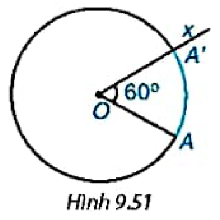
*Hình 9.51*

<!-- pdf:91 -->

**Thử thách nhỏ 2**

Hãy liệt kê $6$ phép quay giữ nguyên một lục giác đều nội tiếp một đường tròn $(O)$.

## BÀI TẬP

9.24. Trong các hình phẳng sau (H.9.52), hình nào là hình phẳng có dạng đa giác đều?

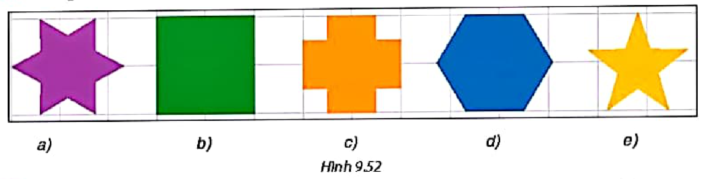
*Hình 9.52*

9.25. Trong các hình dưới đây (H.9.53), hình nào vẽ hai điểm $M$ và $N$ thoả mãn phép quay thuận chiều $60^\circ$ tâm $O$ biến điểm $M$ thành điểm $N$?

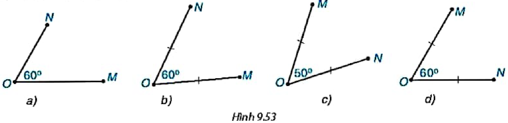
*Hình 9.53*

9.26. Cho tam giác đều $ABC$ nội tiếp đường tròn $(O)$ bán kính $2\text{ cm}$. Tính độ dài các cạnh của tam giác $ABC$.

9.27. Cho hình thoi $ABCD$ có $\widehat{A} = 60^\circ$. Gọi $M, N, P, Q$ lần lượt là trung điểm của $AB, BC, CD, DA$. Chứng minh rằng $MBNPDQ$ là lục giác đều.

9.28. Cho tam giác đều $ABC$ nội tiếp đường tròn $(O)$ như Hình 9.54. Phép quay ngược chiều $60^\circ$ tâm $O$ biến các điểm $A, B, C$ lần lượt thành các điểm $D, E, F$. Chứng minh rằng $ADBECF$ là một lục giác đều.

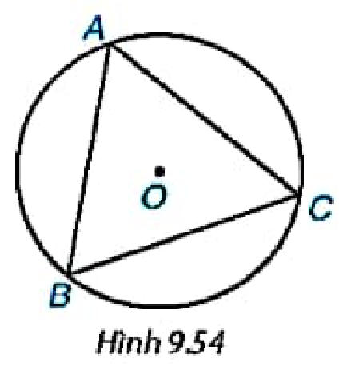
*Hình 9.54*

9.29. Liệt kê năm phép quay giữ nguyên một ngũ giác đều nội tiếp một đường tròn tâm $O$.

9.30. Cho vòng quay mặt trời gồm tám cabin như Hình 9.55. Hỏi để cabin $A$ di chuyển đến vị trí cao nhất thì vòng quay phải quay thuận chiều kim đồng hồ quanh tâm bao nhiêu độ?

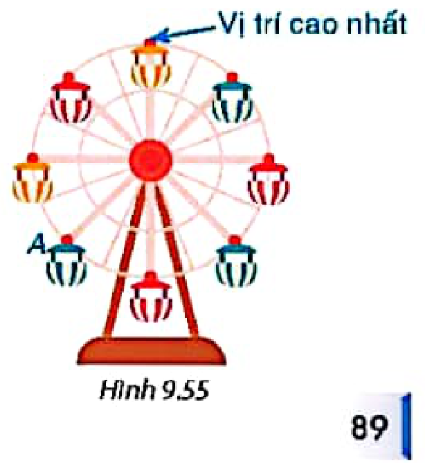
*Hình 9.55*

## 📷 Danh sách hình trong bài

| Mã hình | Trang PDF | Vị trí trong bài | Chú thích gốc |
| --- | :---: | --- | --- |
| H9-toan-b30-01 | 86 | Mục 1, Đa giác | Hình 9.38 |
| H9-toan-b30-02 | 87 | Mục 1, HĐ1 | Hình 9.39 |
| H9-toan-b30-03 | 87 | Mục 1, Câu hỏi | Hình 9.40 |
| H9-toan-b30-04 | 87 | Mục 1, Ví dụ 1a | Hình 9.41 |
| H9-toan-b30-05 | 87 | Mục 1, Ví dụ 1b | Hình 9.42 |
| H9-toan-b30-06 | 88 | Mục 1, Ví dụ 2 | (sách không đánh số chung, bốn hình phẳng Hình a, Hình b, Hình c, Hình d) |
| H9-toan-b30-07 | 88 | Mục 1, Ví dụ 3 | Hình 9.43 |
| H9-toan-b30-08 | 88 | Mục 1, Luyện tập 1 | Hình 9.44 |
| H9-toan-b30-09 | 89 | Mục 1, Thử thách nhỏ 1 | Hình 9.45 |
| H9-toan-b30-10 | 89 | Mục 2, HĐ2 | Hình 9.46 |
| H9-toan-b30-11 | 89 | Mục 2, HĐ3 | Hình 9.47 |
| H9-toan-b30-12 | 89 | Mục 2, Khung kiến thức phép quay | Hình 9.48 |
| H9-toan-b30-13 | 90 | Mục 2, Ví dụ 4 | Hình 9.49 |
| H9-toan-b30-14 | 90 | Mục 2, Luyện tập 2 | Hình 9.50 |
| H9-toan-b30-15 | 90 | Mục 2, Thực hành | Hình 9.51 |
| H9-toan-b30-16 | 91 | Bài tập 9.24 | Hình 9.52 |
| H9-toan-b30-17 | 91 | Bài tập 9.25 (nhãn điểm M ở hình c nằm sát dòng đề bài 9.25 phía trên) | Hình 9.53 |
| H9-toan-b30-18 | 91 | Bài tập 9.28 | Hình 9.54 |
| H9-toan-b30-19 | 91 | Bài tập 9.30 | Hình 9.55 |
