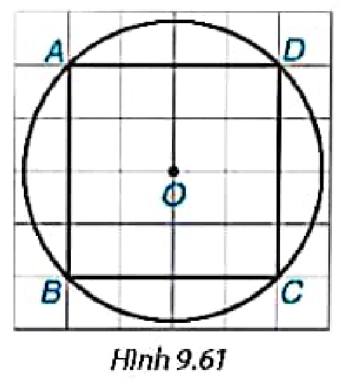
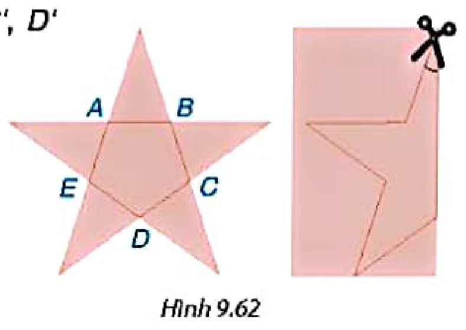

<!-- pdf:94 -->

# BÀI TẬP CUỐI CHƯƠNG IX

## ✏️ A. TRẮC NGHIỆM

9.37. Khẳng định nào sau đây là đúng?

A. Góc nội tiếp có số đo bằng số đo cung bị chắn.

B. Góc có hai cạnh chứa các dây cung của đường tròn là góc nội tiếp đường tròn đó.

C. Góc nội tiếp có số đo bằng một nửa số đo cung bị chắn.

D. Góc có đỉnh nằm trên đường tròn là góc nội tiếp đường tròn đó.

9.38. Cho tứ giác $ABCD$ nội tiếp một đường tròn có $\widehat{A} - \widehat{C} = 100^\circ$. Khẳng định nào dưới đây là đúng?

A. $\widehat{A} = 80^\circ$.

B. $\widehat{C} = 80^\circ$.

C. $\widehat{B} + \widehat{D} = 100^\circ$.

D. $\widehat{A} = 140^\circ$.

9.39. Đa giác nào dưới đây **không** nội tiếp một đường tròn?

A. Đa giác đều.

B. Hình chữ nhật.

C. Hình bình hành.

D. Tam giác.

## ✏️ B. TỰ LUẬN

9.40. Cho tam giác $ABC$ có các đường cao $BE, CF$ cắt nhau tại $H$. Gọi $M$ là trung điểm của $BC$ và $I$ là trung điểm của $AH$. Chứng minh rằng:

a) Tứ giác $AEHF$ nội tiếp đường tròn tâm $I$;

b) $ME, MF$ tiếp xúc với đường tròn ngoại tiếp tứ giác $AEHF$.

9.41. Cho tam giác $ABC$ nội tiếp đường tròn $(O)$. Gọi $M, N, P$ lần lượt là trung điểm của các cạnh $BC, CA, AB$. Chứng minh rằng các tứ giác $ANOP, BPOM, CMON$ là các tứ giác nội tiếp.

9.42. Cho một hình lục giác đều và một hình vuông cùng nội tiếp một đường tròn. Biết rằng hình vuông có cạnh bằng $3\text{ cm}$. Tính chu vi và diện tích của một hình lục giác đều đã cho.

*Hình 9.61*

9.43. a) Phép quay thuận chiều $45^\circ$ tâm $O$ biến các điểm $A, B, C, D$ lần lượt thành các điểm $A', B', C', D'$ (H.9.61). Hãy vẽ tứ giác $A'B'C'D'$.

b) Phép quay trong câu a biến các điểm $A', B', C', D'$ thành những điểm nào?

9.44. Bạn Lan muốn cắt hình ngôi sao có dạng như Hình 9.62 (trong đó $ABCDE$ là một ngũ giác đều). Lan gấp đôi tờ giấy, vẽ một nửa ngôi sao và cắt theo nét vẽ. Góc tạo bởi lưỡi kéo và nếp gấp lúc đầu bằng bao nhiêu?

*Hình 9.62*

## 📷 Danh sách hình trong bài

| Mã hình | Trang PDF | Vị trí trong bài | Chú thích gốc |
| --- | :---: | --- | --- |
| H9-toan-bt-c09-01 | 94 | Bài tập 9.43 | Hình 9.61 |
| H9-toan-bt-c09-02 | 94 | Bài tập 9.44 | Hình 9.62 |
