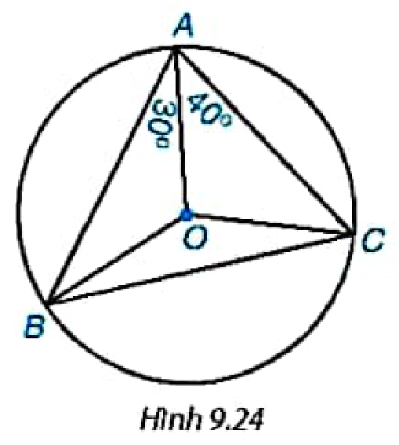
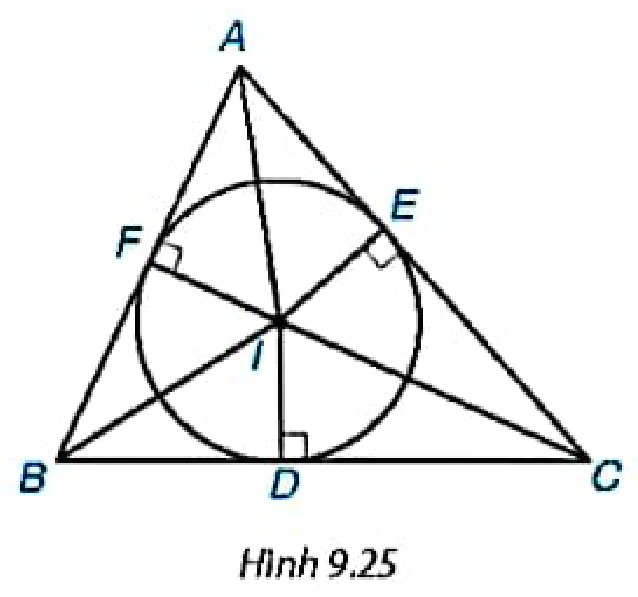
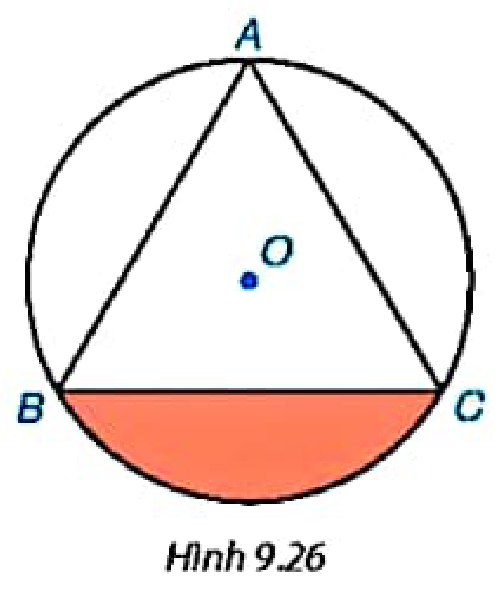
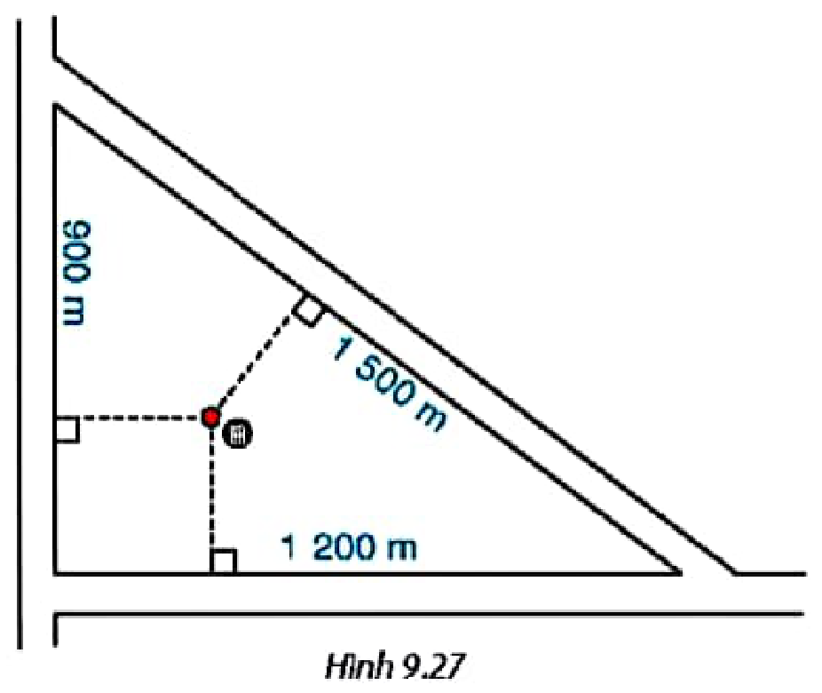

<!-- pdf:80 -->

# LUYỆN TẬP CHUNG (TRANG 78)

**Ví dụ 1:** Cho tam giác $ABC$ nội tiếp đường tròn $(O)$. Biết rằng $\widehat{OAB} = 30^\circ$, $\widehat{OAC} = 40^\circ$. Hãy tính số đo của các góc $ABC$ và $ACB$.

*Hình 9.24*

**Giải** (H.9.24).

Vì $OA = OB$ nên tam giác $OAB$ cân tại $O$.
<!-- ocr-ok: đã đối chiếu ảnh trang PDF 80, câu ngắn chứa nhiều kí hiệu LaTeX -->

Suy ra $\widehat{OBA} = \widehat{OAB} = 30^\circ$.

Do tổng các góc trong tam giác $OAB$ bằng $180^\circ$ nên

$\widehat{AOB} = 180^\circ - \widehat{OAB} - \widehat{OBA} = 180^\circ - 30^\circ - 30^\circ = 120^\circ.$

Tương tự, tam giác $OAC$ cân tại $O$ vì $OA = OC$.

Do đó $\widehat{OCA} = \widehat{OAC} = 40^\circ$.

Do tổng các góc trong tam giác $OAC$ bằng $180^\circ$ nên

$\widehat{AOC} = 180^\circ - \widehat{OAC} - \widehat{OCA} = 180^\circ - 40^\circ - 40^\circ = 100^\circ.$

Xét đường tròn $(O)$ ta có:

Vì góc nội tiếp $ABC$ và góc ở tâm $AOC$ cùng chắn cung nhỏ $AC$ nên

$\widehat{ABC} = \dfrac{1}{2}\widehat{AOC} = 50^\circ;$

Vì góc nội tiếp $ACB$ và góc ở tâm $AOB$ cùng chắn cung nhỏ $AB$ nên

$\widehat{ACB} = \dfrac{1}{2}\widehat{AOB} = 60^\circ.$

**Ví dụ 2:** Cho tam giác $ABC$ có diện tích $S$ và ngoại tiếp đường tròn $(I; r)$. Chứng minh rằng $S = \dfrac{1}{2}r(BC + CA + AB)$.
<!-- ocr-ok: đã đối chiếu ảnh trang PDF 80, OCR không nhận diện nhãn Ví dụ 2 nền xanh -->

*Hình 9.25*

**Giải** (H.9.25).

Gọi $D, E, F$ lần lượt là các tiếp điểm của đường tròn $(I; r)$ với $BC, CA$ và $AB$.

Ta có: $S = S_{\Delta BIC} + S_{\Delta CIA} + S_{\Delta AIB}$

$= \dfrac{1}{2}ID \cdot BC + \dfrac{1}{2}IE \cdot CA + \dfrac{1}{2}IF \cdot AB$

$= \dfrac{1}{2}r(BC + CA + AB).$

<!-- pdf:81 -->

## BÀI TẬP

9.13. Cho tam giác $ABC$ nội tiếp đường tròn $(O)$. Biết rằng $\widehat{BOC} = 120^\circ$ và $\widehat{OCA} = 20^\circ$. Tính số đo các góc của tam giác $ABC$.

9.14. Cho $ABC$ là tam giác đều có cạnh bằng $4\text{ cm}$. Tính bán kính đường tròn ngoại tiếp và bán kính đường tròn nội tiếp tam giác $ABC$.

9.15. Cho tam giác đều $ABC$ có cạnh bằng $3\text{ cm}$ và nội tiếp đường tròn $(O)$ như Hình 9.26.

a) Tính bán kính $R$ của đường tròn $(O)$.

b) Tính diện tích hình viên phân giới hạn bởi dây cung $BC$ và cung nhỏ $BC$.

*Hình 9.26*

9.16. Trong một khu vui chơi có dạng hình tam giác đều với cạnh bằng $60\text{ m}$, người ta muốn tìm một vị trí đặt bộ phát sóng wifi sao cho ở chỗ nào trong khu vui chơi đó đều có thể bắt được sóng. Biết rằng bộ phát sóng đó có tầm phát sóng tối đa là $50\text{ m}$, hỏi rằng có thể tìm được vị trí để đặt bộ phát sóng như vậy hay không?

9.17. Người ta vẽ bản quy hoạch của một khu định cư được bao xung quanh bởi ba con đường thẳng lập thành một tam giác với độ dài các cạnh là $900\text{ m}$, $1\,200\text{ m}$ và $1\,500\text{ m}$ (H.9.27).

a) Tính chu vi và diện tích của phần đất giới hạn bởi tam giác trên.

b) Họ muốn xây dựng một khách sạn bên trong khu dân cư cách đều cả ba con đường đó. Hỏi khi đó khách sạn sẽ cách mỗi con đường một khoảng là bao nhiêu?

*Hình 9.27*

## 📷 Danh sách hình trong bài

| Mã hình | Trang PDF | Vị trí trong bài | Chú thích gốc |
| --- | :---: | --- | --- |
| H9-toan-ltc-c09-01-01 | 80 | Ví dụ 1 | Hình 9.24 |
| H9-toan-ltc-c09-01-02 | 80 | Ví dụ 2 | Hình 9.25 |
| H9-toan-ltc-c09-01-03 | 81 | Bài tập 9.15 | Hình 9.26 |
| H9-toan-ltc-c09-01-04 | 81 | Bài tập 9.17 | Hình 9.27 |
