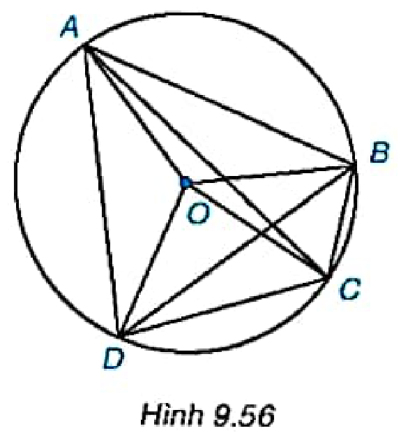
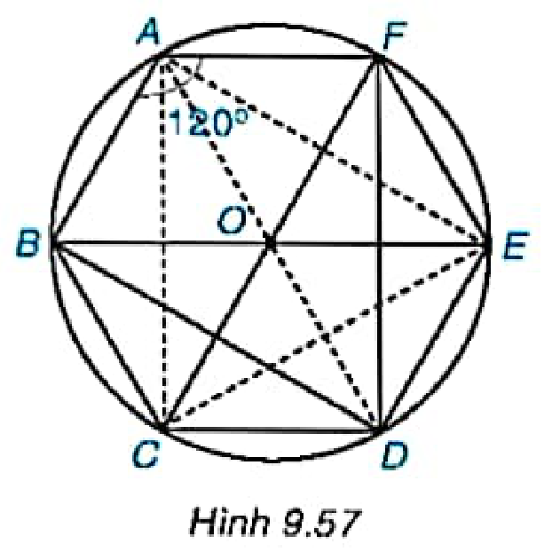
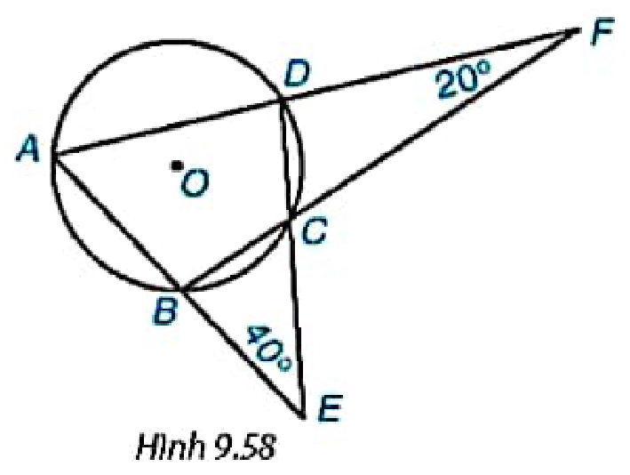
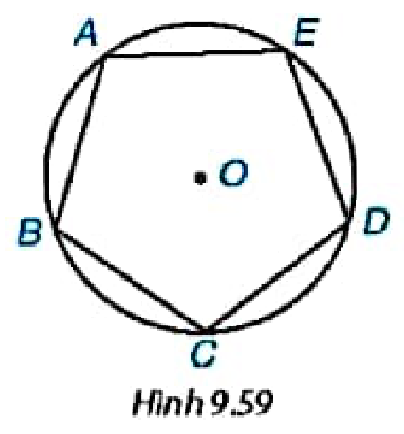
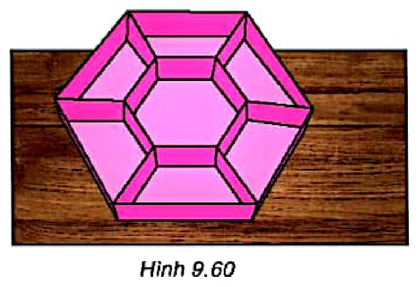

<!-- pdf:92 -->

# LUYỆN TẬP CHUNG (TRANG 90)

**Ví dụ 1:** Cho tứ giác $ABCD$ nội tiếp đường tròn $(O)$. Biết rằng $\widehat{AOB} = 120^\circ$, $\widehat{BOC} = 40^\circ$, $\widehat{COD} = 80^\circ$. Tính số đo các góc của tứ giác $ABCD$.

*Hình 9.56*

**Giải** (H.9.56). Xét đường tròn $(O)$, ta có:
<!-- ocr-ok: đã đối chiếu ảnh trang PDF 92, OCR đọc nhầm từ Xét thành Xót -->

$\widehat{ADB} = \dfrac{1}{2}\widehat{AOB} = 60^\circ$ (góc nội tiếp và góc ở tâm cùng chắn cung $\overset{\frown}{AB}$);

$\widehat{BAC} = \widehat{BDC} = \dfrac{1}{2}\widehat{BOC} = 20^\circ$ (các góc nội tiếp và góc ở tâm cùng chắn cung $\overset{\frown}{BC}$);

$\widehat{CAD} = \dfrac{1}{2}\widehat{COD} = 40^\circ$ (góc nội tiếp và góc ở tâm cùng chắn cung $\overset{\frown}{CD}$).

Suy ra $\widehat{BAD} = \widehat{BAC} + \widehat{CAD} = 60^\circ$ và $\widehat{ADC} = \widehat{ADB} + \widehat{BDC} = 80^\circ$.

Vì các góc đối nhau của tứ giác nội tiếp $ABCD$ có tổng bằng $180^\circ$ nên $\widehat{ABC} = 180^\circ - \widehat{ADC} = 100^\circ$ và $\widehat{BCD} = 180^\circ - \widehat{BAD} = 120^\circ$.

**Ví dụ 2:** Cho lục giác đều $ABCDEF$.
<!-- ocr-ok: đã đối chiếu ảnh trang PDF 92, OCR không nhận diện nhãn Ví dụ 2 nền xanh -->

a) Tính số đo các góc $BCF, BDF, BEF$.

b) Gọi $O$ là tâm của lục giác đều. Hãy chỉ ra ba phép quay tâm $O$ giữ nguyên tam giác $ACE$.

*Hình 9.57*

**Giải** (H.9.57).

a) Lục giác đều $ABCDEF$ có các góc bằng $120^\circ$ và nội tiếp một đường tròn $(O)$. Khi đó, các tứ giác $ABCF, ABDF, ADEF$ nội tiếp $(O)$.

Vì vậy $\widehat{BCF} = 180^\circ - \widehat{BAF} = 180^\circ - 120^\circ = 60^\circ$.

Tương tự, $\widehat{BDF} = \widehat{BEF} = 60^\circ$.

b) Tương tự câu a, các góc của tam giác $ACE$ đều bằng $60^\circ$, hay $ACE$ là tam giác đều và nội tiếp đường tròn $(O)$. Như vậy, ba phép quay tâm $O$ giữ nguyên tam giác $ACE$ là ba phép quay thuận chiều lần lượt $120^\circ, 240^\circ, 360^\circ$ với tâm $O$

<!-- pdf:93 -->

## BÀI TẬP

9.31. Cho tam giác $ABC$ có các đường cao $AD, BE, CF$. Chứng minh rằng $BCEF, CAFD, ABDE$ là những tứ giác nội tiếp.

9.32. Cho tứ giác $ABCD$ nội tiếp đường tròn $(O)$, $AB$ cắt $CD$ tại $E$, $AD$ cắt $BC$ tại $F$ như Hình 9.58. Biết $\widehat{BEC} = 40^\circ$ và $\widehat{DFC} = 20^\circ$, tính số đo các góc của tứ giác $ABCD$.

*Hình 9.58*

9.33. Cho hình vuông $ABCD$ có cạnh bằng $4\text{ cm}$. Tính chu vi, diện tích của các đường tròn nội tiếp và ngoại tiếp hình vuông $ABCD$.

9.34. Biết rằng bốn đỉnh $A, B, C, D$ của một hình vuông cùng nằm trên một đường tròn $(O)$ theo thứ tự ngược chiều kim đồng hồ. Phép quay thuận chiều $45^\circ$ biến các điểm $A, B, C, D$ lần lượt thành các điểm $E, F, G, H$.

a) Vẽ đa giác $EAFBGCHD$.

b) Đa giác $EAFBGCHD$ có phải là một bát giác đều hay không? Vì sao?

9.35. Cho ngũ giác đều $ABCDE$ nội tiếp đường tròn $(O)$ như Hình 9.59.

a) Hãy tìm một phép quay thuận chiều tâm $O$ biến điểm $A$ thành điểm $C$.

b) Phép quay trên sẽ biến các điểm $B, C, D, E$ lần lượt thành những điểm nào? Phép quay này có giữ nguyên ngũ giác đều $ABCDE$ không?

*Hình 9.59*

9.36. Người ta muốn làm một khay đựng bánh kẹo hình lục giác đều có cạnh $10\text{ cm}$ và chia thành $7$ ngăn gồm một lục giác đều nhỏ và $6$ hình thang cân như Hình 9.60. Hỏi lục giác đều nhỏ phải có cạnh bằng bao nhiêu để nó có diện tích bằng hai lần diện tích mỗi hình thang?

*Hình 9.60*

## 📷 Danh sách hình trong bài

| Mã hình | Trang PDF | Vị trí trong bài | Chú thích gốc |
| --- | :---: | --- | --- |
| H9-toan-ltc-c09-02-01 | 92 | Ví dụ 1 | Hình 9.56 |
| H9-toan-ltc-c09-02-02 | 92 | Ví dụ 2 | Hình 9.57 |
| H9-toan-ltc-c09-02-03 | 93 | Bài tập 9.32 | Hình 9.58 |
| H9-toan-ltc-c09-02-04 | 93 | Bài tập 9.35 | Hình 9.59 |
| H9-toan-ltc-c09-02-05 | 93 | Bài tập 9.36 | Hình 9.60 |
