<!-- pdf:95 -->
<!-- Phần giới thiệu đầu Chương X (nửa trên trang PDF 95): HÌNH HỌC TRỰC QUAN — CHƯƠNG X: MỘT SỐ HÌNH KHỐI TRONG THỰC TIỄN -->

Có rất nhiều các vật dụng trong đời sống hằng ngày có dạng hình trụ, hình cầu hay hình nón. Chương này sẽ giúp các em tìm hiểu một vài yếu tố quan trọng của các hình này. Qua đó các em sẽ biết cách tính, chẳng hạn một thùng hình trụ chứa được bao nhiêu lít nước, hay làm một chiếc nón giấy cho đội văn nghệ như thế nào,...
<!-- ocr-ok: đã đối chiếu ảnh trang PDF 95, chữ trắng trên nền xanh đầu Chương X nên OCR đọc lỗi -->

# BÀI 31: HÌNH TRỤ VÀ HÌNH NÓN

## 🔤 Khái niệm, thuật ngữ

- Hình trụ
- Hình nón
- Đường sinh

## 🎯 Kiến thức, kĩ năng

- Mô tả đường sinh, chiều cao, bán kính đáy của hình trụ; đỉnh, đường sinh, chiều cao, bán kính đáy của hình nón.
- Tạo lập hình trụ và hình nón.
- Tính diện tích xung quanh và thể tích của hình trụ, hình nón.
- Giải quyết một số vấn đề thực tiễn gắn với việc tính thể tích, diện tích xung quanh của hình trụ, hình nón.

## 🔴 Mở đầu

Đèn lồng, nón lá ở Hình 10.1 là những vật dụng quen thuộc có dạng hình trụ, hình nón. Trong bài học này, chúng ta sẽ tìm hiểu một số yếu tố cơ bản về hình trụ, hình nón và những vấn đề thực tiễn gắn với việc tính diện tích, thể tích của chúng.

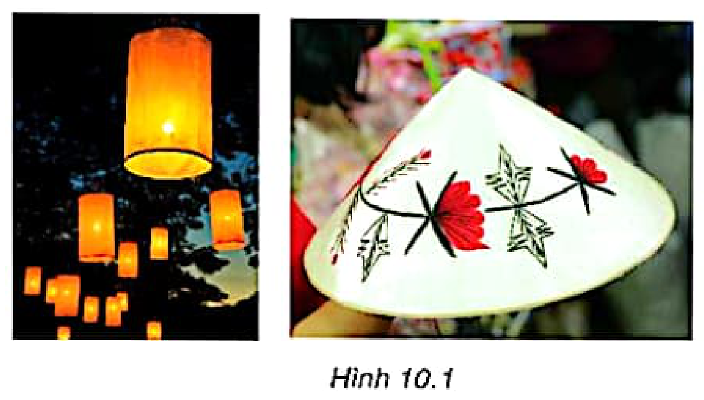
*Hình 10.1*

<!-- pdf:96 -->

## 1. HÌNH TRỤ

**Nhận biết hình trụ**

1. Hộp sữa (H.10.2a) có dạng một hình trụ.

Một số yếu tố của hình trụ được chỉ ra trên Hình 10.2b.

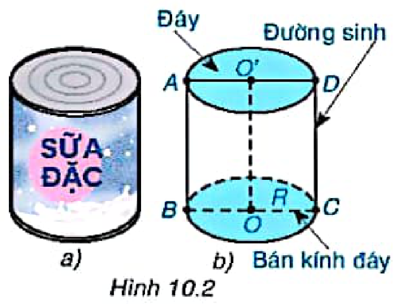
*Hình 10.2*

2. Khi quay hình chữ nhật $O'ABO$ một vòng quanh $OO'$ cố định thì ta được một **hình trụ** (H.10.3), trong đó:

– **Hai đáy của hình trụ** là hai hình tròn bằng nhau $(O'; O'A)$ và $(O; OB)$.

– Mỗi **đường sinh** là một vị trí của $AB$ khi quay. Vậy hình trụ có vô số đường sinh. $R = O'A = OB$ gọi là **bán kính đáy của hình trụ**.

– Độ dài của đoạn $OO'$ gọi là **chiều cao của hình trụ**. Các đường sinh bằng nhau và bằng $OO'$.

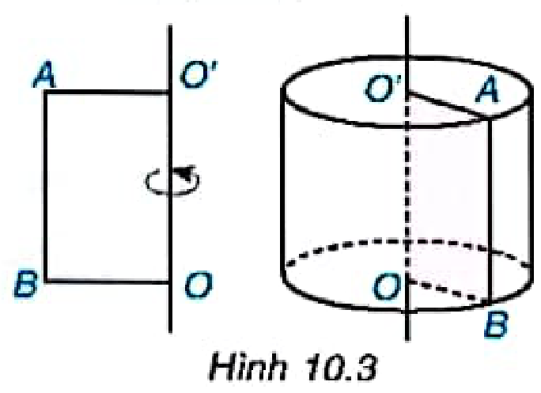
*Hình 10.3*

> ❓ Nêu một số đồ vật có dạng hình trụ trong đời sống.

> Một số yếu tố của hình trụ:
>
> Chiều cao: $h = O'O$.
>
> Bán kính đáy: $R = OB$.
>
> Đường sinh: $l = AB$.

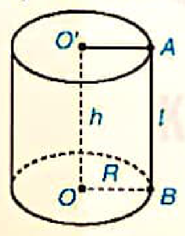

**Ví dụ 1:** Hãy kể tên một bán kính đáy và một đường sinh của hình trụ trong Hình 10.4. Cho biết chiều cao của hình trụ này.

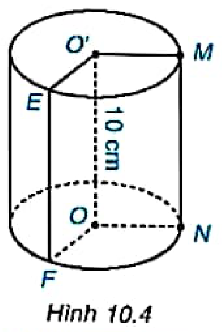
*Hình 10.4*

**Giải**

$O'M$ là một bán kính đáy của hình trụ.

$EF$ là một đường sinh của hình trụ.

Chiều cao $O'O = 10\text{ cm}$.

**Luyện tập 1:** Kể tên các bán kính đáy và đường sinh còn lại của hình trụ có trong Hình 10.4.

<!-- pdf:97 -->

**Chú ý.** Từ một hình trụ, nếu ta cắt rời hai đáy và cắt theo một đường sinh nào đó rồi trải phẳng ra thì ta được một hình phẳng (gồm hai hình tròn và một hình chữ nhật) như Hình 10.5 gọi là **hình khai triển của hình trụ** đã cho.

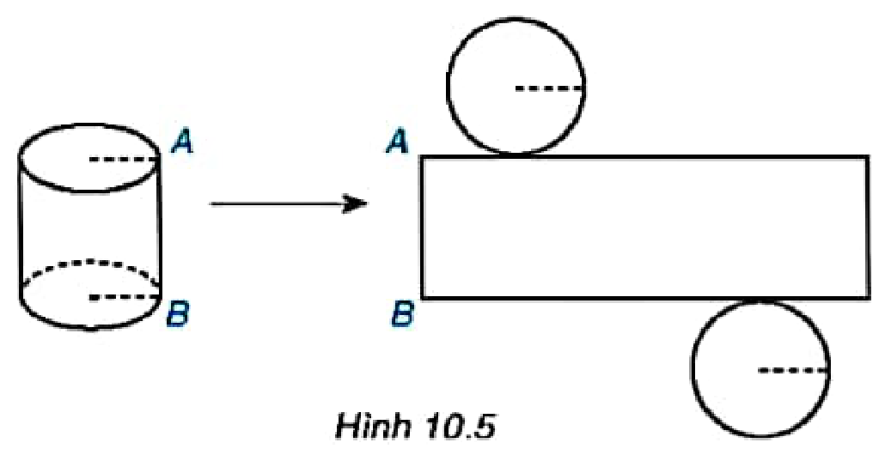
*Hình 10.5*

**Thực hành 1**

Chuẩn bị một băng giấy cứng hình chữ nhật $ABCD$ với $AB = 8\text{ cm}$, $BC = 15\text{ cm}$. Cuộn băng giấy lại sao cho hai cạnh $AB$ và $DC$ sát vào nhau như Hình 10.6 (dùng băng keo dán), ta được một hình trụ (không có đáy). Hãy cho biết chiều cao và chu vi đáy của hình trụ đó.

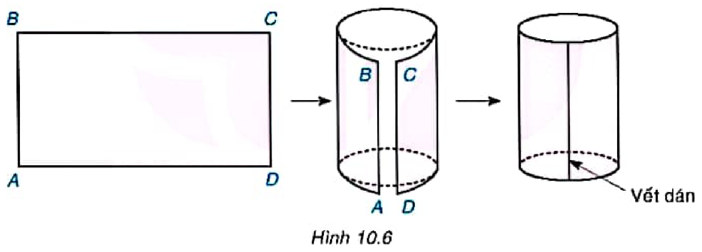
*Hình 10.6*

**Diện tích xung quanh và thể tích của hình trụ**

**HĐ1:** Người ta coi diện tích hình chữ nhật $ABCD$ chính là diện tích xung quanh của hình trụ được tạo thành (xem Thực hành 1). Cho hình trụ có chiều cao $h = 9\text{ cm}$ và bán kính đáy $R = 5\text{ cm}$. Tính diện tích mặt xung quanh của hình trụ.

<!-- term: Diện tích xung quanh của hình trụ -->
Một cách tổng quát, ta có công thức tính *diện tích mặt xung quanh* (gọi tắt là *diện tích xung quanh*, kí hiệu là $S_{\text{xq}}$) của hình trụ như sau:

<!-- term: Diện tích xung quanh của hình trụ -->
> $S_{\text{xq}} = 2\pi Rh$,
> trong đó $R$ là bán kính đáy,
> $h$ là chiều cao.

**HĐ2:** Hãy nhắc lại công thức tính thể tích của hình lăng trụ đứng tam giác (hoặc hình lăng trụ đứng tứ giác) có diện tích đáy $S$ và chiều cao $h$.

<!-- pdf:98 -->

Tương tự, đối với hình trụ ta cũng có công thức tính thể tích $V$ như sau:

> $V = S_{\text{đáy}} \cdot h = \pi R^2 h$,
> trong đó $S_{\text{đáy}}$ là diện tích đáy,
> $R$ là bán kính đáy,
> $h$ là chiều cao.

**Ví dụ 2:** Bác Khôi dự định sơn lại một thùng rác có dạng hình trụ (sơn mặt ngoài và một đáy là nắp) có bán kính đáy bằng $11\text{ cm}$, chiều cao bằng $30\text{ cm}$ (H.10.7).

a) Tính diện tích phần cần sơn của thùng rác.

b) Tính thể tích của thùng rác (làm tròn kết quả đến hàng đơn vị của $\text{cm}^3$).

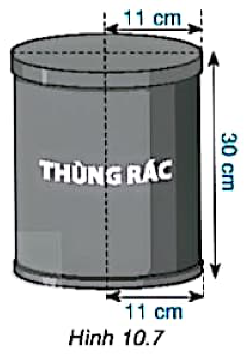
*Hình 10.7*

**Giải**

a) Phần cần sơn bao gồm mặt xung quanh và một đáy của hình trụ.

Theo đề bài, ta có $R = 11\text{ cm}$ và $h = 30\text{ cm}$. Do đó:

$S_{\text{xq}} = 2\pi Rh = 2\pi \cdot 11 \cdot 30 = 660\pi\text{ (cm}^2\text{)};$

$S_{\text{đáy}} = \pi R^2 = \pi \cdot 11^2 = 121\pi\text{ (cm}^2\text{)}.$

Vậy diện tích cần sơn là $S = S_{\text{xq}} + S_{\text{đáy}} = (660 + 121)\pi = 781\pi\text{ (cm}^2\text{)}$.

b) Thể tích của thùng rác là $V = S_{\text{đáy}} \cdot h = 121\pi \cdot 30 = 3\,630\pi \approx 11\,404\text{ (cm}^3\text{)}$.

**Luyện tập 2:** Một thùng nước có dạng hình trụ với chiều cao bằng $1,6\text{ m}$ và bán kính đáy bằng $0,5\text{ m}$.

a) Tính diện tích xung quanh của thùng nước.

b) Hỏi thùng chứa được bao nhiêu lít nước?

(Coi chiều dày của thùng không đáng kể và làm tròn kết quả ở câu b đến hàng đơn vị của lít).

## 2. HÌNH NÓN

**Nhận biết hình nón**

1. Đồ chơi, chi tiết cơ khí (H.10.8) có dạng một hình nón. Một số yếu tố của hình nón được thể hiện trên Hình 10.9b.

<!-- pdf:99 -->

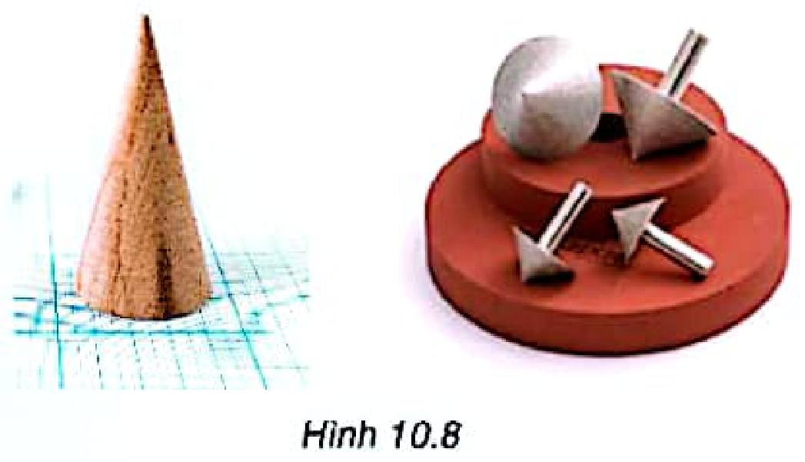
*Hình 10.8*

2. Khi quay tam giác vuông $SOA$ (vuông ở $O$) một vòng quanh $SO$ cố định thì ta được một **hình nón** **đỉnh** $S$ (H.10.9a), trong đó:

– **Đáy của hình nón** là hình tròn $(O; OA)$, $R = OA$ gọi là **bán kính đáy của hình nón**.

<!-- term: Đường sinh của hình nón -->
– Mỗi đường sinh là một vị trí của $SA$ khi quay. Vậy hình nón có vô số đường sinh dài bằng nhau.

– $SO$ gọi là **đường cao của hình nón**. Độ dài đoạn $SO$ được gọi là **chiều cao của hình nón**.

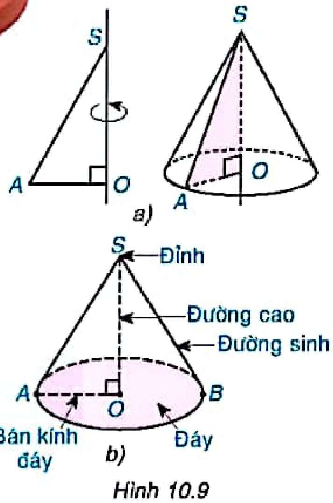
*Hình 10.9*

> ❓ Nêu một số đồ vật có dạng hình nón trong đời sống.

> Một số yếu tố của hình nón:
>
> Đỉnh: $S$.
>
> Chiều cao: $h = SO$.
>
> Đường sinh: $l = SA = SB$.
>
> Bán kính đáy: $R = OA$.

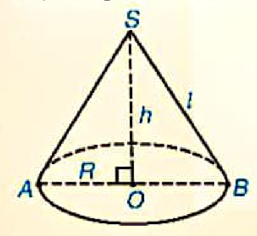

**Ví dụ 3:** Hãy kể tên đỉnh, đường cao, một bán kính đáy và một đường sinh của hình nón trong Hình 10.10.

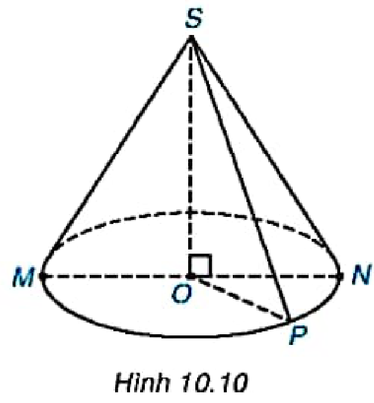
*Hình 10.10*

**Giải**

Đỉnh: $S$.

Đường cao: $SO$.

Một bán kính đáy: $OM$.

Một đường sinh: $SM$.

<!-- pdf:100 -->

**Luyện tập 3:** Kể tên các bán kính đáy và các đường sinh còn lại của hình nón trong Hình 10.10.

**Chú ý.** Cho một hình nón. Nếu ta cắt rời đáy và cắt mặt xung quanh của nó theo đường sinh $SA$ rồi trải phẳng ra thì được một hình phẳng (gồm một hình tròn và một hình quạt tròn) như Hình 10.11 gọi là **hình khai triển của hình nón** đã cho.

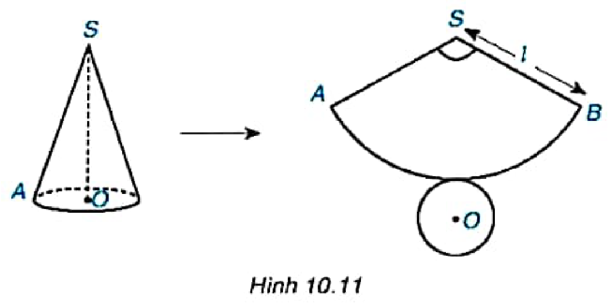
*Hình 10.11*

**Thực hành 2**

Cắt một nửa hình tròn bằng giấy cứng, có đường kính $AB = 20\text{ cm}$ và tâm là $S$. Cuộn nửa hình tròn đó lại sao cho $SA$ và $SB$ sát vào nhau như Hình 10.12 (dùng băng keo dán), ta được một hình nón đỉnh $S$. Hãy cho biết độ dài đường sinh và chu vi đáy của hình nón đó.

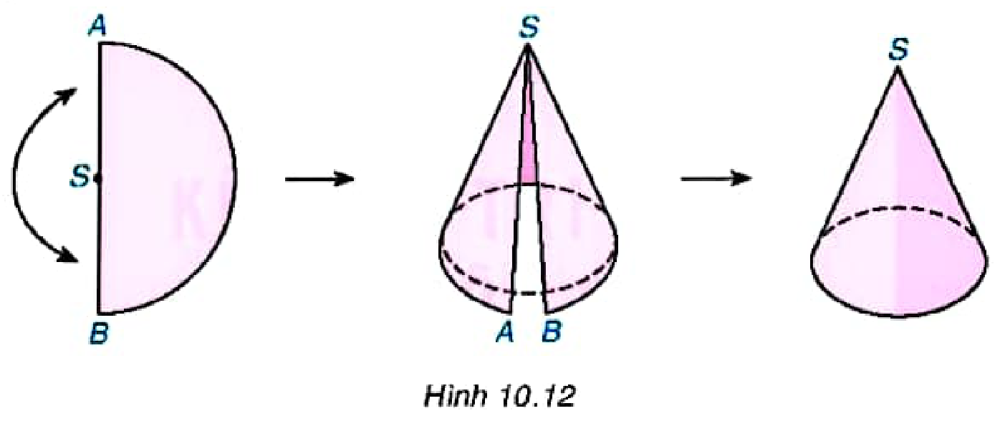
*Hình 10.12*

**Diện tích xung quanh và thể tích của hình nón**

**HĐ3:** Người ta coi diện tích của hình quạt tròn $SAB$ (xem Thực hành 2) chính là diện tích xung quanh của hình nón được tạo thành. Cho hình nón có đường sinh $l = 9\text{ cm}$ và bán kính đáy $r = 5\text{ cm}$. Tính diện tích mặt xung quanh của hình nón.

<!-- term: Diện tích xung quanh của hình nón -->
Một cách tổng quát, ta có công thức tính *diện tích mặt xung quanh* (gọi tắt là *diện tích xung quanh*, kí hiệu là $S_{\text{xq}}$) của hình nón như sau:

<!-- term: Diện tích xung quanh của hình nón -->
> $S_{\text{xq}} = \pi rl$,
> trong đó $r$ là bán kính đáy,
> $l$ là độ dài đường sinh.

<!-- pdf:101 -->

**HĐ4:** Hãy nhắc lại công thức tính thể tích của hình chóp tam giác đều (hoặc hình chóp tứ giác đều) có diện tích đáy $S$ và chiều cao $h$.

Tương tự, ta có công thức tính **thể tích của hình nón** như sau:

> $V = \dfrac{1}{3}S_{\text{đáy}} \cdot h = \dfrac{1}{3}\pi r^2 h$,
> trong đó $S_{\text{đáy}}$ là diện tích đáy,
> $r$ là bán kính đáy,
> $h$ là chiều cao.

**Ví dụ 4:** Cho một hình nón có độ dài đường sinh bằng $10\text{ cm}$, bán kính đáy bằng $6\text{ cm}$ (H.10.13).

a) Tính diện tích xung quanh của hình nón.

b) Tính thể tích của hình nón.

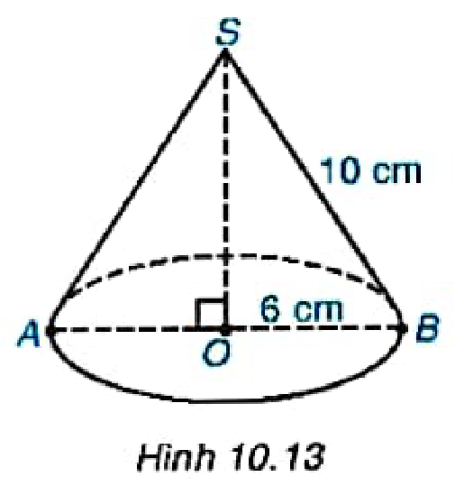
*Hình 10.13*

**Giải**

a) Diện tích xung quanh của hình nón là $S_{\text{xq}} = \pi rl = \pi \cdot 6 \cdot 10 = 60\pi\text{ (cm}^2\text{)}$.

b) Tam giác $SOB$ vuông tại $O$ nên theo định lí Pythagore ta có:

$OB^2 + SO^2 = SB^2$

$6^2 + SO^2 = 10^2$

$SO^2 = 100 - 36 = 64$

$SO = 8\text{ cm}$.

Thể tích của hình nón là $V = \dfrac{1}{3}\pi r^2 h = \dfrac{1}{3}\pi \cdot 6^2 \cdot 8 = 96\pi\text{ (cm}^3\text{)}$.

**Luyện tập 4:** Tính diện tích xung quanh và thể tích của một hình nón có độ dài đường sinh bằng $13\text{ cm}$ và chiều cao bằng $12\text{ cm}$.

**Vận dụng:** Người ta đổ muối thu hoạch được trên cánh đồng muối thành từng đống có dạng hình nón với chiều cao khoảng $0,9\text{ m}$ và đường kính đáy khoảng $1,6\text{ m}$. Hỏi mỗi đống muối có bao nhiêu đềximét khối muối? (Làm tròn kết quả đến hàng đơn vị).

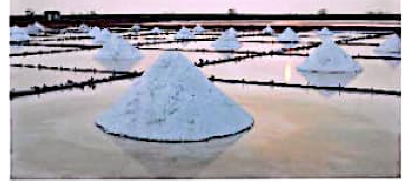

<!-- pdf:102 -->

## BÀI TẬP

10.1. Thay dấu “$?$” bằng giá trị thích hợp và hoàn thành bảng sau vào vở:

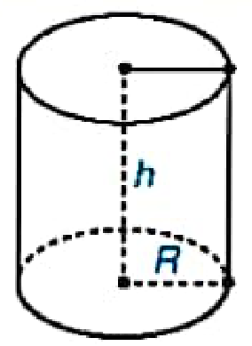

| Hình | Bán kính đáy ($\text{cm}$) | Chiều cao ($\text{cm}$) | Diện tích xung quanh ($\text{cm}^2$) | Thể tích ($\text{cm}^3$) |
| :---: | :---: | :---: | :---: | :---: |
| Hình trụ (bán kính đáy $R$, chiều cao $h$) | $4$ | $6$ | $?$ | $?$ |
| Hình trụ (bán kính đáy $R$, chiều cao $h$) | $3$ | $5$ | $?$ | $?$ |
| Hình trụ (bán kính đáy $R$, chiều cao $h$) | $?$ | $10$ | $?$ | $50\pi$ |
| Hình trụ (bán kính đáy $R$, chiều cao $h$) | $8$ | $?$ | $192\pi$ | $?$ |

10.2. Cho hình chữ nhật $ABCD$ có $AB = 3\text{ cm}$, $BC = 4\text{ cm}$. Quay hình chữ nhật quanh cạnh $AB$ một vòng, ta được một hình trụ. Tính diện tích xung quanh và thể tích của hình trụ tạo thành.

10.3. Khi cho tam giác $SOA$ vuông tại $O$ quay quanh cạnh $SO$ một vòng, ta được một hình nón. Biết $OA = 8\text{ cm}$, $SA = 17\text{ cm}$ (H.10.14).

a) Tính diện tích xung quanh của hình nón.

b) Tính thể tích của hình nón.

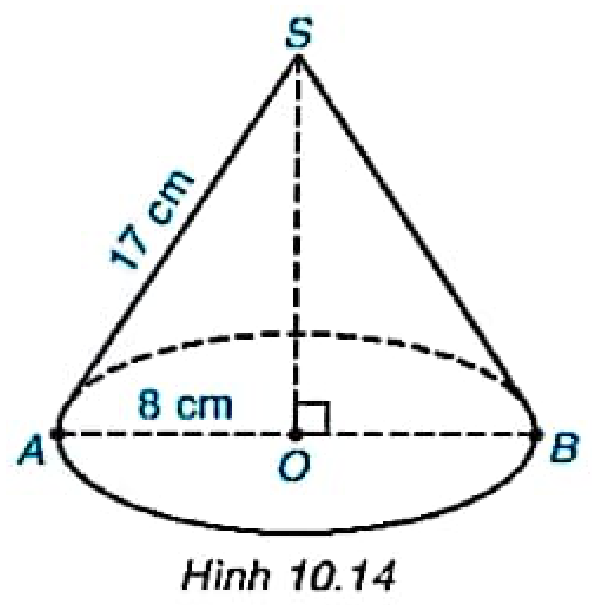
*Hình 10.14*

10.4. Một bóng đèn huỳnh quang có dạng hình trụ được đặt khít vào một hộp giấy cứng dạng hình hộp chữ nhật (H.10.15). Hộp giấy có chiều dài bằng $0,6\text{ m}$, đáy là hình vuông cạnh $4\text{ cm}$. Tính diện tích xung quanh và thể tích của bóng đèn (giả sử bề dày của hộp giấy không đáng kể).

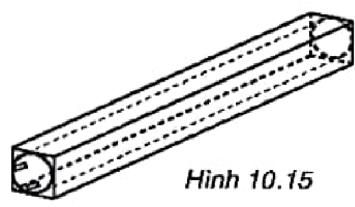
*Hình 10.15*

10.5. Một dụng cụ gồm một phần có dạng hình trụ và một phần có dạng hình nón với các kích thước như Hình 10.16.

a) Tính thể tích của dụng cụ này.

b) Tính diện tích mặt ngoài của dụng cụ (không tính đáy của dụng cụ).

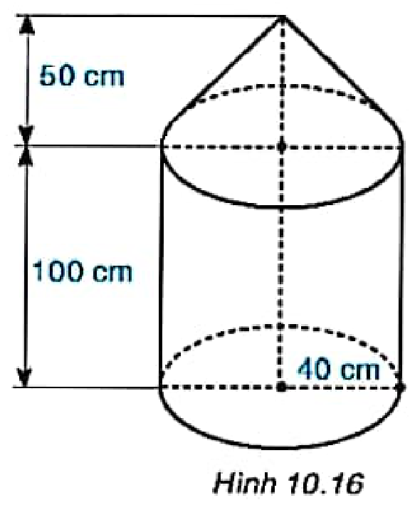
*Hình 10.16*

10.6. Tính thể tích của hình tạo thành khi cho hình $ABCD$ quay quanh $AD$ một vòng (H.10.17).

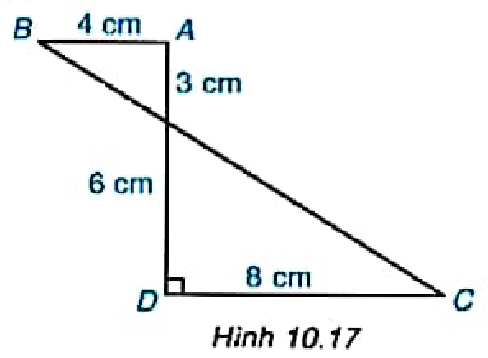
*Hình 10.17*

## 📷 Danh sách hình trong bài

| Mã hình | Trang PDF | Vị trí trong bài | Chú thích gốc |
| --- | :---: | --- | --- |
| H9-toan-b31-01 | 95 | Mở đầu | Hình 10.1 |
| H9-toan-b31-02 | 96 | Mục 1, Nhận biết hình trụ | Hình 10.2 |
| H9-toan-b31-03 | 96 | Mục 1, Nhận biết hình trụ | Hình 10.3 |
| H9-toan-b31-04 | 96 | Mục 1, Khung kiến thức một số yếu tố của hình trụ | (sách không đánh số, hình trụ với tâm hai đáy $O', O$, chiều cao $h$, bán kính đáy $R$, đường sinh $l$) |
| H9-toan-b31-05 | 96 | Mục 1, Ví dụ 1 | Hình 10.4 |
| H9-toan-b31-06 | 97 | Mục 1, Chú ý | Hình 10.5 |
| H9-toan-b31-07 | 97 | Mục 1, Thực hành 1 | Hình 10.6 |
| H9-toan-b31-08 | 98 | Mục 1, Ví dụ 2 | Hình 10.7 |
| H9-toan-b31-09 | 99 | Mục 2, Nhận biết hình nón | Hình 10.8 |
| H9-toan-b31-10 | 99 | Mục 2, Nhận biết hình nón (góc trên trái Hình 10.9a nằm sát mép phải ảnh Hình 10.8 phía trên) | Hình 10.9 |
| H9-toan-b31-11 | 99 | Mục 2, Khung kiến thức một số yếu tố của hình nón | (sách không đánh số, hình nón đỉnh $S$, chiều cao $h$, đường sinh $l$, bán kính đáy $R$) |
| H9-toan-b31-12 | 99 | Mục 2, Ví dụ 3 | Hình 10.10 |
| H9-toan-b31-13 | 100 | Mục 2, Chú ý | Hình 10.11 |
| H9-toan-b31-14 | 100 | Mục 2, Thực hành 2 | Hình 10.12 |
| H9-toan-b31-15 | 101 | Mục 2, Ví dụ 4 | Hình 10.13 |
| H9-toan-b31-16 | 101 | Mục 2, Vận dụng | (sách không đánh số, các đống muối dạng hình nón trên cánh đồng muối) |
| H9-toan-b31-17 | 102 | Bài tập 10.1 | (sách không đánh số, hình trụ bán kính đáy $R$, chiều cao $h$ trong bảng 10.1) |
| H9-toan-b31-18 | 102 | Bài tập 10.3 | Hình 10.14 |
| H9-toan-b31-19 | 102 | Bài tập 10.4 | Hình 10.15 |
| H9-toan-b31-20 | 102 | Bài tập 10.5 | Hình 10.16 |
| H9-toan-b31-21 | 102 | Bài tập 10.6 | Hình 10.17 |
