<!-- pdf:103 -->

# BÀI 32: HÌNH CẦU

## 🔤 Khái niệm, thuật ngữ

- Hình cầu
- Mặt cầu

## 🎯 Kiến thức, kĩ năng

- Mô tả tâm, bán kính của hình cầu, mặt cầu.
- Tạo lập hình cầu, mặt cầu. Nhận biết phần chung của mặt phẳng và hình cầu.
- Tính diện tích mặt cầu, thể tích hình cầu.
- Giải quyết một số vấn đề thực tiễn gắn với việc tính diện tích mặt cầu, thể tích hình cầu.

## 🔴 Mở đầu

Quả bóng đá theo tiêu chuẩn FIFA (liên đoàn bóng đá thế giới) có dạng hình cầu với đường kính khoảng $22\text{ cm}$ (H.10.18). Khi bơm căng quả bóng thì thể tích quả bóng bằng bao nhiêu?

*Hình 10.18*

## 1. MẶT CẦU VÀ HÌNH CẦU

**Nhận biết mặt cầu và hình cầu**

1. Ta đã biết quả bóng (H.10.19) có dạng hình cầu.

Một số yếu tố của hình cầu được chỉ ra trên Hình 10.20.

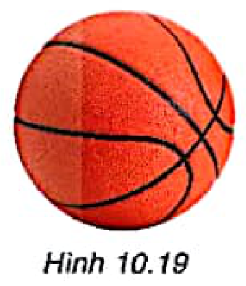
*Hình 10.19*

2. • Khi quay *nửa đường tròn* quanh đường kính $AB$ cố định của nó, ta được một **mặt cầu**.

• Khi quay *nửa hình tròn* quanh đường kính $AB$ cố định của nó, ta được một **hình cầu**.

<!-- term: Tâm của hình cầu -->
<!-- term: Bán kính mặt cầu -->
Tâm và bán kính của nửa đường tròn (hình tròn) cũng là tâm và bán kính của mặt cầu (hình cầu).

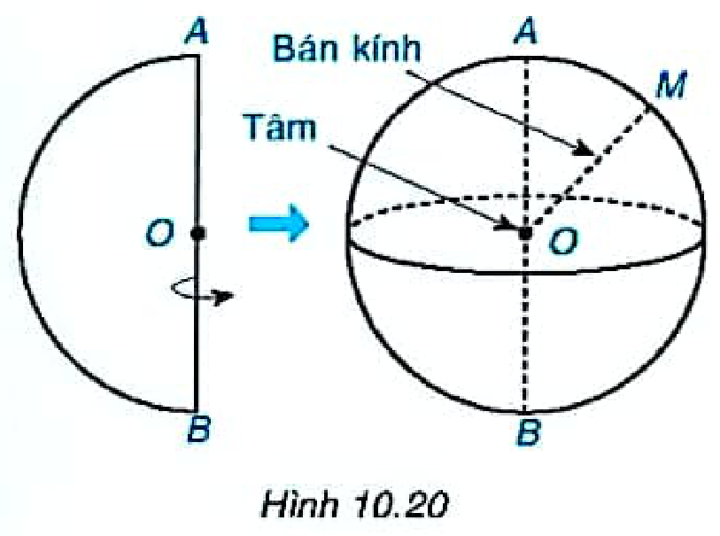
*Hình 10.20*

<!-- pdf:104 -->

> ❓ Tìm một vài hình ảnh của hình cầu, mặt cầu trong thực tế.

<!-- term: Bán kính mặt cầu -->
> Một số yếu tố của mặt cầu:
>
> Tâm mặt cầu: $O$.
>
> Bán kính mặt cầu: $R = OB$.

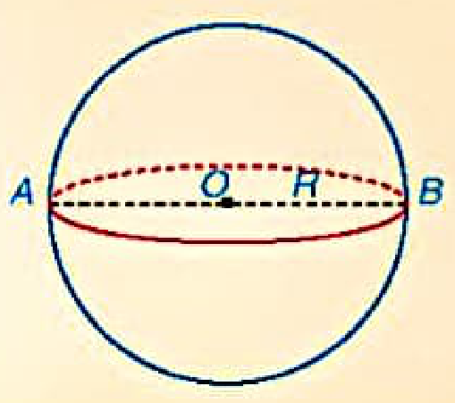

**Ví dụ 1:** Hãy kể tên tâm và một bán kính của mặt cầu trong Hình 10.21.

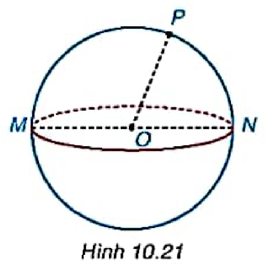
*Hình 10.21*

**Giải**

Tâm mặt cầu: $O$.

Một bán kính: $OP$.

**Luyện tập 1:** Kể tên các bán kính còn lại của mặt cầu trong Hình 10.21.

**Cắt mặt cầu, hình cầu bởi một mặt phẳng**

**HĐ1:** Sọ dừa được xem là có dạng hình cầu. Người ta cắt sọ dừa khô để làm gáo dừa (H.10.22a). Em thấy miệng gáo có dạng hình gì?

**HĐ2:** Khi cắt đôi một quả cam có dạng hình cầu (H.10.22b), em thấy mặt cắt có dạng hình gì?

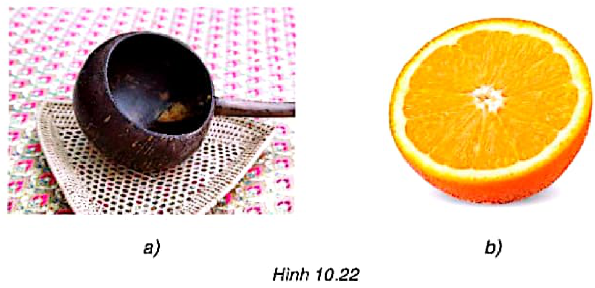
*Hình 10.22*

<!-- pdf:105 -->

Một cách tổng quát:

> 1. Nếu cắt một hình cầu bởi một mặt phẳng thì phần chung của mặt phẳng và hình cầu (còn gọi là **mặt cắt**) là một hình tròn.
>
> 2. Nếu cắt một mặt cầu bán kính $R$ bởi một mặt phẳng thì phần chung của mặt phẳng và mặt cầu là một đường tròn (H.10.23).
>
> - Khi mặt phẳng đi qua tâm thì đường tròn đó có bán kính $R$ và được gọi là **đường tròn lớn**.
> - Khi mặt phẳng không đi qua tâm thì đường tròn đó có bán kính nhỏ hơn $R$.

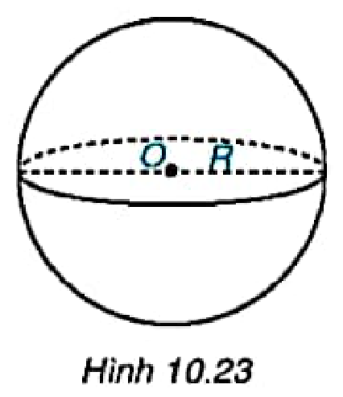
*Hình 10.23*

**Ví dụ 2:** Trái Đất của chúng ta được xem là có dạng hình cầu (nên còn gọi là “Địa Cầu”) và đường Xích đạo là một đường tròn lớn, dài khoảng $40\,075\text{ km}$. Tính đường kính của Trái Đất (làm tròn kết quả đến hàng phần trăm của $\text{km}$).

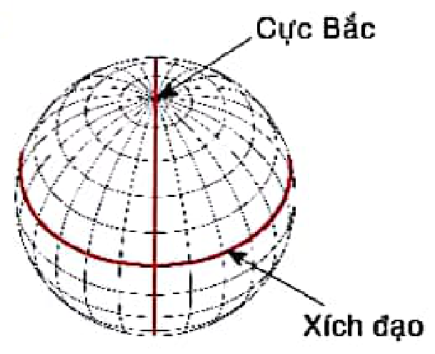

**Giải**

Do đường Xích đạo là một đường tròn lớn nên bán kính của nó bằng bán kính của Trái Đất.

Nếu gọi $R$ là bán kính Trái Đất thì độ dài của đường Xích đạo là $2R\pi \approx 40\,075\text{ (km)}$. Do đó, đường kính của Trái Đất là $2R \approx 40\,075 : \pi \approx 12\,756,27\text{ (km)}$.

**Luyện tập 2:** Khi cắt một hình cầu bởi một mặt phẳng đi qua tâm của hình cầu đó được một hình tròn có diện tích $25\pi\text{ cm}^2$. Tính bán kính của hình cầu.

## 2. DIỆN TÍCH MẶT CẦU VÀ THỂ TÍCH HÌNH CẦU

**Diện tích mặt cầu và thể tích hình cầu**

**HĐ3:** Người ta thấy rằng lượng sơn cần dùng để sơn kín một mặt cầu bán kính $R$ bằng với lượng sơn cần dùng để sơn kín một hình tròn bán kính $2R$ (khi độ dày của lớp sơn như nhau) (H.10.24). Từ đó, em hãy dự đoán công thức tính diện tích mặt cầu bán kính $R$.

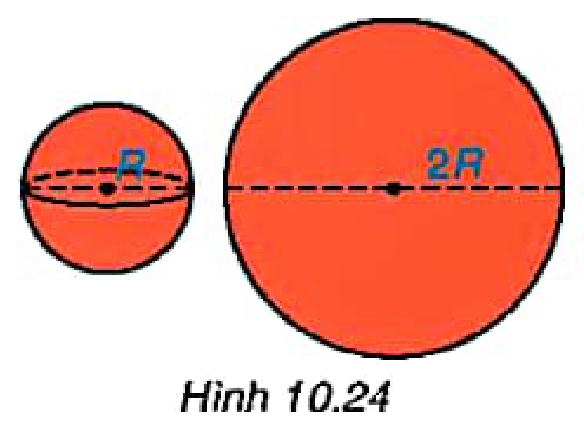
*Hình 10.24*

**HĐ4:** Sử dụng một hình cầu bán kính $R$ và một cốc thuỷ tinh có dạng hình trụ bán kính đáy $R$, chiều cao $2R$. Ban đầu để hình cầu nằm khít trong chiếc cốc có đầy nước.

<!-- pdf:106 -->

Ta nhấc hình cầu ra khỏi cốc thuỷ tinh hình trụ (H.10.25).

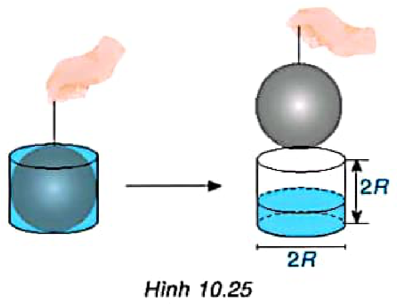
*Hình 10.25*

Đo độ cao cột nước còn lại trong chiếc cốc, ta thấy độ cao này chỉ bằng $\dfrac{1}{3}$ chiều cao của chiếc cốc hình trụ. Từ đó, em hãy dự đoán công thức tính thể tích hình cầu bán kính $R$.

<!-- term: Diện tích mặt cầu -->
Người ta chứng minh được công thức tính diện tích mặt cầu và **thể tích hình cầu** có bán kính $R$ là:

<!-- term: Diện tích mặt cầu -->
> $S = 4\pi R^2$.
>
> $V = \dfrac{4}{3}\pi R^3$.

**Ví dụ 3:** Tính diện tích mặt cầu và thể tích hình cầu có bán kính bằng $10\text{ cm}$.

**Giải**

Diện tích mặt cầu là: $S = 4\pi R^2 = 4\pi \cdot 10^2 = 400\pi\text{ (cm}^2\text{)}$.

Thể tích hình cầu là: $V = \dfrac{4}{3}\pi R^3 = \dfrac{4}{3}\pi \cdot 10^3 = \dfrac{4\,000\pi}{3}\text{ (cm}^3\text{)}$.

**Vận dụng 1:** Em hãy trả lời câu hỏi của *tình huống mở đầu*.

**Ví dụ 4:** Bạn Trang có một bể cá có dạng một phần hình cầu với đường kính bằng $20\text{ cm}$ (H.10.26). Khi nuôi cá, Trang thường đổ vào bể lượng nước có thể tích bằng $\dfrac{2}{3}$ thể tích của hình cầu. Tính thể tích nước bạn Trang đã đổ vào bể cá. (Làm tròn kết quả đến hàng đơn vị của $\text{cm}^3$).

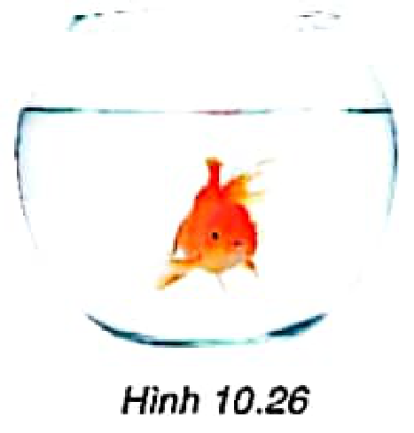
*Hình 10.26*

**Giải**

Bán kính của hình cầu là $20 : 2 = 10\text{ (cm)}$.

<!-- pdf:107 -->

Thể tích của hình cầu là $V = \dfrac{4}{3}\pi R^3 = \dfrac{4}{3}\pi \cdot 10^3 = \dfrac{4\,000\pi}{3}\text{ (cm}^3\text{)}$.

Thể tích nước bạn Trang sử dụng để đổ vào bể cá là:

$\dfrac{2}{3} \cdot \dfrac{4\,000\pi}{3} = \dfrac{8\,000\pi}{9} \approx 2\,793\text{ (cm}^3\text{)}.$

**Vận dụng 2:** Khinh khí cầu đầu tiên được phát minh bởi anh em nhà Montgolfier (người Pháp) vào năm $1782$. Chuyến bay đầu tiên của hai anh em trên khinh khí cầu được thực hiện vào ngày $4$ tháng $6$ năm $1783$ trên bầu trời Place des Cordeliers ở Annonay (nước Pháp) (theo *cand.com.vn*). Giả sử một khinh khí cầu có dạng hình cầu với đường kính bằng $11\text{ m}$. Tính diện tích mặt khinh khí cầu đó (làm tròn kết quả đến hàng đơn vị của $\text{m}^2$).

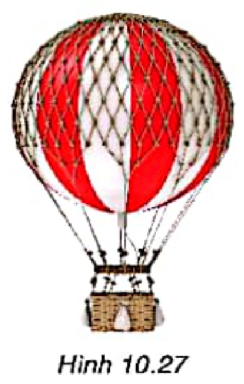
*Hình 10.27*

## BÀI TẬP

10.7. Thay dấu “$?$” bằng giá trị thích hợp và hoàn thành bảng sau vào vở:

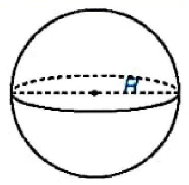

| Hình | Bán kính ($\text{cm}$) | Diện tích mặt cầu ($\text{cm}^2$) | Thể tích hình cầu ($\text{cm}^3$) |
| :---: | :---: | :---: | :---: |
| Hình cầu (bán kính $R$) | $3$ | $?$ | $?$ |
| Hình cầu (bán kính $R$) | $?$ | $100\pi$ | $?$ |
| Hình cầu (bán kính $R$) | $?$ | $?$ | $972\pi$ |
<!-- ocr-ok: đã đối chiếu ảnh trang PDF 107, bảng Bài tập 10.7 có ô đầu tiên là hình vẽ hình cầu -->

10.8. Một cốc đựng ba viên kem có dạng hình cầu, mỗi viên đều có bán kính bằng $3\text{ cm}$. Tính thể tích của kem đựng trong cốc (làm tròn kết quả đến hàng đơn vị của $\text{cm}^3$).

10.9. Một quả bóng đá có chu vi của đường tròn lớn bằng $68,5\text{ cm}$. Quả bóng được ghép nối bởi các miếng da hình lục giác đều màu trắng và đen, mỗi miếng có diện tích bằng $49,83\text{ cm}^2$. Hỏi cần ít nhất bao nhiêu miếng da để làm quả bóng trên? (Coi phần mép khâu không đáng kể).

10.10. Hằng năm cứ dịp Tết đến Xuân về, dân làng Thuý Lĩnh, phường Lĩnh Nam, quận Hoàng Mai, Hà Nội lại tổ chức lễ hội vật cầu truyền thống. Trong lễ hội có sử dụng một quả cầu được tiện bằng gỗ, đường kính khoảng $35\text{ cm}$, sơn đỏ mặt ngoài. Tính diện tích mặt ngoài của quả cầu gỗ nói trên.

## 📷 Danh sách hình trong bài

| Mã hình | Trang PDF | Vị trí trong bài | Chú thích gốc |
| --- | :---: | --- | --- |
| H9-toan-b32-01 | 103 | Mở đầu | Hình 10.18 |
| H9-toan-b32-02 | 103 | Mục 1, Nhận biết mặt cầu và hình cầu | Hình 10.19 |
| H9-toan-b32-03 | 103 | Mục 1, Nhận biết mặt cầu và hình cầu | Hình 10.20 |
| H9-toan-b32-04 | 104 | Mục 1, Khung kiến thức một số yếu tố của mặt cầu (hình vẽ mặt cầu nằm trên nền màu cam của khung kiến thức) | (sách không đánh số, mặt cầu tâm $O$, bán kính $R = OB$) |
| H9-toan-b32-05 | 104 | Mục 1, Ví dụ 1 | Hình 10.21 |
| H9-toan-b32-06 | 104 | Mục 1, HĐ1 và HĐ2 | Hình 10.22 |
| H9-toan-b32-07 | 105 | Mục 1, Cắt mặt cầu, hình cầu bởi một mặt phẳng | Hình 10.23 |
| H9-toan-b32-08 | 105 | Mục 1, Ví dụ 2 | (sách không đánh số, hình cầu Địa Cầu với Cực Bắc và đường Xích đạo) |
| H9-toan-b32-09 | 105 | Mục 2, HĐ3 | Hình 10.24 |
| H9-toan-b32-10 | 106 | Mục 2, HĐ4 | Hình 10.25 |
| H9-toan-b32-11 | 106 | Mục 2, Ví dụ 4 | Hình 10.26 |
| H9-toan-b32-12 | 107 | Mục 2, Vận dụng 2 | Hình 10.27 |
| H9-toan-b32-13 | 107 | Bài tập 10.7 | (sách không đánh số, hình cầu bán kính $R$ trong bảng 10.7) |
