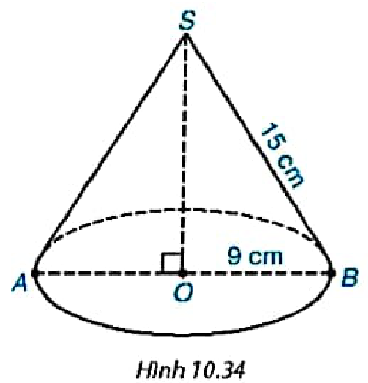
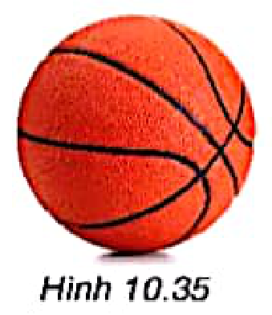
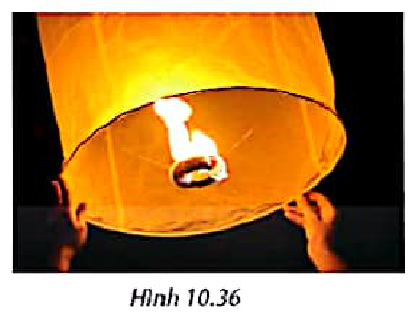
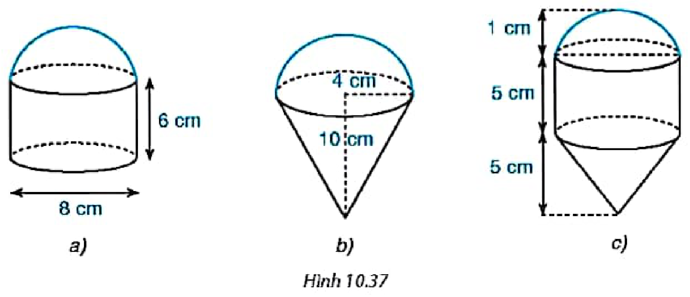
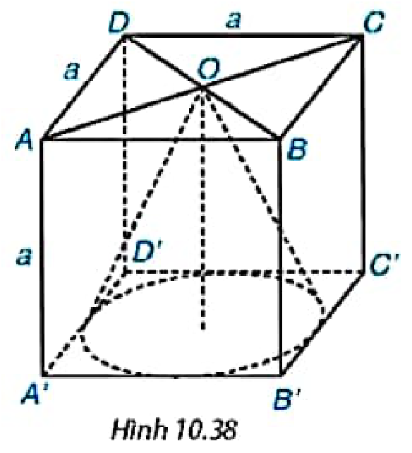
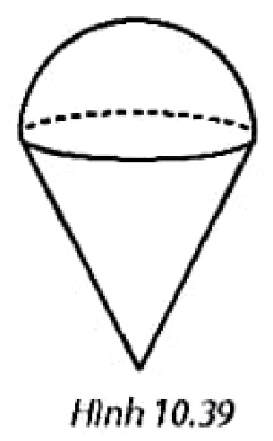
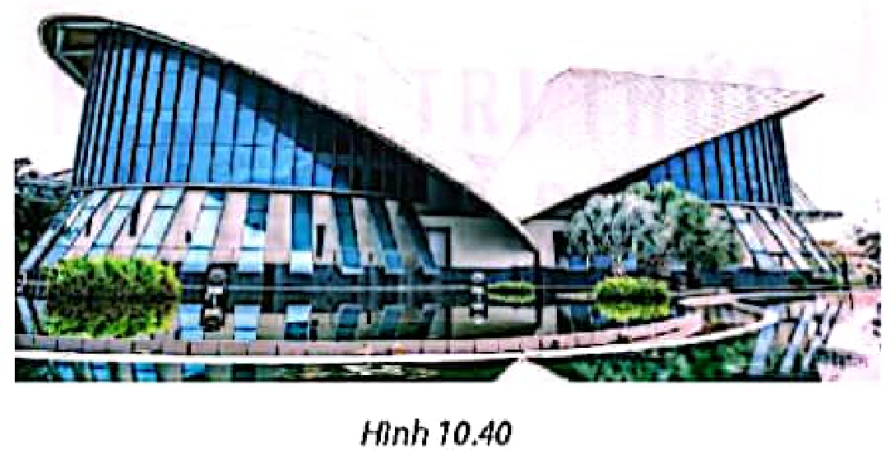

<!-- pdf:110 -->

# BÀI TẬP CUỐI CHƯƠNG X

## ✏️ A. TRẮC NGHIỆM

10.17. Khi quay hình chữ nhật $ABCD$ một vòng quanh cạnh $AB$ ta được một hình trụ có bán kính đáy bằng độ dài đoạn thẳng

A. $AB$.

B. $CD$.

C. $AD$.

D. $AC$.

10.18. Cho tam giác $ABC$ vuông tại $A$ có $AB = 4\text{ cm}$, $BC = 5\text{ cm}$. Khi quay tam giác $ABC$ một vòng quanh cạnh $AC$ ta được một hình nón có chiều cao bằng

A. $4\text{ cm}$.

B. $3\text{ cm}$.

C. $5\text{ cm}$.

D. $9\text{ cm}$.

10.19. Diện tích mặt cầu có đường kính $10\text{ cm}$ là

A. $10\pi\text{ cm}^2$.

B. $400\pi\text{ cm}^2$.

C. $50\pi\text{ cm}^2$.

D. $100\pi\text{ cm}^2$.

10.20. Cho hình nón có bán kính đáy $R = 2\text{ cm}$, độ dài đường sinh $l = 5\text{ cm}$. Diện tích xung quanh của hình nón đã cho bằng

A. $\dfrac{10\pi}{3}\text{ cm}^2$.

B. $\dfrac{50\pi}{3}\text{ cm}^2$.

C. $20\pi\text{ cm}^2$.

D. $10\pi\text{ cm}^2$.

10.21. Một mặt phẳng đi qua tâm hình cầu, cắt hình cầu theo một hình tròn có diện tích $9\pi\text{ cm}^2$. Thể tích của hình cầu bằng

A. $972\pi\text{ cm}^3$.

B. $36\pi\text{ cm}^3$.

C. $6\pi\text{ cm}^3$.

D. $81\pi\text{ cm}^3$.

## ✏️ B. TỰ LUẬN

10.22. Cho hình trụ có bán kính đáy bằng $20\text{ cm}$, chiều cao bằng $30\text{ cm}$.

a) Tính diện tích xung quanh của hình trụ.

b) Tính thể tích của hình trụ.

10.23. Cho hình nón có bán kính đáy bằng $9\text{ cm}$, độ dài đường sinh bằng $15\text{ cm}$ (H.10.34).

a) Tính diện tích xung quanh của hình nón.

b) Tính thể tích của hình nón.

c) **Diện tích toàn phần của hình nón** bằng tổng diện tích xung quanh và diện tích đáy. Tính diện tích toàn phần của hình nón đã cho.

*Hình 10.34*

<!-- pdf:111 -->

10.24. Quả bóng rổ sử dụng trong thi đấu có dạng hình cầu với đường kính bằng $24\text{ cm}$ (H.10.35). Hãy tính:

a) Diện tích bề mặt quả bóng.

b) Thể tích của quả bóng.

*Hình 10.35*

10.25. Đèn trời có dạng hình trụ không có một đáy với đường kính đáy bằng $0,8\text{ m}$ và thân đèn cao $1\text{ m}$ (H.10.36). Tính diện tích giấy dán bên ngoài đèn trời.

*Hình 10.36*

10.26. Các hình dưới đây (H.10.37) được tạo thành từ các nửa hình cầu, hình trụ và hình nón (có cùng bán kính đáy). Tính thể tích của các hình đó theo kích thước đã cho.

*Hình 10.37*

10.27. Cho hình lập phương $ABCD.A'B'C'D'$ cạnh $a$. Tính thể tích của hình nón có đỉnh là tâm $O$ của hình vuông $ABCD$ và đáy là hình tròn tiếp xúc với các cạnh của hình vuông $A'B'C'D'$ (H.10.38).

*Hình 10.38*

<!-- pdf:112 -->

10.28. Bạn Khôi cho một hòn đá cảnh vào một bể nuôi cá hình trụ có đường kính đáy bằng $20\text{ cm}$ thì nước trong bể dâng lên $3\text{ cm}$. Hỏi hòn đá cảnh đó có thể tích bằng bao nhiêu?

10.29. Một chiếc kem ốc quế gồm hai phần: Phần phía dưới dạng hình nón có chiều cao gấp đôi bán kính đáy, phần trên là nửa hình cầu có đường kính bằng đường kính đáy của hình nón phía dưới (H.10.39). Thể tích phần kem phía trên bằng $200\text{ cm}^3$. Tính thể tích của cả chiếc kem.

*Hình 10.39*

10.30. Mái nhà hát Cao Văn Lầu và Trung tâm triển lãm Văn hoá Nghệ thuật tỉnh Bạc Liêu có hình dáng ba chiếc nón lá lớn nhất Việt Nam (H.10.40). Tính diện tích một mái nhà hình nón có đường kính bằng $45\text{ m}$ và chiều cao bằng $24\text{ m}$ (làm tròn kết quả đến hàng đơn vị của $\text{m}^2$).

*Hình 10.40*

## 📷 Danh sách hình trong bài

| Mã hình | Trang PDF | Vị trí trong bài | Chú thích gốc |
| --- | :---: | --- | --- |
| H9-toan-bt-c10-01 | 110 | Bài tập 10.23 | Hình 10.34 |
| H9-toan-bt-c10-02 | 111 | Bài tập 10.24 | Hình 10.35 |
| H9-toan-bt-c10-03 | 111 | Bài tập 10.25 | Hình 10.36 |
| H9-toan-bt-c10-04 | 111 | Bài tập 10.26 | Hình 10.37 |
| H9-toan-bt-c10-05 | 111 | Bài tập 10.27 | Hình 10.38 |
| H9-toan-bt-c10-06 | 112 | Bài tập 10.29 | Hình 10.39 |
| H9-toan-bt-c10-07 | 112 | Bài tập 10.30 | Hình 10.40 |
