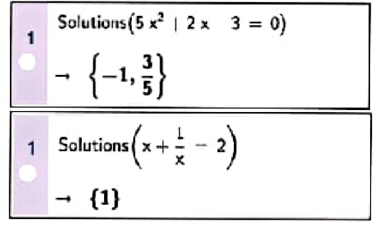
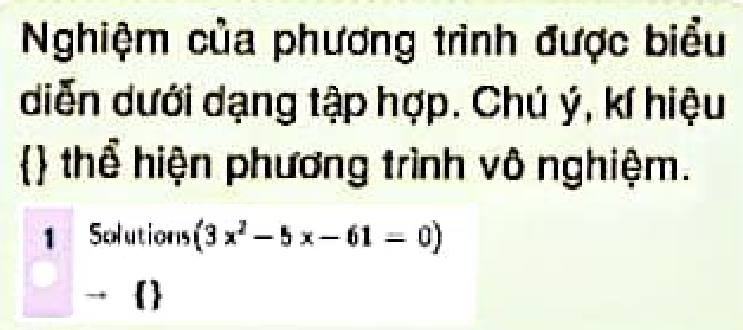
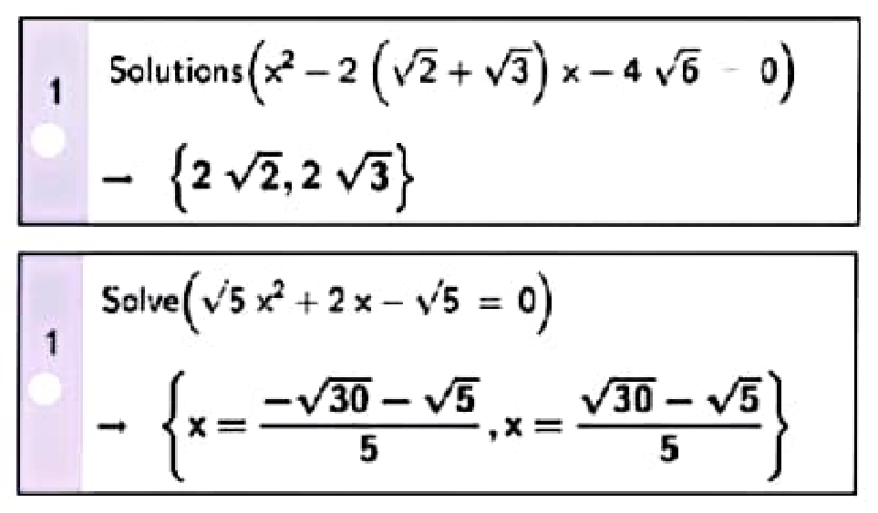
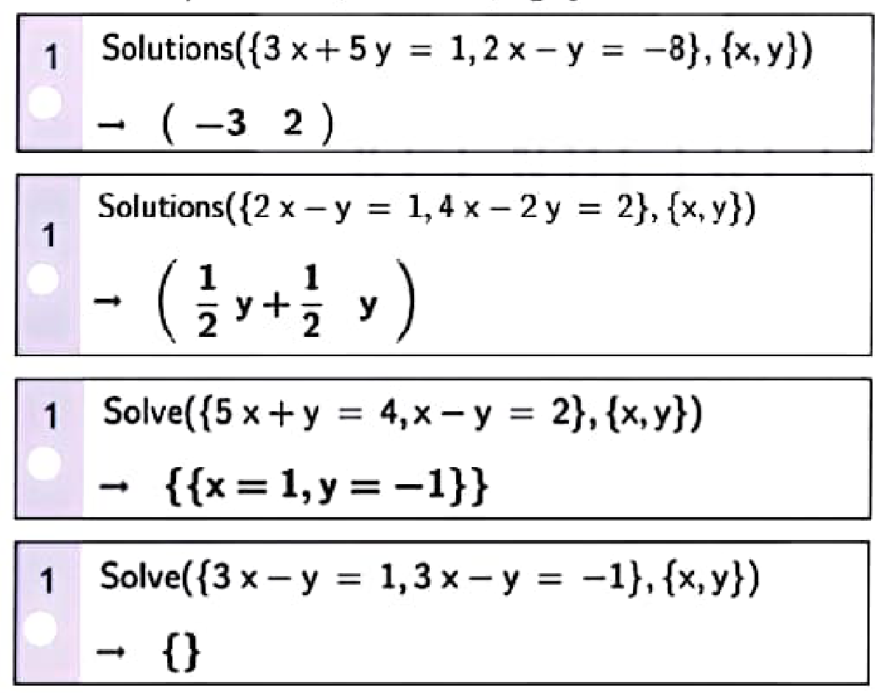
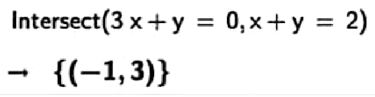
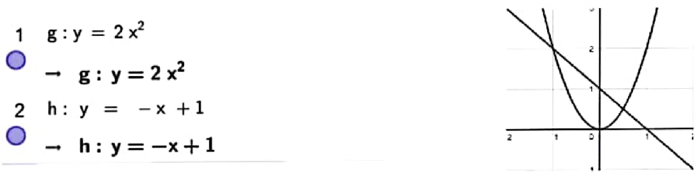
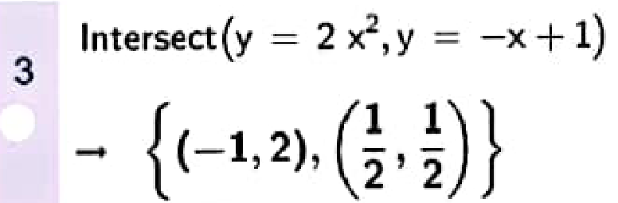

<!-- pdf:113 -->
<!-- Phần mở đầu Hoạt động thực hành trải nghiệm cuối Tập hai -->

# GIẢI PHƯƠNG TRÌNH, HỆ PHƯƠNG TRÌNH VÀ VẼ ĐỒ THỊ HÀM SỐ VỚI PHẦN MỀM GEOGEBRA

## 🎯 Mục tiêu

- Sử dụng phần mềm GeoGebra để vẽ đồ thị của hàm số, giải phương trình một ẩn và giải hệ hai phương trình bậc nhất hai ẩn.

Khởi động phần mềm GeoGebra, chọn Complex Adaptive System (CAS) để thực hiện giải phương trình một ẩn và hệ hai phương trình bậc nhất hai ẩn; chọn Graphic 2 để vẽ đồ thị của hàm số.

## 1. GIẢI PHƯƠNG TRÌNH MỘT ẨN

Để giải phương trình nói chung, phương trình bậc hai một ẩn nói riêng, ta dùng lệnh `Solve(<phương trình>)` hoặc `Solutions(<phương trình>)` trên ô lệnh của cửa sổ CAS, kết quả sẽ được hiển thị ngay bên dưới.

> Nghiệm của phương trình được biểu diễn dưới dạng tập hợp. Chú ý, kí hiệu `{}` thể hiện phương trình vô nghiệm.

<!-- pdf:114 -->

**Chú ý.**

- Để nhập căn bậc hai của $a$ ta gõ “`sqrt(a)`”.
- Để nhập $x^2$ ta gõ “`x^2`”.

## 2. GIẢI HỆ HAI PHƯƠNG TRÌNH BẬC NHẤT HAI ẨN

Để giải hệ hai phương trình bậc nhất hai ẩn, ta có thể sử dụng một trong hai phương pháp sau:

*Cách 1.* Sử dụng câu lệnh `Solve({<phương trình thứ nhất>, <phương trình thứ hai>}, {<biến số thứ nhất>, <biến số thứ hai>})` hoặc `Solutions({<phương trình thứ nhất>, <phương trình thứ hai>}, {<biến số thứ nhất>, <biến số thứ hai>})` trên ô lệnh của cửa sổ CAS, kết quả sẽ được hiển thị ngay bên dưới.

> Kết quả bên có nghĩa: hệ có nghiệm $\begin{cases} x = -3 \\ y = 2. \end{cases}$
>
> Kết quả bên có nghĩa: hệ có nghiệm $\begin{cases} x = \dfrac{1}{2}y + \dfrac{1}{2} \\ y \text{ tuỳ ý.} \end{cases}$

*Cách 2.* Sử dụng lệnh `Intersect (<phương trình thứ nhất>, <phương trình thứ hai>)` trên cửa sổ CAS để tìm toạ độ giao điểm của hai đường thẳng có phương trình tương ứng.

<!-- pdf:115 -->

## 3. VẼ ĐỒ THỊ CỦA HÀM SỐ

Khởi động GeoGebra và chọn đồng thời hai chế độ Graphic 2 và CAS để vẽ đồ thị của hàm số $y = ax^2$ ($a \ne 0$) và hàm số bậc nhất $y = ax + b$ ($a \ne 0$).

– Nhập công thức hàm số $y = ax^2$ và $y = ax + b$ vào từng ô lệnh trong cửa sổ CAS.

– Nháy chuột chọn nút tròn ở đầu mỗi ô lệnh để vẽ đồ thị hàm số trong cửa sổ Graphic 2.

– Sử dụng lệnh `Intersect (<hàm số thứ nhất>, <hàm số thứ hai>)` trên cửa sổ CAS. Toạ độ các giao điểm của hai đồ thị hàm số sẽ hiển thị bên dưới ở dạng tập hợp.

**Chú ý.** Nếu muốn sử dụng giao diện tiếng Việt, sau khi khởi động GeoGebra, chọn Options $\to$ Language $\to$ Vietnamese/Tiếng Việt. Khi đó, thay vì cú pháp lệnh tiếng Anh như trình bày ở trên, ta dùng cú pháp lệnh tiếng Việt tương ứng như trong bảng sau (lưu ý rằng cú pháp lệnh tiếng Việt có thể khác nhau tuỳ theo phiên bản GeoGebra).

| Lệnh | Cú pháp lệnh tiếng Anh | Cú pháp lệnh tiếng Việt |
| :---: | --- | --- |
| Giải phương trình | `Solve(<phương trình>)` | `Giai(<phương trình>)` |
| Giải phương trình | `Solutions(<phương trình>)` | `CacNghiem(<phương trình>)` |
| Giải hệ phương trình | `Solve({<phương trình thứ nhất>, <phương trình thứ hai>}, {<biến số thứ nhất>, <biến số thứ hai>})` | `Giai({<phương trình thứ nhất>, <phương trình thứ hai>}, {<biến số thứ nhất>, <biến số thứ hai>})` |
| Giải hệ phương trình | `Solutions({<phương trình thứ nhất>, <phương trình thứ hai>}, {<biến số thứ nhất>, <biến số thứ hai>})` | `CacNghiem({<phương trình thứ nhất>, <phương trình thứ hai>}, {<biến số thứ nhất>, <biến số thứ hai>})` |
| Tìm giao điểm của hai đồ thị | `Intersect (<hàm số thứ nhất>, <hàm số thứ hai>)` | `GiaoDiem (<hàm số thứ nhất>, <hàm số thứ hai>)` |

<!-- pdf:116 -->

## ✏️ THỰC HÀNH

*Sử dụng phần mềm GeoGebra thực hiện các yêu cầu sau:*

1. Giải các phương trình sau:

a) $x^2 - 4x + 10 = 0$;

b) $x + \dfrac{9}{x - 1} = 7$;

c) $x^2 - 2\left(\sqrt{3} - 1\right)x - 2\sqrt{3} = 0$;

d) $\dfrac{x + 1}{x - 1} - \dfrac{x - 1}{x + 1} = \dfrac{4}{x^2 - 1}$.

2. Giải các hệ phương trình sau:

a) $\begin{cases} 3x - 2y = 4 \\ 2x + y = 5; \end{cases}$

b) $\begin{cases} x + y = 5 \\ 3x + \sqrt[3]{3}y = 6; \end{cases}$

c) $\begin{cases} 3x + 2y = 0 \\ 2x - 3y = 0; \end{cases}$

d) $\begin{cases} x\sqrt{5} - \left(1 + \sqrt{3}\right)y = 1 \\ \left(1 - \sqrt{3}\right)x + y\sqrt{5} = 1. \end{cases}$

3. Cho đường thẳng $(d)$: $y = 2x + \sqrt{3}$ và parabol $(P)$: $y = x^2$.

a) Vẽ đường thẳng $(d)$ và parabol $(P)$ trên cùng một mặt phẳng toạ độ.

b) Tìm toạ độ giao điểm của $(d)$ và $(P)$.

## 📷 Danh sách hình trong bài

| Mã hình | Trang PDF | Vị trí trong bài | Chú thích gốc |
| --- | :---: | --- | --- |
| H9-toan-hd-thtn-03-01 | 113 | Mục 1 | (sách không đánh số, hai ô lệnh Solutions giải phương trình trên cửa sổ CAS) |
| H9-toan-hd-thtn-03-02 | 113 | Mục 1 | (sách không đánh số, hộp giải thích kí hiệu `{}` cho phương trình vô nghiệm trên CAS) |
| H9-toan-hd-thtn-03-03 | 114 | Mục 1 | (sách không đánh số, hai ô lệnh Solutions và Solve giải phương trình chứa căn thức trên CAS) |
| H9-toan-hd-thtn-03-04 | 114 | Mục 2, Cách 1 | (sách không đánh số, bốn ô lệnh Solutions và Solve giải hệ hai phương trình bậc nhất hai ẩn trên CAS) |
| H9-toan-hd-thtn-03-05 | 114 | Mục 2, Cách 2 | (sách không đánh số, ô lệnh Intersect tìm giao điểm hai đường thẳng trên CAS) |
| H9-toan-hd-thtn-03-06 | 115 | Mục 3 | (sách không đánh số, ô lệnh CAS và đồ thị hai hàm số $g: y = 2x^2$, $h: y = -x + 1$ trên cửa sổ Graphic 2) |
| H9-toan-hd-thtn-03-07 | 115 | Mục 3 | (sách không đánh số, ô lệnh Intersect tìm toạ độ giao điểm của hai đồ thị trên CAS) |
