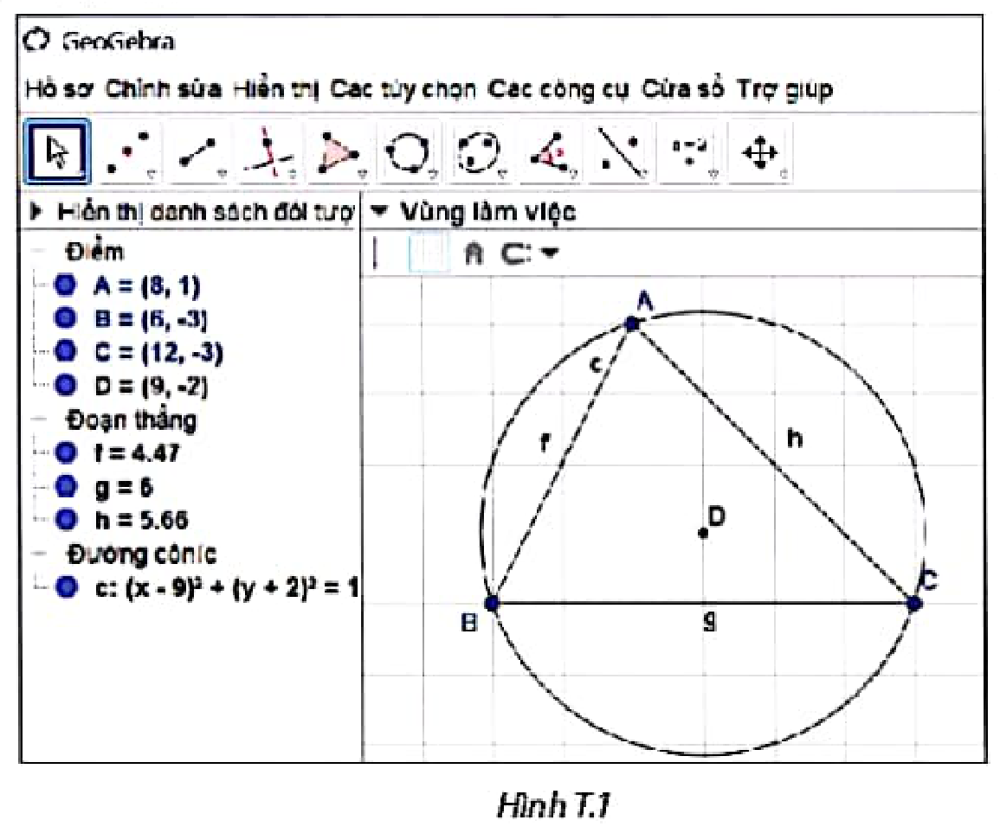
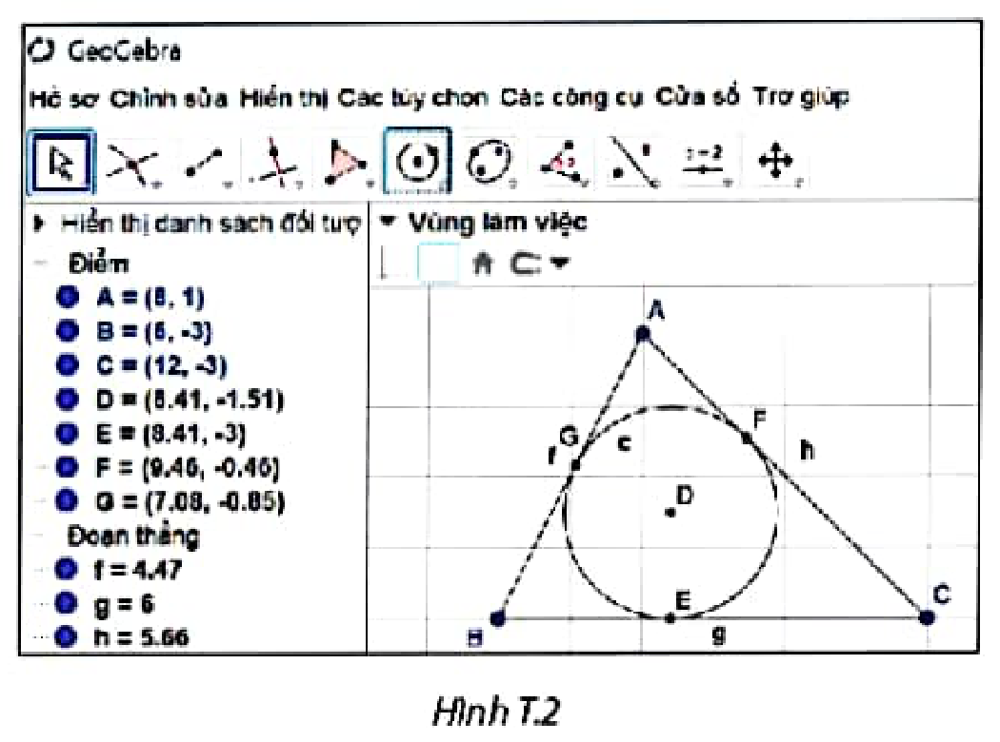
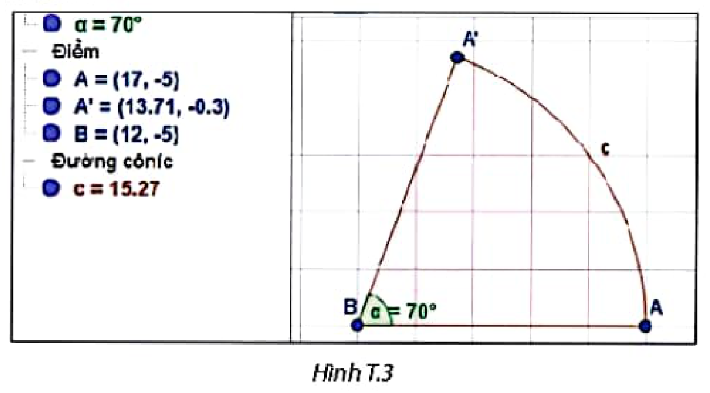
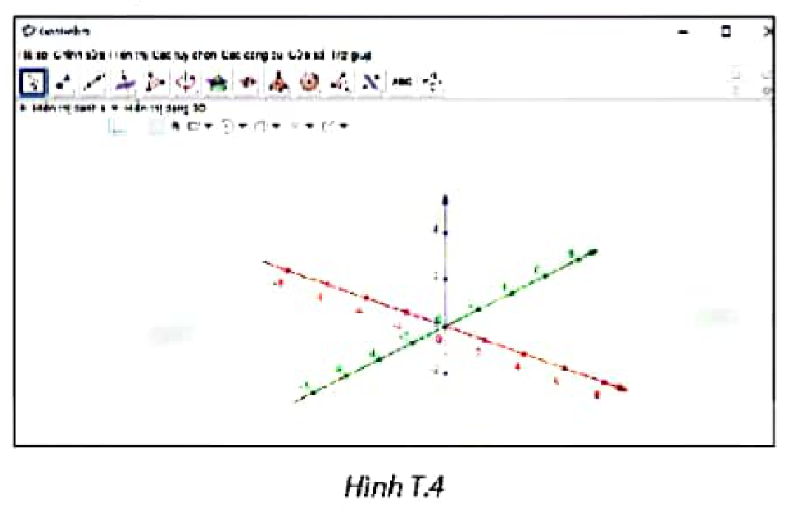
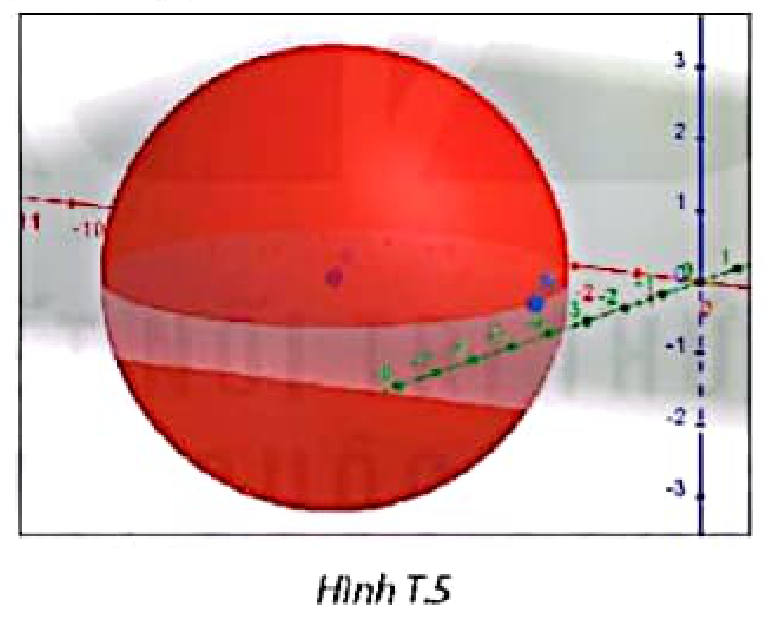
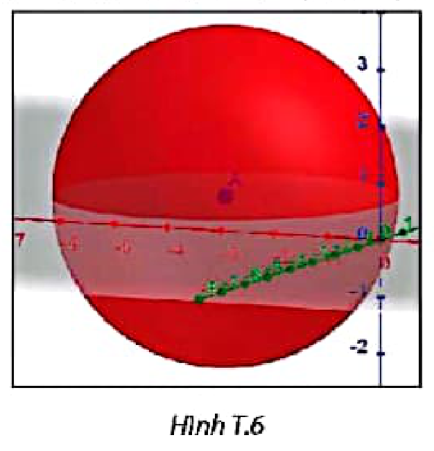
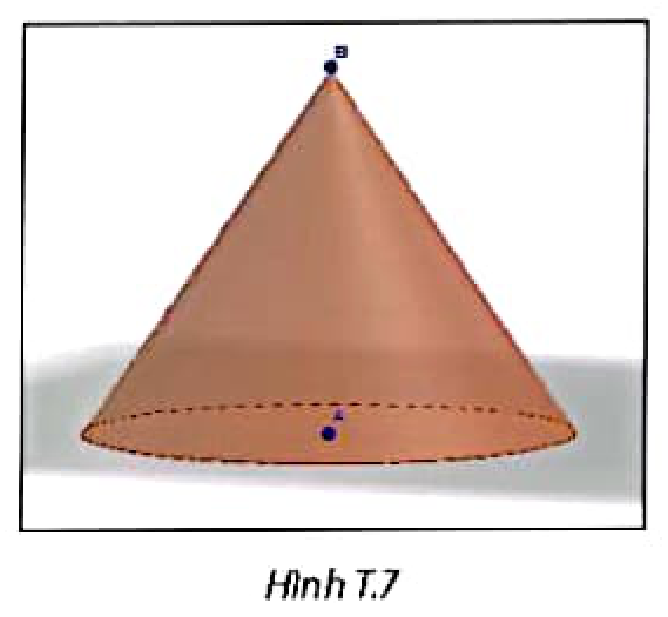
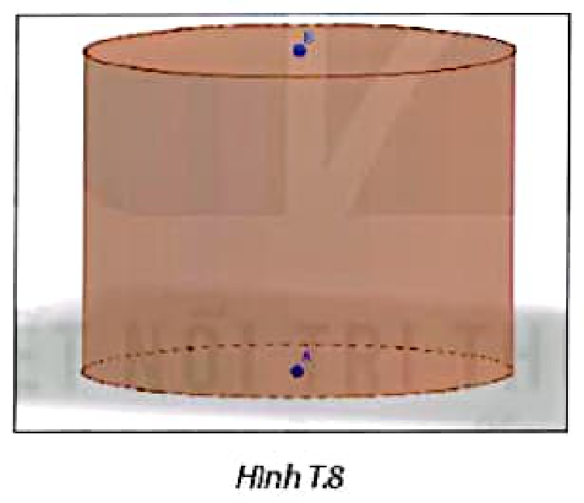

<!-- pdf:117 -->

# VẼ HÌNH ĐƠN GIẢN VỚI PHẦN MỀM GEOGEBRA

## 🎯 Mục tiêu

- Sử dụng phần mềm GeoGebra để vẽ đường tròn, hình quạt tròn và các hình khối đã học như hình cầu, hình nón và hình trụ.

Ở những lớp dưới, các em đã được học về vẽ các đa giác thường gặp bằng phần mềm GeoGebra. Trong bài này, chúng ta sẽ thực hành dùng phần mềm GeoGebra để vẽ đường tròn, hình quạt tròn và các hình khối đã học như hình cầu, hình nón và hình trụ.

**HĐ1:** **Vẽ đường tròn ngoại tiếp tam giác**

Chúng ta sẽ sử dụng nhóm công cụ đường thẳng và đường tròn trong GeoGebra để vẽ đường tròn ngoại tiếp một tam giác.

*Bước 1. Vẽ tam giác $ABC$.*

Chọn công cụ Đường thẳng $\to$ Chọn **Đoạn thẳng** $\to$ Lần lượt chọn điểm $A, B, C$ và nháy nút trái chuột vào điểm $A$ lần nữa ta được tam giác $ABC$.

*Bước 2. Vẽ đường tròn ngoại tiếp tam giác $ABC$.*

Chọn công cụ Đường tròn $\to$ Chọn **Vẽ đường tròn qua 3 điểm có sẵn** $\to$ Lần lượt nháy nút trái chuột vào các điểm $A, B, C$ ta được đường tròn ngoại tiếp tam giác $ABC$.

*Bước 3. Hiển thị tâm của đường tròn.*

Chọn công cụ Điểm $\to$ Chọn **Trung điểm hoặc tâm** $\to$ Nháy nút trái chuột vào đường tròn vừa vẽ ta được tâm $D$.

*Hình T.1*

**Kết quả:** Ta được đường tròn $(D)$ ngoại tiếp tam giác $ABC$ như Hình T.1.

<!-- pdf:118 -->

> ❓ Điểm $D$ có nằm trên trung trực các đoạn thẳng $AB, BC$ và $CA$ không? Hãy dùng lệnh vẽ đường trung trực **Đường trung trực** trong nhóm công cụ vẽ các đường đặc biệt để kiểm tra điều đó.

**HĐ2:** **Vẽ đường tròn nội tiếp tam giác**

Chúng ta sẽ sử dụng nhóm công cụ đường thẳng và đường tròn trong GeoGebra để vẽ đường tròn nội tiếp một tam giác.

*Bước 1. Vẽ tam giác $ABC$ như Bước 1 trong HĐ1.*

*Bước 2. Vẽ tâm đường tròn nội tiếp tam giác $ABC$.*

- Chọn nhóm đường đặc biệt $\to$ Chọn **Đường phân giác** $\to$ Lần lượt nháy nút trái chuột vào các điểm $A, B, C$ ta được đường phân giác góc $B$.
- Chọn nhóm đường đặc biệt $\to$ Chọn **Đường phân giác** $\to$ Lần lượt nháy nút trái chuột vào các điểm $A, C, B$ ta được đường phân giác góc $C$.
- Chọn nhóm điểm $\to$ Chọn **Giao điểm của 2 đối tượng** $\to$ Nháy nút trái chuột vào hai đường phân giác vừa vẽ bên trên ta được điểm $D$ là tâm đường tròn nội tiếp tam giác $ABC$.

*Bước 3. Vẽ đường tròn nội tiếp tam giác $ABC$.*

- Chọn nhóm đường đặc biệt $\to$ Chọn **Đường vuông góc** $\to$ Lần lượt nháy nút trái chuột vào điểm $D$ và đoạn thẳng $BC$ ta được đường thẳng qua $D$ vuông góc với $BC$.
- Chọn nhóm điểm $\to$ Chọn **Giao điểm của 2 đối tượng** $\to$ Nháy nút trái chuột vào đoạn thẳng $BC$ và đường thẳng vừa vẽ ta được tiếp điểm $E$ của đường tròn nội tiếp trên cạnh $BC$.
- Chọn nhóm đường tròn $\to$ Chọn **Đường tròn khi biết tâm và 1 điểm trên đường tròn** $\to$ Nháy chuột lần lượt vào điểm $D$ và $E$ ta được đường tròn $(D)$ nội tiếp tam giác $ABC$.

*Bước 4. Vẽ các tiếp điểm trên $AC$ và $AB$.*

- Chọn nhóm điểm $\to$ Chọn **Giao điểm của 2 đối tượng** $\to$ Nháy nút trái chuột vào đường tròn $(D)$ và đoạn thẳng $AC$ ta được tiếp điểm $F$.
- Chọn nhóm điểm $\to$ Chọn **Giao điểm của 2 đối tượng** $\to$ Nháy nút trái chuột vào đường tròn $(D)$ và đoạn thẳng $AB$ ta được tiếp điểm $G$.

<!-- pdf:119 -->

*Hình T.2*

**Kết quả:** Ẩn các đường phân giác và đường vuông góc đi, ta được đường tròn $(D)$ nội tiếp tam giác $ABC$ với các tiếp điểm trên $BC, CA, AB$ là $E, F, G$ như Hình T.2.

> ❓ Điểm $D$ có nằm trên đường phân giác góc $A$ không? Hãy dùng lệnh vẽ đường phân giác **Đường phân giác** trong nhóm công cụ vẽ các đường đặc biệt để kiểm tra điều đó.

**HĐ3:** **Vẽ hình quạt tròn**

Chúng ta sẽ sử dụng nhóm công cụ góc và đường tròn trong GeoGebra để vẽ hình quạt tròn với số đo góc ở tâm cho trước.

*Bước 1. Vẽ góc $70^\circ$.*

Chọn nhóm góc $\to$ Chọn **Góc với độ lớn cho trước** $\to$ Lần lượt chọn các điểm $A, B$ và nhập số đo $70$ vào cửa sổ mới hiện ra, chọn “ngược chiều kim đồng hồ”, ta được ba điểm $A, B, A'$ sao cho góc $ABA'$ có số đo bằng $70^\circ$.

*Bước 2. Vẽ hình quạt tròn.*

Chọn nhóm đường tròn $\to$ Chọn **Hình quạt khi biết tâm và qua 2 điểm trên hình quạt** $\to$ Lần lượt nháy nút trái chuột vào các điểm $B, A, A'$ ta được hình quạt tròn với góc ở tâm $B$ bằng $70^\circ$ như Hình T.3.

*Hình T.3*

<!-- pdf:120 -->

**HĐ3:** **Vẽ hình cầu, hình nón, hình trụ**

Để vẽ được các hình không gian ba chiều, ta chọn thẻ “Hiển thị” trên thanh công cụ của GeoGebra và chọn “Hiển thị dạng 3D”. Vùng làm việc của GeoGebra sẽ hiển thị như Hình T.4. Trong đó phần màu ghi thể hiện là mặt phẳng dưới đáy nơi ta có thể chọn các điểm.

*Hình T.4*

a) Vẽ mặt cầu tâm $A$ đi qua điểm $B$ như sau:

Chọn nhóm mặt cầu $\to$ Chọn **Mặt cầu biết tâm và qua 1 điểm** $\to$ Lần lượt chọn các điểm $A, B$ ta được mặt cầu tâm $A$ đi qua $B$ (H.T.5).

*Hình T.5*

b) Vẽ mặt cầu tâm $A$ bán kính bằng $3$ như sau:

Chọn nhóm mặt cầu $\to$ Chọn **Mặt cầu biết tâm và qua 1 điểm** $\to$ Chọn điểm $A$ và nhập bán kính $3$, ta được mặt cầu tâm $A$ bán kính $3$ (H.T.6).
<!-- ocr-ok: đã đối chiếu ảnh trang PDF 120, dòng thao tác có biểu tượng công cụ GeoGebra -->

*Hình T.6*

<!-- pdf:121 -->

c) Vẽ hình nón có đáy là hình tròn tâm $A$ bán kính $2$, đỉnh $B$ như sau:

Chọn nhóm hình khối $\to$ Chọn **Hình nón** $\to$ Chọn điểm $A$, chọn điểm $B$ (nhấn nút trái chuột vào một điểm trên vùng làm việc và kéo thả điểm đó đến vị trí thích hợp), nhập bán kính bằng $2$, ẩn các trục ta được hình nón cần dựng (H.T.7).

*Hình T.7*

d) Vẽ hình trụ có đáy là các hình tròn tâm $A, B$ bán kính $2$ như sau:

Chọn nhóm hình khối $\to$ Chọn **Hình trụ** $\to$ Chọn điểm $A$, chọn điểm $B$ (như phần c), nhập bán kính bằng $2$, ẩn các trục toạ độ ta được hình trụ cần dựng (H.T.8).

*Hình T.8*

## ✏️ THỰC HÀNH

*Sử dụng phần mềm GeoGebra thực hiện các yêu cầu sau:*

1. Vẽ một đường tròn tâm $A$ bán kính bằng $2$.
<!-- ocr-ok: đã đối chiếu ảnh trang PDF 121, OCR đọc nhầm từ Vẽ thành Võ -->

b) Sử dụng lệnh vẽ tiếp tuyến **Các tiếp tuyến**, hãy vẽ tam giác $EFG$ ngoại tiếp đường tròn $(A)$ với các tiếp điểm trên $EF, FG, GE$ lần lượt là $B, C, D$.

c) Vẽ đường tròn ngoại tiếp tam giác $EFG$ và lưu thành tệp png.

2. Vẽ một hình trụ và một hình nón có chung đáy và đỉnh của hình nón nằm trên mặt đáy còn lại của hình trụ.

## 📷 Danh sách hình trong bài

| Mã hình | Trang PDF | Vị trí trong bài | Chú thích gốc |
| --- | :---: | --- | --- |
| H9-toan-hd-thtn-04-01 | 117 | HĐ1, Bước 3 | Hình T.1 |
| H9-toan-hd-thtn-04-02 | 119 | HĐ2, Kết quả | Hình T.2 |
| H9-toan-hd-thtn-04-03 | 119 | HĐ3 (Vẽ hình quạt tròn), Bước 2 | Hình T.3 |
| H9-toan-hd-thtn-04-04 | 120 | HĐ3 (Vẽ hình cầu, hình nón, hình trụ) | Hình T.4 |
| H9-toan-hd-thtn-04-05 | 120 | HĐ3 (Vẽ hình cầu, hình nón, hình trụ), câu a | Hình T.5 |
| H9-toan-hd-thtn-04-06 | 120 | HĐ3 (Vẽ hình cầu, hình nón, hình trụ), câu b | Hình T.6 |
| H9-toan-hd-thtn-04-07 | 121 | HĐ3 (Vẽ hình cầu, hình nón, hình trụ), câu c | Hình T.7 |
| H9-toan-hd-thtn-04-08 | 121 | HĐ3 (Vẽ hình cầu, hình nón, hình trụ), câu d | Hình T.8 |
