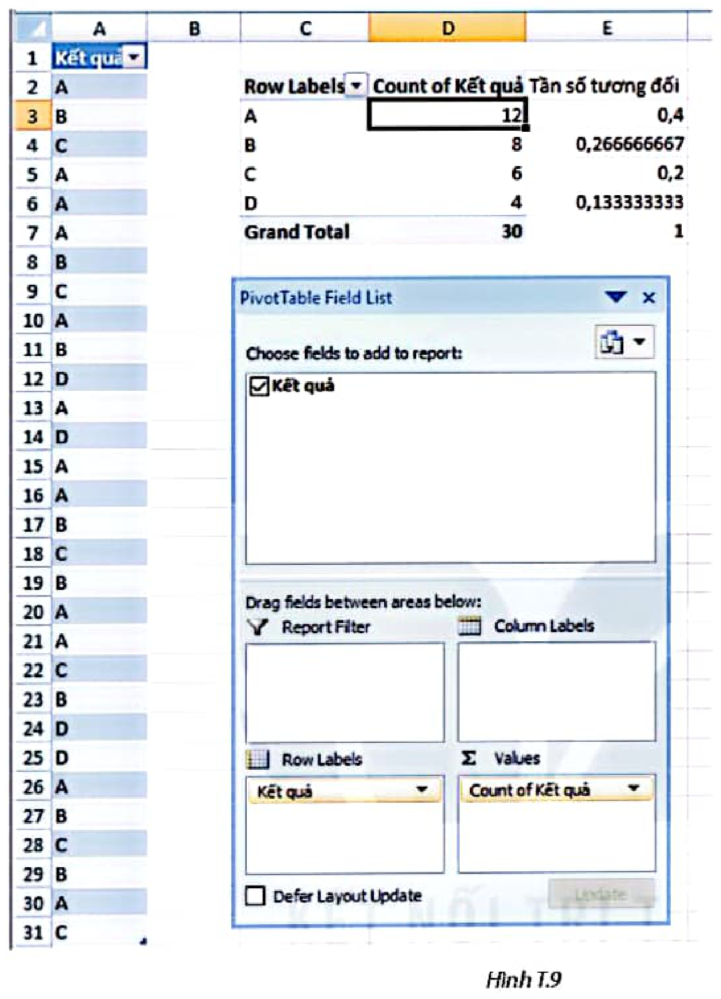
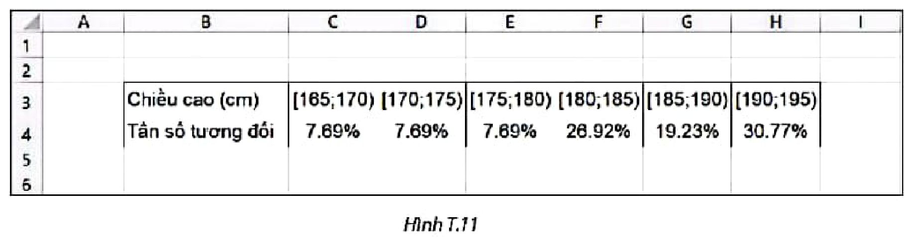
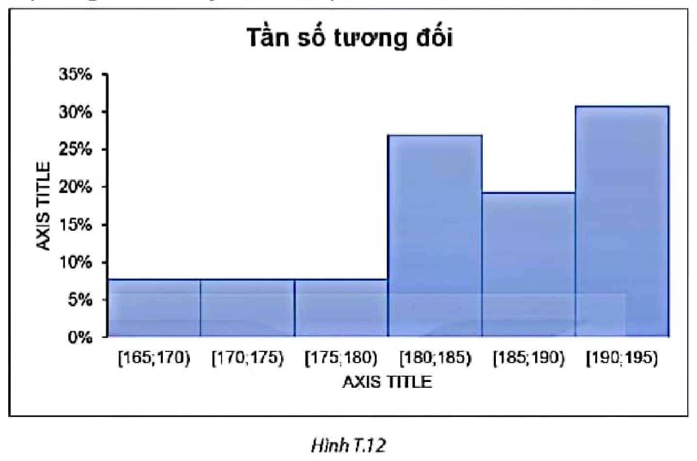
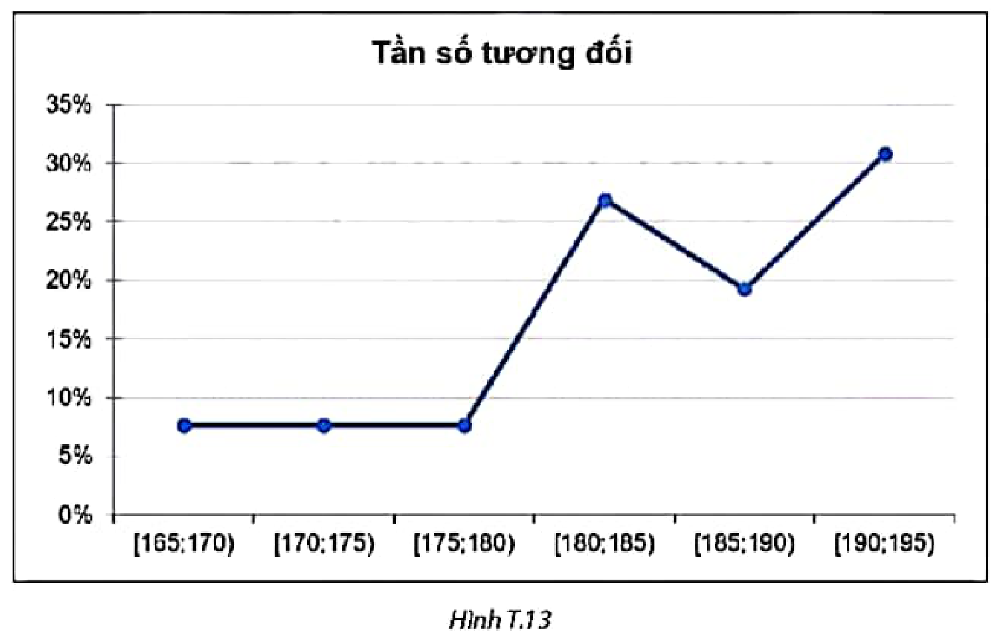
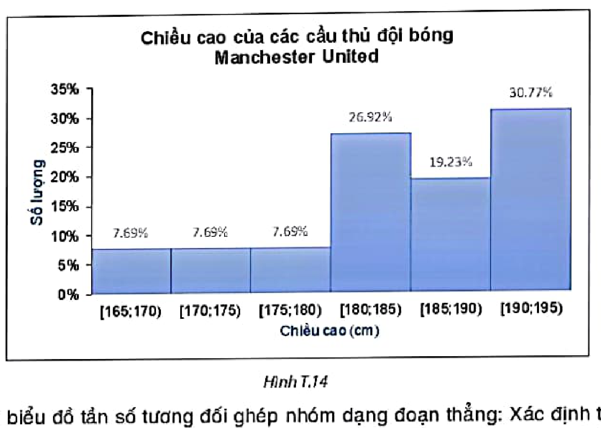
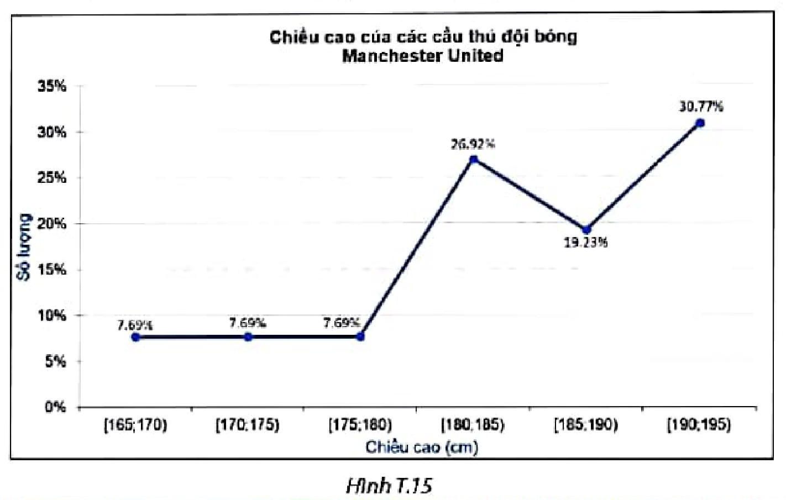

<!-- pdf:122 -->

# XÁC ĐỊNH TẦN SỐ, TẦN SỐ TƯƠNG ĐỐI, VẼ CÁC BIỂU ĐỒ BIỂU DIỄN BẢNG TẦN SỐ, TẦN SỐ TƯƠNG ĐỐI BẰNG EXCEL

## 1. XÁC ĐỊNH TẦN SỐ, TẦN SỐ TƯƠNG ĐỐI VÀ BIỂU DIỄN BẰNG BIỂU ĐỒ

Để xác định tần số, tần số tương đối và biểu diễn bằng biểu đồ (biểu đồ cột, biểu đồ hình quạt tròn từ một dãy dữ liệu dạng liệt kê trong Excel, ta thực hiện các bước sau:

*Bước 1.* Nhập dữ liệu dạng liệt kê vào một cột trong bảng tính.

*Bước 2.* Tạo bảng dữ liệu bằng cách xác định vùng dữ liệu và đặt tên bảng dữ liệu.

*Bước 3.* Sử dụng chức năng Pivot Table để tạo bảng tần số, tần số tương đối.

*Bước 4.* Từ bảng tần số, tần số tương đối vẽ đồ thị biểu diễn.

**Chú ý.** Việc tạo bảng dữ liệu sẽ giúp ta vẫn có các bảng, các biểu đồ khi thay đổi dữ liệu mà không cần thực hiện lại các bước trên, chỉ cần cập nhật dữ liệu và dùng chức năng Refresh.

Các thao tác cụ thể có thể khác nhau tuỳ thuộc vào phiên bản của Excel.

**Ví dụ 1:** Trước vòng bán kết giải bóng đá trường, Ban tổ chức đã phát phiếu hỏi các cổ động viên về đội vô địch. Kết quả thu được như sau:

A, B, C, A, A, B, C, A, B, D, A, D, A, A, B, C, B, A, A, C, B, D, D, A, B, C, B, A, C.

> **PHIẾU THĂM DÒ**
>
> Theo bạn, đội bóng lớp nào sẽ vô địch giải bóng đá trường?
>
> A. 9A. $\quad$ B. 8C. $\quad$ C. 7D. $\quad$ D. 9B.
<!-- ocr-ok: đã đối chiếu ảnh trang PDF 122, nội dung khung Phiếu thăm dò bên phải Ví dụ 1 -->

Để xác định bảng tần số, tần số tương đối cho dãy dữ liệu này trong Excel, ta làm như sau:

*Bước 1.* Nhập dãy dữ liệu trên vào vùng dữ liệu `A2:A31`, ô `A1` là tên cột “Kết quả”.

*Bước 2.* Chọn Insert $\to$ Table, chọn vùng dữ liệu `$A$1:$A$31`, tích vào ô My table has headers. Trong ô Table Name đặt tên cho bảng dữ liệu là *Dudoandoivodich*.

*Bước 3.* Chọn Insert $\to$ Pivot Table. Trong ô Table Range điền tên bảng dữ liệu *Dudoandoivodich*, chọn Existing Worksheet, trong ô Location chọn một vùng dữ liệu bất kì nào đó để đặt bảng kết quả, chẳng hạn ta chọn vùng `C2: E6` thì ô này sẽ hiện `Sheet3!$C$2:$E$6`. Chọn OK. Trong bảng Pivot Table Field List, kéo thả trường Kết quả vào $2$ ô Rowlabels và Values, ta sẽ thu được bảng tần số. Để thu được tần số tương đối của các giá trị, trong ô `E3` ta điền `=D3/$D$7` và sao chép công thức đến hết ô `E6`, điền nội dung “Tần số tương đối” vào ô `E2` và kiểm tra tổng tần số tương đối bằng cách điền `=SUM(E3:E6)` vào ô `E7`. Kết quả thu được như Hình T.9.

<!-- pdf:123 -->

*Hình T.9*

*Bước 4.* Để vẽ biểu đồ ta chọn vùng dữ liệu `C3:D6`, sau đó vào Insert chọn biểu đồ cột hoặc biểu đồ hình quạt tròn, điền các thông tin cần thiết để hoàn thiện biểu đồ. Kết quả thu được như Hình T.10.

*Hình T.10*

<!-- pdf:124 -->

**Thực hành 1**

Hỏi ý kiến của các bạn trong lớp về địa điểm đi dã ngoại với ba lựa chọn: Tràng An, Ba Vì, Đại Lải thu được kết quả sau:

Tràng An, Ba Vì, Tràng An, Tràng An, Ba Vì, Ba Vì, Đại Lải, Tràng An, Tràng An, Ba Vì, Tràng An, Đại Lải, Tràng An, Tràng An, Tràng An, Tràng An, Tràng An, Tràng An, Ba Vì, Đại Lải, Tràng An, Ba Vì, Tràng An, Đại Lải, Ba Vì, Ba Vì, Ba Vì, Ba Vì, Đại Lải, Tràng An.

Sử dụng bảng tính Excel, hãy lập bảng tần số, bảng tần số tương đối cho dãy dữ liệu trên và vẽ các biểu đồ cột, biểu đồ hình quạt tròn biểu diễn chúng.

## 2. VẼ CÁC BIỂU ĐỒ BIỂU DIỄN BẢNG TẦN SỐ, TẦN SỐ TƯƠNG ĐỐI GHÉP NHÓM

Để vẽ các biểu đồ biểu diễn dữ liệu ghép nhóm sử dụng bảng tính Excel thích hợp và thực hiện các bước sau đây:

*Bước 1.* Nhập dữ liệu vào bảng tính Excel và lập bảng tần số tương đối ghép nhóm (nếu cần).

*Bước 2.* Lựa chọn loại biểu đồ cần biểu diễn.

*Bước 3.* Hoàn thiện biểu đồ bằng cách xác định tiêu đề của biểu đồ, chú giải cho các trục, gán nhãn dữ liệu biểu diễn.

**Ví dụ 2:** Chiều cao của các cầu thủ đội bóng Manchester United được cho trong bảng sau:

| Chiều cao ($\text{cm}$) | $[165; 170)$ | $[170; 175)$ | $[175; 180)$ | $[180; 185)$ | $[185; 190)$ | $[190; 195)$ |
| --- | :---: | :---: | :---: | :---: | :---: | :---: |
| Tần số tương đối | $7,69\%$ | $7,69\%$ | $7,69\%$ | $26,92\%$ | $19,23\%$ | $30,77\%$ |

*(Theo webthethao.vn)*

Để vẽ biểu đồ tần số tương đối ghép nhóm dạng cột và dạng đoạn thẳng biểu diễn bảng số liệu ghép nhóm này, ta thực hiện theo các bước sau đây:

*Bước 1.* Nhập dữ liệu vào bảng tính Excel (H.T.11).

*Hình T.11*

<!-- pdf:125 -->

*Bước 2.* Chọn vùng dữ liệu.

– Để vẽ biểu đồ tần số tương đối ghép nhóm dạng cột ta chọn Insert $\to$ Columns $\to$ 2-D Columns sau đó chọn loại biểu đồ mong muốn. Chọn Design, chọn Layout8 (histogram) trong ô Chart layouts. Kết quả thu được như Hình T.12.

*Hình T.12*

– Để vẽ biểu đồ tần số tương đối ghép nhóm dạng đoạn thẳng ta chọn Insert $\to$ Line $\to$ 2-D lines, sau đó chọn loại biểu đồ mong muốn. Kết quả thu được như Hình T.13.

*Hình T.13*

*Bước 3.* Hoàn thiện biểu đồ:

– Đối với biểu đồ tần số tương đối ghép nhóm dạng cột: Xác định tiêu đề của biểu đồ, chú giải cho các trục bằng cách chọn các mục tương ứng và thay nội dung; gán nhãn dữ liệu biểu diễn bằng cách nháy nút phải chuột vào phần các cột của biểu đồ, chọn Add data labels. Kết quả ta thu được biểu đồ như Hình T.14.

<!-- pdf:126 -->

*Hình T.14*

– Đối với biểu đồ tần số tương đối ghép nhóm dạng đoạn thẳng: Xác định tiêu đề của biểu đồ bằng cách chọn các mục tương ứng và thay nội dung; ghi chú giải cho các trục bằng cách chọn Layout $\to$ Axis titles $\to$ Primary Horizontal Axis Title hoặc Primary Vertical Axis Title; gán nhãn dữ liệu biểu diễn bằng cách nháy nút phải chuột vào đường gấp khúc, chọn Add data labels. Kết quả ta thu được biểu đồ như Hình T.15.

*Hình T.15*

**Thực hành 2**

Thời gian chờ của bệnh nhân tại một phòng khám bệnh được cho trong bảng sau:
<!-- ocr-ok: đã đối chiếu ảnh trang PDF 126, OCR bỏ sót dòng mở đầu của Thực hành 2 -->

| Thời gian (phút) | $[0; 10)$ | $[10; 20)$ | $[20; 30)$ | $[30; 40)$ |
| --- | :---: | :---: | :---: | :---: |
| Tần số tương đối | $50\%$ | $10\%$ | $24\%$ | $16\%$ |

Sử dụng bảng tính Excel, vẽ biểu đồ tần số tương đối ghép nhóm dạng cột và dạng đoạn thẳng cho bảng thống kê trên.

## 📷 Danh sách hình trong bài

| Mã hình | Trang PDF | Vị trí trong bài | Chú thích gốc |
| --- | :---: | --- | --- |
| H9-toan-hd-thtn-05-01 | 122 | Mục 1, Ví dụ 1 | (sách không đánh số, mẫu Phiếu thăm dò đội vô địch giải bóng đá trường) |
| H9-toan-hd-thtn-05-02 | 123 | Mục 1, Ví dụ 1, Bước 3 | Hình T.9 |
| H9-toan-hd-thtn-05-03 | 123 | Mục 1, Ví dụ 1, Bước 4 | Hình T.10 |
| H9-toan-hd-thtn-05-04 | 124 | Mục 2, Ví dụ 2, Bước 1 | Hình T.11 |
| H9-toan-hd-thtn-05-05 | 125 | Mục 2, Ví dụ 2, Bước 2 | Hình T.12 |
| H9-toan-hd-thtn-05-06 | 125 | Mục 2, Ví dụ 2, Bước 2 | Hình T.13 |
| H9-toan-hd-thtn-05-07 | 126 | Mục 2, Ví dụ 2, Bước 3 | Hình T.14 |
| H9-toan-hd-thtn-05-08 | 126 | Mục 2, Ví dụ 2, Bước 3 | Hình T.15 |
