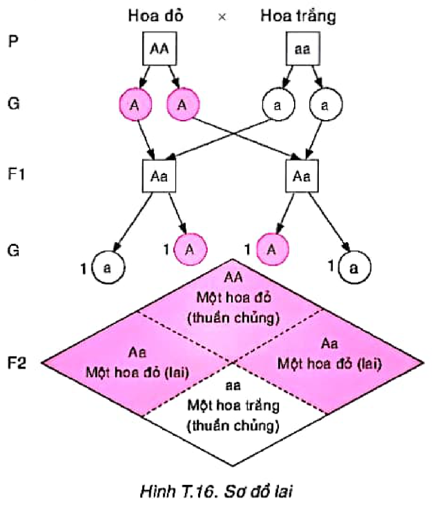

<!-- pdf:127 -->

# GENE TRỘI TRONG CÁC THẾ HỆ LAI

## 🎯 Mục tiêu

- Kiểm chứng lại các quy luật di truyền của Mendel về tỉ lệ kiểu gene, kiểu hình trong các thế hệ lai, khi lai hai bố mẹ khác nhau về một cặp tính trạng thuần chủng tương phản bằng cách tính xác suất, mô phỏng.

**Chuẩn bị:**

– Hai đồng xu với hai màu khác nhau, chẳng hạn màu xanh và màu đỏ.

– Ôn tập các quy luật di truyền của Mendel.

**Thực hiện:**

Lai cây đậu Hà Lan hoa đỏ thuần chủng với cây đậu hoa trắng thuần chủng thu được các cây lai đời F1 đều có hoa đỏ. Cho các cây hoa đỏ đời F1 tự thụ phấn, thế hệ lai đời F2 thu được tỉ lệ phân li kiểu hình là $3$ cây hoa đỏ : $1$ cây hoa trắng.

Theo thuật ngữ của Mendel, màu hoa đỏ là tính trạng trội, màu hoa trắng là tính trạng lặn. Quy ước allele A quy định màu hoa đỏ, allele a quy định màu hoa trắng. Kết quả của phép lai được mô phỏng trong Hình T.16.

*Hình T.16. Sơ đồ lai*
<!-- ocr-ok: đã đối chiếu ảnh trang PDF 127, OCR đọc nhầm chữ Sơ đồ lai thành Sơ đổ lai -->

**Mô phỏng**

Ta sẽ mô phỏng việc lai “bố” và “mẹ” thuộc đời lai F1 và xem xét kiểu gen, kiểu hình của đời lai F2. Giả sử, đồng xu màu xanh kí hiệu cho “bố”, đồng xu màu đỏ kí hiệu cho “mẹ”. Trên mỗi đồng xu quy ước một mặt là A, mặt còn lại là a.

<!-- pdf:128 -->

*Bước 1.* Tung mỗi đồng xu $100$ lần và hoàn thiện bảng sau vào vở:

| STT | Kết quả trên đồng xu màu xanh | Kết quả trên đồng xu màu đỏ | Kiểu gen | Kiểu hình |
| :---: | :---: | :---: | :---: | :---: |
| $1$ | A | a | Aa | Hoa màu đỏ |
| ... | ... | ... | ... | ... |
| $100$ | a | a | aa | Hoa màu trắng |

*Bảng T.1. Kết quả mô phỏng*

*Bước 2.* Dựa vào kết quả thu được ở Bảng T.1, xác định tần số, tần số tương đối của các kiểu gene, kiểu hình và hoàn thiện các bảng sau vào vở:

| Kiểu gene | AA | Aa | aa |
| --- | :---: | :---: | :---: |
| Tần số | $?$ | $?$ | $?$ |
| Tần số tương đối | $?$ | $?$ | $?$ |

*Bảng T.2. Tỉ lệ kiểu gen*

| Kiểu gene | Hoa màu đỏ | Hoa màu trắng |
| --- | :---: | :---: |
| Tần số | $?$ | $?$ |
| Tần số tương đối | $?$ | $?$ |

*Bảng T.3. Tỉ lệ kiểu hình*

*Bước 3.* Hãy kiểm chứng tỉ lệ kiểu gene, kiểu hình thu được trong đời lai F2 với kết luận của Mendel “Khi lai bố mẹ khác nhau về một cặp tính trạng thuần chủng tương phản thì F1 đồng tính về tính trạng của bố hoặc mẹ, còn F2 có sự phân li tính trạng theo tỉ lệ trung bình $3$ trội : $1$ lặn”.

**Giải thích kết luận của Mendel bằng xác suất**

Gọi $xy$ là kiểu gene của một cây đậu trong đời lai F2.

a) Giả thiết rằng khả năng $x, y$ nhận các giá trị A, a là như nhau. Các giá trị có thể có của $xy$ được cho trong bảng sau:

| $x$ \ $y$ | A | a |
| :---: | :---: | :---: |
| A | AA | aA |
| a | Aa | aa |

*Bảng T.4. Các phương án tổ hợp*

Hãy liệt kê kiểu gene có thể có của một cây đậu trong đời lai F2. Bốn phương án tổ hợp trong Bảng T.4 có đồng khả năng hay không?

b) Tính xác suất của các sự kiện “Cây đậu trong đời lai F2 có kiểu gene AA”, “Cây đậu trong đời lai F2 có kiểu gene aa”; “Cây đậu trong đời lai F2 có hoa màu đỏ”; “Cây đậu trong đời lai F2 có hoa màu trắng”.

c) So sánh các xác suất tính được với các kết luận của Mendel về tỉ lệ kiểu gene, kiểu hình trong đời lai F2 khi lai hai bố mẹ khác nhau về một cặp tính trạng thuần chủng tương phản.

**Thực hành**

Thực hiện mô phỏng theo cách tương tự với các phép lai khác.

## 📷 Danh sách hình trong bài

| Mã hình | Trang PDF | Vị trí trong bài | Chú thích gốc |
| --- | :---: | --- | --- |
| H9-toan-hd-thtn-06-01 | 127 | Thực hiện | Hình T.16. Sơ đồ lai |
