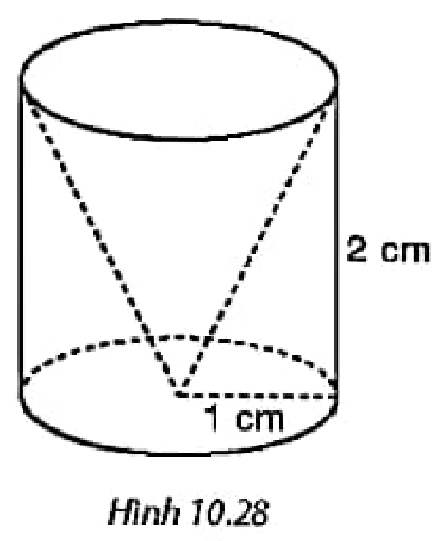
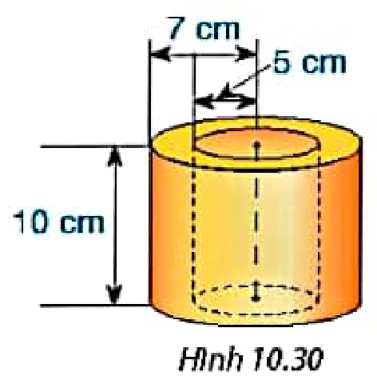
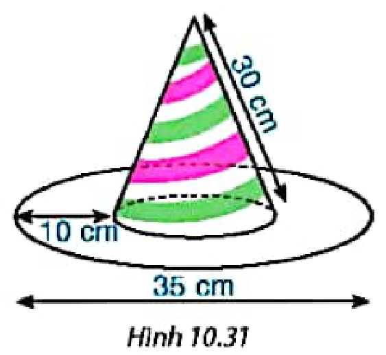
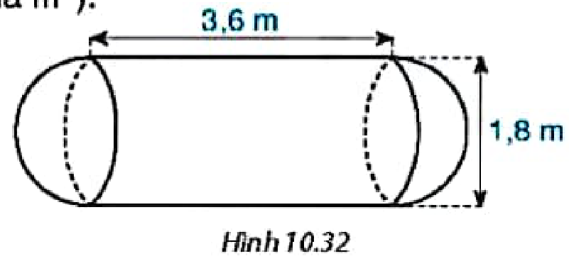
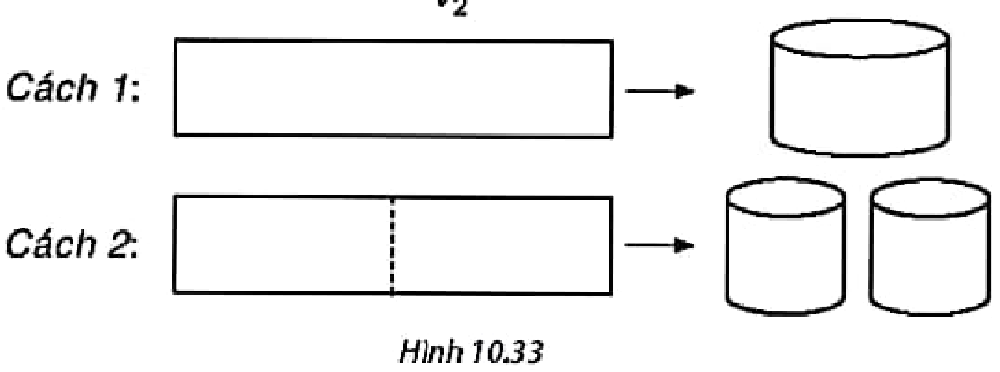

<!-- pdf:108 -->

# LUYỆN TẬP CHUNG (TRANG 106)

**Ví dụ 1:** Một hình trụ có bán kính đáy bằng $1\text{ cm}$ và chiều cao bằng $2\text{ cm}$. Người ta khoan đi một phần có dạng hình nón như Hình 10.28 thì thể tích phần còn lại của hình trụ bằng bao nhiêu?

*Hình 10.28*

**Giải**

Thể tích của hình trụ là $V_1 = \pi R^2 h = \pi \cdot 1^2 \cdot 2 = 2\pi\text{ (cm}^3\text{)}$.

Thể tích phần bị khoan có dạng hình nón là:

$V_2 = \dfrac{1}{3}\pi R^2 h = \dfrac{1}{3}\pi \cdot 1^2 \cdot 2 = \dfrac{2\pi}{3}\text{ (cm}^3\text{)}.$

Thể tích phần còn lại là $V = V_1 - V_2 = 2\pi - \dfrac{2\pi}{3} = \dfrac{4\pi}{3}\text{ (cm}^3\text{)}$.

**Ví dụ 2:** Một hộp đựng bóng tennis có dạng hình trụ chứa vừa khít ba quả bóng tennis xếp theo chiều dọc (H.10.29). Các quả bóng tennis có dạng hình cầu, đường kính $6,4\text{ cm}$.

a) Tính thể tích hộp đựng bóng (bỏ qua bề dày của vỏ hộp, làm tròn kết quả đến hàng đơn vị của $\text{cm}^3$).

b) Tính thể tích bên trong hộp đựng bóng không bị chiếm bởi ba quả bóng tennis.

*Hình 10.29*

**Giải**

a) Chiều cao hộp đựng bóng hình trụ là $h = 6,4 \cdot 3 = 19,2\text{ (cm)}$.

Bán kính đáy hộp đựng bóng hình trụ là $R = 6,4 : 2 = 3,2\text{ (cm)}$.

Thể tích hộp đựng bóng hình trụ nói trên là:

$V = \pi R^2 h = \pi \cdot 3,2^2 \cdot 19,2 \approx 618\text{ (cm}^3\text{)}.$

b) Bán kính quả bóng tennis là $R' = 6,4 : 2 = 3,2\text{ (cm)}$.

Thể tích của ba quả bóng tennis có dạng hình cầu là:

$V' = 3 \cdot \left(\dfrac{4}{3}\pi \cdot R'^3\right) = 3 \cdot \left(\dfrac{4}{3}\pi \cdot 3,2^3\right) \approx 412\text{ (cm}^3\text{)}.$

Thể tích bên trong hộp đựng bóng không bị chiếm bởi ba quả bóng tennis là:

$V'' = V - V' \approx 618 - 412 = 206\text{ (cm}^3\text{)}.$

## BÀI TẬP

10.11. Cho một hình trụ có đường kính của đáy bằng với chiều cao và có thể tích bằng $2\pi\text{ cm}^3$.

a) Tính chiều cao của hình trụ.

b) **Diện tích toàn phần của hình trụ** bằng tổng diện tích xung quanh và diện tích hai đáy hình trụ. Tính diện tích toàn phần của hình trụ trên.

<!-- pdf:109 -->

10.12. Một vòng bi bằng thép có hình dạng (phần thép giữa hai hình trụ) và kích thước như Hình 10.30. Tính thể tích của vòng bi đó.

*Hình 10.30*

10.13. Chiếc mũ của chú hề với các kích thước như Hình 10.31. Hãy tính tổng diện tích vải cần để làm chiếc mũ (coi mép khâu không đáng kể và làm tròn kết quả đến hàng phần chục của $\text{cm}^2$).

*Hình 10.31*

10.14. Người ta nhấn chìm hoàn toàn $5$ viên bi có dạng hình cầu vào một chiếc cốc hình trụ đựng đầy nước, mỗi viên bi có đường kính $2\text{ cm}$. Tính lượng nước tràn ra khỏi cốc.

10.15. Một bồn chứa xăng gồm hai nửa hình cầu có đường kính bằng $1,8\text{ m}$ và một hình trụ có chiều cao bằng $3,6\text{ m}$ (H.10.32). Tính thể tích của bồn chứa xăng (làm tròn kết quả đến hàng phần trăm của $\text{m}^3$).

*Hình 10.32*

10.16. Từ một tấm tôn hình chữ nhật có kích thước $50\text{ cm} \times 240\text{ cm}$, người ta làm mặt xung quanh của các thùng đựng nước hình trụ có chiều cao bằng $50\text{ cm}$, theo hai cách sau (H.10.33):

- *Cách 1:* Gò tấm tôn ban đầu thành mặt xung quanh của thùng nước hình trụ.
- *Cách 2:* Cắt tấm tôn ban đầu thành hai tấm bằng nhau hình chữ nhật, rồi gò mỗi tấm đó thành mặt xung quanh của một thùng.

Kí hiệu $V_1$ là thể tích của thùng gò được theo *Cách 1* và $V_2$ là tổng thể tích của hai thùng gò được theo *Cách 2*. Tính tỉ số $\dfrac{V_1}{V_2}$ (giả sử các mối hàn là không đáng kể).

*Hình 10.33*

## 📷 Danh sách hình trong bài

| Mã hình | Trang PDF | Vị trí trong bài | Chú thích gốc |
| --- | :---: | --- | --- |
| H9-toan-ltc-c10-01-01 | 108 | Ví dụ 1 | Hình 10.28 |
| H9-toan-ltc-c10-01-02 | 108 | Ví dụ 2 | Hình 10.29 |
| H9-toan-ltc-c10-01-03 | 109 | Bài tập 10.12 | Hình 10.30 |
| H9-toan-ltc-c10-01-04 | 109 | Bài tập 10.13 | Hình 10.31 |
| H9-toan-ltc-c10-01-05 | 109 | Bài tập 10.15 (nhãn 3,6 m nằm sát dòng đề bài 10.15 phía trên) | Hình 10.32 |
| H9-toan-ltc-c10-01-06 | 109 | Bài tập 10.16 (đỉnh hình trụ Cách 1 nằm sát mẫu số $V_2$ của dòng đề bài 10.16 phía trên) | Hình 10.33 |
