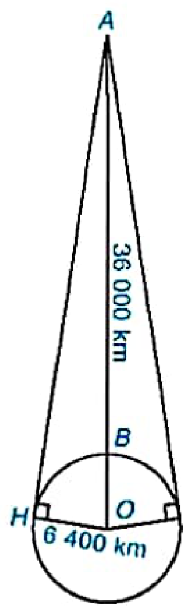
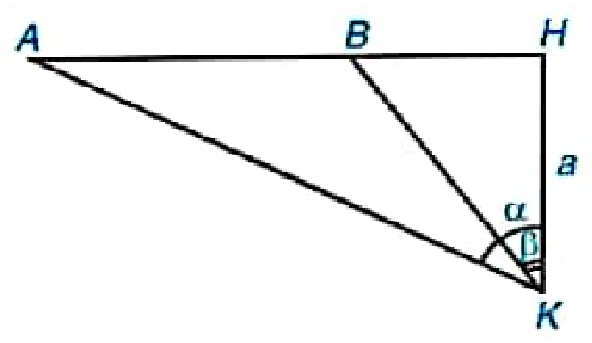
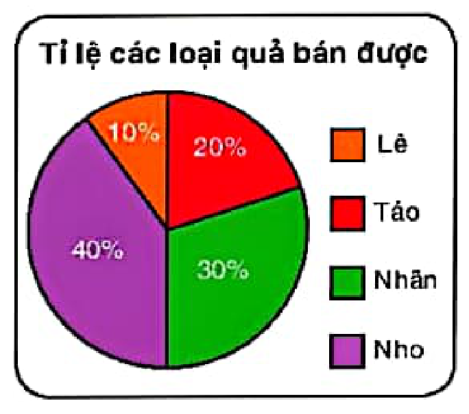

<!-- pdf:129 -->

# BÀI TẬP ÔN TẬP CUỐI NĂM

## ✏️ ĐẠI SỐ

1. Xét biểu thức $P = \dfrac{x\sqrt{x} - x + 2\sqrt{x} + 4}{x\sqrt{x} + 8}$ với $x \ge 0$.
<!-- ocr-ok: đã đối chiếu ảnh trang PDF 129, câu chứa biểu thức căn thức LaTeX -->

a) Chứng minh rằng $P = 1 - \dfrac{1}{\sqrt{x} + 2}$.

b) Tính giá trị biểu thức đã cho tại $x = 64$.

2. Một vệ tinh địa tĩnh chuyển động theo quỹ đạo tròn cách bề mặt Trái Đất khoảng $AB = 36\,000\text{ km}$, tâm quỹ đạo trùng với tâm $O$ của Trái Đất như hình bên. Vệ tinh phát tín hiệu vô tuyến theo đường thẳng đến một số vị trí trên bề mặt Trái Đất. Cho biết bán kính Trái Đất khoảng $6\,400\text{ km}$, vị trí xa nhất trên bề mặt Trái Đất có thể nhận được tín hiệu từ vệ tinh cách vệ tinh bao nhiêu kilômét? (Làm tròn kết quả đến hàng đơn vị).

3. Giải các bất phương trình sau:

a) $-6x + 3(x + 1) > 4x - (x - 4)$;

b) $(2x + 1)(2x - 1) < 4x^2 - 4x + 1$.

4. Giải các phương trình sau:

a) $\dfrac{2}{x + 1} - \dfrac{2x}{x^2 - x + 1} = \dfrac{3}{x^3 + 1}$;

b) $\dfrac{x + 1}{2x - 1} - \dfrac{2}{2x + 1} = \dfrac{2x^2}{4x^2 - 1}$.

5. Kí hiệu $(d_1)$ là đường thẳng $x + 2y = 4$, $(d_2)$ là đường thẳng $x - y = 1$.

a) Vẽ $(d_1)$ và $(d_2)$ trên cùng một mặt phẳng toạ độ.

b) Giải hệ phương trình $\begin{cases} x + 2y = 4 \\ x - y = 1 \end{cases}$ để tìm toạ độ giao điểm của hai đường thẳng $(d_1)$ và $(d_2)$.

6. Với mỗi giá trị đã cho của $m$, hãy giải hệ phương trình sau:

$\begin{cases} x\sqrt{2} - 3y = m \\ m^2 x - 3y\sqrt{2} = 2. \end{cases}$

a) $m = \sqrt{2}$;

b) $m = -\sqrt{2}$;

c) $m = 2\sqrt{2}$.

7. Để chuẩn bị làm một ngôi nhà, chú Ba tính rằng tổng diện tích xây dựng là khoảng $100\text{ m}^2$ và tổng chi phí (tiền vật liệu và tiền công thợ) hết khoảng $600$ triệu đồng. Khi thực hiện, diện tích xây dựng tăng thêm $20\text{ m}^2$ và cứ mỗi mét vuông xây dựng, chi phí tiền vật liệu tăng thêm $10\%$ và tiền công thợ tăng thêm $\dfrac{1}{5}$ so với dự tính ban đầu. Do đó tổng chi phí thực tế là $804$ triệu đồng. Hỏi thực tế chú Ba phải trả bao nhiêu tiền vật liệu và bao nhiêu tiền công thợ cho mỗi mét vuông xây dựng?

<!-- pdf:130 -->

8. Hai bến A và B trên một dòng sông cách nhau $36\text{ km}$. Một ca nô xuôi dòng từ bến A đến bến B, rồi sau đó ngược dòng từ bến B về bến A hết thời gian bằng thời gian nó đi quãng đường $75\text{ km}$ khi nước yên lặng. Tính vận tốc thực của ca nô (tức là vận tốc của ca nô khi nước yên lặng), biết rằng vận tốc dòng nước là $3\text{ km/h}$.

## HÌNH HỌC VÀ ĐO LƯỜNG

9. Để đo khoảng cách giữa hai điểm $A$ và $B$ không tới được, một người đứng ở điểm $H$ sao cho $B$ ở giữa $A$ và $H$ rồi dịch chuyển đến điểm $K$ sao cho $KH$ vuông góc với $AB$ tại $H$, $HK = a\text{ (m)}$, ngắm nhìn $A$ với $\widehat{AKH} = \alpha$, ngắm nhìn $B$ với $\widehat{BKH} = \beta$ ($\alpha > \beta$).
<!-- ocr-ok: đã đối chiếu ảnh trang PDF 130, đề bài chứa nhiều kí hiệu điểm và góc bằng LaTeX -->

a) Hãy biểu diễn $AB$ theo $a, \alpha, \beta$.

b) Khi $a = 3\text{ m}$, $\alpha = 60^\circ$, $\beta = 30^\circ$, hãy tính $AB$ (làm tròn kết quả đến chữ số thập phân thứ ba của mét).

10. Cho tam giác $ABC$ vuông tại $B$ có góc $\widehat{A} = 30^\circ$, $AB = 6\text{ cm}$. Vẽ tia $Bt$ sao cho $\widehat{tBC} = 30^\circ$, cắt tia $AC$ ở $D$ ($C$ nằm giữa $A$ và $D$).
<!-- ocr-ok: đã đối chiếu ảnh trang PDF 130, đề bài chứa nhiều kí hiệu góc và tia bằng LaTeX -->

a) Chứng minh tam giác $ABD$ cân tại $B$.

b) Tính khoảng cách từ $D$ đến đường thẳng $AB$.

11. Tứ giác $ABCD$ có hai góc đối diện $B$ và $D$ vuông, hai góc kia không vuông.

a) Chứng minh rằng có một đường tròn đi qua bốn điểm $A, B, C$ và $D$. Ta gọi đó là đường tròn $(\mathscr{C})$.

b) Gọi $I$ và $K$ lần lượt là trung điểm các đường chéo $AC$ và $BD$ của tứ giác. Chứng minh rằng $IK \perp BD$.

c) Kí hiệu các tiếp tuyến của đường tròn $(\mathscr{C})$ tại $A, B$ và $C$ lần lượt là $a, b$ và $c$. Giả sử $b$ cắt $a$ và $c$ theo thứ tự tại $E$ và $F$. Chứng minh rằng tứ giác $AEFC$ là một hình thang.

d) Chứng minh rằng $EF = AE + CF$.

12. Tỉ lệ các loại quả bán được trong một ngày của một cửa hàng được thể hiện trong biểu đồ hình quạt tròn như hình bên. Số phần trăm ghi trong mỗi hình quạt đúng bằng tỉ số giữa số đo của cung tròn tương ứng và số đo của cả đường tròn ($360^\circ$).

a) Tính số đo của mỗi cung tròn ứng với hình quạt màu tím, màu cam và màu đỏ.

b) Tính số đo của cung còn lại (ứng với hình quạt màu xanh) bằng hai cách.

<!-- pdf:131 -->

13. Cho tam giác $ABC$ ($AB < AC$) ngoại tiếp đường tròn $(I)$ với các tiếp điểm trên $BC, CA, AB$ lần lượt là $D, E, F$. Gọi $X$ và $Y$ lần lượt là chân đường cao kẻ từ $B$ và $C$ xuống $CI$ và $BI$. Chứng minh rằng:

a) $DBXF, DCYE$ là các tứ giác nội tiếp.
<!-- ocr-ok: đã đối chiếu ảnh trang PDF 131, câu ngắn chứa kí hiệu tứ giác LaTeX và OCR đọc tú giác -->

b) Bốn điểm $X, Y, E, F$ thẳng hàng.

14. Bạn Khôi làm một chiếc mũ sinh nhật bằng bìa cứng có dạng hình nón với đường kính đáy bằng $20\text{ cm}$, độ dài đường sinh bằng $30\text{ cm}$. Tính diện tích giấy để làm chiếc mũ sinh nhật trên (lấy $\pi \approx 3,14$ và coi mép dán không đáng kể).

## ✏️ THỐNG KÊ VÀ XÁC SUẤT

15. Chiều cao ($\text{cm}$) của $20$ bé trai $24$ tháng tuổi được cho như bảng sau:

| $85,2$ | $87,9$ | $80,3$ | $92,1$ | $93,7$ | $88,5$ | $94,2$ | $83,0$ | $95,1$ | $84,6$ |
| :---: | :---: | :---: | :---: | :---: | :---: | :---: | :---: | :---: | :---: |
| $84,1$ | $89,6$ | $87,5$ | $90,3$ | $81,2$ | $87,6$ | $93,5$ | $84,8$ | $94,4$ | $85,1$ |

Theo Tổ chức Y tế thế giới WHO, nếu bé trai $24$ tháng tuổi có chiều cao dưới $81,7\text{ cm}$ được xem là thấp còi, chiều cao từ $81,7\text{ cm}$ đến dưới $93,9\text{ cm}$ được xem là đạt chuẩn, chiều cao từ $93,9\text{ cm}$ trở lên được xem là cao.

a) Hãy hoàn thiện bảng sau vào vở:

| Phân loại theo chiều cao | Thấp còi | Đạt chuẩn | Cao |
| --- | :---: | :---: | :---: |
| Số trẻ | $?$ | $?$ | $?$ |

b) Tính tỉ lệ bé trai $24$ tháng tuổi theo các mức phân loại về chiều cao. Vẽ biểu đồ hình quạt tròn biểu diễn các tỉ lệ thu được.

c) Ước lượng số bé trai thấp còi, đạt chuẩn, cao trong số $1\,200$ bé trai $24$ tháng tuổi.

16. Một nhóm của lớp 9A có $3$ bạn nam và $2$ bạn nữ. Giáo viên chọn ngẫu nhiên $2$ bạn trong nhóm để tham gia một phong trào của trường.

a) Mô tả không gian mẫu.

b) Tính xác suất để hai bạn được chọn khác giới.

## 📷 Danh sách hình trong bài

| Mã hình | Trang PDF | Vị trí trong bài | Chú thích gốc |
| --- | :---: | --- | --- |
| H9-toan-on-tap-cuoi-nam-01 | 129 | Đại số, Bài 2 | (sách không đánh số, sơ đồ vệ tinh địa tĩnh và Trái Đất) |
| H9-toan-on-tap-cuoi-nam-02 | 130 | Hình học và Đo lường, Bài 9 | (sách không đánh số, sơ đồ ngắm đo khoảng cách $AB$ từ $H$ và $K$) |
| H9-toan-on-tap-cuoi-nam-03 | 130 | Hình học và Đo lường, Bài 12 | Tỉ lệ các loại quả bán được |
| H9-toan-on-tap-cuoi-nam-04 | 131 | Hình học và Đo lường, Bài 14 | (sách không đánh số, chiếc mũ sinh nhật dạng hình nón) |
