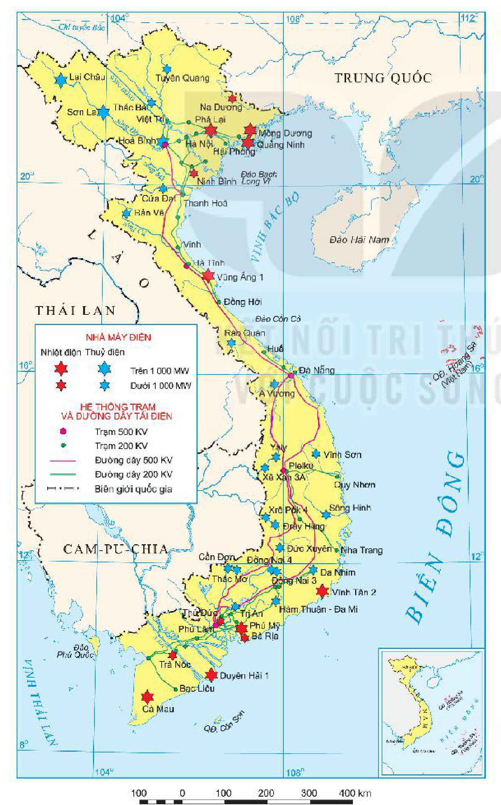
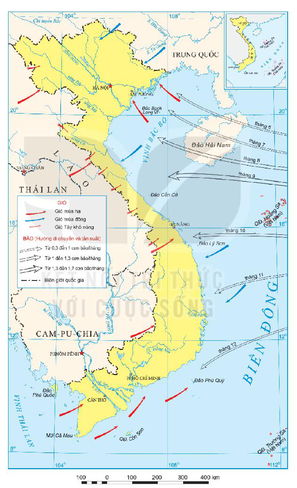
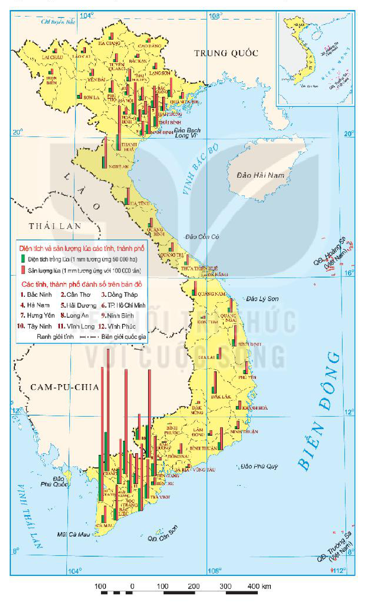
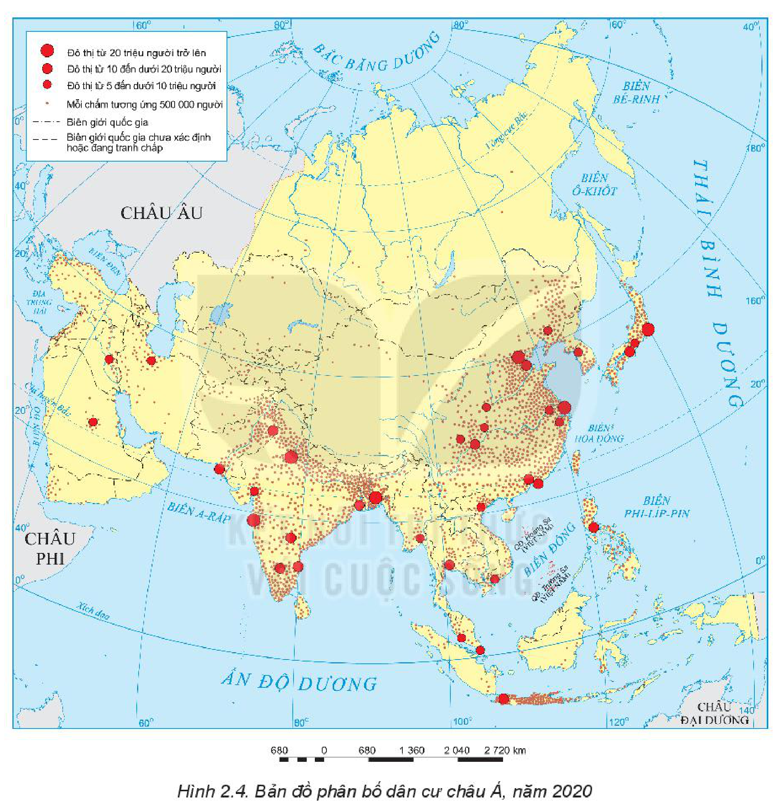
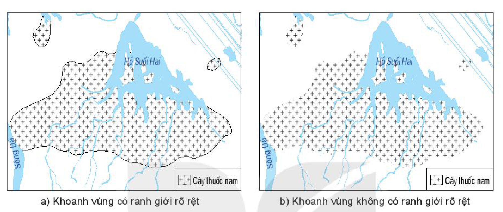

<!-- pdf:8 -->

# BÀI 2: MỘT SỐ PHƯƠNG PHÁP BIỂU HIỆN CÁC ĐỐI TƯỢNG ĐỊA LÍ TRÊN BẢN ĐỒ

## 🔴 Mở đầu

<!-- term: Phương pháp bản đồ – biểu đồ -->
Các bản đồ địa lí có nội dung rất phong phú và đa dạng, bao gồm các đối tượng tự nhiên, kinh tế – xã hội. Muốn sử dụng, khai thác bản đồ có hiệu quả, chúng ta phải có những hiểu biết về các phương pháp biểu hiện các đối tượng trên bản đồ. Có những phương pháp nào biểu hiện các đối tượng địa lí trên bản đồ? Các phương pháp đó có gì khác biệt?

## 1. Phương pháp kí hiệu

<!-- term: Phương pháp bản đồ – biểu đồ -->
<!-- term: Phương pháp kí hiệu -->
Phương pháp kí hiệu dùng để thể hiện các đối tượng địa lí phân bố theo những điểm cụ thể (đỉnh núi, các mỏ khoáng sản,...) hay những đối tượng tập trung trên những diện tích nhỏ mà không thể biểu hiện trên bản đồ theo tỉ lệ (nhà máy, điểm dân cư, trường học,...).

<!-- term: Phương pháp bản đồ – biểu đồ -->
<!-- term: Phương pháp kí hiệu -->
Trên bản đồ, người ta dùng các dạng kí hiệu bản đồ khác nhau để thể hiện cho từng đối tượng, được đặt chính xác vào vị trí mà đối tượng đó phân bố trên bản đồ.

<!-- term: Phương pháp bản đồ – biểu đồ -->
<!-- term: Phương pháp kí hiệu -->
Phương pháp kí hiệu có khả năng thể hiện về mặt chất lượng, số lượng, cấu trúc, sự phát triển và phân bố của đối tượng thông qua hình dạng, màu sắc, kích thước,... của kí hiệu.

*Hình 2.1. Bản đồ một số nhà máy điện ở Việt Nam, năm 2020*

<!-- term: Phương pháp bản đồ – biểu đồ -->
*Mô tả hình:* Bản đồ thể hiện sự phân bố các nhà máy điện và hệ thống trạm, đường dây tải điện ở Việt Nam năm 2020 bằng phương pháp kí hiệu. Nhà máy nhiệt điện được kí hiệu bằng ngôi sao màu đỏ, nhà máy thuỷ điện bằng ngôi sao màu xanh dương, với hai kích cỡ: Trên 1 000 MW (ngôi sao lớn) và Dưới 1 000 MW (ngôi sao nhỏ). Hệ thống trạm và đường dây tải điện gồm: Trạm 500 KV (chấm tròn hồng), Trạm 200 KV (chấm tròn xanh lá), Đường dây 500 KV (đường liền nét đỏ), Đường dây 200 KV (đường liền nét xanh lá). Một số nhà máy lớn trên 1 000 MW gồm: Lai Châu, Sơn La, Hoà Bình (thuỷ điện); Mông Dương, Phả Lại, Vũng Áng 1, Vĩnh Tân 2, Phú Mỹ, Duyên Hải 1 (nhiệt điện). Bản đồ có khung phụ thể hiện quần đảo Hoàng Sa và quần đảo Trường Sa của Việt Nam.
<!-- ocr-ok: mô tả hình ảnh bổ trợ không phải chữ in trực tiếp trong sách -->

<!-- term: Phương pháp bản đồ – biểu đồ -->
> ❓ Dựa vào thông tin trong mục 1 và hình 2.1, hãy trình bày phương pháp kí hiệu (đối tượng, hình thức và khả năng thể hiện).

<!-- pdf:9 -->

## 2. Phương pháp kí hiệu đường chuyển động

<!-- term: Phương pháp bản đồ – biểu đồ -->
<!-- term: Phương pháp kí hiệu đường chuyển động -->
Phương pháp kí hiệu đường chuyển động dùng để thể hiện sự di chuyển của các đối tượng, hiện tượng tự nhiên, kinh tế – xã hội trên bản đồ.

<!-- term: Phương pháp bản đồ – biểu đồ -->
<!-- term: Phương pháp kí hiệu đường chuyển động -->
Trên bản đồ, sự di chuyển của các đối tượng được thể hiện bằng các mũi tên.

<!-- term: Phương pháp bản đồ – biểu đồ -->
<!-- term: Phương pháp kí hiệu đường chuyển động -->
Đặc điểm của đối tượng, hiện tượng được thể hiện thông qua màu sắc, độ rộng và hướng của mũi tên.

*Hình 2.2. Bản đồ hoạt động của gió và bão ở Việt Nam*

<!-- term: Phương pháp bản đồ – biểu đồ -->
*Mô tả hình:* Bản đồ thể hiện hoạt động của gió và bão ở Việt Nam bằng phương pháp kí hiệu đường chuyển động (các mũi tên). Về gió: mũi tên màu đỏ chỉ Gió mùa hạ (hướng tây nam), mũi tên màu xanh dương chỉ Gió mùa đông (hướng đông bắc), mũi tên mảnh màu đỏ sẫm chỉ Gió Tây khô nóng (ở khu vực Bắc Trung Bộ và Tây Bắc). Về bão (Hướng di chuyển và tần suất): các mũi tên màu trắng viền xám từ Biển Đông đổ bộ vào đất liền theo các tháng (từ tháng 6 ở phía bắc đến tháng 12 ở phía nam) với độ rộng mũi tên thể hiện tần suất: Từ 0,3 đến 1 cơn bão/tháng (mũi tên hẹp), Từ 1 đến 1,3 cơn bão/tháng (mũi tên vừa), Từ 1,3 đến 1,7 cơn bão/tháng (mũi tên rộng, tập trung vào tháng 9, tháng 10 ở vùng biển Trung Bộ).
<!-- ocr-ok: mô tả hình ảnh bổ trợ không phải chữ in trực tiếp trong sách -->

<!-- term: Phương pháp bản đồ – biểu đồ -->
> ❓ Dựa vào thông tin trong mục 2 và hình 2.2, hãy trình bày phương pháp kí hiệu đường chuyển động (đối tượng, hình thức và khả năng thể hiện).

<!-- pdf:10 -->

## 3. Phương pháp bản đồ – biểu đồ

<!-- term: Phương pháp bản đồ – biểu đồ -->
Phương pháp bản đồ – biểu đồ thể hiện giá trị tổng cộng của đối tượng địa lí theo từng lãnh thổ (đơn vị hành chính) bằng cách đặt các biểu đồ vào phạm vi của các đơn vị lãnh thổ đó. Ví dụ: giá trị xuất khẩu và nhập khẩu của các quốc gia; số dân của một tỉnh, sản lượng lúa của các tỉnh trong quốc gia,...

<!-- term: Phương pháp bản đồ – biểu đồ -->
Trên bản đồ, người ta có thể sử dụng các loại biểu đồ khác nhau: biểu đồ cột, biểu đồ tròn,...

<!-- term: Phương pháp bản đồ – biểu đồ -->
Phương pháp này thể hiện được các đặc điểm về số lượng, chất lượng của các đối tượng và thường dùng để thể hiện trên bản đồ kinh tế – xã hội.

<!-- term: Phương pháp bản đồ – biểu đồ -->
*Hình 2.3. Bản đồ diện tích và sản lượng lúa cả năm của các tỉnh, thành phố ở Việt Nam, năm 2020*

<!-- term: Phương pháp bản đồ – biểu đồ -->
*Mô tả hình:* Bản đồ thể hiện diện tích và sản lượng lúa của các tỉnh, thành phố ở Việt Nam năm 2020 bằng phương pháp bản đồ – biểu đồ. Tại mỗi tỉnh, thành phố có đặt biểu đồ cột ghép gồm hai cột: cột màu xanh lá thể hiện Diện tích trồng lúa (1 mm tương ứng 50 000 ha) và cột màu đỏ hồng thể hiện Sản lượng lúa (1 mm tương ứng với 100 000 tấn). Các tỉnh ở vùng Đồng bằng sông Cửu Long (như Kiên Giang, An Giang, Đồng Tháp, Long An, Sóc Trăng) và Đồng bằng sông Hồng (như Thái Bình, Nam Định), Thanh Hoá, Nghệ An có các cột diện tích và sản lượng lúa cao nổi bật. Các tỉnh, thành phố diện tích nhỏ được đánh số từ 1 đến 12 trên bản đồ (1. Bắc Ninh, 2. Cần Thơ, 3. Đồng Tháp, 4. Hà Nam, 5. Hải Dương, 6. TP. Hồ Chí Minh, 7. Hưng Yên, 8. Long An, 9. Ninh Bình, 10. Tây Ninh, 11. Vĩnh Long, 12. Vĩnh Phúc).
<!-- ocr-ok: mô tả hình ảnh bổ trợ không phải chữ in trực tiếp trong sách -->

<!-- term: Phương pháp bản đồ – biểu đồ -->
> ❓ Dựa vào thông tin trong mục 3 và hình 2.3, hãy trình bày phương pháp bản đồ – biểu đồ (đối tượng, hình thức và khả năng thể hiện).

<!-- pdf:11 -->

## 4. Phương pháp chấm điểm

<!-- term: Phương pháp bản đồ – biểu đồ -->
<!-- term: Phương pháp chấm điểm -->
Phương pháp chấm điểm biểu hiện các đối tượng phân tán nhỏ lẻ trên lãnh thổ bằng sự phân bố của các điểm chấm trên bản đồ. Mỗi một điểm chấm tương ứng với một số lượng của đối tượng nhất định.

<!-- term: Phương pháp bản đồ – biểu đồ -->
Phương pháp này chủ yếu thể hiện về số lượng của đối tượng.

*Hình 2.4. Bản đồ phân bố dân cư châu Á, năm 2020*

<!-- term: Phương pháp bản đồ – biểu đồ -->
*Mô tả hình:* Bản đồ thể hiện sự phân bố dân cư châu Á năm 2020 bằng phương pháp chấm điểm kết hợp kí hiệu quy mô đô thị. Mỗi chấm nhỏ màu nâu đỏ tương ứng 500 000 người. Các hình tròn màu đỏ thể hiện các đô thị lớn theo 3 mức: Đô thị từ 20 triệu người trở lên, Đô thị từ 10 đến dưới 20 triệu người, và Đô thị từ 5 đến dưới 10 triệu người. Các điểm chấm phân bố dày đặc ở khu vực Nam Á (Ấn Độ, Băng-la-đét), Đông Á (phía đông Trung Quốc, Nhật Bản, Hàn Quốc) và Đông Nam Á (đảo Gia-va của In-đô-nê-xi-a, các đồng bằng châu thổ); trong khi rất thưa thớt ở Bắc Á (Xi-bia), Trung Á, Tây Á và vùng núi cao Tây Tạng.
<!-- ocr-ok: mô tả hình ảnh bổ trợ không phải chữ in trực tiếp trong sách -->

<!-- term: Phương pháp bản đồ – biểu đồ -->
> ❓ Dựa vào thông tin trong mục 4 và hình 2.4, hãy trình bày phương pháp chấm điểm (đối tượng, hình thức và khả năng thể hiện).

<!-- pdf:12 -->

## 5. Phương pháp khoanh vùng

<!-- term: Phương pháp bản đồ – biểu đồ -->
<!-- term: Phương pháp khoanh vùng -->
Phương pháp khoanh vùng thể hiện những đối tượng phân bố theo vùng nhưng không đều khắp trên lãnh thổ mà chỉ có ở từng vùng nhất định. Ví dụ: vùng phân bố các dân tộc khác nhau, vùng rừng, đồng cỏ,...

<!-- term: Phương pháp bản đồ – biểu đồ -->
<!-- term: Phương pháp khoanh vùng -->
Có nhiều cách khác nhau để khoanh vùng trên bản đồ như dùng các đường nét liền, đường nét đứt, màu sắc, kí hiệu hoặc viết tên đối tượng vào vùng đó.

*Hình 2.5. Một số cách khác nhau thể hiện vùng trồng cây thuốc nam*

*Mô tả hình:* Hình gồm hai lược đồ khu vực xung quanh Hồ Suối Hai và Sông Đà thể hiện vùng trồng cây thuốc nam (kí hiệu bằng các dấu cộng `+`): a) Khoanh vùng có ranh giới rõ rệt (các dấu cộng phân bố trong vùng được bao quanh bởi đường viền nét liền khép kín rõ ràng); b) Khoanh vùng không có ranh giới rõ rệt (các dấu cộng phân bố tập trung theo vùng nhưng không có đường viền bao quanh).
<!-- ocr-ok: mô tả hình ảnh bổ trợ không phải chữ in trực tiếp trong sách -->

<!-- term: Phương pháp bản đồ – biểu đồ -->
> ❓ Dựa vào thông tin trong mục 5 và hình 2.5, hãy trình bày phương pháp khoanh vùng (đối tượng, hình thức và khả năng thể hiện).

<!-- term: Phương pháp bản đồ – biểu đồ -->
Ngoài các phương pháp thể hiện bản đồ nói trên, còn có các phương pháp khác để thể hiện các đối tượng địa lí lên bản đồ như: phương pháp kí hiệu theo đường, phương pháp đường đẳng trị, phương pháp nền chất lượng, phương pháp bản đồ – mật độ và phương pháp biểu đồ định vị.

## ✏️ Luyện tập

<!-- term: Phương pháp bản đồ – biểu đồ -->
1. Lập bảng để phân biệt một số phương pháp biểu hiện các đối tượng địa lí trên bản đồ (về đối tượng, hình thức, khả năng thể hiện của phương pháp).
2. Phương pháp nào sẽ được sử dụng khi biểu hiện các đối tượng, hiện tượng sau trên bản đồ?
   - Mỏ khoáng sản
   - Sự di dân từ nông thôn ra đô thị
   - Phân bố dân cư nông thôn
   - Số học sinh các xã, phường, thị trấn
   - Cơ sở sản xuất

## 🚀 Vận dụng

<!-- term: Phương pháp bản đồ – biểu đồ -->
Sưu tầm một số bản đồ, tìm hiểu các đối tượng và phương pháp đã được sử dụng để biểu hiện các đối tượng đó trên bản đồ.

## 📷 Danh sách hình trong bài

<!-- term: Phương pháp bản đồ – biểu đồ -->
| Mã hình | Trang PDF | Vị trí trong bài | Chú thích gốc |
| --- | --- | --- | --- |
| H10-dia-b02-01 | 8 | Mục 1 | Hình 2.1. Bản đồ một số nhà máy điện ở Việt Nam, năm 2020 |
| H10-dia-b02-02 | 9 | Mục 2 | Hình 2.2. Bản đồ hoạt động của gió và bão ở Việt Nam |
| H10-dia-b02-03 | 10 | Mục 3 | Hình 2.3. Bản đồ diện tích và sản lượng lúa cả năm của các tỉnh, thành phố ở Việt Nam, năm 2020 |
| H10-dia-b02-04 | 11 | Mục 4 | Hình 2.4. Bản đồ phân bố dân cư châu Á, năm 2020 |
| H10-dia-b02-05 | 12 | Mục 5 | Hình 2.5. Một số cách khác nhau thể hiện vùng trồng cây thuốc nam |
