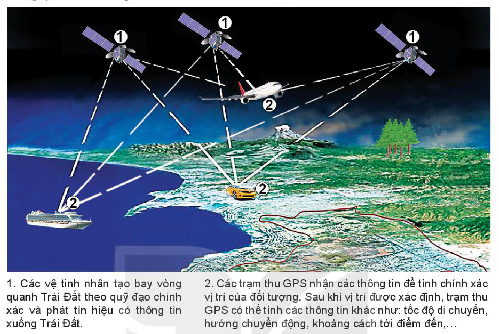

<!-- pdf:13 -->

# BÀI 3: SỬ DỤNG BẢN ĐỒ TRONG HỌC TẬP VÀ ĐỜI SỐNG, MỘT SỐ ỨNG DỤNG CỦA GPS VÀ BẢN ĐỒ SỐ TRONG ĐỜI SỐNG

## 🔴 Mở đầu

Bản đồ là công cụ học tập hữu ích trong môn Địa lí và được sử dụng nhiều trong đời sống. Ngày nay, với sự phát triển của công nghệ, các ứng dụng liên quan đến bản đồ như GPS, bản đồ số ngày càng đa dạng và tiện ích. GPS và bản đồ số là gì? GPS và bản đồ số có ứng dụng như thế nào trong cuộc sống?

## 1. Sử dụng bản đồ trong học tập địa lí và đời sống

<!-- term: Sử dụng bản đồ -->
Để sử dụng, khai thác bản đồ đạt hiệu quả cao, cần lưu ý những điểm sau:
- Xác định rõ nội dung, yêu cầu của việc đọc bản đồ.
- Chọn bản đồ phù hợp với nội dung cần tìm hiểu.
- Hiểu được các yếu tố cơ bản của bản đồ như: tỉ lệ bản đồ, kí hiệu bản đồ, phương pháp biểu hiện các đối tượng địa lí trên bản đồ,...
- Tìm hiểu kĩ bảng chú giải bản đồ.
- Xác định mối quan hệ giữa các đối tượng địa lí trên bản đồ.
- Khi đọc bản đồ để giải thích một hiện tượng địa lí nào đó cần phải đọc các bản đồ có nội dung liên quan để phân tích, so sánh và rút ra nhận định cần thiết.

> 💡 Em có biết?
>
> Khi tìm hiểu một con sông trên bản đồ địa hình, phải thấy được mối liên quan giữa hướng chảy, độ dốc, đặc điểm của lòng sông với địa hình ở khu vực đó như thế nào.

> ❓ Dựa vào thông tin trong mục 1, hãy nêu cách sử dụng bản đồ trong học tập địa lí và đời sống.

## 2. Một số ứng dụng của GPS và bản đồ số trong đời sống

### a) Khái niệm GPS và bản đồ số

- GPS:

<!-- term: Hệ thống định vị toàn cầu -->
GPS (viết tắt của Global Positioning System) hay hệ thống định vị toàn cầu là hệ thống xác định vị trí của bất kì đối tượng nào trên bề mặt Trái Đất thông qua hệ thống vệ tinh.

> 💡 Em có biết?
>
> GPS do Bộ Quốc phòng Hoa Kỳ thiết kế, xây dựng, vận hành và quản lí. Ban đầu GPS phục vụ cho mục đích quân sự, nhưng từ năm 1980, Chính phủ Hoa Kỳ cho phép sử dụng trong dân sự. GPS hoạt động trong mọi thời tiết, mọi nơi trên Trái Đất, không mất phí sử dụng, chỉ cần có thiết bị thu tín hiệu và phần mềm hỗ trợ.
>
> Ngoài GPS, một số hệ thống khác cũng có chức năng tương tự như: GALILEO, GLONASS, BEIDOU,...

<!-- pdf:14 -->

Nguyên lí hoạt động của GPS như sau:

1. Các vệ tinh nhân tạo bay vòng quanh Trái Đất theo quỹ đạo chính xác và phát tín hiệu có thông tin xuống Trái Đất.
2. Các trạm thu GPS nhận các thông tin để tính chính xác vị trí của đối tượng. Sau khi vị trí được xác định, trạm thu GPS có thể tính các thông tin khác như: tốc độ di chuyển, hướng chuyển động, khoảng cách tới điểm đến,...

*Hình 3.1. Nguyên lí hoạt động của GPS*

*Mô tả hình:* Sơ đồ minh hoạ nguyên lí hoạt động của GPS gồm hai bộ phận: (1) Các vệ tinh nhân tạo trên không gian bay vòng quanh Trái Đất và phát các chùm tín hiệu (đường nét đứt) xuống bề mặt Trái Đất; (2) Các trạm thu GPS gắn trên máy bay, tàu thuỷ trên biển và ô tô trên đất liền nhận tín hiệu từ nhiều vệ tinh để xác định chính xác vị trí, tốc độ, hướng di chuyển và khoảng cách tới điểm đến.
<!-- ocr-ok: mô tả hình ảnh bổ trợ không phải chữ in trực tiếp trong sách -->

- Bản đồ số:

<!-- term: Bản đồ số -->
Bản đồ số là một tập hợp có tổ chức, lưu trữ các dữ liệu bản đồ trên thiết bị có khả năng đọc như máy tính, điện thoại thông minh và được thể hiện dưới dạng hình ảnh bản đồ.

Bản đồ số rất thuận lợi trong sử dụng, lưu trữ và chỉnh sửa, vì vậy ngày càng được ứng dụng rộng rãi trong đời sống.

### b) Ứng dụng của GPS và bản đồ số

GPS và bản đồ số được sử dụng nhiều trong cuộc sống hiện đại với nhiều ứng dụng hữu ích.

<!-- term: Ứng dụng của GPS và bản đồ số -->
Ứng dụng nổi bật nhất của GPS là định vị, nhằm xác định vị trí chính xác của các đối tượng trên bản đồ. Nếu như GPS có tính năng định vị thì bản đồ số là công cụ truyền tải, giám sát tính năng đó.

<!-- term: Ứng dụng của GPS và bản đồ số -->
GPS và bản đồ số dùng để dẫn đường, quản lí và điều hành sự di chuyển của các đối tượng có gắn thiết bị định vị với các chức năng như: xác định điểm cần đến, quãng đường di chuyển, các cung đường có thể sử dụng; quản lí, giám sát, lưu trữ lộ trình đường đi của đối tượng (phương tiện giao thông, các cơn bão,...); tính số ki-lô-mét đã di chuyển và cước phí cho xe buýt, xe khách, xe taxi, xe ôm công nghệ,...; chống trộm cho các phương tiện;...

<!-- pdf:15 -->

Ngoài ra, GPS và bản đồ số còn dùng để tìm người, thiết bị đã mất hay để đánh dấu địa điểm khi chụp ảnh cũng như tối ưu hoá kết quả tìm kiếm dựa trên khu vực,...

GPS và bản đồ số được ứng dụng rộng rãi trong nhiều lĩnh vực như trong giao thông vận tải, trong đo đạc khảo sát và thi công công trình, trong quân sự, trong khí tượng và giám sát Trái Đất,...

*Hình 3.2. Người dùng sử dụng ứng dụng GPS trên điện thoại thông minh để xác định vị trí và tìm đường đi*

*Mô tả hình:* Hình ảnh bàn tay người dùng đang cầm điện thoại thông minh hiển thị bản đồ số với các biểu tượng ghim định vị (pin) trên các tuyến đường, phía sau là toàn cảnh khu đô thị với nhiều toà nhà cao tầng và các biểu tượng định vị hiển thị tương ứng trong không gian thành phố.
<!-- ocr-ok: mô tả hình ảnh bổ trợ không phải chữ in trực tiếp trong sách -->

> ❓ Dựa vào thông tin và các hình trong mục 2, cho biết một số ứng dụng và tính năng của GPS và bản đồ số.

## ✏️ Luyện tập

Nêu ý nghĩa của GPS và bản đồ số trong đời sống.

## 🚀 Vận dụng

Tìm hiểu về ứng dụng của GPS và bản đồ số trong một lĩnh vực mà em quan tâm (giao thông, nông nghiệp, môi trường,...).

## 📷 Danh sách hình trong bài

| Mã hình | Trang PDF | Vị trí trong bài | Chú thích gốc |
| --- | --- | --- | --- |
| H10-dia-b03-01 | 14 | Mục 2.a | Hình 3.1. Nguyên lí hoạt động của GPS |
| H10-dia-b03-02 | 15 | Mục 2.b | Hình 3.2. Người dùng sử dụng ứng dụng GPS trên điện thoại thông minh để xác định vị trí và tìm đường đi |
