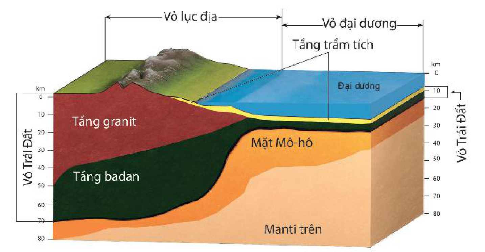

<!-- pdf:16 -->

# BÀI 4: SỰ HÌNH THÀNH TRÁI ĐẤT, VỎ TRÁI ĐẤT VÀ VẬT LIỆU CẤU TẠO VỎ TRÁI ĐẤT

## 🔴 Mở đầu

Lịch sử Trái Đất bắt đầu từ cách đây khoảng 4,5 tỉ năm. Trải qua khoảng thời gian rất lâu dài, Trái Đất dần hình thành như ngày nay. Quá trình hình thành Trái Đất diễn ra như thế nào?

## 1. Nguồn gốc hình thành Trái Đất

Có rất nhiều giả thuyết khác nhau về nguồn gốc của Trái Đất, liên quan chặt chẽ với sự hình thành hệ Mặt Trời.

<!-- term: Nguồn gốc hình thành Trái Đất -->
Một số giả thuyết cho rằng: Mặt Trời khi hình thành di chuyển trong dải Ngân Hà, đi qua đám mây bụi và khí. Do lực hấp dẫn của Vũ Trụ mà trước hết là của Mặt Trời, khí và bụi chuyển động quanh Mặt Trời theo những quỹ đạo hình elip, dần dần ngưng tụ thành các hành tinh (trong đó có Trái Đất). Vào cuối thời kì vật chất ngưng tụ, khi Trái Đất đã có khối lượng lớn gần như hiện nay, quá trình tăng nhiệt bắt đầu diễn ra và dẫn đến sự nóng chảy của vật chất ở bên trong và sắp xếp thành các lớp. Ngày nay, với những tiến bộ và phát triển không ngừng của khoa học – kĩ thuật, nhất là trong lĩnh vực vật lí thiên văn, khoa học vũ trụ, đã có thêm nhiều căn cứ mới để giải thích về nguồn gốc Trái Đất và các thiên thể khác trong hệ Mặt Trời.

> 💡 Em có biết?
>
> Có nhiều nhà khoa học đưa ra các giả thuyết về nguồn gốc của Trái Đất, như: Im-ma-nu-en Căng, Pi-e Xi-mông La-plat, Ôt-tô Xmit,...
<!-- ocr-ok: đối chiếu trực tiếp ảnh trang PDF, OCR đọc sai tên phiên âm Pi-e Xi-mông La-plat, Ôt-tô Xmit -->

> ❓ Dựa vào thông tin trong mục 1, hãy trình bày nguồn gốc hình thành Trái Đất.

## 2. Đặc điểm của vỏ Trái Đất

Theo tài liệu nghiên cứu sóng địa chấn, Trái Đất được cấu tạo bởi ba lớp đồng tâm: ngoài cùng là vỏ Trái Đất, tiếp đến là manti và trong cùng là nhân Trái Đất.

<!-- term: Vỏ Trái Đất -->
Vỏ Trái Đất là lớp vật chất cứng ngoài cùng của Trái Đất, độ dày dao động từ 5 km (ở đại dương) đến 70 km (ở lục địa). Căn cứ vào sự khác nhau về thành phần cấu tạo và độ dày, vỏ Trái Đất được chia thành hai kiểu chính: vỏ lục địa và vỏ đại dương.

<!-- pdf:17 -->

*Hình 4. Sơ đồ cấu tạo vỏ Trái Đất*

*Mô tả hình:* Sơ đồ mặt cắt cấu tạo vỏ Trái Đất theo chiều sâu (từ 0 đến 80 km), phân biệt hai kiểu: Vỏ lục địa (dày tới khoảng 70 km) và Vỏ đại dương (mỏng hơn, nằm dưới lớp nước Đại dương). Từ trên xuống dưới gồm: Tầng trầm tích (mỏng, nằm trên cùng), Tầng granit (chỉ có ở vỏ lục địa, không có ở vỏ đại dương), Tầng badan (nằm dưới tầng granit ở lục địa và nằm ngay dưới tầng trầm tích ở đại dương). Bên dưới tầng badan là Mặt Mô-hô (ranh giới ngăn cách vỏ Trái Đất với lớp Manti trên).
<!-- ocr-ok: mô tả hình ảnh bổ trợ không phải chữ in trực tiếp trong sách -->

<!-- term: Vỏ lục địa -->
<!-- term: Vỏ đại dương -->
Trên cùng là tầng trầm tích, do các vật liệu vụn, nhỏ bị nén chặt tạo thành; tầng này không liên tục và có độ dày không đều. Tầng granit gồm các loại đá nhẹ (như đá granit và các loại đá có tính chất tương tự như đá granit) tạo nên; lớp vỏ lục địa được cấu tạo chủ yếu bằng granit. Tầng badan gồm các loại đá nặng hơn (như đá badan và các loại đá có tính chất tương tự như đá badan) tạo nên; lớp vỏ đại dương cấu tạo chủ yếu bằng badan.

<!-- term: Mặt Mô-hô -->
<!-- term: Quyển sial -->
> 💡 Em có biết?
>
> Ranh giới giữa vỏ Trái Đất và manti được gọi là mặt Mô-hô. Bề mặt Mô-hô được Mô-hô-rô-vich, nhà địa chất người Crô-a-ti-a xác định lần đầu tiên năm 1909, khi ông nhận thấy sự gia tăng đột ngột của vận tốc lan truyền các sóng địa chấn tại mặt này.
>
> Vỏ Trái Đất chỉ chiếm khoảng 1% thể tích và 0,5% khối lượng của Trái Đất nhưng có vai trò quan trọng đối với tự nhiên và đời sống con người. Thành phần vật chất của vỏ Trái Đất, ngoài o-xy thì chủ yếu là si-lic và nhôm, vì thế vỏ Trái Đất còn được gọi là quyển sial.

> ❓ Dựa vào thông tin trong mục 2 và hình 4, hãy:
> - Trình bày đặc điểm vỏ Trái Đất.
> - Nêu sự khác nhau giữa vỏ lục địa và vỏ đại dương.

## 3. Vật liệu cấu tạo vỏ Trái Đất

Vật liệu cấu tạo nên vỏ Trái Đất là khoáng vật và đá.

<!-- term: Khoáng vật -->
- Khoáng vật là những nguyên tố tự nhiên hoặc hợp chất hoá học trong thiên nhiên, xuất hiện do kết quả của các quá trình địa chất.

<!-- term: Đá -->
- Đá là tập hợp của một hay nhiều khoáng vật và là bộ phận chủ yếu cấu tạo nên vỏ Trái Đất. Theo nguồn gốc, đá được phân chia thành ba nhóm:
  <!-- term: Đá macma -->
  + Đá macma (đá granit, đá badan,...) được tạo thành do quá trình ngưng kết (nguội lạnh) của các silicat nóng chảy.
  <!-- term: Đá trầm tích -->
  + Đá trầm tích (đá vôi, sa thạch,...) hình thành trong các vùng trũng do sự lắng tụ và nén chặt các vật liệu vụn nhỏ.
  <!-- term: Đá biến chất -->
  + Đá biến chất (đá gơnai, đá hoa, đá phiến,...) được thành tạo từ đá macma hoặc đá trầm tích bị biến đổi sâu sắc do tác động của nhiệt, áp suất,...

> ❓ Đọc thông tin trong mục 3, hãy nêu các vật liệu cấu tạo nên vỏ Trái Đất.

## ✏️ Luyện tập

1. Hãy nêu đặc điểm các tầng đá của vỏ Trái Đất.
2. Theo nguồn gốc, các loại đá cấu tạo nên vỏ Trái Đất gồm mấy nhóm? Các nhóm đá được hình thành như thế nào?

## 🚀 Vận dụng

Hãy tìm hiểu về nguồn gốc hình thành và vùng phân bố của đá vôi ở Việt Nam.

## 📷 Danh sách hình trong bài

| Mã hình | Trang PDF | Vị trí trong bài | Chú thích gốc |
| --- | --- | --- | --- |
| H10-dia-b04-01 | 17 | Mục 2 | Hình 4. Sơ đồ cấu tạo vỏ Trái Đất |
