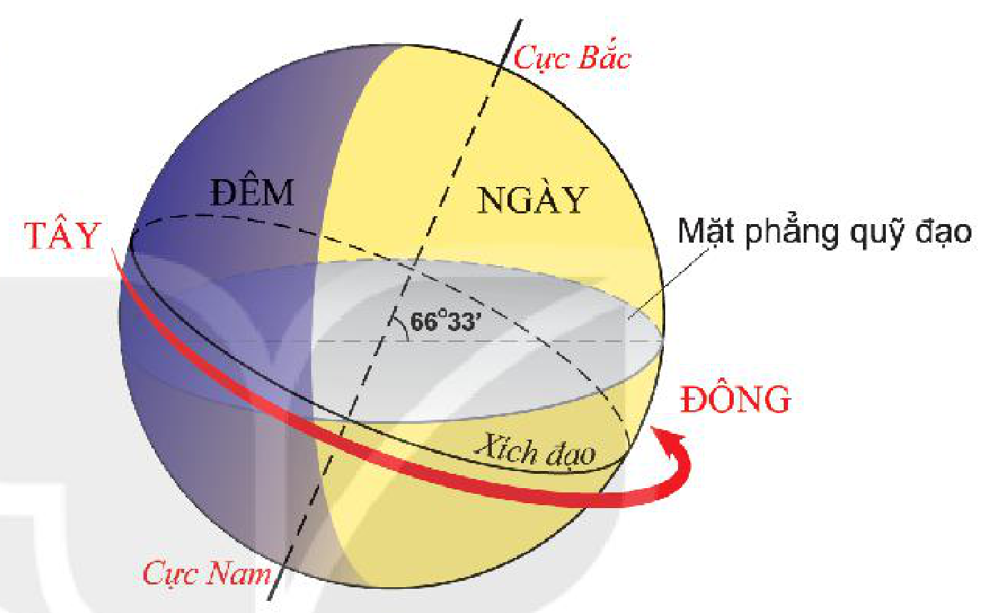
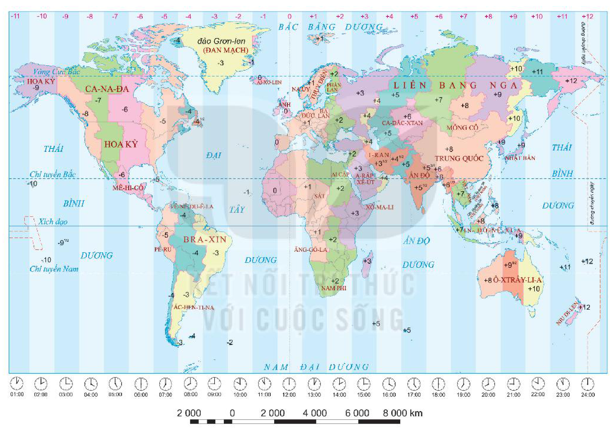
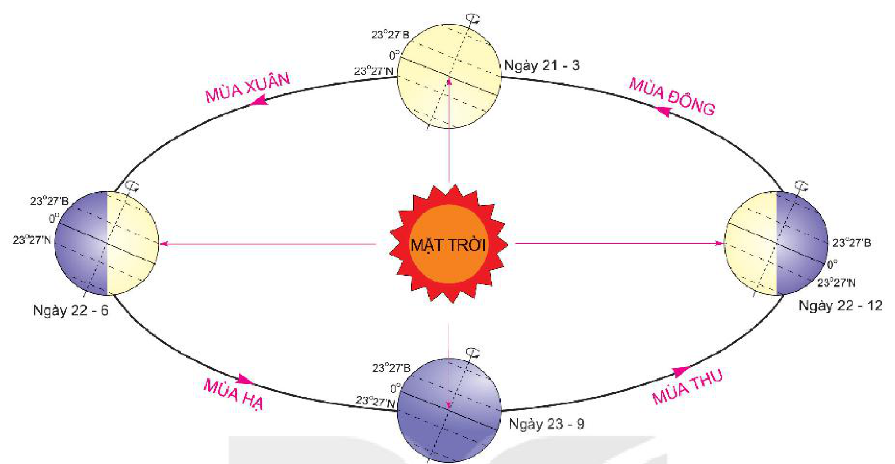
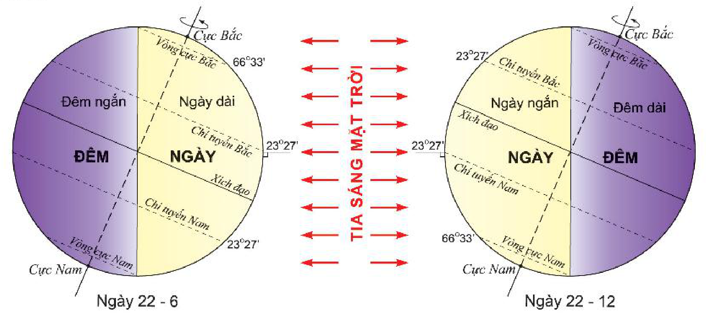

<!-- pdf:18 -->

# BÀI 5: HỆ QUẢ ĐỊA LÍ CÁC CHUYỂN ĐỘNG CỦA TRÁI ĐẤT

## 🔴 Mở đầu

Trong hệ Mặt Trời, Trái Đất không ngừng vận động, trong đó có chuyển động tự quay quanh trục và quay quanh Mặt Trời. Các chuyển động này tạo ra những hệ quả địa lí vô cùng quan trọng đối với thiên nhiên và cuộc sống con người. Đó là những hệ quả nào? Tại sao lại có những hệ quả đó?

## 1. Hệ quả địa lí của chuyển động tự quay quanh trục

> 💡 Em có biết?
>
> Vận tốc tự quay quanh trục của Trái Đất rất lớn, lớn nhất ở Xích đạo và nhỏ nhất ở hai cực.

*Hình 5.1. Chuyển động tự quay và hiện tượng ngày đêm trên Trái Đất*

*Mô tả hình:* Hình vẽ khối cầu Trái Đất tự quay quanh trục nối Cực Bắc – Cực Nam theo chiều từ Tây sang Đông (mũi tên màu đỏ dọc theo Xích đạo). Trục Trái Đất nghiêng một góc 66°33' so với mặt phẳng quỹ đạo. Nửa khối cầu hướng về phía Mặt Trời có màu vàng sáng là NGÀY, nửa khối cầu khuất ánh sáng Mặt Trời có màu tím sẫm là ĐÊM.
<!-- ocr-ok: mô tả hình ảnh bổ trợ không phải chữ in trực tiếp trong sách -->

> ❓ Dựa vào hình 5.1 và kiến thức đã học, hãy trình bày đặc điểm chuyển động tự quay quanh trục của Trái Đất (chiều tự quay, độ nghiêng của trục, chu kì tự quay,...).

### a) Sự luân phiên ngày đêm

<!-- term: Sự luân phiên ngày đêm -->
Do có hình khối cầu, nên Trái Đất luôn được Mặt Trời chiếu sáng một nửa còn một nửa chưa được chiếu sáng, sinh ra ngày và đêm. Trái Đất tự quay quanh trục, dẫn đến tất cả mọi nơi trên bề mặt Trái Đất đều lần lượt được Mặt Trời chiếu sáng rồi lại lần lượt chìm trong bóng tối, gây nên hiện tượng ngày đêm luân phiên.

> ❓ Đọc thông tin trong mục a và quan sát hình 5.1, trả lời các câu hỏi sau:
> - Tại sao có sự luân phiên ngày đêm trên Trái Đất?
> - Nếu Trái Đất chỉ chuyển động quanh Mặt Trời mà không tự quay quanh trục thì trên Trái Đất hiện tượng ngày đêm sẽ diễn ra như thế nào?

### b) Giờ trên Trái Đất

<!-- term: Giờ địa phương -->
<!-- term: Giờ múi -->
Trái Đất có dạng hình khối cầu và tự quay quanh trục từ tây sang đông, nên ở cùng một thời điểm, người đứng ở các kinh tuyến khác nhau sẽ nhìn thấy Mặt Trời ở các độ cao khác nhau; vì vậy các địa điểm thuộc các kinh tuyến khác nhau sẽ có giờ khác nhau, đó là giờ địa phương (hay giờ mặt trời). Giờ địa phương không thuận tiện trong đời sống, sản xuất. Do đó, người ta chia bề mặt Trái Đất làm 24 múi giờ, mỗi múi rộng 15 độ kinh tuyến. Các địa phương nằm trong cùng một múi giờ sẽ thống nhất có một giờ, đó là giờ múi.

<!-- pdf:19 -->

<!-- term: Giờ quốc tế -->
Giờ ở múi số 0 (múi có đường kinh tuyến gốc chạy qua giữa múi) được lấy làm giờ quốc tế hay giờ GMT. Trong thực tế, ranh giới các múi giờ thường được điều chỉnh theo biên giới quốc gia, tạo thành các khu vực giờ.

> 💡 Em có biết?
>
> Hà Nội (kinh độ 105°52'Đ) sẽ có giờ địa phương chênh 3 phút 24 giây so với Hải Phòng (kinh độ 106°43'Đ).
>
> Trên thế giới, những nước có lãnh thổ rộng thường dùng nhiều múi giờ (Liên bang Nga, Hoa Kỳ, Ca-na-đa,...). Có những nước lãnh thổ rộng lớn, trải trên nhiều múi giờ (như Trung Quốc) nhưng lại chỉ dùng một giờ chung cho cả nước.
<!-- ocr-ok: toạ độ kinh độ trong sách in 105°52'Đ và 106°43'Đ -->

*Hình 5.2. Bản đồ giờ trên Trái Đất*

*Mô tả hình:* Bản đồ thế giới chia thành 24 dải múi giờ từ -11 đến +12 (với múi giờ 0 đi qua Anh, Tây Âu và Tây Phi). Phía dưới mỗi múi giờ có mặt đồng hồ minh hoạ giờ tương ứng từ 01:00 đến 24:00 (khi múi 0 là 12:00). Ranh giới các khu vực giờ trên đất liền được điều chỉnh theo biên giới quốc gia và vùng lãnh thổ (ví dụ: Việt Nam ở múi giờ +7, Trung Quốc dùng chung múi giờ +8, Ấn Độ dùng giờ +5 1/2). Đường chuyển ngày quốc tế (đường nét đứt màu đỏ) chạy dọc kinh tuyến 180° qua Thái Bình Dương ở hai rìa bản đồ.
<!-- ocr-ok: mô tả hình ảnh bổ trợ không phải chữ in trực tiếp trong sách -->

<!-- term: Đường chuyển ngày quốc tế -->
Người ta quy định lấy kinh tuyến 180° đi qua giữa múi giờ số 12 ở Thái Bình Dương làm đường chuyển ngày quốc tế. Nếu đi từ phía tây sang phía đông (theo chiều tự quay của Trái Đất) qua kinh tuyến 180° thì lùi lại một ngày lịch, còn nếu đi từ phía đông sang phía tây qua kinh tuyến 180° thì phải tăng thêm một ngày lịch. Trong thực tế đường chuyển ngày quốc tế không phải là đường thẳng mà cũng thay đổi theo biên giới quốc gia.

> ❓ Dựa vào thông tin trong mục b và quan sát hình 5.2, hãy cho biết:
> - Tại sao các địa điểm nằm trên các kinh tuyến khác nhau lại có giờ địa phương khác nhau.
> - Những nước nào có cùng giờ với Việt Nam.

<!-- pdf:20 -->

## 2. Hệ quả địa lí do chuyển động quanh Mặt Trời

*Hình 5.3. Chuyển động của Trái Đất quanh Mặt Trời và các mùa ở bán cầu Bắc*

*Mô tả hình:* Sơ đồ quỹ đạo chuyển động hình elip của Trái Đất quanh Mặt Trời theo chiều ngược chiều kim đồng hồ, với 4 vị trí tiêu biểu: Ngày 21 – 3 (Xuân phân), Ngày 22 – 6 (Hạ chí, nửa cầu Bắc ngả về phía Mặt Trời), Ngày 23 – 9 (Thu phân), Ngày 22 – 12 (Đông chí, nửa cầu Bắc chếch xa Mặt Trời). Trên quỹ đạo ghi tên bốn mùa ở bán cầu Bắc: MÙA XUÂN (từ 21 – 3 đến 22 – 6), MÙA HẠ (từ 22 – 6 đến 23 – 9), MÙA THU (từ 23 – 9 đến 22 – 12), MÙA ĐÔNG (từ 22 – 12 đến 21 – 3). Ở mọi vị trí, trục Trái Đất luôn giữ độ nghiêng không đổi và song song với chính nó.
<!-- ocr-ok: mô tả hình ảnh bổ trợ không phải chữ in trực tiếp trong sách -->

> ❓ Dựa vào hình 5.3 và kiến thức đã học, hãy mô tả chuyển động của Trái Đất quanh Mặt Trời (quỹ đạo, hướng chuyển động, hướng và độ nghiêng của trục Trái Đất, thời gian hoàn thành một vòng chuyển động).

### a) Hiện tượng ngày đêm dài ngắn khác nhau

<!-- term: Hiện tượng ngày đêm dài ngắn khác nhau -->
Trong năm, các địa điểm ở bán cầu Bắc và bán cầu Nam đều có hiện tượng ngày, đêm dài ngắn khác nhau theo mùa và theo vĩ độ, trừ hai ngày 21 – 3 và 23 – 9 có thời gian ngày, đêm bằng nhau.

<!-- term: Hiện tượng ngày đêm dài ngắn khác nhau -->
Ở Xích đạo, quanh năm có độ dài ngày và đêm bằng nhau, càng xa Xích đạo sự chênh lệch thời gian giữa ngày và đêm càng lớn. Riêng ở hai cực có sáu tháng ngày, sáu tháng đêm.

> 💡 Em có biết?
>
> Tốc độ chuyển động của Trái Đất trên quỹ đạo rất lớn, trung bình là 29,8 km/s. Tốc độ thay đổi phụ thuộc vào khoảng cách của Trái Đất đến Mặt Trời gần hay xa.

*Hình 5.4. Hiện tượng ngày và đêm vào các ngày 22 – 6 và ngày 22 – 12*

*Mô tả hình:* Sơ đồ so sánh sự chiếu sáng của Tia sáng Mặt Trời lên Trái Đất vào hai ngày: Ngày 22 – 6 (bên trái: tia sáng mặt trời vuông góc với tiếp tuyến tại Chí tuyến Bắc 23°27'B; bán cầu Bắc có Ngày dài, Đêm ngắn, từ Vòng cực Bắc 66°33'B đến Cực Bắc hoàn toàn là ban ngày; bán cầu Nam có Ngày ngắn, Đêm dài, từ Vòng cực Nam đến Cực Nam hoàn toàn là ban đêm) và Ngày 22 – 12 (bên phải: tia sáng mặt trời vuông góc với tiếp tuyến tại Chí tuyến Nam 23°27'N; bán cầu Bắc có Ngày ngắn, Đêm dài, vùng cực Bắc hoàn toàn là đêm; bán cầu Nam có Ngày dài, Đêm ngắn, vùng cực Nam hoàn toàn là ngày).
<!-- ocr-ok: mô tả hình ảnh bổ trợ không phải chữ in trực tiếp trong sách -->

<!-- pdf:21 -->

> 💡 Em có biết?
>
> Thành phố Xanh Pê-téc-bua nằm ở vĩ độ 59°57'B là thành phố lớn thứ hai ở Liên bang Nga. Xanh Pê-téc-bua thu hút khách du lịch với hiện tượng “đêm trắng”. Hằng năm, vào mùa hạ, hàng triệu du khách từ khắp nơi đến đây để chiêm ngưỡng, thưởng thức hiện tượng thiên nhiên kì thú này.
<!-- ocr-ok: toạ độ vĩ độ trong sách in 59°57'B -->

> ❓ Dựa vào thông tin và hình 5.4 trong mục a, hãy giải thích hiện tượng ngày đêm dài ngắn khác nhau ở hai bán cầu.

### b) Các mùa trong năm

<!-- term: Mùa -->
Mùa là khoảng thời gian trong năm, có những đặc điểm riêng về thời tiết và khí hậu.

<!-- term: Mùa -->
Nguyên nhân sinh ra các mùa là do Trái Đất chuyển động quanh Mặt Trời với hướng trục không thay đổi và nghiêng với mặt phẳng quỹ đạo một góc khoảng 66°33', làm cho góc chiếu của tia sáng mặt trời và thời gian tiếp nhận ánh sáng mặt trời thay đổi trong năm.
<!-- ocr-ok: góc nghiêng trong sách in 66°33' -->

Hiện tượng mùa diễn ra ngược nhau giữa bán cầu Bắc và bán cầu Nam. Bốn mùa biểu hiện rõ nhất ở vùng ôn đới. Vùng nhiệt đới có hai mùa nhưng không rõ rệt, vùng hàn đới chỉ có một mùa lạnh kéo dài.

> 💡 Em có biết?
>
> Một năm chia ra bốn mùa. Ở bán cầu Bắc, các ngày: 21 – 3, 22 – 6, 23 – 9 và 22 – 12 được lấy là bốn ngày khởi đầu của bốn mùa. Ở Việt Nam, thời gian bắt đầu của các mùa được sớm hơn khoảng 45 ngày do tính theo âm – dương lịch.

> ❓ Dựa vào thông tin trong mục b và hình 5.3, hãy trình bày hiện tượng mùa diễn ra ở bán cầu Bắc.

## ✏️ Luyện tập

1. Ngày và giờ ở Mê-hi-cô là bao nhiêu khi Việt Nam là 7 giờ sáng ngày 1 – 1 – 2022?
2. Hiện tượng chênh lệch độ dài ngày, đêm diễn ra như thế nào ở các vùng nhiệt đới, ôn đới và hàn đới?
3. Hãy cho biết nguyên nhân sinh ra mùa trên Trái Đất. Hiện tượng mùa khác nhau như thế nào ở các vùng nhiệt đới, ôn đới và hàn đới?

## 🚀 Vận dụng

Chọn một trong hai nhiệm vụ sau:

1. Giải thích tại sao người hâm mộ bóng đá ở Việt Nam, muốn theo dõi trực tiếp các trận bóng của giải ngoại hạng Anh thường phải thức đêm để xem, trong khi thực tế các trận bóng bên Anh thường được bắt đầu vào buổi chiều.
2. Giải thích câu tục ngữ:
   *Đêm tháng năm chưa nằm đã sáng,*
   *Ngày tháng mười chưa cười đã tối.*
   Câu tục ngữ đó đúng với những khu vực nào trên Trái Đất?

## 📷 Danh sách hình trong bài

| Mã hình | Trang PDF | Vị trí trong bài | Chú thích gốc |
| --- | --- | --- | --- |
| H10-dia-b05-01 | 18 | Mục 1 | Hình 5.1. Chuyển động tự quay và hiện tượng ngày đêm trên Trái Đất |
| H10-dia-b05-02 | 19 | Mục 1.b | Hình 5.2. Bản đồ giờ trên Trái Đất |
| H10-dia-b05-03 | 20 | Mục 2 | Hình 5.3. Chuyển động của Trái Đất quanh Mặt Trời và các mùa ở bán cầu Bắc |
| H10-dia-b05-04 | 20 | Mục 2.a | Hình 5.4. Hiện tượng ngày và đêm vào các ngày 22 – 6 và ngày 22 – 12 |
