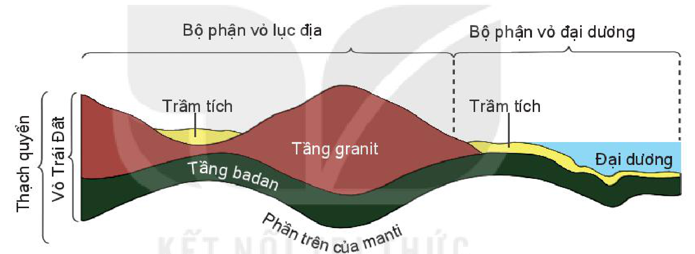
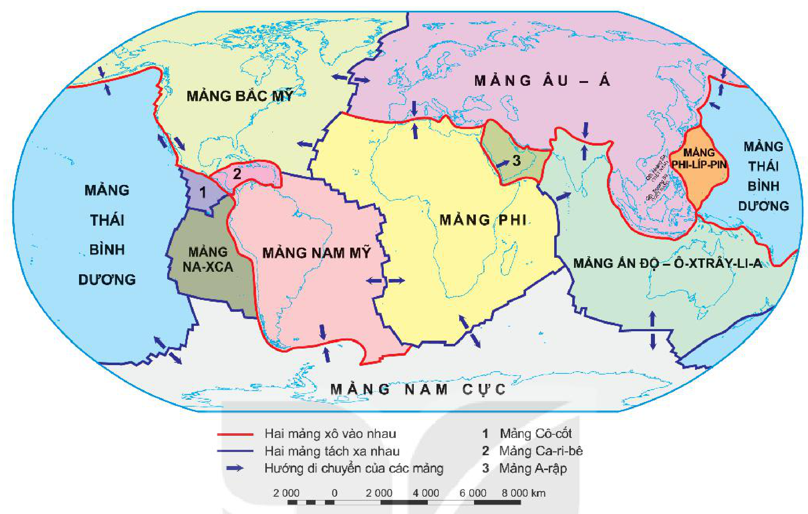
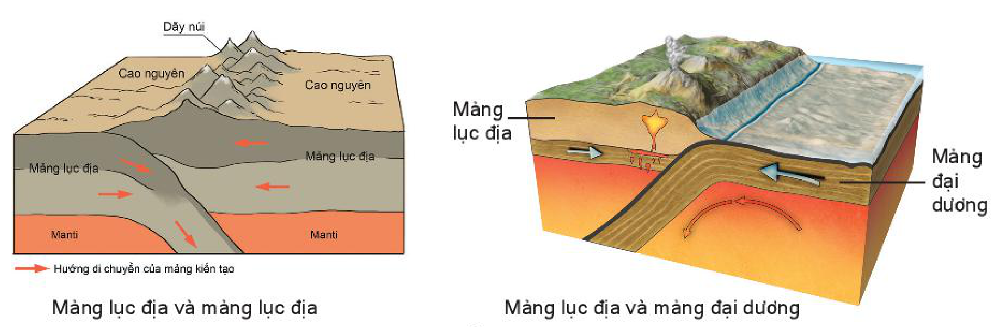
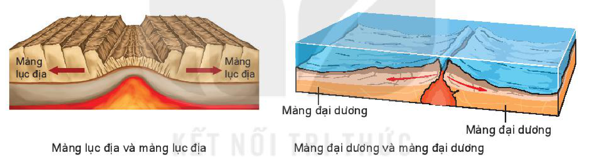

<!-- pdf:22 -->

# BÀI 6: THẠCH QUYỂN, THUYẾT KIẾN TẠO MẢNG

## 🔴 Mở đầu

Bề mặt của Trái Đất vô cùng phong phú, đa dạng. Nguyên nhân nào đã tạo nên điều đó? Bề mặt của Trái Đất có thay đổi như thế nào trong lịch sử phát triển Trái Đất?

## 1. Thạch quyển

<!-- term: Thạch quyển -->
Thạch quyển gồm vỏ Trái Đất và phần cứng mỏng phía trên của manti. Thạch quyển có độ dày khoảng 100 km, được cấu tạo bởi các loại đá khác nhau.

*Hình 6.1. Vỏ Trái Đất và thạch quyển*

*Mô tả hình:* Sơ đồ mặt cắt thể hiện phạm vi của Vỏ Trái Đất và Thạch quyển ở Bộ phận vỏ lục địa và Bộ phận vỏ đại dương. Vỏ Trái Đất gồm lớp Trầm tích, Tầng granit (ở bộ phận vỏ lục địa) và Tầng badan. Thạch quyển bao gồm toàn bộ Vỏ Trái Đất cộng thêm Phần trên của manti nằm ngay bên dưới tầng badan.
<!-- ocr-ok: mô tả hình ảnh bổ trợ không phải chữ in trực tiếp trong sách -->

Ranh giới bên dưới của thạch quyển tiếp xúc với lớp quánh dẻo của manti, nên các mảng kiến tạo có thể di chuyển, trượt trên đó.

> ❓ Đọc thông tin trong mục 1 và hình 6.1, hãy:
> - Nêu khái niệm thạch quyển và giới hạn của thạch quyển.
> - Phân biệt sự khác nhau giữa vỏ Trái Đất và thạch quyển.

## 2. Thuyết kiến tạo mảng

<!-- term: Thuyết kiến tạo mảng -->
Thuyết kiến tạo mảng đề cập đến sự chuyển động của các mảng kiến tạo (mảng thạch quyển).

<!-- pdf:23 -->

*Hình 6.2. Lược đồ các mảng kiến tạo của Trái Đất*

*Mô tả hình:* Lược đồ thế giới thể hiện ranh giới và hướng di chuyển của các mảng kiến tạo lớn (Mảng Âu – Á, Mảng Bắc Mỹ, Mảng Nam Mỹ, Mảng Phi, Mảng Ấn Độ – Ô-xtrây-li-a, Mảng Thái Bình Dương, Mảng Nam Cực) và một số mảng nhỏ hơn (Mảng Phi-líp-pin, Mảng Na-xca, 1. Mảng Cô-cốt, 2. Mảng Ca-ri-bê, 3. Mảng A-rập). Đường màu đỏ thể hiện nơi Hai mảng xô vào nhau, đường màu xanh tím thể hiện nơi Hai mảng tách xa nhau, mũi tên màu xanh chỉ Hướng di chuyển của các mảng.
<!-- ocr-ok: mô tả hình ảnh bổ trợ không phải chữ in trực tiếp trong sách -->

<!-- term: Thuyết kiến tạo mảng -->
<!-- term: Mảng kiến tạo -->
Theo thuyết kiến tạo mảng, nguyên nhân của các hiện tượng kiến tạo (hình thành các nếp uốn, các đứt gãy,...) và động đất, núi lửa là do hoạt động chuyển dịch một số mảng kiến tạo của vỏ Trái Đất. Trong quá trình hình thành, thạch quyển bị gãy vỡ và tách ra thành những mảng cứng gọi là mảng kiến tạo. Các mảng kiến tạo không đứng yên mà dịch chuyển trên lớp quánh dẻo của manti. Mỗi mảng kiến tạo thường bao gồm cả phần lục địa và phần đáy đại dương, nhưng có mảng chỉ có phần đáy đại dương như mảng Thái Bình Dương. Trong khi di chuyển, các mảng kiến tạo có thể xô vào nhau hoặc tách xa nhau.

> 💡 Em có biết?
>
> Ý tưởng ban đầu về thuyết kiến tạo mảng xuất hiện khi các nhà khoa học nhận thấy hình thái bờ phía đông của Nam Mỹ và bờ phía tây của châu Phi có thể khớp nhau. Các giả thuyết cho rằng các lục địa này xưa kia từng là một thể thống nhất, về sau mới tách rời nhau và di chuyển đến vị trí như ngày nay.

Khi hai mảng lục địa xô vào nhau, chúng sẽ bị dồn ép, uốn nếp như trường hợp hình thành dãy Hi-ma-lay-a do hai mảng Ấn Độ – Ô-xtrây-li-a và Âu – Á xô vào nhau. Ở đó, vỏ lục địa bị nén ép mạnh và có sự hút chìm của vỏ lục địa dưới vỏ lục địa, làm hình thành các dãy núi lục địa cao, đồ sộ.

<!-- pdf:24 -->

Khi một mảng đại dương (như mảng Na-xca) xô húc với một mảng lục địa (như mảng Nam Mỹ), do chịu sức ép nên vỏ đại dương bị hút chìm dưới vỏ lục địa tạo thành vực biển sâu (vực biển Pê-ru – Chi-lê) và dãy núi cao lục địa (dãy An-đét).

*Hình 6.3. Hai mảng kiến tạo xô vào nhau*

*Mô tả hình:* Hình gồm hai sơ đồ mặt cắt minh hoạ sự tiếp xúc dồn ép: bên trái là Mảng lục địa và mảng lục địa xô vào nhau (hai mảng lục địa chuyển động ngược chiều nhau trên lớp Manti, một mảng chúi xuống dưới mảng kia, nâng cao địa hình tạo thành Cao nguyên và Dãy núi); bên phải là Mảng lục địa và mảng đại dương xô vào nhau (Mảng đại dương bị hút chìm xuống dưới Mảng lục địa vào trong manti, tạo ra vực biển sâu ở ranh giới và dãy núi kèm núi lửa phun trào trên lục địa).
<!-- ocr-ok: mô tả hình ảnh bổ trợ không phải chữ in trực tiếp trong sách -->

<!-- term: Macma -->
Khi hai mảng kiến tạo tách xa nhau sẽ tạo ra vết nứt lớn, macma trào lên thành các dãy núi nằm dọc theo vết nứt, kèm theo hiện tượng động đất hoặc núi lửa, như ở sống núi ngầm giữa Đại Tây Dương.

*Hình 6.4. Hai mảng kiến tạo tách xa nhau*

*Mô tả hình:* Hình gồm hai sơ đồ mặt cắt minh hoạ sự tách dãn: bên trái là Mảng lục địa và mảng lục địa tách xa nhau (hai mảng lục địa di chuyển ngược chiều ra xa nhau, tạo thung lũng tách giãn ở giữa nơi macma từ dưới dâng lên); bên phải là Mảng đại dương và mảng đại dương tách xa nhau (hai mảng đại dương dưới đáy biển tách xa nhau dọc theo vết nứt, macma trào lên tạo thành sống núi ngầm đại dương).
<!-- ocr-ok: mô tả hình ảnh bổ trợ không phải chữ in trực tiếp trong sách -->

Nhìn chung, vùng tiếp xúc giữa các mảng kiến tạo là những nơi không ổn định, thường có hoạt động kiến tạo xảy ra, kèm theo động đất và núi lửa.

> ❓ 1. Dựa vào hình 6.2, hãy xác định các mảng kiến tạo của Trái Đất.
> 2. Dựa vào thông tin trong mục 2, hãy trình bày nội dung chính của thuyết kiến tạo mảng.

## ✏️ Luyện tập

Dựa vào thông tin trong mục 2 và các hình 6.3, 6.4, hãy mô tả kết quả khi các mảng kiến tạo xô vào nhau và tách xa nhau.

## 🚀 Vận dụng

Tìm hiểu về các vùng núi trẻ Hi-ma-lay-a, An-đét (vị trí, đặc điểm, sự hình thành,...).

## 📷 Danh sách hình trong bài

| Mã hình | Trang PDF | Vị trí trong bài | Chú thích gốc |
| --- | --- | --- | --- |
| H10-dia-b06-01 | 22 | Mục 1 | Hình 6.1. Vỏ Trái Đất và thạch quyển |
| H10-dia-b06-02 | 23 | Mục 2 | Hình 6.2. Lược đồ các mảng kiến tạo của Trái Đất |
| H10-dia-b06-03 | 24 | Mục 2 | Hình 6.3. Hai mảng kiến tạo xô vào nhau |
| H10-dia-b06-04 | 24 | Mục 2 | Hình 6.4. Hai mảng kiến tạo tách xa nhau |
