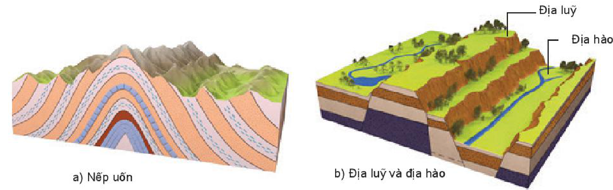
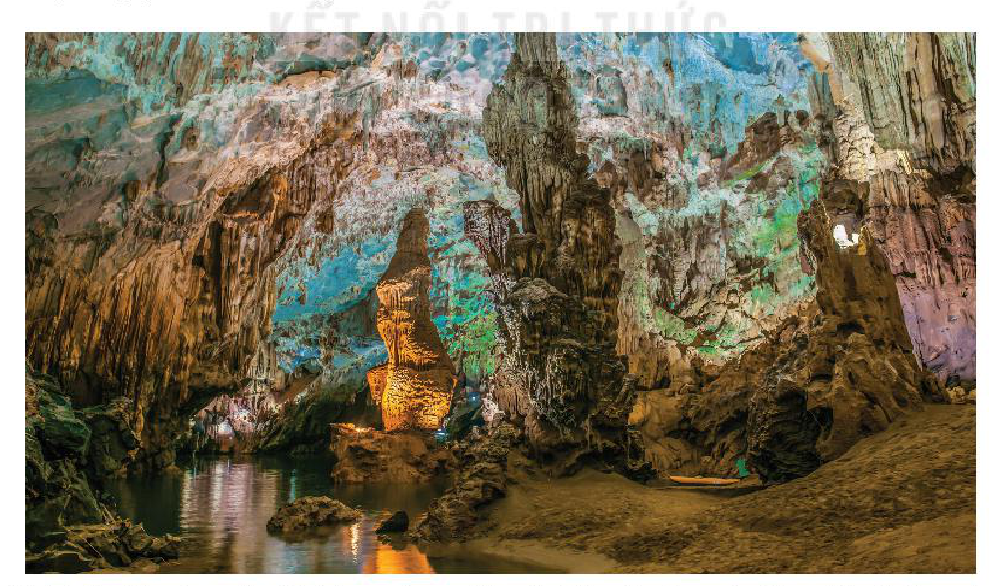
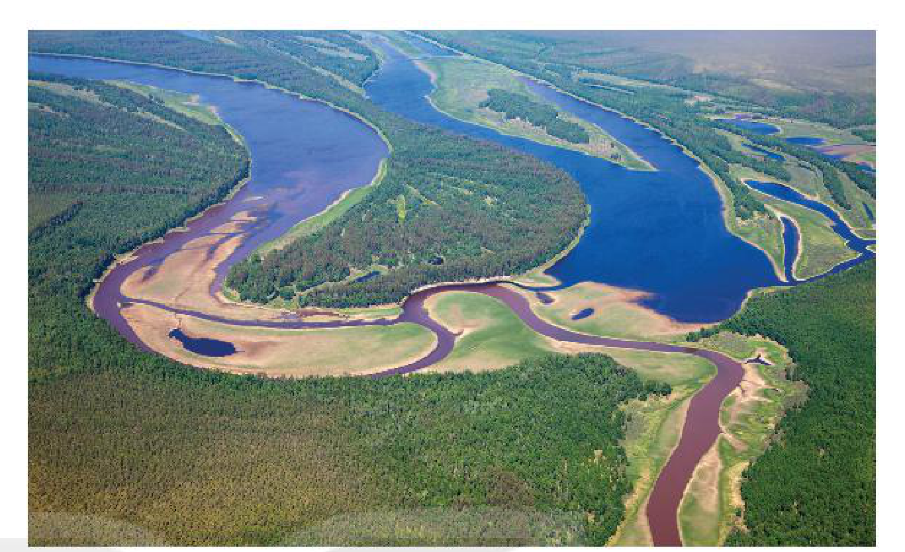

<!-- pdf:25 -->

# BÀI 7: NỘI LỰC VÀ NGOẠI LỰC

## 🔴 Mở đầu

Địa hình bề mặt Trái Đất là kết quả tác động đồng thời và liên tục của nội lực và ngoại lực. Vậy hai lực này diễn ra ở đâu, do nguyên nhân nào và chúng tác động tới địa hình bề mặt Trái Đất ra sao?

## 1. Tác động của nội lực đến địa hình bề mặt Trái Đất

### a) Khái niệm

<!-- term: Nội lực -->
Nội lực là lực sinh ra trong lòng Trái Đất, liên quan tới nguồn năng lượng bên trong Trái Đất.

<!-- term: Nội lực -->
Nguyên nhân sinh ra nội lực là do sự phân huỷ của các chất phóng xạ, do các phản ứng hoá học toả nhiệt, do chuyển động tự quay của Trái Đất, do sự sắp xếp vật chất theo tỉ trọng,...

### b) Tác động

Nội lực tác động tới địa hình bề mặt Trái Đất thông qua các vận động kiến tạo như vận động theo phương thẳng đứng và theo phương nằm ngang.

<!-- term: Vận động theo phương thẳng đứng -->
<!-- term: Biển tiến -->
<!-- term: Biển thoái -->
Vận động theo phương thẳng đứng là vận động nâng lên hạ xuống diễn ra trong một khu vực rộng lớn, làm cho bộ phận này của lục địa được nâng lên, trong khi bộ phận khác bị hạ xuống, kết quả dẫn tới hiện tượng biển tiến và biển thoái.

<!-- term: Vận động theo phương nằm ngang -->
Vận động theo phương nằm ngang làm cho vỏ Trái Đất bị nén ép ở chỗ này và tách dãn ở chỗ khác, gây ra hiện tượng uốn nếp và đứt gãy.

> 💡 Em có biết?
>
> Uốn nếp là hiện tượng đất đá bị uốn thành nếp nhưng không phá vỡ tính liên tục. Đứt gãy xảy ra ở những vùng đá cứng, làm cho đất đá bị gãy, vỡ rồi bị di chuyển ngược hướng nhau theo phương thẳng đứng hay nằm ngang, tạo thành các hẻm vực, các thung lũng, địa hào, địa luỹ,...

<!-- term: Dạng địa hình -->
Xu hướng chung của nội lực là tạo ra sự gồ ghề, cao thấp, mấp mô của địa hình mặt đất. Những dạng địa hình do nội lực tạo ra thường có kích thước lớn như châu lục, các dãy núi cao,...

*Hình 7.1. Hiện tượng uốn nếp và đứt gãy*

*Mô tả hình:* Hình gồm hai sơ đồ khối địa chất: a) Nếp uốn (các lớp đất đá trầm tích nhiều màu bị nén ép uốn cong thành các nếp uốn lồi và lõm liên tục, không bị đứt gãy); b) Địa luỹ và địa hào (các lớp đất đá bị đứt gãy theo các mặt trượt, khối đất đá được nâng cao lên giữa hai đứt gãy tạo thành Địa luỹ, khối đất đá bị sụt lún thấp xuống tạo thành Địa hào có sông chảy qua).
<!-- ocr-ok: mô tả hình ảnh bổ trợ không phải chữ in trực tiếp trong sách -->

> ❓ Đọc thông tin trong mục 1, hãy:
> - Trình bày khái niệm và nguyên nhân sinh ra nội lực.
> - Kể tên các dạng địa hình được hình thành chủ yếu do tác động của nội lực.

<!-- pdf:26 -->

## 2. Tác động của ngoại lực đến địa hình bề mặt Trái Đất

### a) Khái niệm

<!-- term: Ngoại lực -->
Ngoại lực là lực diễn ra trên bề mặt Trái Đất như tác động của gió, mưa, nước chảy, sóng biển, băng, sinh vật và con người. Nguyên nhân chủ yếu sinh ra ngoại lực do nguồn năng lượng bức xạ mặt trời.

### b) Tác động

Tác động của quá trình ngoại lực thông qua ba quá trình: phong hoá, bóc mòn, vận chuyển và bồi tụ. Xu hướng chung của ngoại lực là phá huỷ, hạ thấp độ cao và san bằng địa hình.

- Quá trình phong hoá

<!-- term: Quá trình phong hoá -->
Phong hoá là quá trình phá huỷ, làm thay đổi đá và khoáng vật dưới tác động của nhiệt độ, nước, sinh vật,... Quá trình phong hoá bao gồm: phong hoá vật lí, phong hoá hoá học và phong hoá sinh học. Kết quả chung của quá trình phong hoá là tạo ra lớp vỏ phong hoá.

<!-- term: Phong hoá vật lí -->
<!-- term: Phong hoá hoá học -->
<!-- term: Phong hoá sinh học -->
> 💡 Em có biết?
>
> Phong hoá vật lí làm thay đổi kích thước nhưng không làm thay đổi về thành phần hoá học của đá. Nguyên nhân là sự thay đổi đột ngột của nhiệt độ, sự đóng băng của nước,...
>
> Phong hoá hoá học làm biến đổi thành phần và tính chất hoá học của đá và khoáng vật, do tác động của nước, các chất khí hoà tan trong nước.
>
> Phong hoá sinh học làm thay đổi cả về kích thước và thành phần hoá học của đá, do tác động của sinh vật.

- Quá trình bóc mòn

<!-- term: Quá trình bóc mòn -->
Bóc mòn là quá trình dời chuyển các sản phẩm phong hoá khỏi vị trí ban đầu, dưới tác động của nước chảy, sóng biển, gió, băng hà,... Tuỳ theo nhân tố bóc mòn mà quá trình bóc mòn lại chia thành quá trình xâm thực (do nước chảy), quá trình mài mòn (do sóng biển và băng hà) và quá trình thổi mòn (do gió). Các quá trình này tạo ra các dạng địa hình hết sức phong phú và đa dạng.

*Hình 7.2. Các dạng địa hình trong hang động là kết quả của sự hoà tan đá vôi do nước (động Phong Nha – Quảng Bình)*

*Mô tả hình:* Ảnh chụp bên trong động Phong Nha (Quảng Bình) với dòng sông ngầm phía dưới và hệ thống thạch nhũ, măng đá, cột đá vôi nhiều hình thù trên vòm hang và vách hang, được hình thành do quá trình phong hoá hoá học (hoà tan đá vôi do nước) và kết tủa canxi cacbonat.
<!-- ocr-ok: mô tả hình ảnh bổ trợ không phải chữ in trực tiếp trong sách -->

<!-- pdf:27 -->

- Quá trình vận chuyển và quá trình bồi tụ
  <!-- term: Quá trình vận chuyển -->
  + Quá trình vận chuyển là quá trình di chuyển vật liệu từ nơi này đến nơi khác.
  <!-- term: Quá trình bồi tụ -->
  + Quá trình bồi tụ là quá trình tích tụ các vật liệu để tạo ra các dạng địa hình bồi tụ: đồng bằng, bãi bồi,...

> 💡 Em có biết?
>
> Các vật liệu được vận chuyển có thể dưới dạng hoà tan, lơ lửng trong dòng nước (phù sa). Các vật liệu nhỏ, nhẹ có thể bị cuốn đi do gió. Những vật liệu có kích thước lớn thì lăn theo đáy sông hay các mặt dốc.

*Hình 7.3. Địa hình bồi tụ*

*Mô tả hình:* Ảnh chụp từ trên cao một đoạn sông uốn khúc chảy qua vùng đồng bằng với các bãi bồi phù sa ven sông và thảm thực vật xanh tốt hai bên bờ, minh hoạ địa hình bồi tụ do dòng chảy sông ngòi.
<!-- ocr-ok: mô tả hình ảnh bổ trợ không phải chữ in trực tiếp trong sách -->

Các quá trình phong hoá, bóc mòn, vận chuyển và bồi tụ liên quan mật thiết với nhau. Quá trình phong hoá chuẩn bị vật liệu cho quá trình bóc mòn, bóc mòn lại làm phơi ra những lớp đá mới cho quá trình phong hoá diễn ra. Tuy nhiên, chỉ có bóc mòn và bồi tụ là tạo thành địa hình.

<!-- term: Dạng địa hình -->
Xu hướng chung của ngoại lực là phá huỷ, san bằng sự gồ ghề, mấp mô làm cho địa hình trở nên bằng phẳng hơn. Các dạng địa hình do ngoại lực tạo nên rất đa dạng và phức tạp, thường là những dạng địa hình nhỏ.

Nội lực và ngoại lực có mối quan hệ chặt chẽ với nhau trong sự hình thành và phát triển địa hình bề mặt Trái Đất. Chúng xảy ra đồng thời, nhưng luôn mâu thuẫn, đối kháng nhau để tạo ra các dạng địa hình khác nhau.

> ❓ Dựa vào thông tin và hình ảnh trong mục 2, hãy:
> - Trình bày khái niệm, nguyên nhân sinh ra ngoại lực.
> - Phân tích tác động của quá trình phong hoá, bóc mòn, vận chuyển, bồi tụ đến sự hình thành địa hình bề mặt Trái Đất.

## ✏️ Luyện tập

Nêu sự khác nhau của nội lực và ngoại lực (về khái niệm, nguyên nhân).

## 🚀 Vận dụng

Chọn một trong hai nhiệm vụ sau:

1. Các đồng bằng châu thổ như đồng bằng sông Hồng và đồng bằng sông Cửu Long được hình thành chủ yếu bởi quá trình nội lực hay quá trình ngoại lực, cụ thể là quá trình nào?
2. Hãy kể tên một số hang động nổi tiếng ở Việt Nam.

## 📷 Danh sách hình trong bài

| Mã hình | Trang PDF | Vị trí trong bài | Chú thích gốc |
| --- | --- | --- | --- |
| H10-dia-b07-01 | 25 | Mục 1.b | Hình 7.1. Hiện tượng uốn nếp và đứt gãy |
| H10-dia-b07-02 | 26 | Mục 2.b | Hình 7.2. Các dạng địa hình trong hang động là kết quả của sự hoà tan đá vôi do nước (động Phong Nha – Quảng Bình) |
| H10-dia-b07-03 | 27 | Mục 2.b | Hình 7.3. Địa hình bồi tụ |
