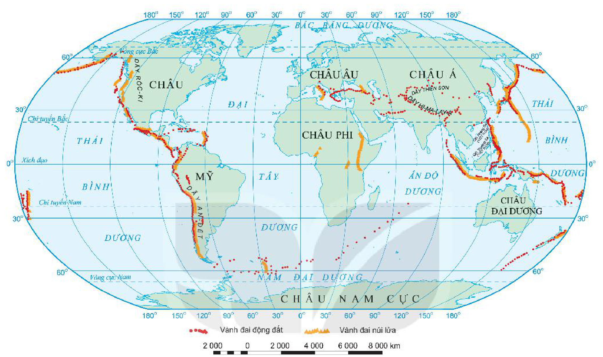

<!-- pdf:28 -->

# BÀI 8: THỰC HÀNH: SỰ PHÂN BỐ CÁC VÀNH ĐAI ĐỘNG ĐẤT, NÚI LỬA

<!-- term: Vành đai động đất -->
<!-- term: Vành đai núi lửa -->
<!-- term: Nam Đại Dương -->
Cho bản đồ:

*Hình 8. Bản đồ các vành đai động đất, núi lửa*

<!-- term: Vành đai động đất -->
<!-- term: Vành đai núi lửa -->
<!-- term: Nam Đại Dương -->
*Mô tả hình:* Bản đồ thế giới thể hiện sự phân bố các Vành đai động đất (kí hiệu bằng dải các chấm tròn màu đỏ) và Vành đai núi lửa (kí hiệu bằng dải các hình núi lửa màu vàng cam). Các vành đai động đất và núi lửa lớn gồm: vành đai bao quanh Thái Bình Dương (dọc bờ tây Châu Mỹ qua Dãy Rốc-ki, Dãy An-đét và dọc bờ đông Châu Á qua Nhật Bản, Phi-líp-pin, In-đô-nê-xi-a xuống Niu Di-len), vành đai Địa Trung Hải – Hi-ma-lay-a (từ Nam Âu qua Tây Á, Dãy Thiên Sơn, Dãy Hi-ma-lay-a nối sang Đông Nam Á), và các dải dọc sống núi ngầm giữa Đại Tây Dương, Ấn Độ Dương, Nam Đại Dương (nằm ở phía nam vĩ tuyến 60°N bao quanh Châu Nam Cực) cũng như khu vực Đông Phi.
<!-- ocr-ok: mô tả hình ảnh bổ trợ không phải chữ in trực tiếp trong sách -->

<!-- term: Vành đai động đất -->
<!-- term: Vành đai núi lửa -->
1. Dựa vào hình 8, hãy:
   - Xác định các vành đai động đất, vành đai núi lửa trên thế giới.
   - Cho biết động đất và núi lửa tập trung nhiều nhất ở các khu vực nào trên thế giới.
2. Dựa vào hình 6.2, hình 8 và kiến thức đã học, hãy trình bày mối quan hệ giữa sự phân bố các vành đai động đất, vành đai núi lửa với sự chuyển dịch các mảng kiến tạo.
3. Tìm hiểu thông tin, cho biết ở Việt Nam đã từng xảy ra hiện tượng động đất và núi lửa ở đâu.

## 📷 Danh sách hình trong bài

| Mã hình | Trang PDF | Vị trí trong bài | Chú thích gốc |
| --- | --- | --- | --- |
| H10-dia-b08-01 | 28 | Bài thực hành | Hình 8. Bản đồ các vành đai động đất, núi lửa |
