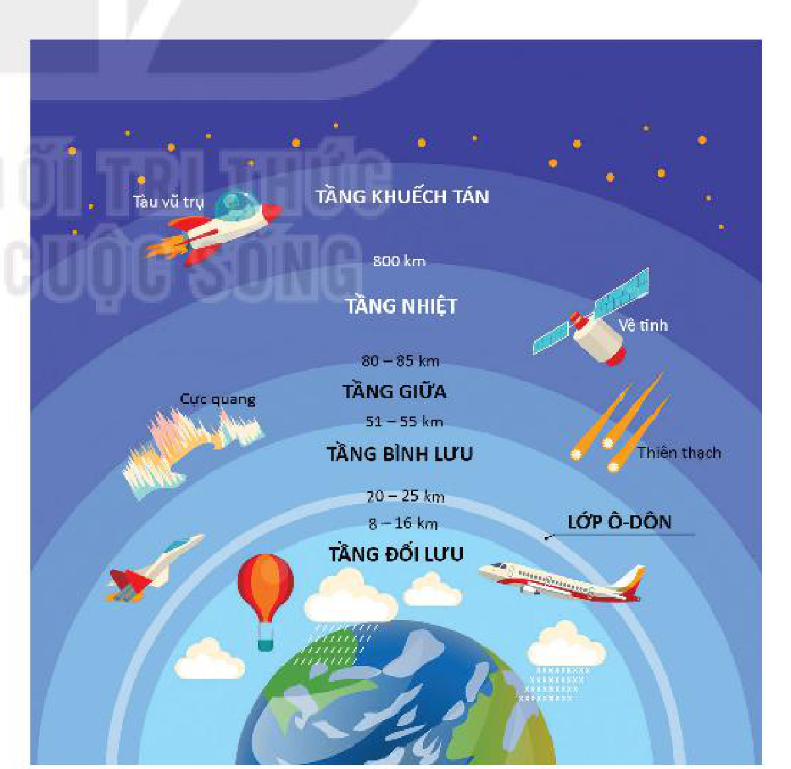
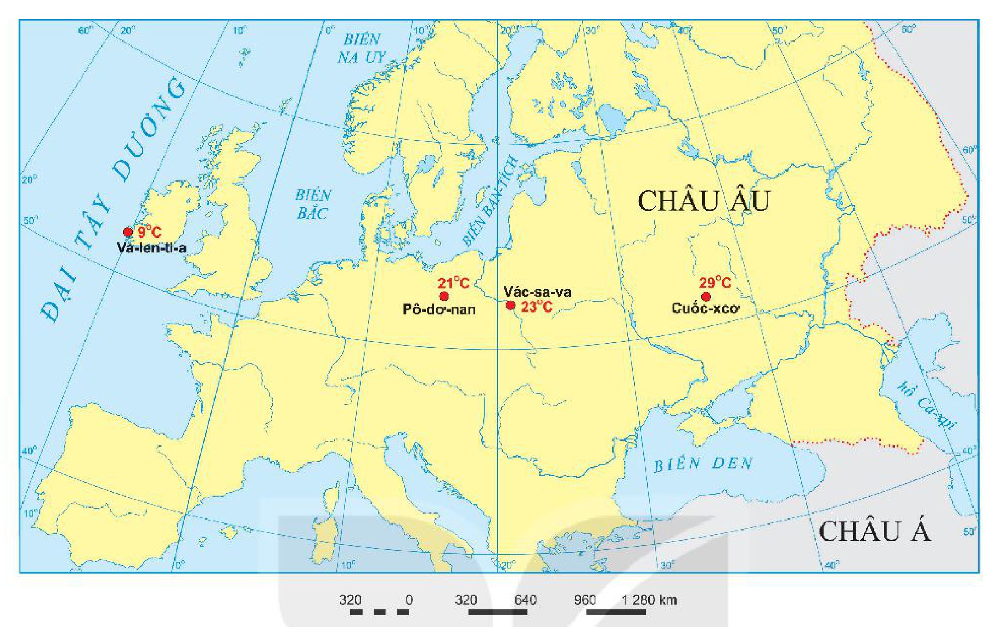
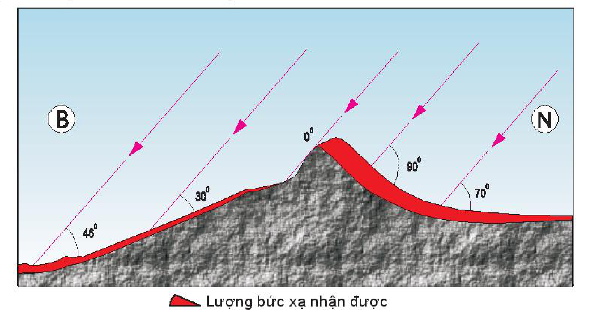
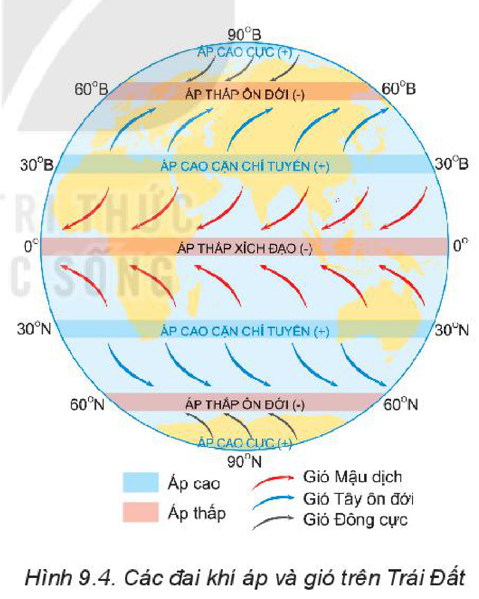
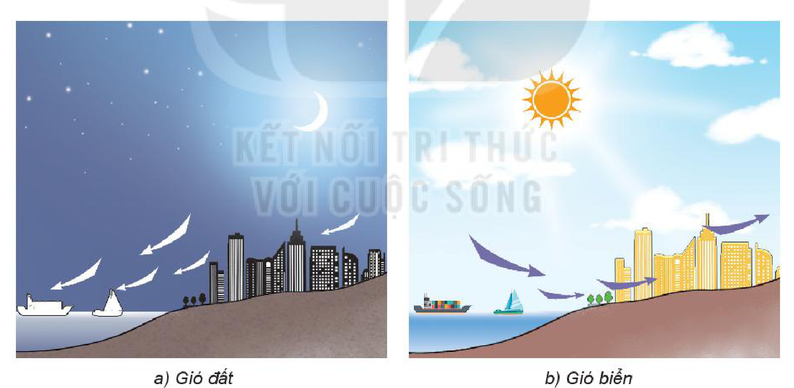
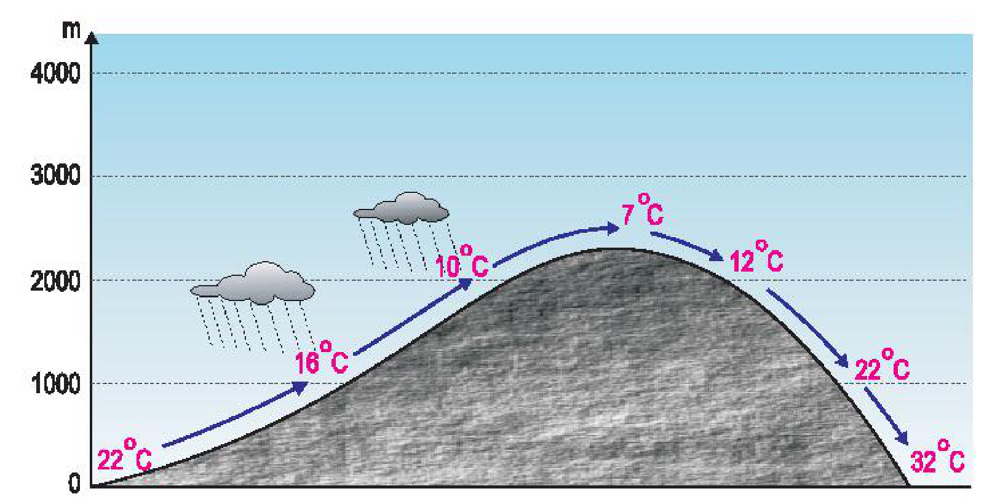
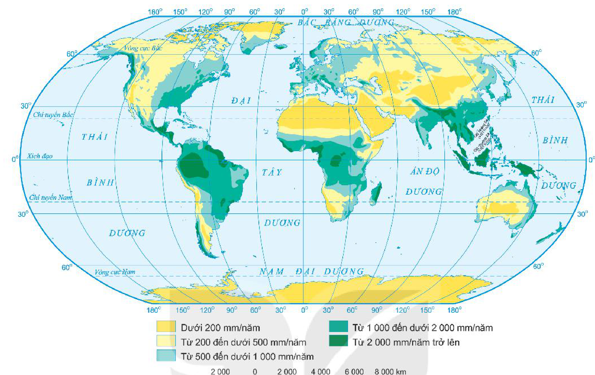

<!-- pdf:29 -->

# BÀI 9: KHÍ QUYỂN, CÁC YẾU TỐ KHÍ HẬU

## 🔴 Mở đầu

Trái Đất là hành tinh có kích thước đủ lớn giữ được bầu khí quyển bao quanh. Tất cả các yếu tố khí hậu như nhiệt độ, khí áp, gió, mưa,... diễn ra trong khí quyển đều có những quy luật riêng, đồng thời có mối liên hệ và tác động lẫn nhau, tạo nên sự đa dạng, phức tạp của khí hậu Trái Đất. Các yếu tố khí hậu diễn ra như thế nào trong khí quyển?

## 1. Khái niệm khí quyển

<!-- term: Khí quyển -->
Khí quyển là lớp không khí bao quanh Trái Đất, luôn chịu ảnh hưởng của Vũ Trụ, trước hết là Mặt Trời.

<!-- term: Khí quyển -->
Thành phần chính của khí quyển là không khí, bao gồm hỗn hợp các chất khí, chủ yếu là ni-tơ (78,1%), o-xy (20,9%) và các chất khí khác (ác-gông, các-bo-nic, hơi nước,...), ngoài ra còn có bụi và các tạp chất khác.

<!-- term: Tầng đối lưu -->
<!-- term: Tầng bình lưu -->
Về cấu trúc, khí quyển chia thành năm tầng có đặc điểm khác nhau, trong đó tầng đối lưu là quan trọng nhất vì có liên quan tới các quá trình tự nhiên diễn ra trên bề mặt Trái Đất.

<!-- term: Frông -->
> 💡 Em có biết?
> Frông là bề mặt tiếp xúc giữa hai khối khí có nguồn gốc khác nhau và khác biệt về tính chất vật lí. Trên mỗi bán cầu có hai frông căn bản: frông địa cực (FA), frông ôn đới (FP). Giữa khối khí chí tuyến và khối khí xích đạo khi tiếp xúc với nhau không tạo ra frông thường xuyên và liên tục mà chỉ tạo thành dải hội tụ nhiệt đới.

*Hình 9.1. Các tầng khí quyển*

<!-- term: Tầng đối lưu -->
<!-- term: Tầng bình lưu -->
*Mô tả hình:* Sơ đồ mặt cắt các tầng khí quyển từ bề mặt Trái Đất lên cao: TẦNG ĐỐI LƯU (từ mặt đất đến 8 – 16 km, nơi có mây, mưa, khinh khí cầu, máy bay dân dụng), TẦNG BÌNH LƯU (từ 8 – 16 km đến 51 – 55 km, có LỚP Ô-DÔN ở độ cao 20 – 25 km), TẦNG GIỮA (từ 51 – 55 km đến 80 – 85 km, nơi xuất hiện thiên thạch bốc cháy), TẦNG NHIỆT (từ 80 – 85 km đến 800 km, nơi có cực quang và vệ tinh nhân tạo), và TẦNG KHUẾCH TÁN (trên 800 km, nơi có tàu vũ trụ).
<!-- ocr-ok: mô tả hình ảnh bổ trợ không phải chữ in trực tiếp trong sách -->

<!-- term: Khối khí -->
Ở lớp không khí gần mặt đất của tầng đối lưu, mỗi bán cầu từ phía cực về Xích đạo được chia thành bốn khối khí chính, có tính chất khác nhau: khối khí cực (A) rất lạnh, khối khí ôn đới (P) lạnh, khối khí chí tuyến (T) rất nóng và khối khí xích đạo (E) nóng ẩm.

<!-- pdf:30 -->

> ❓ Dựa vào thông tin trong mục 1 và hình 9.1, hãy:
> - Nêu khái niệm khí quyển.
> - Kể tên và xác định giới hạn của các tầng khí quyển.

## 2. Nhiệt độ không khí

### a) Nhiệt độ phân bố theo vĩ độ

Bảng 9. NHIỆT ĐỘ TRUNG BÌNH NĂM VÀ BIÊN ĐỘ NHIỆT ĐỘ NĂM THEO VĨ ĐỘ Ở BÁN CẦU BẮC

| Vĩ độ | Nhiệt độ trung bình năm (°C) | Biên độ nhiệt độ năm (°C) |
| --- | --- | --- |
| 0° | 24,5 | 1,8 |
| 20° | 25,0 | 7,4 |
| 30° | 20,4 | 13,3 |
| 40° | 14,0 | 17,7 |
| 50° | 5,4 | 23,8 |
| 60° | -0,6 | 29,0 |
| 70° | -10,4 | 32,2 |
| ... | ... | ... |
<!-- ocr-ok: bảng số liệu đối chiếu trực tiếp từ ảnh trang PDF -->

<!-- term: Nhiệt độ không khí -->
<!-- term: Vòng đai nhiệt -->
Biểu hiện rõ rệt của quy luật phân bố nhiệt độ theo vĩ độ là sự hình thành các vòng đai nhiệt: vòng đai nóng, vòng đai ôn hoà, vòng đai lạnh và vòng đai băng giá vĩnh cửu. Ranh giới của các vòng đai nhiệt được xác định dựa vào các đường đẳng nhiệt trung bình năm 20°C và các đường đẳng nhiệt 10°C và 0°C của tháng nóng nhất.

> 💡 Em có biết?
>
> Nhiệt độ trung bình năm của nước ta tăng dần từ bắc vào nam. Nhiệt độ trung bình năm ở Lạng Sơn là 21,6°C, ở Hà Nội là 23,5°C, ở Huế là 25,1°C, ở Quy Nhơn là 26,4°C, ở Thành phố Hồ Chí Minh là 26,9°C,...

> ❓ Dựa vào thông tin trong mục a và bảng 9, hãy nhận xét về sự thay đổi nhiệt độ trung bình năm và biên độ nhiệt độ năm theo vĩ độ ở bán cầu Bắc.

### b) Nhiệt độ phân bố theo lục địa và đại dương

<!-- term: Phân bố nhiệt độ theo lục địa, đại dương -->
- Bề mặt đất nhận nhiệt nhanh hơn và toả nhiệt cũng nhanh hơn bề mặt nước. Vì vậy vào mùa hạ, lục địa có nhiệt độ cao hơn đại dương; còn vào mùa đông, lục địa có nhiệt độ thấp hơn đại dương. Các địa điểm nằm sâu trong lục địa thường có biên độ nhiệt độ lớn hơn các địa điểm nằm gần đại dương.
- Những địa điểm có nhiệt độ trung bình năm cao nhất và những địa điểm có nhiệt độ trung bình năm thấp nhất đều nằm trên lục địa. Hoang mạc Xa-ha-ra là nơi có nhiệt độ trung bình năm cao nhất, tới trên 40°C. Lục địa Nam Cực có nhiệt độ trung bình năm thấp nhất, có nơi xuống tới -57°C.
- Ngoài ra, nhiệt độ không khí còn thay đổi theo bờ đông và bờ tây lục địa, do ảnh hưởng của các dòng biển nóng, lạnh.

<!-- pdf:31 -->

*Hình 9.2. Biên độ nhiệt độ năm thay đổi theo vị trí gần hay xa đại dương*

*Mô tả hình:* Lược đồ khu vực Châu Âu thể hiện biên độ nhiệt độ năm tại 4 địa điểm nằm gần cùng vĩ tuyến 52°B từ bờ Đại Tây Dương vào sâu trong lục địa: Va-len-ti-a (Ai-len, sát bờ Đại Tây Dương) là 9°C; Pô-dơ-nan (Ba Lan) là 21°C; Vác-sa-va (Ba Lan) là 23°C; và Cuốc-xcơ (Liên bang Nga, nằm sâu trong lục địa) là 29°C.
<!-- ocr-ok: mô tả hình ảnh bổ trợ không phải chữ in trực tiếp trong sách -->

> ❓ Dựa vào thông tin mục b và hình 9.2, nhận xét và giải thích sự thay đổi của biên độ nhiệt độ ở các địa điểm nằm trên khoảng vĩ tuyến 52°B.

### c) Nhiệt độ phân bố theo địa hình

<!-- term: Nhiệt độ không khí -->
<!-- term: Nhiệt độ phân bố theo địa hình -->
Nhiệt độ không khí trong tầng đối lưu giảm dần theo độ cao, trung bình giảm đi 0,6°C khi độ cao tăng lên 100 m.

<!-- term: Nhiệt độ không khí -->
<!-- term: Nhiệt độ phân bố theo địa hình -->
Ngoài ra, nhiệt độ không khí còn thay đổi theo độ dốc và hướng phơi của sườn núi do liên quan đến góc chiếu của tia sáng mặt trời tới bề mặt đất.

*Hình 9.3. Nhiệt độ thay đổi theo độ dốc và hướng phơi của sườn núi*

*Mô tả hình:* Sơ đồ mặt cắt một ngọn núi theo hướng Bắc (B) – Nam (N) với các tia sáng mặt trời chiếu xiên từ phía Nam (mũi tên màu hồng). Sườn phía Nam (N) đón nắng có góc nhập xạ lớn (70°, 90° vuông góc với mặt sườn) nên lớp màu đỏ biểu thị Lượng bức xạ nhận được rất dày; đỉnh núi bằng phẳng có góc chiếu 0° và sườn phía Bắc (B) khuất nắng hơn có góc chiếu nhỏ (30°, 46°) nên lớp màu đỏ biểu thị lượng bức xạ nhận được mỏng hơn.
<!-- ocr-ok: mô tả hình ảnh bổ trợ không phải chữ in trực tiếp trong sách -->

> ❓ Đọc thông tin trong mục c và hình 9.3, trình bày sự thay đổi nhiệt độ không khí theo địa hình.

<!-- pdf:32 -->

## 3. Khí áp và gió

### a) Khí áp

- Khí áp và nguyên nhân thay đổi khí áp
  <!-- term: Khí áp -->
  + Khí áp là sức nén của không khí xuống bề mặt đất. Tuỳ theo tình trạng của không khí mà tỉ trọng không khí thay đổi, làm cho khí áp cũng thay đổi theo.
  + Nguyên nhân thay đổi của khí áp:
    Khí áp thay đổi theo nhiệt độ: nhiệt độ cao, không khí nở ra, tỉ trọng giảm, khí áp giảm và ngược lại, nhiệt độ giảm, không khí co lại, tỉ trọng tăng, khí áp tăng.
    Khí áp thay đổi theo độ cao: càng lên cao không khí càng loãng, sức nén càng nhỏ, khí áp giảm.
    Khí áp thay đổi theo độ ẩm: không khí chứa hơi nước nhẹ hơn không khí khô nên khí áp giảm, ngược lại, không khí khô thì khí áp tăng.
    Ngoài ra, khí áp còn thay đổi theo thành phần không khí.

> 💡 Em có biết?
>
> Áp suất của khí quyển ở bề mặt biển trung bình bằng 760 mm thuỷ ngân, tương đương với 1 013 mb được coi là khí áp tiêu chuẩn; lớn hơn là áp cao, nhỏ hơn là áp thấp.

- Sự hình thành các đai khí áp trên Trái Đất
  <!-- term: Các đai khí áp trên Trái Đất -->
  + Các đai khí áp cao và các đai khí áp thấp trên Trái Đất phân bố xen kẽ và đối xứng qua đai áp thấp xích đạo.
  + Ở vùng Xích đạo, do nhiệt độ cao quanh năm, hơi nước bốc lên mạnh, chiếm dần chỗ không khí khô, sức nén không khí giảm, hình thành đai áp thấp xích đạo (nguyên nhân nhiệt lực). Không khí bốc lên cao từ Xích đạo, di chuyển về chí tuyến và dồn xuống, sức nén không khí tăng, hình thành nên các đai áp cao cận chí tuyến (nguyên nhân động lực). Ở vùng Bắc Cực và Nam Cực, do nhiệt độ rất thấp, sức nén không khí tăng, hình thành các đai áp cao cực (nguyên nhân nhiệt lực). Từ các đai áp cao ở cận chí tuyến và ở vùng cực, không khí di chuyển về vùng ôn đới, gặp nhau và bốc lên cao, sức nén không khí giảm, hình thành các đai áp thấp ôn đới (nguyên nhân động lực). Tuy nhiên, các đai khí áp trên Trái Đất không liên tục mà bị chia cắt thành các trung tâm khí áp riêng biệt do sự phân bố xen kẽ giữa lục địa và đại dương.

*Hình 9.4. Các đai khí áp và gió trên Trái Đất*

*Mô tả hình:* Sơ đồ hình cầu Trái Đất thể hiện 7 đai khí áp (màu xanh nhạt là Áp cao `+`, màu hồng cam là Áp thấp `-`) và các đới gió chính theo vĩ độ: ở 0° là ÁP THẤP XÍCH ĐẠO (-); ở khoảng 30°B và 30°N là hai đai ÁP CAO CẬN CHÍ TUYẾN (+); ở khoảng 60°B và 60°N là hai đai ÁP THẤP ÔN ĐỚI (-); ở 90°B và 90°N là hai đai ÁP CAO CỰC (+). Giữa các đai khí áp là các mũi tên chỉ hướng gió: Gió Mậu dịch (mũi tên đỏ, thổi từ áp cao cận chí tuyến 30° về áp thấp xích đạo 0°), Gió Tây ôn đới (mũi tên xanh dương, thổi từ áp cao cận chí tuyến 30° về áp thấp ôn đới 60°), và Gió Đông cực (mũi tên đen, thổi từ áp cao cực 90° về áp thấp ôn đới 60°).
<!-- ocr-ok: mô tả hình ảnh bổ trợ không phải chữ in trực tiếp trong sách -->

> ❓ Dựa vào thông tin và hình trong mục a, hãy:
> - Nêu các nguyên nhân dẫn đến sự thay đổi khí áp trên Trái Đất.
> - Trình bày sự hình thành các đai khí áp trên Trái Đất.

<!-- pdf:33 -->

### b) Gió

- Một số loại gió chính
  <!-- term: Gió Mậu dịch -->
  + Gió Mậu dịch thổi từ đai áp cao cận chí tuyến về đai áp thấp xích đạo, có hướng và tốc độ tương đối ổn định quanh năm, ở bán cầu Bắc có hướng đông bắc, ở bán cầu Nam có hướng đông nam, tính chất của gió nói chung là khô.
  <!-- term: Gió Tây ôn đới -->
  + Gió Tây ôn đới là gió thổi quanh năm từ đai áp cao cận chí tuyến về đai áp thấp ôn đới theo hướng tây nam ở bán cầu Bắc, hướng tây bắc ở bán cầu Nam và thường có độ ẩm cao, gây mưa.
  <!-- term: Gió Đông cực -->
  + Gió Đông cực là gió thổi từ vùng áp cao cực về áp thấp ôn đới theo hướng đông bắc ở bán cầu Bắc và hướng đông nam ở bán cầu Nam, rất lạnh và khô.
  <!-- term: Gió mùa -->
  + Gió mùa là gió thổi theo mùa, hướng và tính chất gió ở hai mùa trái ngược nhau. Nguyên nhân hình thành gió mùa chủ yếu do sự nóng lên hay lạnh đi không đều giữa lục địa và đại dương (gió mùa ngoại chí tuyến) hoặc giữa hai bán cầu (gió mùa nội chí tuyến).
    Gió mùa phân bố chủ yếu ở đới nóng như: Nam Á, Đông Nam Á, Đông Phi, Đông Bắc Ô-xtrây-li-a và một số khu vực vĩ độ trung bình như: Đông Trung Quốc, Đông Nam Hoa Kỳ.

- Gió địa phương
  <!-- term: Gió địa phương -->
  <!-- term: Gió đất và gió biển -->
  + Gió đất và gió biển hình thành ở vùng ven biển, thay đổi hướng theo đêm và ngày. Nguyên nhân là do sự nóng lên và lạnh đi không đều giữa đất liền và biển.

*Hình 9.5. Gió đất và gió biển*

*Mô tả hình:* Hình gồm hai sơ đồ vùng ven biển: a) Gió đất (vào ban đêm có mặt trăng, các mũi tên màu trắng chỉ gió thổi từ đất liền ra biển); b) Gió biển (vào ban ngày có mặt trời, các mũi tên màu tím chỉ gió thổi từ biển vào đất liền).
<!-- ocr-ok: mô tả hình ảnh bổ trợ không phải chữ in trực tiếp trong sách -->

  <!-- term: Gió địa phương -->
  <!-- term: Gió fơn -->
  + Gió fơn là loại gió vượt núi, nhiệt độ giảm đi và gây mưa ở sườn đón gió, khi vượt sang sườn bên kia, hơi nước giảm, nhiệt độ tăng lên, trở thành gió khô nóng.

<!-- pdf:34 -->

*Hình 9.6. Gió fơn*

*Mô tả hình:* Sơ đồ mặt cắt một ngọn núi cao hơn 2 500 m minh hoạ hiện tượng gió fơn: ở sườn đón gió bên trái, không khí ẩm đi lên từ độ cao 0 m (22°C) qua 1 000 m (16°C), 2 000 m (10°C) đến đỉnh núi (7°C), hình thành mây và gây mưa lớn ở sườn đón gió; sau khi vượt qua đỉnh núi tràn xuống sườn khuất gió bên phải, không khí trở nên khô và nóng dần lên nhanh chóng qua 2 000 m (12°C), 1 000 m (22°C) và xuống chân núi bên phải đạt 32°C.
<!-- ocr-ok: mô tả hình ảnh bổ trợ không phải chữ in trực tiếp trong sách -->

> ❓ Dựa vào thông tin và các hình trong mục b, hãy trình bày một số loại gió chính trên Trái Đất và gió địa phương.

## 4. Mưa

### a) Các nhân tố ảnh hưởng đến lượng mưa

<!-- term: Các nhân tố ảnh hưởng đến lượng mưa -->
Các nhân tố ảnh hưởng tới lượng mưa là khí áp, frông, gió, dòng biển, địa hình.
- Khí áp: Vùng áp thấp hút gió và đẩy không khí ẩm lên cao sinh ra mây, gây mưa như vùng Xích đạo. Ở vùng áp cao không khí bị nén xuống không bốc lên cao được và chỉ có gió thổi đi nên ít mưa như vùng cực, vùng chí tuyến.
- Frông: Dọc các frông nóng hay lạnh, không khí nóng bốc lên trên không khí lạnh nên bị lạnh đi, gây ra mưa. Miền có frông hay dải hội tụ nhiệt đới đi qua thường có mưa nhiều.
- Gió: Vùng nằm sâu trong lục địa, nếu không có gió từ đại dương thổi vào thì mưa rất ít. Vùng có gió Mậu dịch hoạt động sẽ ít mưa, vùng có gió mùa hoạt động sẽ mưa nhiều.
- Dòng biển: Cùng nằm ven bờ đại dương, nhưng nơi có dòng biển nóng chảy qua thì mưa nhiều. Nơi có dòng biển lạnh chảy qua thì mưa ít.
- Địa hình: Cùng một sườn núi đón gió, càng lên cao nhiệt độ càng giảm, càng mưa nhiều, nhưng tới một độ cao nào đó, độ ẩm không khí đã giảm nhiều, sẽ không còn mưa. Cùng một dãy núi thì sườn đón gió mưa nhiều, sườn khuất gió thường mưa ít và khô ráo.

<!-- term: Mưa -->
> 💡 Em có biết?
> Không khí càng lên cao càng lạnh, hơi nước ngưng đọng thành những hạt nước nhỏ và nhẹ, tụ lại thành những đám mây. Các hạt nước trong đám mây khi kết hợp với nhau hoặc được ngưng tụ thêm hơi nước làm tăng kích thước và rơi xuống mặt đất tạo thành mưa.

> ❓ Dựa vào thông tin trong mục a, hãy phân tích các nhân tố ảnh hưởng đến lượng mưa.

### b) Phân bố mưa

<!-- term: Phân bố mưa trên Trái Đất -->
Nhìn chung, lượng mưa phân bố trên Trái Đất theo vĩ độ và theo khu vực.

<!-- term: Phân bố mưa trên Trái Đất -->
Lượng mưa phân bố không đều theo vĩ độ và có sự xen kẽ giữa các vùng mưa nhiều và các vùng mưa ít. Mưa nhiều nhất ở vùng Xích đạo, mưa tương đối ít ở hai vùng chí tuyến, mưa nhiều ở hai vùng ôn đới và mưa rất ít ở hai vùng cực.

<!-- term: Phân bố mưa trên Trái Đất -->
Ở mỗi một vùng theo chiều đông – tây lại có sự phân hoá thành những khu vực có lượng mưa khác nhau do tác động của địa hình, dòng biển, vị trí gần biển hay xa biển,...

<!-- pdf:35 -->

*Hình 9.7. Bản đồ lượng mưa trung bình năm trên lục địa*

*Mô tả hình:* Bản đồ thế giới thể hiện lượng mưa trung bình năm trên lục địa theo 5 thang màu: Dưới 200 mm/năm (màu vàng đậm, phân bố ở Bắc Phi – Xa-ha-ra, Tây Nam Á, Trung Á, Tây Nam Bắc Mỹ, nội địa Ô-xtrây-li-a, Châu Nam Cực); Từ 200 đến dưới 500 mm/năm (màu vàng nhạt); Từ 500 đến dưới 1 000 mm/năm (màu xanh ngọc nhạt); Từ 1 000 đến dưới 2 000 mm/năm (màu xanh lá vừa); Từ 2 000 mm/năm trở lên (màu xanh lá đậm, phân bố ở lưu vực A-ma-dôn, bồn địa Công-gô, Đông Nam Á, Nam Á). Trên bản đồ ghi tên các đại dương gồm Thái Bình Dương, Đại Tây Dương, Ấn Độ Dương, Bắc Băng Dương và Nam Đại Dương.
<!-- ocr-ok: mô tả hình ảnh bổ trợ không phải chữ in trực tiếp trong sách -->

> 💡 Em có biết?
>
> Những khu vực mưa ít là nơi có áp cao như chí tuyến và vùng cực. Các vùng hoang mạc mưa dưới 200 mm/năm, ở A-ri-ca thuộc hoang mạc A-ta-ca-ma chỉ mưa 0,8 mm/năm,... Những nơi mưa nhiều là những vùng núi cao, có hướng chắn gió, điển hình là Se-ra-pun-di (Ấn Độ) ở độ cao 1 313 m thuộc dãy Hi-ma-lay-a, lượng mưa trung bình gần 12 000 mm/năm.

> ❓ Dựa vào thông tin trong mục b và hình 9.7, hãy nhận xét về sự phân bố lượng mưa trên Trái Đất.

## ✏️ Luyện tập

1. Trình bày đặc điểm phân bố nhiệt độ trên Trái Đất.
2. Sự hình thành các đai khí áp và các đới gió có liên quan gì với nhau?

## 🚀 Vận dụng

Chọn một trong hai nhiệm vụ sau:

1. Dựa vào kiến thức đã học, hãy giải thích hiện tượng thời tiết trong câu thơ sau của nhà thơ Thuý Bắc:
   "Trường Sơn Đông
   Trường Sơn Tây
   Bên nắng đốt
   Bên mưa quây..."
2. Tại sao vào mùa nóng bức, người dân ở vùng đồng bằng và các đô thị rất thích đi du lịch, nghỉ dưỡng ở Sa Pa và Đà Lạt?

## 📷 Danh sách hình trong bài

| Mã hình | Trang PDF | Vị trí trong bài | Chú thích gốc |
| --- | --- | --- | --- |
| H10-dia-b09-01 | 29 | Mục 1 | Hình 9.1. Các tầng khí quyển |
| H10-dia-b09-02 | 31 | Mục 2.b | Hình 9.2. Biên độ nhiệt độ năm thay đổi theo vị trí gần hay xa đại dương |
| H10-dia-b09-03 | 31 | Mục 2.c | Hình 9.3. Nhiệt độ thay đổi theo độ dốc và hướng phơi của sườn núi |
| H10-dia-b09-04 | 32 | Mục 3.a | Hình 9.4. Các đai khí áp và gió trên Trái Đất |
| H10-dia-b09-05 | 33 | Mục 3.b | Hình 9.5. Gió đất và gió biển |
| H10-dia-b09-06 | 34 | Mục 3.b | Hình 9.6. Gió fơn |
| H10-dia-b09-07 | 35 | Mục 4.b | Hình 9.7. Bản đồ lượng mưa trung bình năm trên lục địa |
