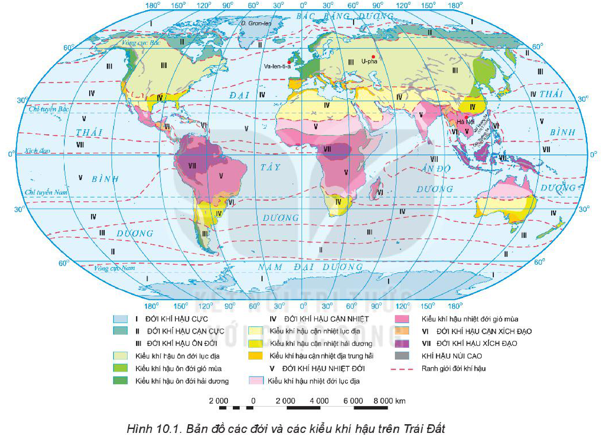
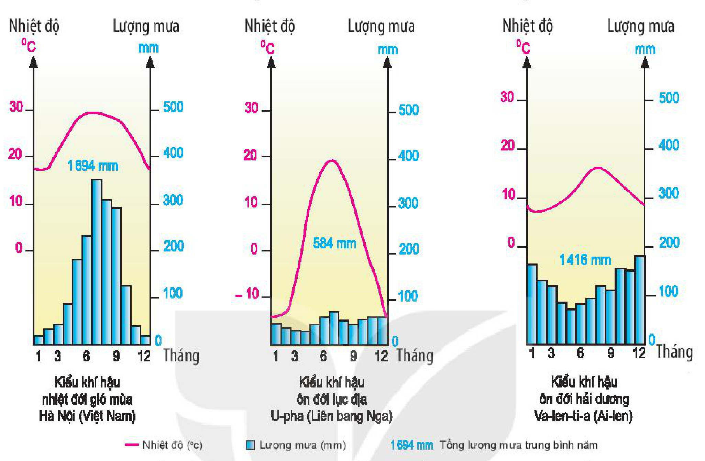

<!-- pdf:36 -->

# BÀI 10: THỰC HÀNH: ĐỌC BẢN ĐỒ CÁC ĐỚI VÀ CÁC KIỂU KHÍ HẬU TRÊN TRÁI ĐẤT, PHÂN TÍCH BIỂU ĐỒ MỘT SỐ KIỂU KHÍ HẬU

## 1. Đọc bản đồ các đới và các kiểu khí hậu trên Trái Đất

Cho bản đồ:

<!-- term: Các đới và các kiểu khí hậu trên Trái Đất -->
*Hình 10.1. Bản đồ các đới và các kiểu khí hậu trên Trái Đất*

<!-- term: Biểu đồ nhiệt độ và lượng mưa -->
<!-- term: Các đới và các kiểu khí hậu trên Trái Đất -->
*Mô tả hình:* Bản đồ thế giới thể hiện sự phân bố 7 đới khí hậu từ cực về Xích đạo ở hai bán cầu (I. Đới khí hậu cực; II. Đới khí hậu cận cực; III. Đới khí hậu ôn đới gồm kiểu ôn đới lục địa, ôn đới gió mùa, ôn đới hải dương; IV. Đới khí hậu cận nhiệt gồm kiểu cận nhiệt lục địa, cận nhiệt gió mùa, cận nhiệt địa trung hải; V. Đới khí hậu nhiệt đới gồm kiểu nhiệt đới lục địa, nhiệt đới gió mùa; VI. Đới khí hậu cận xích đạo; VII. Đới khí hậu xích đạo) cùng khu vực khí hậu núi cao và vị trí các trạm Hà Nội, U-pha, Va-len-ti-a.
<!-- ocr-ok: mô tả hình ảnh bổ trợ không phải chữ in trực tiếp trong sách -->

<!-- term: Các đới và các kiểu khí hậu trên Trái Đất -->
Dựa vào hình 10.1, hãy:

<!-- term: Các đới và các kiểu khí hậu trên Trái Đất -->
- Xác định phạm vi và tên của các đới khí hậu.
- Cho biết sự phân hoá thành các kiểu khí hậu ở các đới.
- Xác định Việt Nam nằm trong đới khí hậu nào.

<!-- pdf:37 -->

## 2. Phân tích biểu đồ một số kiểu khí hậu

<!-- term: Biểu đồ nhiệt độ và lượng mưa -->
Cho biểu đồ nhiệt độ, lượng mưa của một số trạm khí tượng:

<!-- term: Biểu đồ nhiệt độ và lượng mưa -->
*Hình 10.2. Biểu đồ nhiệt độ, lượng mưa của một số trạm khí tượng trên thế giới*

<!-- term: Biểu đồ nhiệt độ và lượng mưa -->
<!-- term: Các đới và các kiểu khí hậu trên Trái Đất -->
*Mô tả hình:* Ba biểu đồ tương quan nhiệt – ẩm (đường biểu diễn nhiệt độ theo °C và cột biểu diễn lượng mưa theo mm qua 12 tháng) của ba kiểu khí hậu: Kiểu khí hậu nhiệt đới gió mùa tại Hà Nội (Việt Nam, tổng lượng mưa 1 694 mm), Kiểu khí hậu ôn đới lục địa tại U-pha (Liên bang Nga, tổng lượng mưa 584 mm) và Kiểu khí hậu ôn đới hải dương tại Va-len-ti-a (Ai-len, tổng lượng mưa 1 416 mm).
<!-- ocr-ok: mô tả hình ảnh bổ trợ không phải chữ in trực tiếp trong sách -->

<!-- term: Biểu đồ nhiệt độ và lượng mưa -->
Dựa vào hình 10.2, hãy:

<!-- term: Biểu đồ nhiệt độ và lượng mưa -->
- Phân tích yếu tố nhiệt độ:
  + Nhiệt độ trung bình tháng cao nhất, nhiệt độ trung bình tháng thấp nhất (khoảng bao nhiêu °C).
  + Biên độ nhiệt độ năm (khoảng bao nhiêu °C).
- Phân tích yếu tố lượng mưa:
  + Tổng lượng mưa trung bình năm.
  + Chế độ mưa, thể hiện qua các tháng trong năm (chênh lệch nhiều hay ít, mưa nhiều vào những tháng nào; mưa ít hoặc không mưa vào những tháng nào,...).

## 📷 Danh sách hình trong bài

<!-- term: Biểu đồ nhiệt độ và lượng mưa -->
<!-- term: Các đới và các kiểu khí hậu trên Trái Đất -->
| Mã hình | Trang PDF | Vị trí trong bài | Chú thích gốc |
| --- | --- | --- | --- |
| H10-dia-b10-01 | 36 | Mục 1 | Hình 10.1. Bản đồ các đới và các kiểu khí hậu trên Trái Đất |
| H10-dia-b10-02 | 37 | Mục 2 | Hình 10.2. Biểu đồ nhiệt độ, lượng mưa của một số trạm khí tượng trên thế giới |
<!-- ocr-ok: bảng danh mục hình tổng hợp cuối bài -->
