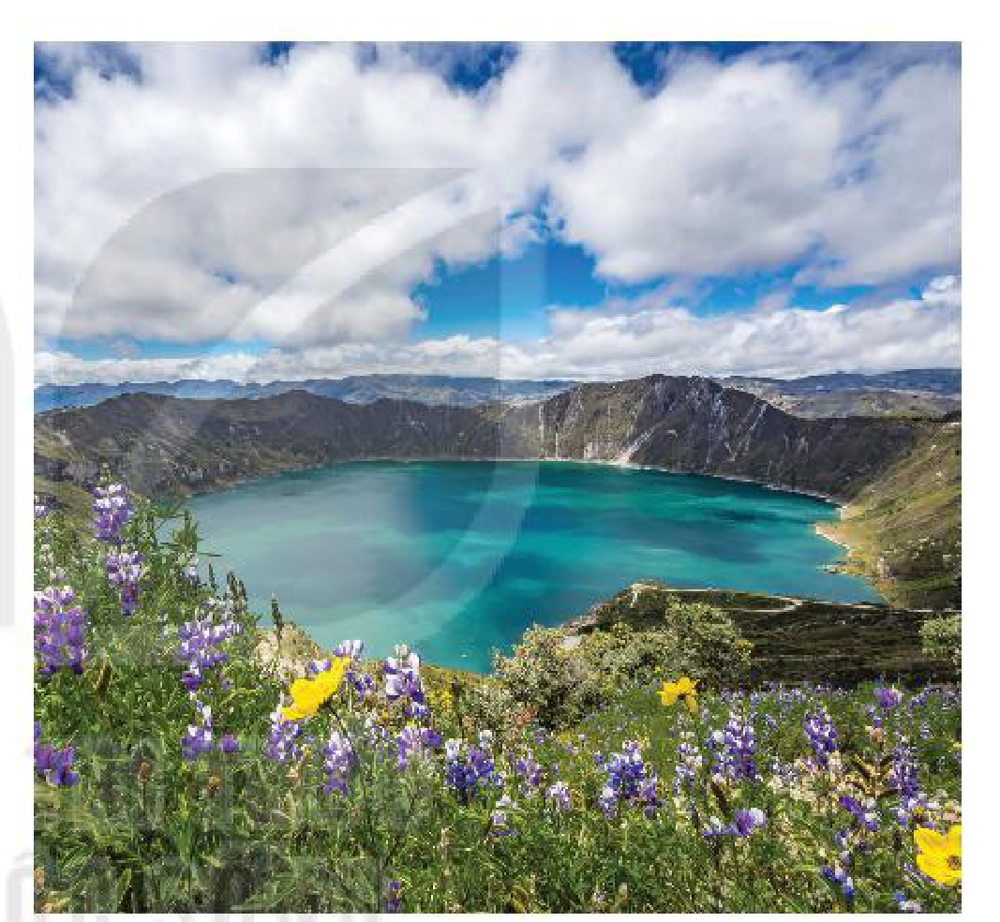
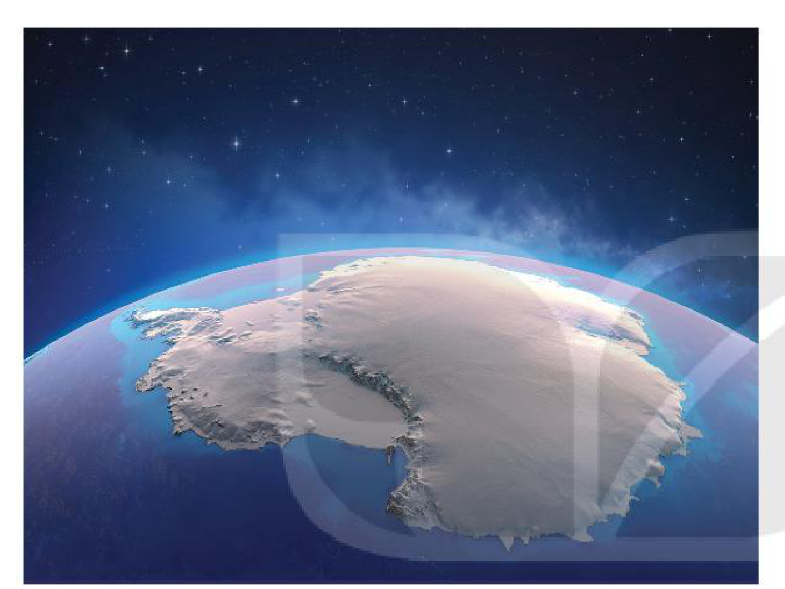

<!-- pdf:38 -->

# BÀI 11: THUỶ QUYỂN, NƯỚC TRÊN LỤC ĐỊA

## 🔴 Mở đầu

<!-- term: Nước ngầm -->
<!-- term: Thuỷ quyển -->
Nước là vật chất tiên quyết để sự sống phát sinh và phát triển. Nước trên Trái Đất tồn tại dưới những dạng nào và có ở những đâu?

## 1. Khái niệm thuỷ quyển

<!-- term: Nước ngầm -->
<!-- term: Thuỷ quyển -->
Thuỷ quyển là toàn bộ lớp nước bao quanh Trái Đất, phân bố trong các đại dương, trên lục địa, trong các lớp đất đá, trong khí quyển và cả trong cơ thể sinh vật.

<!-- term: Nước ngầm -->
<!-- term: Nước băng tuyết và sông băng -->
<!-- term: Các nhân tố ảnh hưởng đến chế độ nước sông -->
<!-- term: Thuỷ quyển -->
Mỗi bộ phận của thuỷ quyển đều có vai trò quan trọng. Nước trong đại dương và nước băng tuyết giữ ổn định nhiệt độ của bề mặt Trái Đất. Lượng nước ngọt trong khí quyển và trên lục địa tuy chiếm tỉ lệ rất nhỏ nhưng giúp duy trì sự sống trên đất liền.

> ❓ Dựa vào thông tin trong mục 1, hãy nêu khái niệm thuỷ quyển.

## 2. Nước trên lục địa

### a) Các nhân tố ảnh hưởng đến chế độ nước sông

<!-- term: Nước ngầm -->
<!-- term: Nước băng tuyết và sông băng -->
<!-- term: Các nhân tố ảnh hưởng đến chế độ nước sông -->
<!-- term: Thuỷ quyển -->
<!-- term: Sông -->
Sông là dòng chảy thường xuyên, tương đối lớn trên bề mặt lục địa và đảo, được các nguồn nước mưa, nước ngầm, nước băng tuyết tan nuôi dưỡng.

<!-- term: Nước ngầm -->
<!-- term: Các nhân tố ảnh hưởng đến chế độ nước sông -->
<!-- term: Thuỷ quyển -->
<!-- term: Chế độ nước sông -->
Sự thay đổi của lưu lượng nước sông có tính chu kì trong năm gọi là chế độ nước. Chế độ nước chịu ảnh hưởng chủ yếu bởi các đặc điểm địa lí tự nhiên của nguồn cung cấp và bề mặt lưu vực.

<!-- term: Nước ngầm -->
<!-- term: Các nhân tố ảnh hưởng đến chế độ nước sông -->
- Ảnh hưởng của nguồn cấp nước

<!-- term: Nước ngầm -->
<!-- term: Các nhân tố ảnh hưởng đến chế độ nước sông -->
<!-- term: Thuỷ quyển -->
Sông được cấp nước từ hai nguồn chính: nước ngầm là nguồn cấp ít biến động, có vai trò điều tiết nước trong năm; nước trên mặt (nước mưa, nước băng tuyết tan) là nguồn cấp có biến động rõ rệt theo mùa. Chế độ nước sông phụ thuộc chủ yếu vào chế độ mưa hay băng tuyết tan.

<!-- term: Nước ngầm -->
<!-- term: Các nhân tố ảnh hưởng đến chế độ nước sông -->
Tuỳ thuộc vào số lượng nguồn cấp mà chế độ nước sông là phức tạp (trong năm có nhiều mùa lũ, cạn xen kẽ) hay đơn giản (mỗi năm có một mùa lũ và một mùa cạn).

<!-- term: Nước băng tuyết và sông băng -->
> 💡 Em có biết?
>
> <!-- term: Lưu lượng nước sông -->
> Lưu lượng là lượng nước được chuyển tải qua mặt cắt ngang sông trong thời gian 1 giây (m³/s). Lưu lượng có giá trị tức thời, trung bình trong ngày, tháng, năm và nhiều năm.
>
> <!-- term: Mùa lũ và mùa cạn -->
> Khoảng thời gian trong năm, khi lưu lượng nước sông vượt quá giá trị lưu lượng trung bình năm gọi là mùa lũ, khi lưu lượng nhỏ hơn lưu lượng trung bình năm là mùa cạn.

<!-- pdf:39 -->

<!-- term: Nước ngầm -->
<!-- term: Nước băng tuyết và sông băng -->
<!-- term: Các nhân tố ảnh hưởng đến chế độ nước sông -->
<!-- term: Thuỷ quyển -->
- Ảnh hưởng của đặc điểm bề mặt lưu vực
  + Địa hình: Độ dốc địa hình làm tăng cường độ tập trung lũ. Ở sườn đón gió, sông thường có lượng nước cấp trên mặt dồi dào hơn so với ở sườn khuất gió.
  + Hồ đầm và thực vật có tác dụng điều tiết dòng chảy. Chúng giữ lại trên lưu vực một phần nước mưa hay nước băng tuyết tan, làm giảm lũ. Lượng nước giữ lại sau đó sẽ chảy từ hồ ra hoặc thấm từ nước ngầm sang cung cấp cho sông.
  + Sự phân bố và số lượng phụ lưu, chi lưu: Nếu các phụ lưu tập trung trên một đoạn sông ngắn, dễ xảy ra tình trạng lũ chồng lũ. Ngược lại, nếu các phụ lưu phân bố đều theo chiều dài dòng chính, mỗi đợt lũ có thể kéo dài hơn nhưng lũ không quá cao. Sông có nhiều chi lưu, nước lũ thoát nhanh, chế độ nước sông sẽ bớt phức tạp.

<!-- term: Các nhân tố ảnh hưởng đến chế độ nước sông -->
> ❓ Đọc thông tin trong mục a, hãy phân tích các nhân tố ảnh hưởng đến chế độ nước sông.

### b) Hồ

<!-- term: Nước ngầm -->
<!-- term: Các nhân tố ảnh hưởng đến chế độ nước sông -->
<!-- term: Thuỷ quyển -->
<!-- term: Hồ -->
Hồ là những vùng trũng chứa nước trên bề mặt Trái Đất, không trực tiếp thông với biển.

<!-- term: Phân loại hồ theo nguồn gốc hình thành -->
Theo nguồn gốc hình thành, hồ bao gồm các loại:

<!-- term: Nước ngầm -->
<!-- term: Phân loại hồ theo nguồn gốc hình thành -->
- Hồ núi lửa: có nguồn gốc từ hoạt động của núi lửa. Các hồ núi lửa thường hình thành ở miệng núi lửa đã tắt và khá sâu.
- Hồ kiến tạo: hình thành tại các nơi lún sụt, nứt vỡ trên mặt đất do các mảng kiến tạo di chuyển, như hồ Bai-can (Liên bang Nga). Các hồ này thường dài và sâu.
- Hồ móng ngựa: hình thành tại các khúc uốn sông bị tách ra khỏi dòng chính, sau khi chuyển dòng. Hồ dạng này thường nông, có dạng cong, như Hồ Tây (Hà Nội).

<!-- term: Phân loại hồ theo nguồn gốc hình thành -->
*Hình 11.1. Hồ núi lửa Qui-lo-toa (Ê-cu-a-đo)*

<!-- term: Phân loại hồ theo nguồn gốc hình thành -->
*Mô tả hình:* Ảnh chụp hồ núi lửa Qui-lo-toa ở Ê-cu-a-đo với mặt nước màu xanh ngọc bích nằm sâu trong miệng núi lửa hình phễu đã tắt, bao quanh là vách núi dốc và thảm cỏ hoa dại ở tiền cảnh.
<!-- ocr-ok: mô tả hình ảnh bổ trợ không phải chữ in trực tiếp trong sách -->

<!-- term: Phân loại hồ theo nguồn gốc hình thành -->
- Hồ băng hà: Trong quá trình di chuyển, các khối đá do sông băng cổ mang theo đã bào lõm mặt đất bên dưới. Về sau, khi sông băng không còn, các hố lõm trở thành lòng hồ, như hệ thống Ngũ Hồ (ở biên giới Hoa Kỳ và Ca-na-đa).
- Hồ nhân tạo: hồ do con người tạo nên, với các mục đích khác nhau như hồ thuỷ điện, hồ thuỷ lợi, hồ cảnh quan,...

<!-- term: Phân loại hồ theo nguồn gốc hình thành -->
> 💡 Em có biết?
>
> Hồ thuỷ điện lớn nhất thế giới là đập Tam Hiệp, trên sông Trường Giang, Trung Quốc. Hồ dài 660 km, rộng 1,12 km, thể tích 39,3 km³ và tổng diện tích mặt nước 1 045 km².
<!-- ocr-ok: hộp Em có biết bị OCR trộn lẫn hai cột, đã đối chiếu chính xác với trang PDF 39 -->

<!-- term: Phân loại hồ theo nguồn gốc hình thành -->
> ❓ Dựa vào thông tin trong mục b, hãy phân biệt các loại hồ theo nguồn gốc hình thành.

<!-- pdf:40 -->

### c) Nước băng tuyết

<!-- term: Nước ngầm -->
<!-- term: Phân loại hồ theo nguồn gốc hình thành -->
<!-- term: Các nhân tố ảnh hưởng đến chế độ nước sông -->
<!-- term: Thuỷ quyển -->
<!-- term: Nước băng tuyết và sông băng -->
Khi nhiệt độ xuống dưới 0°C, mưa chuyển từ trạng thái lỏng sang xốp là tuyết. Nếu lượng tuyết tan ra hằng năm ít hơn lượng tuyết rơi xuống, tuyết sẽ tích đọng lại và bị nén thành băng. Sau hàng trăm, thậm chí hàng nghìn năm, khi độ dày đạt trên 30 m, trọng lực sẽ khiến băng có thể tự dịch chuyển từ vài cm đến 30 m/ngày, tạo thành sông băng. Sông băng có quy mô rất lớn so với sông bình thường, là một trong các nhân tố thành tạo, biến đổi địa hình những nơi nó di chuyển qua. Khi nhiệt độ tăng, băng tuyết tan ra và tạo nên mùa lũ cho các con sông trong vùng.

<!-- term: Nước băng tuyết và sông băng -->
<!-- term: Thuỷ quyển -->
Băng tuyết khá phổ biến ở vùng hàn đới, ôn đới và trên các vùng núi cao. Hơn 90% lượng băng trên Trái Đất nằm ở vùng cực Bắc và cực Nam.

<!-- term: Nước băng tuyết và sông băng -->
<!-- term: Thuỷ quyển -->
*Hình 11.2. Lục địa Nam Cực bị sông băng che phủ gần như toàn bộ*

<!-- term: Nước băng tuyết và sông băng -->
<!-- term: Thuỷ quyển -->
*Mô tả hình:* Ảnh mô phỏng nhìn từ vũ trụ thể hiện lục địa Nam Cực được bao phủ gần như hoàn toàn bởi lớp băng tuyết dày màu trắng sáng nổi bật trên nền đại dương xanh thẫm.
<!-- ocr-ok: mô tả hình ảnh bổ trợ không phải chữ in trực tiếp trong sách -->

<!-- term: Nước băng tuyết và sông băng -->
> 💡 Em có biết?
>
> Các khối băng lớn thường có màu xanh, vì bị nén mất hết bọt khí, chỉ hấp thụ dải sáng có bước sóng xanh. Đảo Grơn-len lớn nhất thế giới, bị sông băng che phủ 81% diện tích, luôn có màu xanh da trời.

<!-- term: Các nhân tố ảnh hưởng đến chế độ nước sông -->
<!-- term: Thuỷ quyển -->
> ❓ Đọc thông tin trong mục c, hãy trình bày đặc điểm chủ yếu của nước băng tuyết.

### d) Nước ngầm

<!-- term: Các nhân tố ảnh hưởng đến chế độ nước sông -->
<!-- term: Thuỷ quyển -->
<!-- term: Nước ngầm -->
Nước ngầm tồn tại ở dưới bề mặt đất. Nước ngầm do nước trên mặt (nước mưa, băng tuyết tan, sông, hồ) thấm xuống.

<!-- term: Nước ngầm -->
<!-- term: Nước băng tuyết và sông băng -->
<!-- term: Các nhân tố ảnh hưởng đến chế độ nước sông -->
<!-- term: Thuỷ quyển -->
Mực nước ngầm và lượng nước ngầm phụ thuộc vào nguồn cung cấp nước, đặc điểm địa hình (dốc hay bằng phẳng), khả năng thấm nước của đất đá, mức độ bốc hơi và lớp phủ thực vật. Tại các vùng ẩm ướt, đất đá dễ thấm hút, nước ngầm dồi dào và nằm khá nông, thậm chí sát mặt đất. Tại các vùng khô hạn, nước ngầm có thể nằm dưới sâu vài chục hay hàng trăm mét.

<!-- term: Nước ngầm -->
Trong nước ngầm có hàm lượng các chất khoáng nhất định. Thành phần và hàm lượng các chất khoáng thay đổi tuỳ khu vực, phụ thuộc vào tính chất đất đá.

<!-- term: Nước ngầm -->
<!-- term: Phân loại hồ theo nguồn gốc hình thành -->
> 💡 Em có biết?
>
> <!-- term: Vết lộ nước ngầm -->
> Nơi nước ngầm thoát lên mặt đất gọi là vết lộ. Một số nơi trên hoang mạc có các vết lộ với lượng nước thoát ra khá lớn, tạo ra các ốc đảo xanh tươi, tương phản với cảnh quan khô cằn xung quanh.

<!-- pdf:41 -->

<!-- term: Giải pháp bảo vệ nguồn nước ngọt -->
<!-- term: Nước ngầm -->
<!-- term: Các nhân tố ảnh hưởng đến chế độ nước sông -->
<!-- term: Thuỷ quyển -->
Nước ngầm có vai trò quan trọng đối với tự nhiên và kinh tế – xã hội. Đây là nguồn nước ngọt quan trọng của con người trong sinh hoạt và sản xuất, nguồn cấp nước cho sông, hồ đầm vào mùa khô; tầng nước ngầm có vai trò cố định các lớp đất đá để chống sụt lún.

<!-- term: Giải pháp bảo vệ nguồn nước ngọt -->
<!-- term: Nước ngầm -->
Việc khai thác và sử dụng nước ngầm không hợp lí dẫn tới tình trạng suy giảm lượng nước ngầm. Hiện nay, việc chôn lấp, xử lí rác thải không đúng cách ở nhiều nơi đã làm ô nhiễm nguồn nước ngầm.

<!-- term: Các nhân tố ảnh hưởng đến chế độ nước sông -->
> ❓ Đọc thông tin trong mục d, hãy trình bày đặc điểm chủ yếu của nước ngầm.

### e) Các giải pháp bảo vệ nguồn nước ngọt

<!-- term: Giải pháp bảo vệ nguồn nước ngọt -->
<!-- term: Nước ngầm -->
<!-- term: Thuỷ quyển -->
Các nguồn nước ngọt trên Trái Đất đang bị suy giảm do nhiều nguyên nhân. Bảo vệ nguồn nước ngọt là yêu cầu cấp thiết hiện nay của tất cả các quốc gia trên thế giới.

<!-- term: Nước ngầm -->
<!-- term: Giải pháp bảo vệ nguồn nước ngọt -->
Các giải pháp chủ yếu bảo vệ nguồn nước ngọt là:

<!-- term: Giải pháp bảo vệ nguồn nước ngọt -->
<!-- term: Nước ngầm -->
- Sử dụng nguồn nước ngọt một cách hiệu quả, tiết kiệm và tránh lãng phí.
- Giữ sạch nguồn nước, tránh ô nhiễm nguồn nước ngọt.
- Phân phối lại nguồn nước ngọt trên thế giới.

<!-- term: Giải pháp bảo vệ nguồn nước ngọt -->
> 💡 Em có biết?
>
> Từ năm 1993, Liên hợp quốc đã lấy ngày 22 – 3 hằng năm làm Ngày Nước Thế giới. Mỗi năm sẽ có một chủ đề khác nhau nhằm nâng cao nhận thức, trách nhiệm của các quốc gia trong việc bảo vệ tài nguyên nước.

<!-- term: Giải pháp bảo vệ nguồn nước ngọt -->
<!-- term: Nước ngầm -->
> ❓ Dựa vào thông tin trong mục e, hãy nêu các giải pháp để bảo vệ nguồn nước ngọt.

## ✏️ Luyện tập

<!-- term: Giải pháp bảo vệ nguồn nước ngọt -->
<!-- term: Nước ngầm -->
<!-- term: Các nhân tố ảnh hưởng đến chế độ nước sông -->
1. Lập sơ đồ thể hiện các nhân tố ảnh hưởng đến chế độ nước sông.
2. Tại sao bảo vệ nguồn nước ngọt là yêu cầu cấp bách của tất cả các quốc gia trên thế giới hiện nay?

## 🚀 Vận dụng

Chọn một trong hai nhiệm vụ sau:

<!-- term: Giải pháp bảo vệ nguồn nước ngọt -->
1. Tìm hiểu về một con sông hoặc hồ lớn trên thế giới.
2. Tìm hiểu tình trạng ô nhiễm nguồn nước ở địa phương em.

## 📷 Danh sách hình trong bài

<!-- term: Nước băng tuyết và sông băng -->
<!-- term: Phân loại hồ theo nguồn gốc hình thành -->
<!-- term: Thuỷ quyển -->
| Mã hình | Trang PDF | Vị trí trong bài | Chú thích gốc |
| --- | --- | --- | --- |
| H10-dia-b11-01 | 39 | Mục 2.b | Hình 11.1. Hồ núi lửa Qui-lo-toa (Ê-cu-a-đo) |
| H10-dia-b11-02 | 40 | Mục 2.c | Hình 11.2. Lục địa Nam Cực bị sông băng che phủ gần như toàn bộ |
<!-- ocr-ok: bảng danh mục hình tổng hợp cuối bài -->
