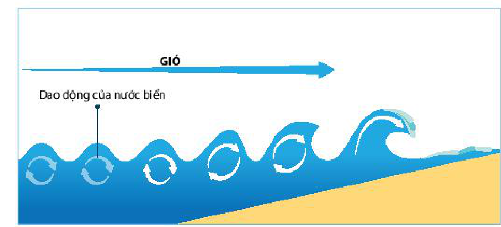
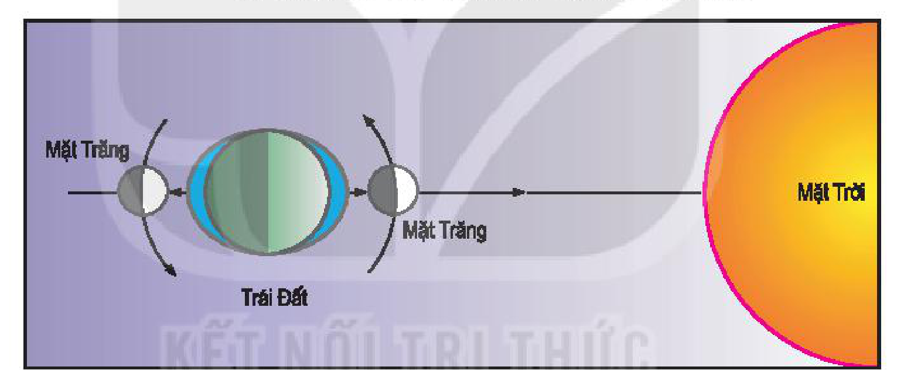
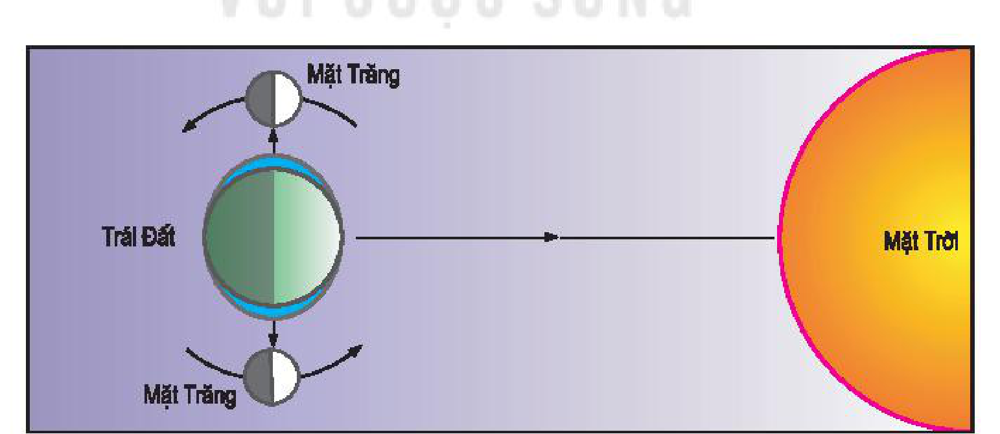
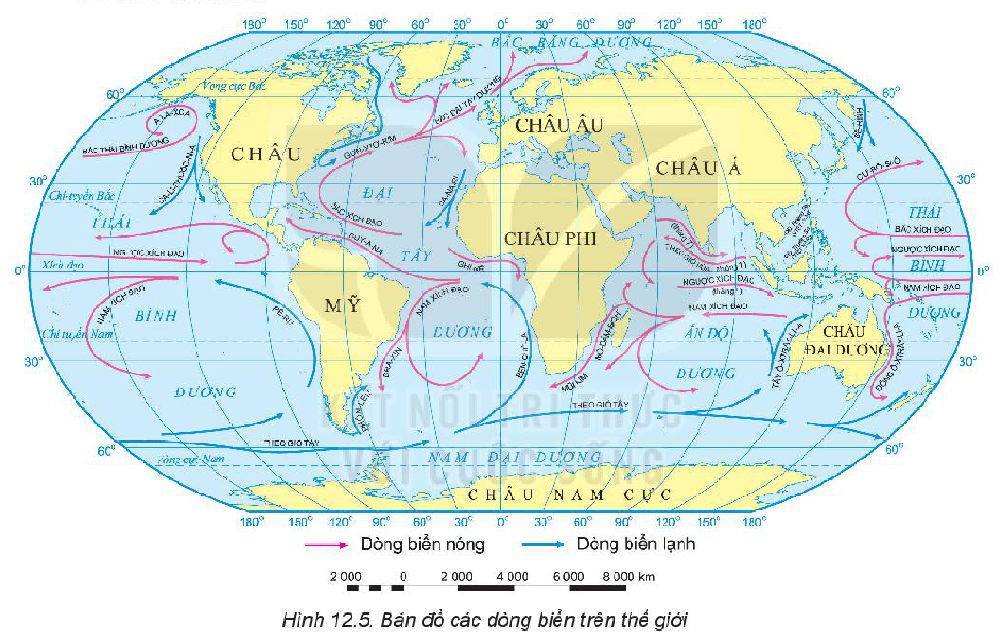

<!-- pdf:42 -->

# BÀI 12: NƯỚC BIỂN VÀ ĐẠI DƯƠNG

## 🔴 Mở đầu

<!-- term: Vai trò của biển và đại dương -->
<!-- term: Dòng biển nóng và dòng biển lạnh -->
<!-- term: Dòng biển -->
<!-- term: Chế độ nhiệt của nước biển -->
<!-- term: Độ muối của nước biển -->
Trong thuỷ quyển, nước biển và đại dương chiếm 97,5% tổng lượng nước. Biển và đại dương có tầm quan trọng đặc biệt đối với sự sống và các hoạt động kinh tế của con người. Nước biển và đại dương có những tính chất gì? Trong biển và đại dương diễn ra những vận động nào?

## 1. Tính chất của nước biển và đại dương

### a) Độ muối

<!-- term: Chế độ nhiệt của nước biển -->
<!-- term: Độ muối của nước biển -->
Nước biển có nhiều chất hoà tan, nhiều nhất là các muối khoáng. Độ muối trung bình của nước biển là 35‰. Độ muối tăng hay giảm phụ thuộc vào lượng bốc hơi, lượng mưa và lượng nước sông đổ vào (ví dụ: Biển Đỏ có độ muối đạt tới 43‰, trong khi biển Ban-tích có độ muối chỉ dưới 10‰).

<!-- term: Dòng biển nóng và dòng biển lạnh -->
<!-- term: Chế độ nhiệt của nước biển -->
<!-- term: Độ muối của nước biển -->
Độ muối còn thay đổi theo vĩ độ: vùng Xích đạo độ muối là 34,5‰, vùng chí tuyến độ muối là 36,8‰, vùng ôn đới độ muối giảm xuống 35‰, vùng gần cực độ muối chỉ còn 34‰.

<!-- term: Chế độ nhiệt của nước biển -->
<!-- term: Độ muối của nước biển -->
Độ muối cũng thay đổi khá phức tạp theo độ sâu, tuỳ thuộc vào các điều kiện khí tượng, thuỷ văn.

### b) Nhiệt độ

<!-- term: Vai trò của biển và đại dương -->
<!-- term: Dòng biển nóng và dòng biển lạnh -->
<!-- term: Dòng biển -->
<!-- term: Độ muối của nước biển -->
<!-- term: Chế độ nhiệt của nước biển -->
Chế độ nhiệt của nước biển điều hoà hơn chế độ nhiệt của không khí. Nhiệt độ trung bình bề mặt toàn bộ đại dương thế giới là khoảng 17°C.

<!-- term: Dòng biển nóng và dòng biển lạnh -->
<!-- term: Thuỷ triều -->
<!-- term: Chế độ nhiệt của nước biển -->
<!-- term: Độ muối của nước biển -->
Nhiệt độ nước biển thay đổi theo mùa trong năm, mùa hạ cao hơn mùa đông.

<!-- term: Dòng biển nóng và dòng biển lạnh -->
<!-- term: Thuỷ triều -->
<!-- term: Chế độ nhiệt của nước biển -->
<!-- term: Độ muối của nước biển -->
Nhiệt độ nước biển giảm dần từ Xích đạo về hai cực. Ở đới nóng, nhiệt độ nước biển trung bình là 27 – 28°C, ôn đới là 15 – 16°C, đới lạnh dưới 1°C. Nhiệt độ nước biển cũng thay đổi theo độ sâu.

<!-- term: Vai trò của biển và đại dương -->
<!-- term: Dòng biển nóng và dòng biển lạnh -->
<!-- term: Dòng biển -->
<!-- term: Chế độ nhiệt của nước biển -->
> ❓ Đọc thông tin trong mục 1, hãy trình bày tính chất của nước biển và đại dương.
<!-- ocr-ok: OCR trang 42 bỏ sót dòng câu hỏi cuối mục 1 do màu chữ xanh nhạt -->

## 2. Sóng, thuỷ triều và dòng biển

### a) Sóng biển

<!-- term: Thuỷ triều -->
<!-- term: Chế độ nhiệt của nước biển -->
<!-- term: Sóng biển -->
Sóng biển là sự dao động của nước biển theo chiều thẳng đứng. Sóng phát sinh chủ yếu là do gió. Gió càng mạnh, sóng càng lớn.

*Hình 12.1. Sơ đồ sự hình thành sóng biển*

*Mô tả hình:* Sơ đồ cắt dọc mặt nước biển cho thấy mũi tên hướng gió thổi ngang trên mặt biển làm các phần tử nước biển dao động theo quỹ đạo tròn chiều thẳng đứng tạo thành các ngọn sóng nhấp nhô tiến vào bờ.
<!-- ocr-ok: mô tả hình ảnh bổ trợ không phải chữ in trực tiếp trong sách -->

*Hình 12.2. Sóng biển*

*Mô tả hình:* Ảnh chụp thực tế các đợt sóng biển tung bọt trắng xoá khi xô vào vùng nước nông ven bờ.
<!-- ocr-ok: mô tả hình ảnh bổ trợ không phải chữ in trực tiếp trong sách -->

<!-- pdf:43 -->

<!-- term: Vai trò của biển và đại dương -->
<!-- term: Sóng thần -->
Các hoạt động động đất, núi lửa lớn dưới đáy biển tạo nên một dạng sóng dài đặc biệt, lan truyền theo phương ngang, với tốc độ lớn, vào đến bờ có thể cao trên 20 m, gọi là sóng thần, một dạng thảm hoạ thiên nhiên tàn khốc.

> ❓ Dựa vào thông tin trong mục a và hình 12.1, 12.2, hãy giải thích hiện tượng sóng biển.

### b) Thuỷ triều

<!-- term: Vai trò của biển và đại dương -->
<!-- term: Thuỷ triều -->
Thuỷ triều là hiện tượng nước biển dâng cao và hạ thấp theo quy luật hằng ngày.

<!-- term: Vai trò của biển và đại dương -->
<!-- term: Dòng biển -->
<!-- term: Thuỷ triều -->
Nguyên nhân chủ yếu sinh ra thuỷ triều là do lực hấp dẫn của Mặt Trăng và Mặt Trời cùng với lực li tâm của Trái Đất.

<!-- term: Dòng biển nóng và dòng biển lạnh -->
<!-- term: Thuỷ triều -->
<!-- term: Chế độ nhiệt của nước biển -->
<!-- term: Độ muối của nước biển -->
<!-- term: Triều cường và triều kém -->
Thuỷ triều lên xuống với biên độ thay đổi theo không gian và thời gian. Trong mỗi tháng âm lịch, khi ba thiên thể Mặt Trời, Mặt Trăng, Trái Đất thẳng hàng, biên độ nước dâng lớn, gọi là triều cường. Khi ba thiên thể nằm trên hai đường vuông góc, biên độ nước dâng nhỏ, gọi là triều kém.

<!-- term: Thuỷ triều -->
Thuỷ triều còn chịu tác động của các nhân tố khác như sự thay đổi khí áp, hình dạng bờ biển,...

> 💡 Em có biết?
>
> <!-- term: Bán nhật triều và nhật triều -->
> Có hai chế độ triều phổ biến là:
> - Bán nhật triều: mỗi ngày có hai lần nước dâng, hai lần nước rút.
> - Nhật triều: mỗi ngày một lần nước dâng, một lần nước rút.

<!-- term: Thuỷ triều -->
*Hình 12.3. Vị trí của Mặt Trăng, Trái Đất và Mặt Trời vào các ngày “triều cường” (lực tạo triều lớn nhất)*

<!-- term: Thuỷ triều -->
*Mô tả hình:* Sơ đồ minh hoạ Mặt Trăng (ở vị trí không trăng hoặc trăng tròn), Trái Đất và Mặt Trời nằm trên cùng một đường thẳng, lớp nước thuỷ triều bao quanh Trái Đất phình to về hai phía đối diện tạo biên độ triều lớn nhất.
<!-- ocr-ok: mô tả hình ảnh bổ trợ không phải chữ in trực tiếp trong sách -->

<!-- term: Thuỷ triều -->
*Hình 12.4. Vị trí của Mặt Trăng, Trái Đất và Mặt Trời vào các ngày “triều kém” (lực tạo triều nhỏ nhất)*

<!-- term: Thuỷ triều -->
*Mô tả hình:* Sơ đồ minh hoạ Mặt Trăng (ở vị trí trăng khuyết đầu tháng hoặc cuối tháng) tạo với Trái Đất và Mặt Trời hai đường vuông góc, làm lực tạo triều phân tán khiến biên độ triều nhỏ nhất.
<!-- ocr-ok: mô tả hình ảnh bổ trợ không phải chữ in trực tiếp trong sách -->

<!-- term: Thuỷ triều -->
> ❓ Dựa vào thông tin trong mục b và các hình 12.3, 12.4, hãy:
> - Giải thích hiện tượng thuỷ triều.
> - Cho biết khi dao động thuỷ triều có biên độ lớn nhất và nhỏ nhất thì ở Trái Đất thấy hình dạng Mặt Trăng như thế nào.

<!-- pdf:44 -->

### c) Dòng biển

<!-- term: Vai trò của biển và đại dương -->
<!-- term: Dòng biển nóng và dòng biển lạnh -->
<!-- term: Thuỷ triều -->
<!-- term: Chế độ nhiệt của nước biển -->
<!-- term: Dòng biển -->
Dòng biển là các dòng nước chảy trong biển và đại dương. Các dòng biển sinh ra chủ yếu do các loại gió thường xuyên hoặc sự chênh lệch nhiệt độ, độ muối,... giữa các vùng biển khác nhau.

<!-- term: Dòng biển -->
<!-- term: Chế độ nhiệt của nước biển -->
<!-- term: Dòng biển nóng và dòng biển lạnh -->
Có hai loại dòng biển: dòng biển nóng và dòng biển lạnh. Dòng biển được gọi là nóng hay lạnh tuỳ theo tương quan với nhiệt độ nước biển xung quanh.

<!-- term: Dòng biển nóng và dòng biển lạnh -->
<!-- term: Dòng biển -->
Dòng biển nóng xuất phát từ vùng vĩ độ thấp chảy về vùng vĩ độ cao.

<!-- term: Dòng biển nóng và dòng biển lạnh -->
Dòng biển lạnh xuất phát từ vùng vĩ độ cao chảy về vùng vĩ độ thấp.

<!-- term: Dòng biển nóng và dòng biển lạnh -->
<!-- term: Dòng biển -->
<!-- term: Chế độ nhiệt của nước biển -->
Ở vùng gió mùa hoạt động thường xuyên, xuất hiện các dòng biển thay đổi tính chất và đổi chiều theo mùa.

<!-- term: Vai trò của biển và đại dương -->
<!-- term: Dòng biển nóng và dòng biển lạnh -->
<!-- term: Dòng biển -->
<!-- term: Chế độ nhiệt của nước biển -->
> 💡 Em có biết?
>
> Dòng biển giúp phân bố lại nhiệt trên bề mặt Trái Đất, điều hoà khí hậu. Nơi dòng biển nóng, lạnh giao nhau, tập trung nguồn hải sản rất lớn.
<!-- ocr-ok: hộp Em có biết bị OCR trộn lẫn hai cột, đã đối chiếu chính xác với trang PDF 44 -->

<!-- term: Dòng biển nóng và dòng biển lạnh -->
<!-- term: Dòng biển -->
*Hình 12.5. Bản đồ các dòng biển trên thế giới*

<!-- term: Dòng biển nóng và dòng biển lạnh -->
<!-- term: Dòng biển -->
<!-- term: Chế độ nhiệt của nước biển -->
*Mô tả hình:* Bản đồ thế giới thể hiện hệ thống các dòng biển nóng (mũi tên màu đỏ, như dòng Gơn-xtơ-rim, Cu-rô-si-ô, Bra-xin, Đông Ô-xtrây-li-a, Bắc Xích đạo, Nam Xích đạo) và các dòng biển lạnh (mũi tên màu xanh, như dòng Ca-li-phoóc-ni-a, Pê-ru, Ca-na-ri, Ben-ghê-la, Tây Ô-xtrây-li-a, dòng biển Theo gió Tây) trong các đại dương.
<!-- ocr-ok: mô tả hình ảnh bổ trợ không phải chữ in trực tiếp trong sách -->

<!-- term: Dòng biển nóng và dòng biển lạnh -->
<!-- term: Dòng biển -->
> ❓ Dựa vào thông tin trong mục c, hình 12.5, hãy:
> - Trình bày chuyển động của các dòng biển trong đại dương.
> - Kể tên một số dòng biển trong các đại dương.

## 3. Vai trò của biển và đại dương đối với phát triển kinh tế – xã hội

<!-- term: Dòng biển -->
<!-- term: Vai trò của biển và đại dương -->
Biển và đại dương có vai trò to lớn đối với phát triển kinh tế – xã hội, đặc biệt là trong thời đại ngày nay:

<!-- term: Vai trò của biển và đại dương -->
<!-- term: Dòng biển -->
- Biển và đại dương cung cấp nguồn tài nguyên quý giá: tài nguyên sinh vật biển; tài nguyên khoáng sản biển (dầu mỏ, khí thiên nhiên, muối biển,...); năng lượng sóng biển, thuỷ triều,...

<!-- pdf:45 -->

<!-- term: Vai trò của biển và đại dương -->
<!-- term: Dòng biển -->
<!-- term: Chế độ nhiệt của nước biển -->
- Biển và đại dương là môi trường cho các hoạt động kinh tế – xã hội: đánh bắt và nuôi trồng thuỷ sản, giao thông vận tải biển, du lịch biển,...
- Biển và đại dương góp phần điều hoà khí hậu, đảm bảo sự đa dạng sinh học.

<!-- term: Vai trò của biển và đại dương -->
<!-- term: Dòng biển -->
Tuy nhiên, tài nguyên biển là có hạn và dễ bị tổn thương. Vì vậy, con người cần khai thác biển và đại dương một cách hợp lí và bền vững.

<!-- term: Vai trò của biển và đại dương -->
<!-- term: Dòng biển -->
> ❓ Đọc thông tin trong mục 3, hãy nêu vai trò của biển và đại dương đối với phát triển kinh tế – xã hội.

## ✏️ Luyện tập

<!-- term: Vai trò của biển và đại dương -->
<!-- term: Dòng biển nóng và dòng biển lạnh -->
<!-- term: Dòng biển -->
<!-- term: Thuỷ triều -->
<!-- term: Chế độ nhiệt của nước biển -->
1. Giải thích sự khác biệt về nhiệt độ và độ muối của các biển và đại dương.
2. Phân biệt ba dạng vận động của nước biển: sóng, thuỷ triều, dòng biển.

## 🚀 Vận dụng

<!-- term: Vai trò của biển và đại dương -->
- Tìm hiểu thông tin, cho biết vai trò của biển đối với kinh tế – xã hội nước ta.

## 📷 Danh sách hình trong bài

<!-- term: Dòng biển nóng và dòng biển lạnh -->
<!-- term: Dòng biển -->
<!-- term: Thuỷ triều -->
| Mã hình | Trang PDF | Vị trí trong bài | Chú thích gốc |
| --- | --- | --- | --- |
| H10-dia-b12-01 | 42 | Mục 2.a | Hình 12.1. Sơ đồ sự hình thành sóng biển |
| H10-dia-b12-02 | 42 | Mục 2.a | Hình 12.2. Sóng biển |
| H10-dia-b12-03 | 43 | Mục 2.b | Hình 12.3. Vị trí của Mặt Trăng, Trái Đất và Mặt Trời vào các ngày “triều cường” (lực tạo triều lớn nhất) |
| H10-dia-b12-04 | 43 | Mục 2.b | Hình 12.4. Vị trí của Mặt Trăng, Trái Đất và Mặt Trời vào các ngày “triều kém” (lực tạo triều nhỏ nhất) |
| H10-dia-b12-05 | 44 | Mục 2.c | Hình 12.5. Bản đồ các dòng biển trên thế giới |
<!-- ocr-ok: bảng danh mục hình tổng hợp cuối bài -->
