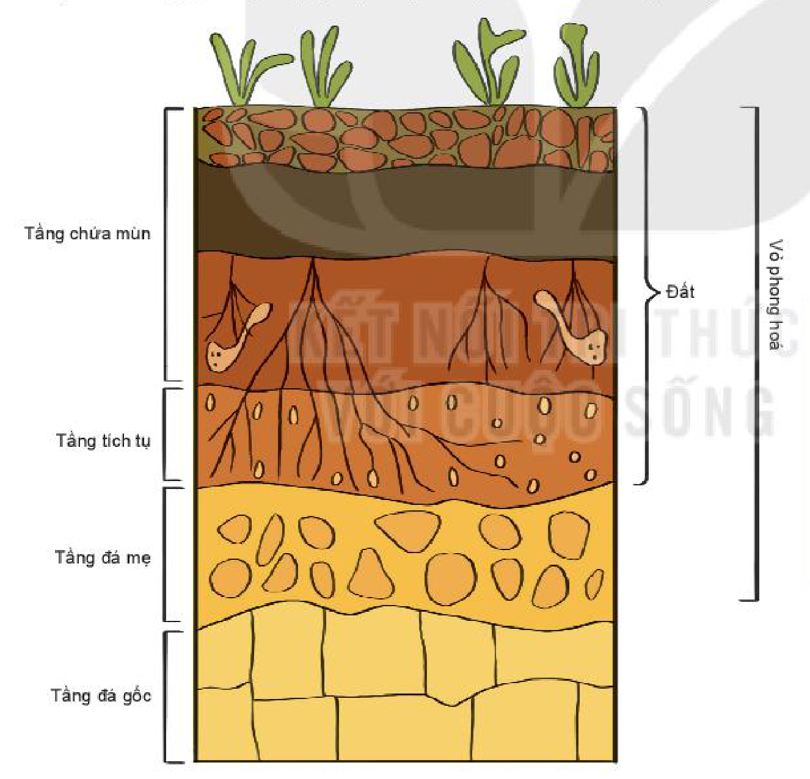
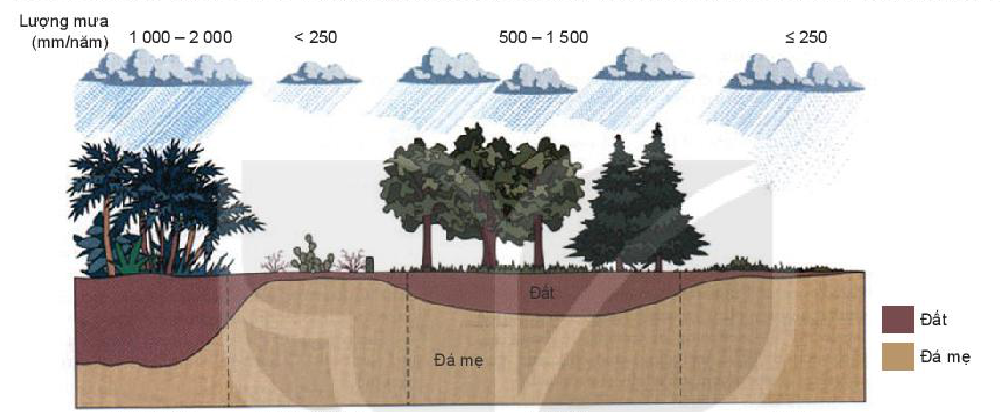

<!-- pdf:46 -->

# BÀI 14: ĐẤT TRÊN TRÁI ĐẤT

## 🔴 Mở đầu

<!-- term: Các nhân tố hình thành đất -->
Đất là một trong những thành phần cấu tạo nên vỏ Trái Đất. Đất có vai trò quan trọng đối với sự sống, là nền tảng cho hầu hết các loài thực vật tồn tại và phát triển. Đất được hình thành như thế nào? Những nhân tố nào tham gia vào quá trình hình thành đất?

## 1. Khái niệm đất và vỏ phong hoá

<!-- term: Các nhân tố hình thành đất -->
<!-- term: Đất -->
Đất là lớp vật chất mỏng bao phủ bề mặt các lục địa và đảo, được tạo thành do quá trình phong hoá các loại đá. Đất được cấu tạo bởi các thành phần chính bao gồm chất khoáng, chất hữu cơ, không khí và nước. Đặc trưng cơ bản của đất là độ phì.

<!-- term: Các nhân tố hình thành đất -->
<!-- term: Độ phì của đất -->
Độ phì là khả năng đất cung cấp nước, các chất dinh dưỡng và các yếu tố khác (như nhiệt, khí,...), giúp thực vật sinh trưởng và phát triển.

*Hình 14.1. Phẫu diện đất và vỏ phong hoá*

<!-- term: Các nhân tố hình thành đất -->
*Mô tả hình:* Sơ đồ mặt cắt thẳng đứng của phẫu diện đất và vỏ phong hoá từ trên xuống dưới gồm: Tầng chứa mùn và Tầng tích tụ (hợp thành lớp Đất), tiếp đến là Tầng đá mẹ (cùng với lớp Đất hợp thành Vỏ phong hoá), và dưới cùng là Tầng đá gốc.
<!-- ocr-ok: mô tả hình ảnh bổ trợ không phải chữ in trực tiếp trong sách -->

<!-- term: Các nhân tố hình thành đất -->
> 💡 Em có biết?
>
> <!-- term: Phẫu diện đất -->
> Phẫu diện đất là một mặt cắt thẳng đứng của đất, có các tầng đất khác nhau. Mỗi tầng đất có quá trình hình thành khác nhau, tính chất đất cũng khác nhau về màu sắc, vật liệu, độ phì,...

<!-- term: Vỏ phong hoá -->
Vỏ phong hoá là sản phẩm phong hoá của đá gốc, phần trên cùng của vỏ Trái Đất, chịu ảnh hưởng của nhiều yếu tố bên ngoài, có cấu trúc phân tầng theo chiều thẳng đứng.

> ❓ Dựa vào hình 14.1 và thông tin trong mục 1, hãy:
> - Trình bày khái niệm về đất.
> - Nêu sự khác nhau giữa lớp vỏ phong hoá và đất.

<!-- pdf:47 -->

## 2. Các nhân tố hình thành đất

<!-- term: Các nhân tố hình thành đất -->
Bất kì loại đất tự nhiên nào trên Trái Đất cũng được hình thành bởi các nhân tố: đá mẹ, khí hậu, địa hình, sinh vật và thời gian. Tuỳ vào điều kiện hình thành mà mỗi nhân tố có sự tác động mạnh, yếu khác nhau, tạo nên các loại đất khác nhau về tính chất, thành phần và giá trị sử dụng.

<!-- term: Các nhân tố hình thành đất -->
<!-- term: Đá mẹ -->
- Đá mẹ là nhân tố khởi đầu của quá trình hình thành đất, các đặc tính của đá mẹ như màu sắc, cấu tạo, thành phần khoáng sẽ tác động đến tính chất lí, hoá của đất. Nếu đất được hình thành từ đá mẹ có tính chất chua như granit, thạch anh,... thì đất sẽ chua, nếu đất hình thành trên đá mẹ có tính kiềm như gabrô, badan,... thì đất mang tính kiềm.
- Khí hậu có vai trò rất quan trọng trong quá trình hình thành đất, tác động đến sự phát triển của các nhân tố khác như đá mẹ, địa hình, sinh vật. Hai yếu tố nhiệt độ và lượng mưa của khí hậu có tác động mạnh nhất đến quá trình phong hoá đá và hình thành đất.

<!-- term: Các nhân tố hình thành đất -->
*Hình 14.2. Mối quan hệ giữa sự hình thành đất và khí hậu ở bán cầu Bắc*

<!-- term: Các nhân tố hình thành đất -->
*Mô tả hình:* Sơ đồ cắt ngang thể hiện độ dày tầng đất và đá mẹ thay đổi theo lượng mưa và đới khí hậu ở bán cầu Bắc: vùng Nhiệt đới (lượng mưa 1 000 – 2 000 mm/năm) có tầng đất và đá mẹ rất dày; vùng Hoang mạc (lượng mưa < 250 mm/năm) tầng đất rất mỏng; vùng Ôn đới (lượng mưa 500 – 1 500 mm/năm) tầng đất dày vừa phải; vùng Cực (lượng mưa ≤ 250 mm/năm) tầng đất hầu như không phát triển.
<!-- ocr-ok: mô tả hình ảnh bổ trợ không phải chữ in trực tiếp trong sách -->

<!-- term: Các nhân tố hình thành đất -->
- Địa hình có tác động chủ yếu tới sự phân phối nhiệt độ, độ ẩm và tích tụ vật liệu. Nước chảy theo độ dốc của địa hình làm xói mòn đất, rửa trôi các chất dinh dưỡng trong đất. Ở vùng núi cao, nhiệt độ thấp nên quá trình phong hoá diễn ra chậm, vỏ phong hoá mỏng, sự hình thành đất yếu. Ở những nơi bằng phẳng, quá trình bồi tụ chiếm ưu thế, tầng đất dày.
- Sinh vật tham gia vào quá trình phá huỷ đá. Chất hữu cơ trong đất phụ thuộc rất nhiều vào sự xuất hiện của sinh vật tác động vào quá trình hình thành đất. Xác của sinh vật phân huỷ sẽ cung cấp chất dinh dưỡng cho đất. Ngoài ra, sinh vật còn ngăn chặn xói mòn, rửa trôi đất.
- Thời gian hình thành đất được hiểu là tuổi của đất. Các loại đất tự nhiên đều cần có thời gian để hình thành.

<!-- term: Các nhân tố hình thành đất -->
Con người không tham gia vào quá trình hình thành đất tự nhiên nhưng lại có vai trò rất quan trọng làm biến đổi đất, tạo ra một số loại đất có tính chất bị biến đổi, như đất trồng lúa nước, đất bạc màu, đất xói mòn trơ sỏi đá.

<!-- term: Các nhân tố hình thành đất -->
> ❓ Dựa vào thông tin và hình 14.2 trong mục 2, hãy trình bày các nhân tố hình thành đất.

## ✏️ Luyện tập

<!-- term: Các nhân tố hình thành đất -->
1. Vẽ sơ đồ thể hiện các nhân tố hình thành đất.
2. Tại sao trên Trái Đất có nhiều loại đất khác nhau?

## 🚀 Vận dụng

- Tìm hiểu về một số biện pháp để tăng độ phì, chống ô nhiễm, thoái hoá đất.

## 📷 Danh sách hình trong bài

<!-- term: Các nhân tố hình thành đất -->
| Mã hình | Trang PDF | Vị trí trong bài | Chú thích gốc |
| --- | --- | --- | --- |
| H10-dia-b14-01 | 46 | Mục 1 | Hình 14.1. Phẫu diện đất và vỏ phong hoá |
| H10-dia-b14-02 | 47 | Mục 2 | Hình 14.2. Mối quan hệ giữa sự hình thành đất và khí hậu ở bán cầu Bắc |
<!-- ocr-ok: bảng danh mục hình tổng hợp cuối bài -->
