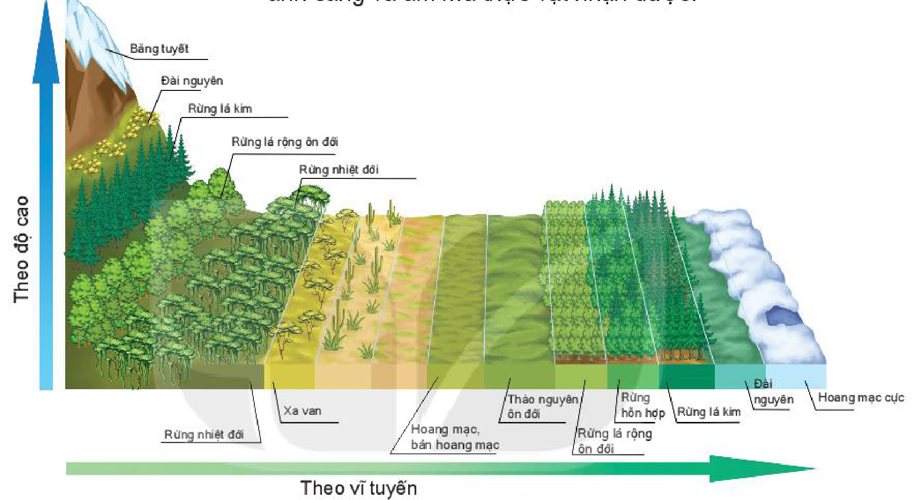

<!-- pdf:48 -->

# BÀI 15: SINH QUYỂN

## 🔴 Mở đầu

<!-- term: Các nhân tố ảnh hưởng đến sự phát triển và phân bố của sinh vật -->
<!-- term: Đặc điểm của sinh quyển -->
Sự sống trên Trái Đất hình thành đã làm thay đổi toàn bộ quá trình phát triển của các thành phần khác trên Trái Đất. Giới sinh vật trên Trái Đất rất đa dạng và phức tạp. Những nhân tố nào tác động đến sự phát triển và phân bố của sinh vật?

## 1. Khái niệm

<!-- term: Các nhân tố ảnh hưởng đến sự phát triển và phân bố của sinh vật -->
<!-- term: Đặc điểm của sinh quyển -->
<!-- term: Sinh quyển -->
Sinh quyển là một trong những bộ phận cấu tạo nên lớp vỏ Trái Đất, nơi có sự sống tồn tại. Giới hạn của sinh quyển phụ thuộc vào sự tồn tại của sự sống. Ranh giới trên cao tiếp xúc với lớp ô-dôn của khí quyển, ranh giới thấp xuống tận đáy sâu của các hố đại dương và dừng lại ở đáy lớp vỏ phong hoá trên đất liền.

<!-- term: Đặc điểm của sinh quyển -->
Như vậy, sinh quyển bao gồm: phần thấp của khí quyển (tầng đối lưu), toàn bộ thuỷ quyển và phần trên của thạch quyển.
<!-- ocr-ok: OCR nhận diện nhầm dấu ở từ quyển, đã đối chiếu chính xác với trang PDF 48 -->

<!-- term: Các nhân tố ảnh hưởng đến sự phát triển và phân bố của sinh vật -->
> ❓ Dựa vào thông tin trong mục 1, hãy cho biết sinh quyển là gì. Nêu phạm vi, giới hạn của sinh quyển.

## 2. Đặc điểm của sinh quyển

<!-- term: Đặc điểm của sinh quyển -->
Sinh quyển có một số đặc điểm cơ bản sau:

<!-- term: Các nhân tố ảnh hưởng đến sự phát triển và phân bố của sinh vật -->
<!-- term: Đặc điểm của sinh quyển -->
- Khối lượng của sinh quyển nhỏ hơn nhiều so với khối lượng vật chất của các quyển còn lại trong vỏ Trái Đất.
- Sinh quyển có khả năng tích luỹ năng lượng. Nhờ có khả năng quang hợp, cây xanh có thể tạo nên vật chất hữu cơ từ vật chất vô cơ. Sau đó các năng lượng này được chuyển cho các cơ thể khác trong quá trình dinh dưỡng,...
- Sinh quyển có mối quan hệ mật thiết và tác động qua lại với các quyển thành phần trên Trái Đất. Sinh quyển tác động đến sự thay đổi của các thành phần khí trong khí quyển, tham gia vào vòng tuần hoàn nước và quá trình trao đổi chất của sinh vật dưới nước, là một trong những nhân tố quan trọng trong quá trình hình thành đất.

<!-- term: Đặc điểm của sinh quyển -->
> ❓ Dựa vào thông tin trong mục 2, hãy:
> - Trình bày các đặc điểm của sinh quyển.
> - Lấy ví dụ về mối quan hệ của sinh quyển với thuỷ quyển, khí quyển, đất.

## 3. Các nhân tố ảnh hưởng đến sự phát triển, phân bố của sinh vật

<!-- term: Đặc điểm của sinh quyển -->
<!-- term: Các nhân tố ảnh hưởng đến sự phát triển và phân bố của sinh vật -->
- Khí hậu: Các yếu tố nhiệt độ, ánh sáng,... ảnh hưởng đến sự phát triển và phân bố sinh vật. Mỗi loài sinh vật thích nghi với một giới hạn sinh thái nhất định.
  + Nhiệt độ tác động đến các quá trình sinh trưởng, phát triển (nảy mầm, ra hoa, sinh sản,...) và quy định vùng phân bố của sinh vật.
  + Ánh sáng mặt trời là nguồn cung cấp năng lượng chính cho mọi sự sống trên Trái Đất. Ánh sáng tác động đến quá trình quang hợp của cây xanh, đến khả năng định hướng và sinh sản của động vật.

<!-- term: Các nhân tố ảnh hưởng đến sự phát triển và phân bố của sinh vật -->
> 💡 Em có biết?
>
> Đa số các sinh vật sống trong phạm vi nhiệt độ 0 – 40°C. Tuy nhiên, cũng có một số sinh vật sống được ở nhiệt độ rất cao (như vi khuẩn ở suối nước nóng chịu được nhiệt độ 70 – 90°C) hoặc nơi có nhiệt độ rất thấp (ấu trùng sâu ngô chịu được nhiệt độ -27°C).

<!-- term: Các nhân tố ảnh hưởng đến sự phát triển và phân bố của sinh vật -->
<!-- term: Đặc điểm của sinh quyển -->
- Nước: Là nguyên liệu cho cây quang hợp, là phương tiện vận chuyển và trao đổi khoáng, chất hữu cơ trong cây, vận chuyển máu và chất dinh dưỡng ở động vật. Những nơi có nguồn nước dồi dào, sinh vật rất phát triển. Ngược lại, ở những vùng hoang mạc khô hạn, sinh vật có số lượng rất ít.

<!-- pdf:49 -->

> 💡 Em có biết?
>
> Một số loài cây như đỗ quyên, phát triển rất tốt trên đất chua, nhưng nếu trồng trên đất kiềm sẽ nhanh chết. Hoa cẩm tú cầu ra hoa màu hồng nếu trồng trên đất chua và ra hoa màu xanh trên đất kiềm.

<!-- term: Các nhân tố ảnh hưởng đến sự phát triển và phân bố của sinh vật -->
<!-- term: Đặc điểm của sinh quyển -->
- Đất: Cấu trúc của đất, độ pH đất, độ phì có vai trò rất quan trọng đến sự phát triển và sự phân bố thực vật. Qua đó, cũng tác động đến sự phân bố động vật.
- Địa hình: Độ cao của địa hình làm thay đổi lượng nhiệt, lượng nước và các chất dinh dưỡng trong đất mà cây nhận được. Nhiệt và ẩm thay đổi theo độ cao làm cho phân bố thực vật cũng thay đổi theo và hình thành nên các vành đai tương ứng như sự thay đổi theo chiều vĩ độ.

<!-- term: Các nhân tố ảnh hưởng đến sự phát triển và phân bố của sinh vật -->
Độ dốc và hướng sườn cũng tác động đến lượng nhiệt, ánh sáng và ẩm mà thực vật nhận được.

<!-- term: Các nhân tố ảnh hưởng đến sự phát triển và phân bố của sinh vật -->
*Hình 15. Các vành đai thực vật thay đổi theo vĩ độ (từ vùng nhiệt đới lên cực) và theo độ cao (ở vùng nhiệt đới)*

<!-- term: Các nhân tố ảnh hưởng đến sự phát triển và phân bố của sinh vật -->
*Mô tả hình:* Sơ đồ phối cảnh ba chiều thể hiện sự tương đồng giữa các đới thực vật thay đổi theo vĩ tuyến (từ trái sang phải: Rừng nhiệt đới, Xa van, Hoang mạc và bán hoang mạc, Thảo nguyên ôn đới, Rừng lá rộng ôn đới, Rừng hỗn hợp, Rừng lá kim, Đài nguyên, Hoang mạc cực) và các vành đai thực vật thay đổi theo độ cao ở vùng nhiệt đới (từ chân núi lên đỉnh núi: Rừng nhiệt đới, Rừng lá rộng ôn đới, Rừng lá kim, Đài nguyên, Băng tuyết).
<!-- ocr-ok: mô tả hình ảnh bổ trợ không phải chữ in trực tiếp trong sách -->

<!-- term: Các nhân tố ảnh hưởng đến sự phát triển và phân bố của sinh vật -->
> 💡 Em có biết?
>
> Cây ngô có nguồn gốc từ khu vực Trung Mỹ. Sau cuộc phát kiến ra châu Mỹ của Cô-lôm-bô, các quá trình di cư, giao lưu giữa người châu Âu và châu Mỹ đã phổ biến loại cây này đến châu Âu rồi ra khắp thế giới. Đến nay ngô là cây lương thực có sản lượng đứng đầu thế giới.

<!-- term: Các nhân tố ảnh hưởng đến sự phát triển và phân bố của sinh vật -->
- Sinh vật: Nhân tố quan trọng tác động đến sự phát triển và phân bố của động vật là nguồn thức ăn. Vì thế, nơi nào có nguồn thức ăn phong phú thì nơi đó có sự tập trung của nhiều loài, tạo nên tính đa dạng sinh học trong tự nhiên.
- Con người: Hoạt động kinh tế cũng có ảnh hưởng rất lớn tới sự phân bố của sinh vật cả theo hướng tích cực (mở rộng phạm vi phân bố của nhiều loại cây trồng, vật nuôi,...) và tiêu cực (phá rừng, thu hẹp diện tích rừng tự nhiên,...). Con người đã lai tạo ra nhiều giống mới làm đa dạng sinh vật.

<!-- term: Các nhân tố ảnh hưởng đến sự phát triển và phân bố của sinh vật -->
> ❓ Dựa vào thông tin và hình 15 trong mục 3, hãy phân tích các nhân tố ảnh hưởng đến sự phát triển, phân bố của sinh vật.

## ✏️ Luyện tập

<!-- term: Các nhân tố ảnh hưởng đến sự phát triển và phân bố của sinh vật -->
- Dựa vào hình 15, hãy nêu sự thay đổi thảm thực vật theo vĩ độ (từ vùng nhiệt đới lên cực) và theo độ cao (ở vùng nhiệt đới).

## 🚀 Vận dụng

- Tìm hiểu và cho biết tại sao cây chè được trồng nhiều ở vùng Trung du và miền núi Bắc Bộ, còn cây cà phê được trồng nhiều ở vùng Tây Nguyên nước ta.

## 📷 Danh sách hình trong bài

<!-- term: Các nhân tố ảnh hưởng đến sự phát triển và phân bố của sinh vật -->
| Mã hình | Trang PDF | Vị trí trong bài | Chú thích gốc |
| --- | --- | --- | --- |
| H10-dia-b15-01 | 49 | Mục 3 | Hình 15. Các vành đai thực vật thay đổi theo vĩ độ (từ vùng nhiệt đới lên cực) và theo độ cao (ở vùng nhiệt đới) |
<!-- ocr-ok: bảng danh mục hình tổng hợp cuối bài -->
