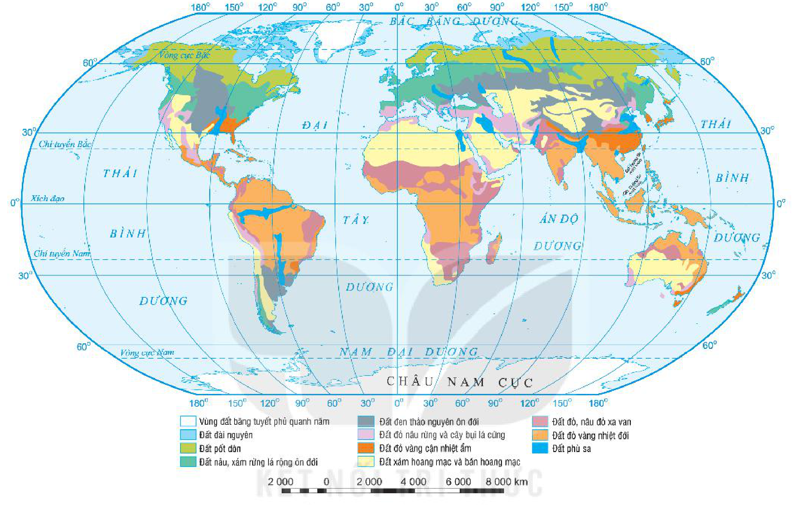
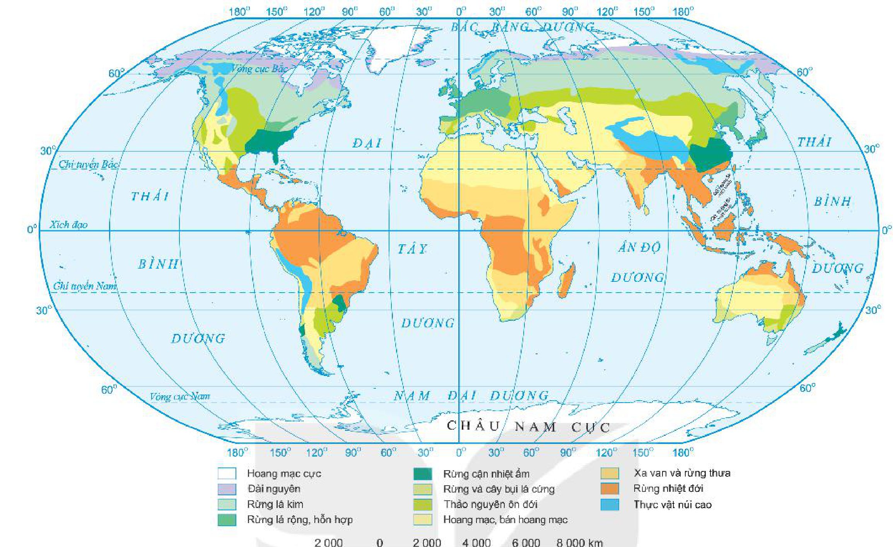
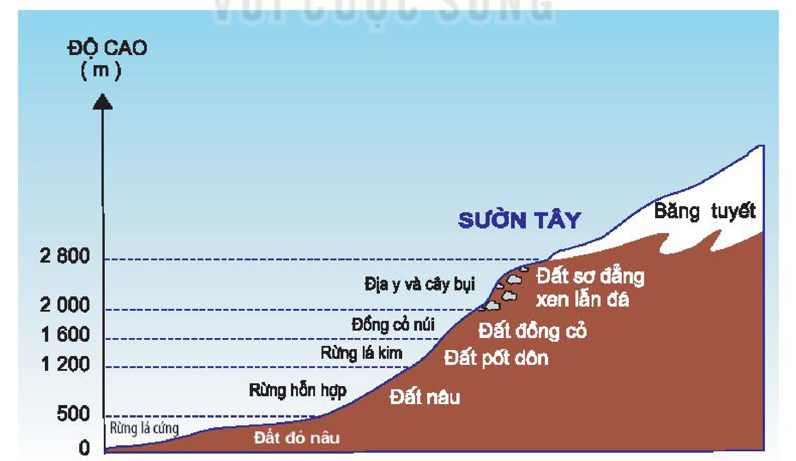

<!-- pdf:50 -->

# BÀI 16: THỰC HÀNH: TÌM HIỂU SỰ PHÂN BỐ ĐẤT VÀ SINH VẬT TRÊN TRÁI ĐẤT

## 1. Sự phân bố đất trên Trái Đất

<!-- term: Các nhóm đất chính trên Trái Đất -->
*Hình 16.1. Bản đồ các nhóm đất chính trên Trái Đất*

<!-- term: Sự phân bố sinh vật và đất theo độ cao -->
<!-- term: Các kiểu thảm thực vật chính trên Trái Đất -->
<!-- term: Các nhóm đất chính trên Trái Đất -->
*Mô tả hình:* Bản đồ thế giới thể hiện sự phân bố các nhóm đất chính trên Trái Đất theo màu sắc chú giải gồm: Vùng đất băng tuyết phủ quanh năm; Đất đài nguyên; Đất pốt dôn; Đất nâu, xám rừng lá rộng ôn đới; Đất đen thảo nguyên ôn đới; Đất đỏ nâu rừng và cây bụi lá cứng; Đất đỏ vàng cận nhiệt ẩm; Đất xám hoang mạc và bán hoang mạc; Đất đỏ, nâu đỏ xa van; Đất đỏ vàng nhiệt đới; Đất phù sa.
<!-- ocr-ok: mô tả hình ảnh bổ trợ không phải chữ in trực tiếp trong sách -->

<!-- term: Các nhóm đất chính trên Trái Đất -->
Dựa vào hình 16.1 hãy:

<!-- term: Sự phân bố sinh vật và đất theo độ cao -->
<!-- term: Các kiểu thảm thực vật chính trên Trái Đất -->
<!-- term: Các nhóm đất chính trên Trái Đất -->
- Kể tên các nhóm đất chính trên Trái Đất.
- Xác định phạm vi phân bố của đất đài nguyên, đất pốt dôn, đất đen thảo nguyên ôn đới, đất đỏ vàng nhiệt đới, đất xám hoang mạc và bán hoang mạc.

## 2. Sự phân bố thảm thực vật trên Trái Đất

<!-- term: Các kiểu thảm thực vật chính trên Trái Đất -->
Dựa vào hình 16.2, hãy:

<!-- term: Sự phân bố sinh vật và đất theo độ cao -->
<!-- term: Các kiểu thảm thực vật chính trên Trái Đất -->
<!-- term: Các nhóm đất chính trên Trái Đất -->
- Kể tên các thảm thực vật chính từ cực về Xích đạo.
- Xác định phạm vi phân bố của các thảm thực vật rừng lá kim, thảo nguyên ôn đới, rừng nhiệt đới.

<!-- pdf:51 -->

<!-- term: Sự phân bố sinh vật và đất theo độ cao -->
<!-- term: Các kiểu thảm thực vật chính trên Trái Đất -->
<!-- term: Các nhóm đất chính trên Trái Đất -->
*Hình 16.2. Bản đồ các kiểu thảm thực vật chính trên Trái Đất*

<!-- term: Sự phân bố sinh vật và đất theo độ cao -->
<!-- term: Các kiểu thảm thực vật chính trên Trái Đất -->
<!-- term: Các nhóm đất chính trên Trái Đất -->
*Mô tả hình:* Bản đồ thế giới thể hiện sự phân bố các kiểu thảm thực vật chính trên Trái Đất theo màu sắc chú giải gồm: Hoang mạc cực; Đài nguyên; Rừng lá kim; Rừng lá rộng, hỗn hợp; Rừng cận nhiệt ẩm; Rừng và cây bụi lá cứng; Thảo nguyên ôn đới; Hoang mạc, bán hoang mạc; Xa van và rừng thưa; Rừng nhiệt đới; Thực vật núi cao.
<!-- ocr-ok: mô tả hình ảnh bổ trợ không phải chữ in trực tiếp trong sách -->

## 3. Sự phân bố sinh vật và đất theo độ cao

<!-- term: Các kiểu thảm thực vật chính trên Trái Đất -->
<!-- term: Sự phân bố sinh vật và đất theo độ cao -->
Quan sát hình 16.3 và dựa vào kiến thức đã học, hãy cho biết ở sườn tây dãy Cáp-ca (từ chân núi lên đỉnh núi) có những vành đai thực vật và đất nào.

<!-- term: Sự phân bố sinh vật và đất theo độ cao -->
<!-- term: Các kiểu thảm thực vật chính trên Trái Đất -->
*Hình 16.3. Sơ đồ các vành đai thực vật và đất ở sườn tây dãy Cáp-ca*

<!-- term: Sự phân bố sinh vật và đất theo độ cao -->
<!-- term: Các kiểu thảm thực vật chính trên Trái Đất -->
<!-- term: Các nhóm đất chính trên Trái Đất -->
*Mô tả hình:* Sơ đồ mặt cắt sườn tây dãy Cáp-ca theo độ cao (m) thể hiện các vành đai thực vật và đất tương ứng từ chân núi lên đỉnh núi: từ 0 – 500 m là Rừng lá cứng và Đất đỏ nâu; từ 500 – 1 200 m là Rừng hỗn hợp và Đất nâu; từ 1 200 – 1 600 m là Rừng lá kim và Đất pốt dôn; từ 1 600 – 2 000 m là Đồng cỏ núi và Đất đồng cỏ; từ 2 000 – 2 800 m là Địa y và cây bụi cùng Đất sơ đẳng xen lẫn đá; trên 2 800 m là Băng tuyết.
<!-- ocr-ok: mô tả hình ảnh bổ trợ không phải chữ in trực tiếp trong sách -->

## 📷 Danh sách hình trong bài

<!-- term: Sự phân bố sinh vật và đất theo độ cao -->
<!-- term: Các kiểu thảm thực vật chính trên Trái Đất -->
<!-- term: Các nhóm đất chính trên Trái Đất -->
| Mã hình | Trang PDF | Vị trí trong bài | Chú thích gốc |
| --- | --- | --- | --- |
| H10-dia-b16-01 | 50 | Mục 1 | Hình 16.1. Bản đồ các nhóm đất chính trên Trái Đất |
| H10-dia-b16-02 | 51 | Mục 2 | Hình 16.2. Bản đồ các kiểu thảm thực vật chính trên Trái Đất |
| H10-dia-b16-03 | 51 | Mục 3 | Hình 16.3. Sơ đồ các vành đai thực vật và đất ở sườn tây dãy Cáp-ca |
<!-- ocr-ok: bảng danh mục hình tổng hợp cuối bài -->
